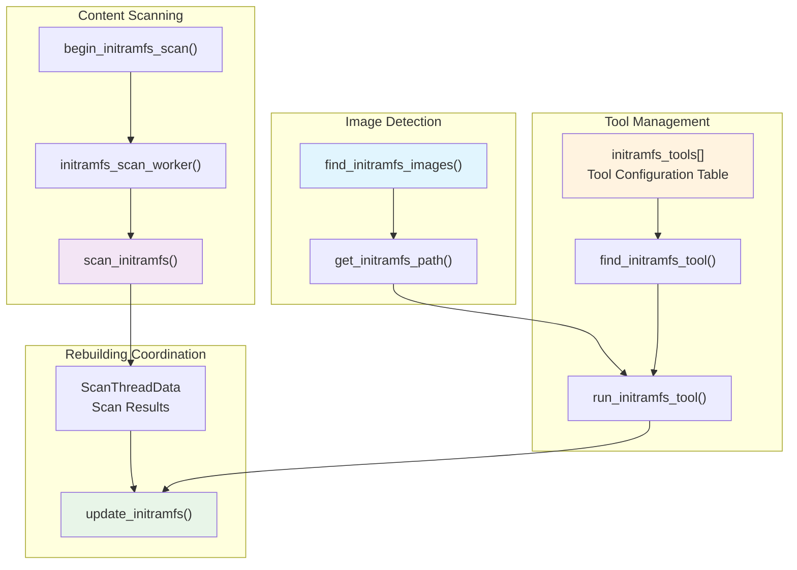
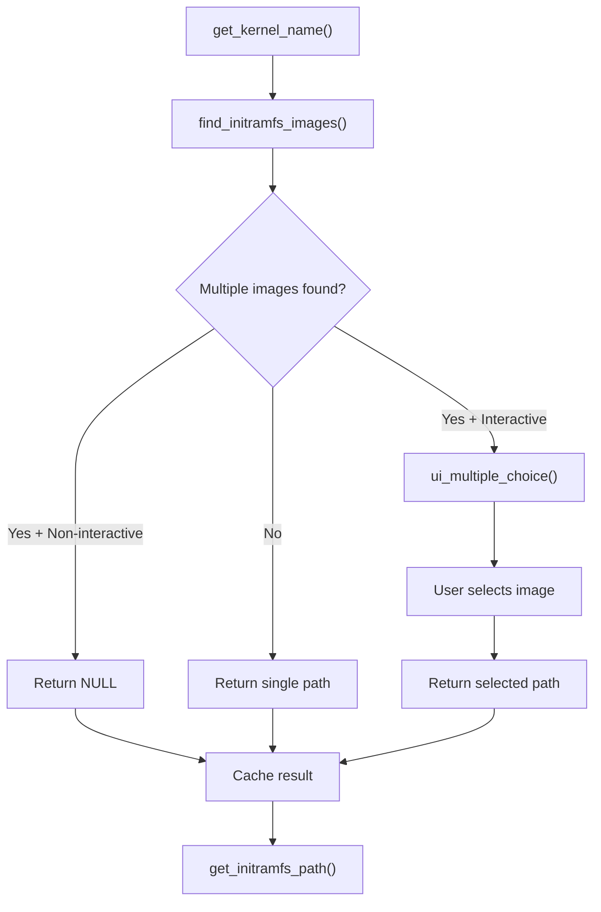
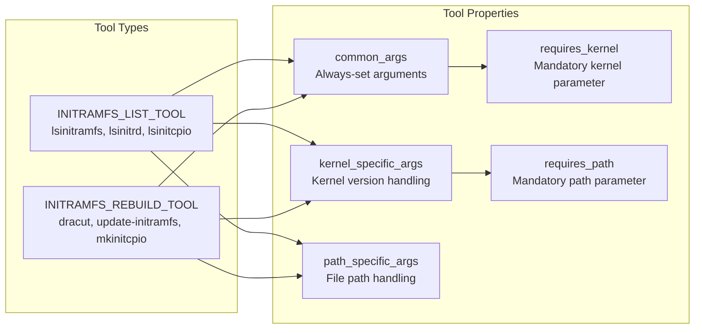
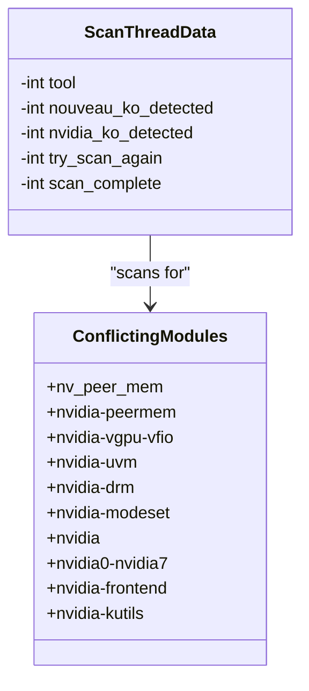
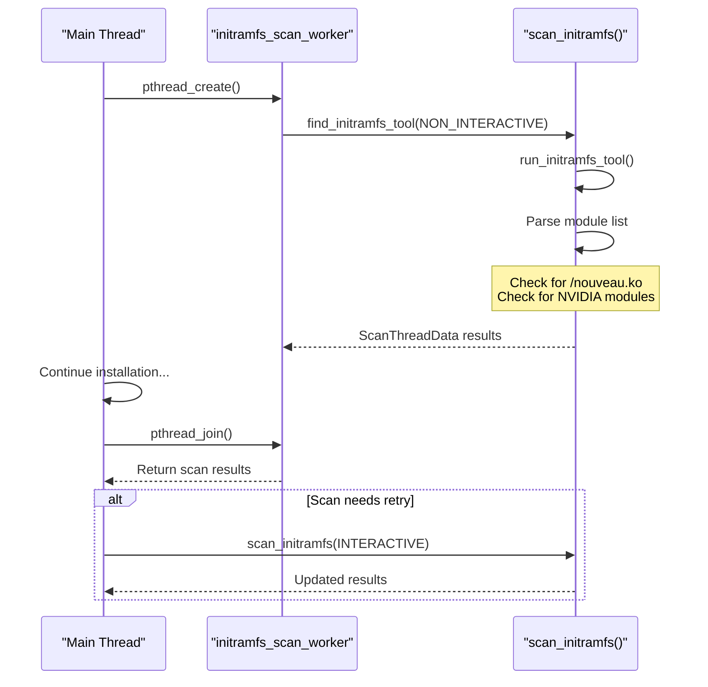
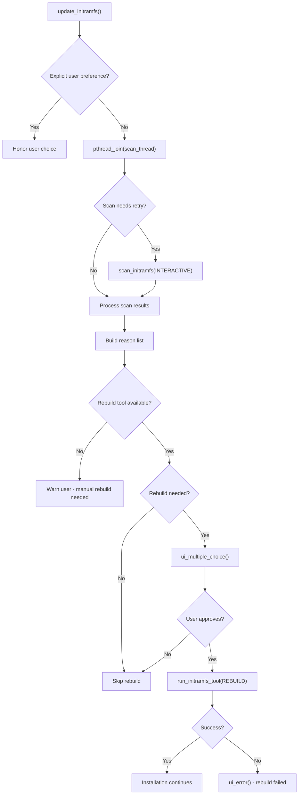
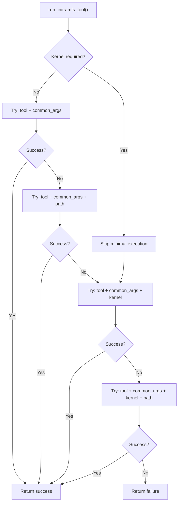
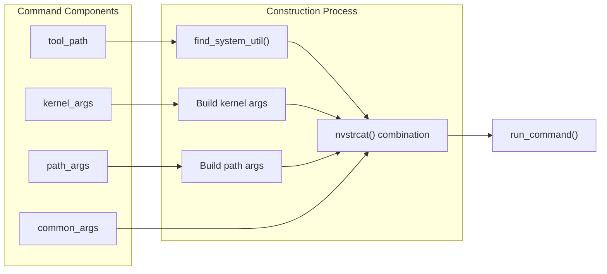

<!-- source: DeepWiki mcp.deepwiki.com · repo NVIDIA/nvidia-installer · page 6.2 Initramfs Management · fetched 2026-10-26 -->

# Initramfs Management

Relevant source files

The following files were used as context for generating this wiki page:

- [conflicting-kernel-modules.c](conflicting-kernel-modules.c)
- [initramfs.c](initramfs.c)

The Initramfs Management system handles detection, scanning, and rebuilding of initramfs images during NVIDIA driver installation. This system ensures that conflicting kernel modules (particularly Nouveau and old NVIDIA modules) are properly handled in the initramfs to prevent driver conflicts during boot.

The system operates independently from other installation components and provides both automatic detection and user-interactive modes for handling initramfs-related tasks. For general kernel module management, see [Kernel Module Management](#3.3).

## System Architecture

The initramfs management system consists of four main components: image detection, tool management, content scanning, and rebuilding coordination.

Sources: [initramfs.c:1-704]()

## Initramfs Image Detection

The system locates initramfs images using well-known naming patterns across different Linux distributions. It searches `/boot` for files matching various templates.

### Detection Patterns

| Pattern | Example | Distribution |
|---------|---------|--------------|
| `initramfs-{kernel}.img` | `initramfs-5.15.0-generic.img` | Red Hat, CentOS |
| `initrd-{kernel}` | `initrd-5.15.0-generic` | SUSE |
| `initrd.img-{kernel}` | `initrd.img-5.15.0-generic` | Ubuntu, Debian |
| `initramfs-linux.img` | `initramfs-linux.img` | Arch Linux |

The detection process handles kernel version parsing and architecture-specific naming:

Sources: [initramfs.c:34-100](), [initramfs.c:112-160]()

## Tool Management System

The system supports multiple initramfs tools across different Linux distributions through a unified interface. Tools are categorized by their primary function: listing contents or rebuilding images.

### Tool Configuration

The `initramfs_tools[]` table defines supported tools and their parameters:

### Tool Selection Process

Tool selection follows a priority-based approach with fallback mechanisms:

| Tool | Purpose | Common Args | Kernel Args | Path Args |
|------|---------|-------------|-------------|-----------|
| `dracut` | Rebuild | `--force` | `--kver` | Optional |
| `update-initramfs` | Rebuild | `-u` | `-k` | Not supported |
| `mkinitcpio` | Rebuild | `-P` | Optional | Optional |
| `lsinitramfs` | List | None | Not supported | `-l` (required) |
| `lsinitrd` | List | None | `-k` (optional) | Optional |

Sources: [initramfs.c:162-248](), [initramfs.c:277-325]()

## Content Scanning System

The scanning system detects conflicting kernel modules within initramfs images using a background thread approach. It searches for both Nouveau modules and existing NVIDIA modules that could interfere with the new installation.

### Scan Data Structure

The `ScanThreadData` structure tracks scan progress and results:

### Threading Model

Scanning operates asynchronously to avoid blocking the main installation process:

Sources: [initramfs.c:482-567](), [initramfs.c:569-586](), [conflicting-kernel-modules.c:29-46]()

## Rebuilding Workflow

The `update_initramfs()` function coordinates the complete rebuilding process, integrating scan results with user preferences and tool availability.

### Decision Flow

### Rebuild Triggers

The system identifies several conditions that warrant initramfs rebuilding:

| Condition | Detection Method | Reason |
|-----------|------------------|---------|
| Nouveau disabled | `nouveau_is_present()` | Nouveau blacklisting requires initramfs update |
| Nouveau in initramfs | String search for `/nouveau.ko` | Remove conflicting driver |
| NVIDIA modules present | Search for conflicting module patterns | Remove old NVIDIA modules |
| Scan inconclusive | Tool failure or missing tools | Precautionary rebuild |

Sources: [initramfs.c:591-703]()

## Tool Execution Framework

The `run_initramfs_tool()` function provides a robust execution framework with multiple fallback strategies for different argument combinations.

### Execution Strategy

### Command Construction

The system builds command lines dynamically based on tool capabilities:

Sources: [initramfs.c:426-480](), [initramfs.c:331-423]()

---

