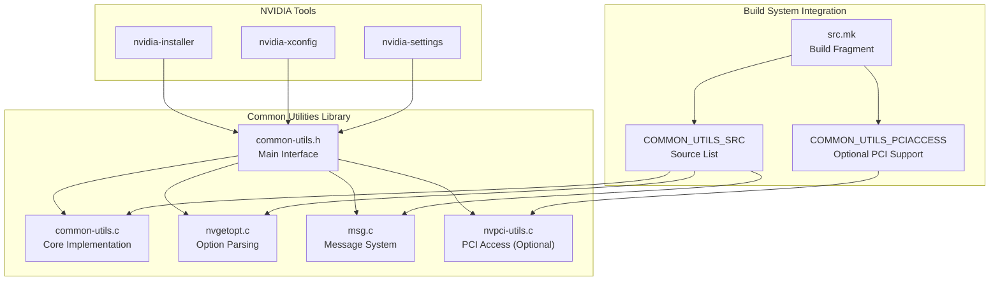
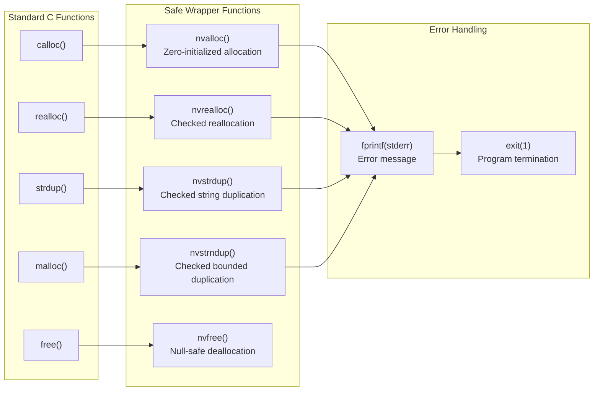
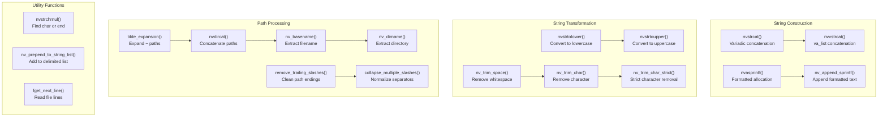
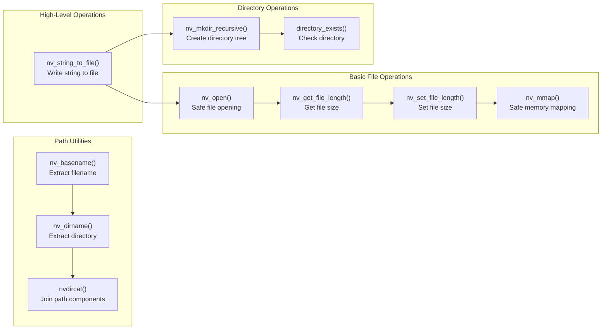
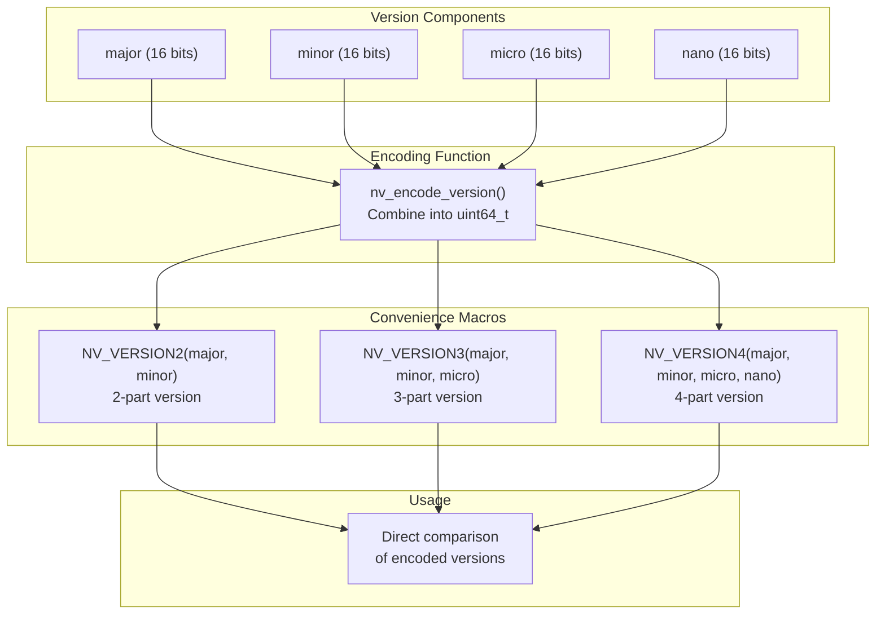
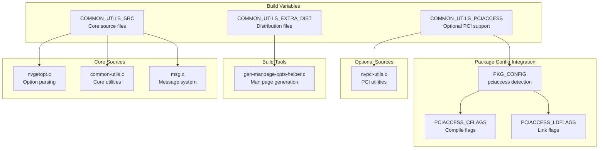
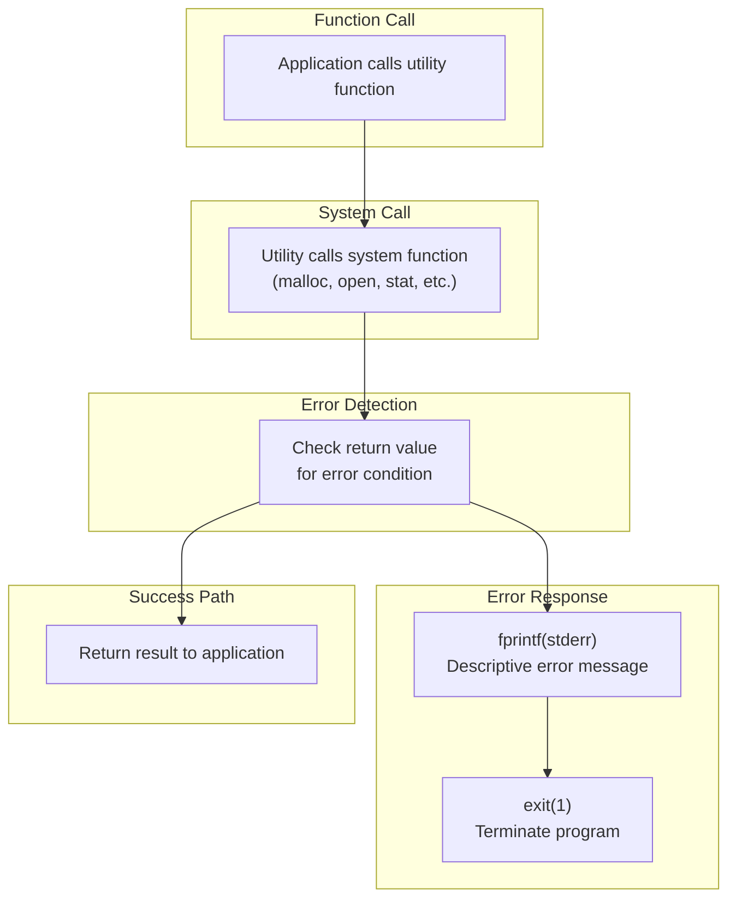

<!-- source: DeepWiki mcp.deepwiki.com · repo NVIDIA/nvidia-installer · page 6.3 Common Utilities Library · fetched 2026-10-26 -->

# Common Utilities Library

<details>
<summary>Relevant source files</summary>

The following files were used as context for generating this wiki page:

- [common-utils/common-utils.c](common-utils/common-utils.c)
- [common-utils/common-utils.h](common-utils/common-utils.h)
- [common-utils/src.mk](common-utils/src.mk)

</details>


The Common Utilities Library provides a shared collection of utility functions used across multiple NVIDIA tools including nvidia-installer, nvidia-xconfig, and nvidia-settings. This library standardizes common operations like memory management, string manipulation, file operations, and system utilities with consistent error handling and behavior across all NVIDIA tools.

For information about the build system that integrates this library, see [Build System](#5). For system validation utilities specific to the installer, see [System Validation and Detection](#6.1).

## Purpose and Architecture

The common utilities library serves as a foundational layer providing safe, error-checked implementations of common operations. All memory allocation functions include automatic error handling that terminates the program on failure, eliminating the need for null-pointer checks throughout the codebase.

### Library Integration Architecture



Sources: [common-utils/src.mk:1-41](), [common-utils/common-utils.h:23-143]()

## Memory Management System

The library provides a comprehensive set of memory management functions that wrap standard C library functions with automatic error checking and program termination on failure.

### Memory Management Functions



| Function | Purpose | Error Behavior |
|----------|---------|----------------|
| `nvalloc()` | Zero-initialized allocation | Print error and exit |
| `nvrealloc()` | Resize existing allocation | Print error and exit |
| `nvstrdup()` | Duplicate string | Print error and exit |
| `nvstrndup()` | Duplicate bounded string | Print error and exit |
| `nvfree()` | Safe deallocation | Ignores NULL pointers |

Sources: [common-utils/common-utils.c:52-291](), [common-utils/common-utils.h:54-65]()

## String Manipulation System

The library provides advanced string manipulation capabilities including concatenation, formatting, case conversion, and path processing.

### String Operations Architecture



Sources: [common-utils/common-utils.c:72-444](), [common-utils/common-utils.h:55-84]()

## File System Operations

The library provides comprehensive file system utilities with error checking and cross-platform compatibility.

### File System Function Categories



Key features of the file system operations:
- All functions include comprehensive error checking
- Path utilities never modify original strings
- `nv_mkdir_recursive()` can optionally return a list of created directories
- `nv_string_to_file()` automatically creates parent directories

Sources: [common-utils/common-utils.c:455-689](), [common-utils/common-utils.h:72-81]()

## Version Management System

The library provides utilities for encoding and comparing version numbers across different formats.

### Version Encoding Implementation



The encoding scheme uses bit shifting to pack version components:
- Bits 48-63: Major version (16 bits)
- Bits 32-47: Minor version (16 bits)  
- Bits 16-31: Micro version (16 bits)
- Bits 0-15: Nano version (16 bits)

Sources: [common-utils/common-utils.h:103-123]()

## Build System Integration

The common utilities library integrates with the build system through a makefile fragment that provides conditional compilation and dependency management.

### Build Configuration Structure



| Variable | Purpose | Files |
|----------|---------|-------|
| `COMMON_UTILS_SRC` | Source files to compile | nvgetopt.c, common-utils.c, msg.c |
| `COMMON_UTILS_EXTRA_DIST` | Files for distribution | Headers and helper utilities |
| `COMMON_UTILS_PCIACCESS` | Enable PCI access support | nvpci-utils.c when set |

Sources: [common-utils/src.mk:1-41]()

## Utility Types and Constants

The library defines several utility types and constants used throughout NVIDIA tools.

### Core Definitions and Macros

```mermaid
graph LR
    subgraph "Boolean Definitions"
        A["TRUE (1)"]
        B["FALSE (0)"]
        C["NVOptionalBool enum<br/>DEFAULT/FALSE/TRUE"]
    end
    
    subgraph "Utility Macros"
        D["ARRAY_LEN(arr)<br/>Array length calculation"]
        E["NV_MIN(x,y)<br/>Minimum value"]
        F["NV_MAX(x,y)<br/>Maximum value"]
    end
    
    subgraph "Formatting Constants"
        G["TAB (\"  \")<br/>Standard indentation"]
        H["BIGTAB (\"      \")<br/>Large indentation"]
    end
    
    subgraph "Compiler Support"
        I["NV_INLINE<br/>Inline function support"]
        J["NV_ATTRIBUTE_PRINTF<br/>Printf format checking"]
    end
    
    subgraph "Version Identification"
        K["NV_ID_STRING<br/>Program identification"]
    end
```

The `NVOptionalBool` enum provides three-state boolean logic:
- `NV_OPTIONAL_BOOL_DEFAULT (-1)`: Unset state
- `NV_OPTIONAL_BOOL_FALSE (0)`: Explicitly false
- `NV_OPTIONAL_BOOL_TRUE (1)`: Explicitly true

Sources: [common-utils/common-utils.h:34-142]()

## Error Handling Philosophy

The common utilities library implements a consistent error handling philosophy where memory allocation failures and critical system errors result in immediate program termination with descriptive error messages.

### Error Handling Pattern



This approach eliminates the need for extensive error checking throughout the codebase, as utility functions either succeed or terminate the program with a clear error message.

Sources: [common-utils/common-utils.c:52-63](), [common-utils/common-utils.c:455-466](), [common-utils/common-utils.c:476-489]()

---

