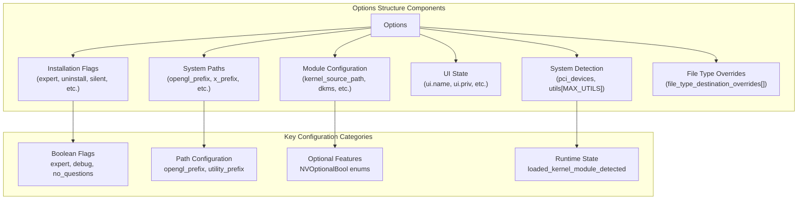
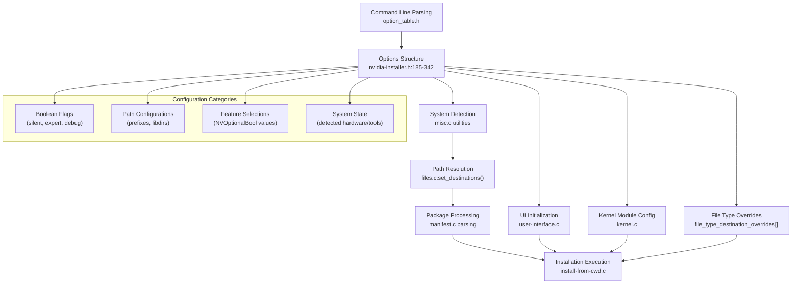
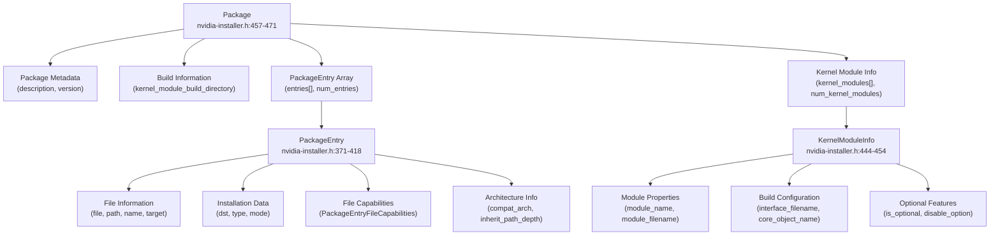
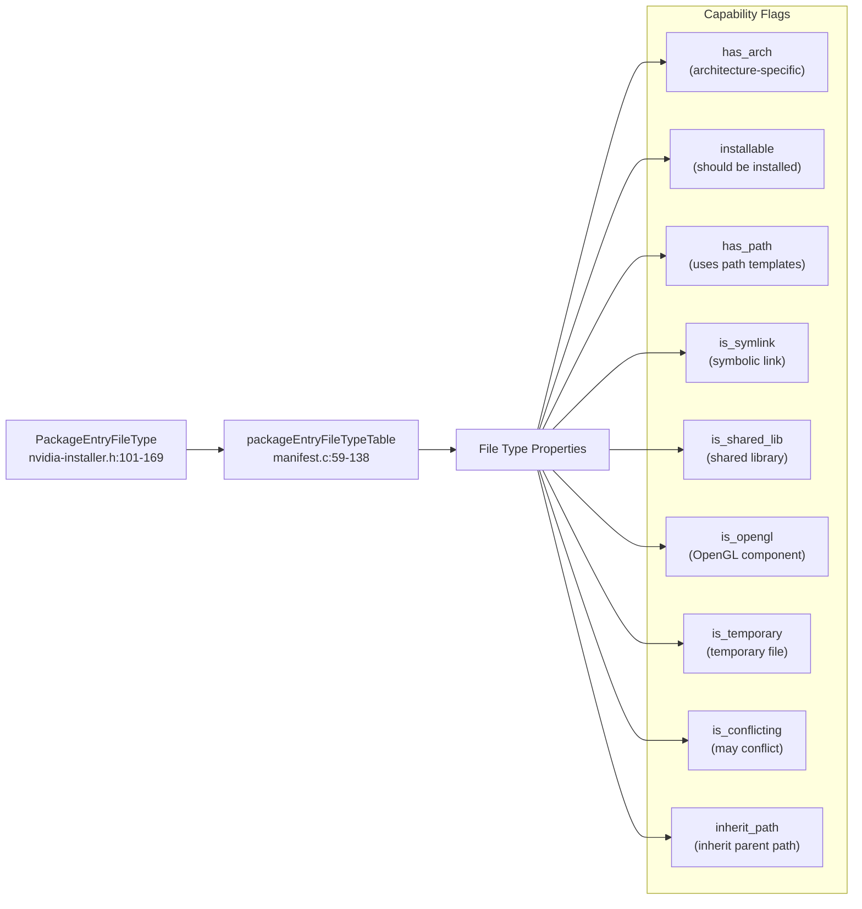
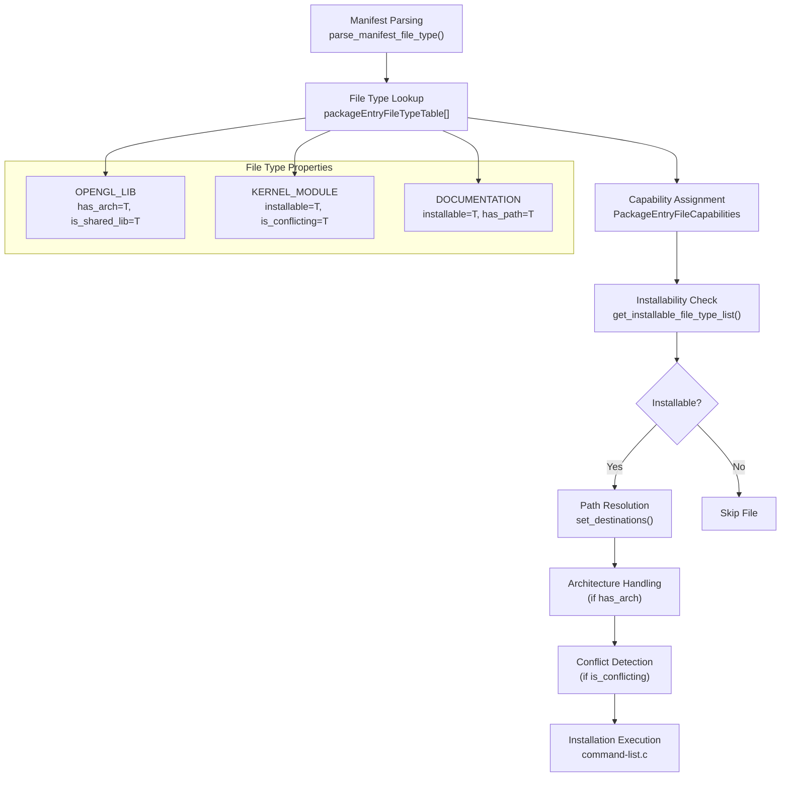
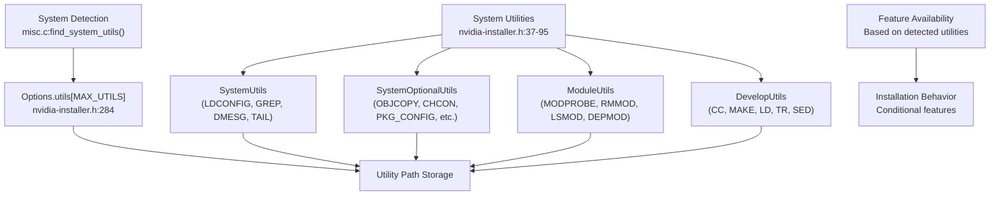
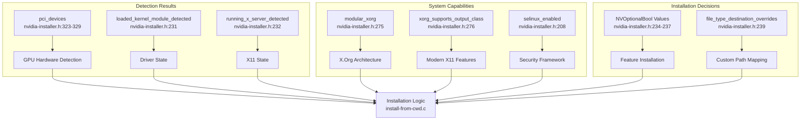

<!-- source: DeepWiki mcp.deepwiki.com · repo NVIDIA/nvidia-installer · page 7 Data Structures and Configuration · fetched 2026-10-26 -->

# Data Structures and Configuration

Relevant source files

The following files were used as context for generating this wiki page:

- [manifest.c](manifest.c)
- [nvidia-installer.h](nvidia-installer.h)

This document provides a comprehensive reference for the core data structures that drive the nvidia-installer's configuration and package management systems. It covers the primary `Options` structure that holds installation configuration, the `Package` and `PackageEntry` structures that represent the driver package contents, and the file type classification system that determines how different components are handled during installation.

For information about how these structures are populated during command line parsing, see [Command Line Interface](#3.1). For details on how the installation engine uses these structures, see [Installation Engine](#3.2).

## Core Configuration Structure

The `Options` structure serves as the central configuration hub for the entire installation process. It contains all user preferences, system detection results, and runtime state information needed to coordinate the installation.

### Options Structure Overview

**Options Structure Categories**

The `Options` structure is organized into several logical categories:

| Category | Purpose | Key Fields |
|----------|---------|------------|
| Installation Control | Basic installation behavior | `expert`, `uninstall`, `silent`, `no_questions` |
| Path Configuration | Directory and file locations | `opengl_prefix`, `x_prefix`, `utility_prefix` |
| Module Management | Kernel module handling | `kernel_source_path`, `dkms`, `no_kernel_modules` |
| Feature Toggles | Optional component installation | `install_libglvnd_libraries`, `install_compat32_libs` |
| System Detection | Runtime environment information | `pci_devices`, `utils[]`, `modular_xorg` |
| UI Configuration | User interface state | `ui.name`, `ui.priv`, `ui.status_active` |

**Sources:** [nvidia-installer.h:185-342]()

### Configuration Flow Architecture

**Sources:** [nvidia-installer.h:185-342](), [option_table.h](), [install-from-cwd.c](), [misc.c]()

## Package Data Structures

The package system uses a hierarchical structure to represent the driver package contents, with the `Package` structure containing metadata and an array of `PackageEntry` structures representing individual files.

### Package Structure Hierarchy

**Package Entry File Lifecycle**

| Field | Purpose | Set By | Used By |
|-------|---------|--------|---------|
| `file` | Source filename in package | Manifest parser | File operations |
| `path` | Template path pattern | Manifest parser | Path resolution |
| `dst` | Final installation destination | `set_destinations()` | Installation execution |
| `type` | File type classification | Manifest parser | Installation logic |
| `caps` | File capabilities/properties | `parse_manifest_file_type()` | Feature decisions |

**Sources:** [nvidia-installer.h:457-471](), [nvidia-installer.h:371-418](), [nvidia-installer.h:444-454]()

## File Type Classification System

The installer uses a comprehensive file type system to determine how different components should be handled during installation. Each file type has associated capabilities that control installation behavior.

### File Type Capabilities Matrix

**Key File Type Categories**

| Category | File Types | Capabilities | Installation Behavior |
|----------|------------|--------------|----------------------|
| Kernel Components | `KERNEL_MODULE`, `KERNEL_MODULE_SRC` | `installable`, `is_conflicting` | Module building/loading |
| OpenGL Libraries | `OPENGL_LIB`, `TLS_LIB`, `GLVND_LIB` | `has_arch`, `is_shared_lib`, `is_opengl` | Library installation with arch handling |
| Symbolic Links | `OPENGL_SYMLINK`, `CUDA_SYMLINK` | `is_symlink`, `has_arch` | Link creation with architecture paths |
| System Integration | `SYSTEMD_UNIT`, `XORG_OUTPUTCLASS_CONFIG` | `installable` | System service integration |
| Documentation | `DOCUMENTATION`, `MANPAGE` | `installable`, `has_path` | Documentation installation |

**Sources:** [nvidia-installer.h:101-169](), [manifest.c:59-138]()

### File Type Processing Pipeline

**Sources:** [manifest.c:165-180](), [manifest.c:185-225](), [files.c]()

## System Utility Management

The installer maintains comprehensive tracking of system utilities required for various operations. These are organized into categorized enumerations that drive system validation and feature availability.

### Utility Classification System

**Utility Categories and Usage**

| Category | Purpose | Key Utilities | Impact on Installation |
|----------|---------|---------------|----------------------|
| SystemUtils | Core system operations | `LDCONFIG`, `GREP`, `DMESG` | Required for basic functionality |
| SystemOptionalUtils | Enhanced features | `OBJCOPY`, `SYSTEMCTL`, `DKMS` | Enable optional capabilities |
| ModuleUtils | Kernel module management | `MODPROBE`, `DEPMOD`, `LSMOD` | Required for module installation |
| DevelopUtils | Kernel compilation | `CC`, `MAKE`, `LD` | Required for building modules |

**Sources:** [nvidia-installer.h:37-95](), [nvidia-installer.h:284](), [misc.c]()

## Configuration State Management

The installer maintains several categories of runtime state that influence installation decisions and track system conditions discovered during execution.

### Runtime State Tracking

**Configuration Categories**

| State Category | Fields | Purpose |
|----------------|--------|---------|
| Hardware Detection | `pci_devices.found_supported`, `pci_devices.found_vga` | GPU compatibility validation |
| Driver State | `loaded_kernel_module_detected`, `kernel_module_signed` | Existing installation detection |
| System Architecture | `modular_xorg`, `xorg_supports_output_class` | Feature capability determination |
| Optional Features | `install_libglvnd_libraries`, `install_compat32_libs` | User/auto-detected preferences |
| Path Customization | `file_type_destination_overrides[]` | Custom installation locations |

**Sources:** [nvidia-installer.h:323-329](), [nvidia-installer.h:231-232](), [nvidia-installer.h:275-276](), [nvidia-installer.h:234-237](), [nvidia-installer.h:239]()

---

