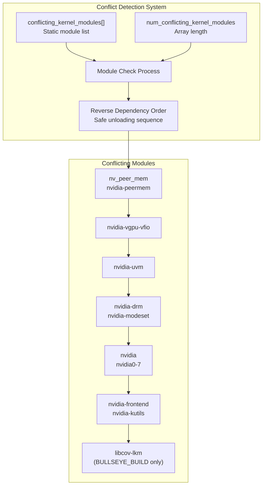
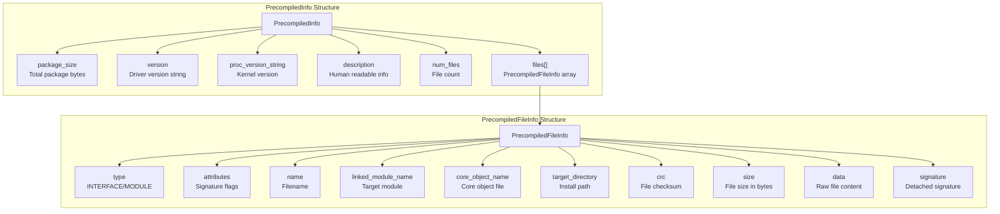
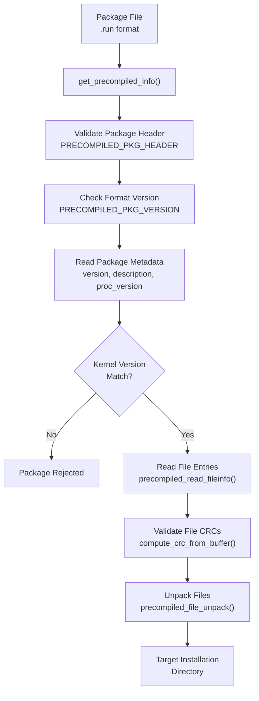
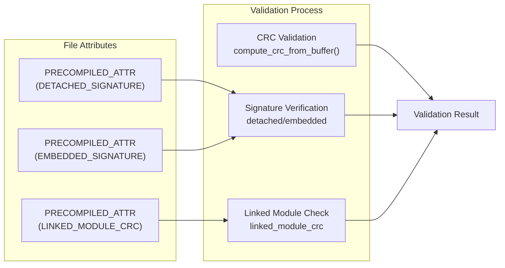
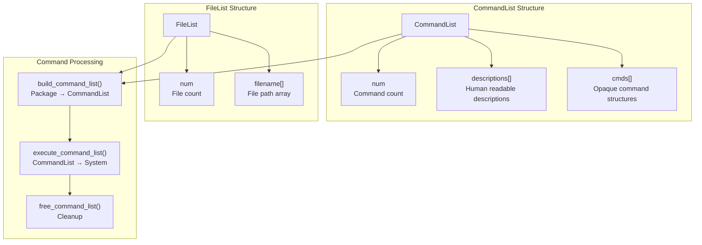
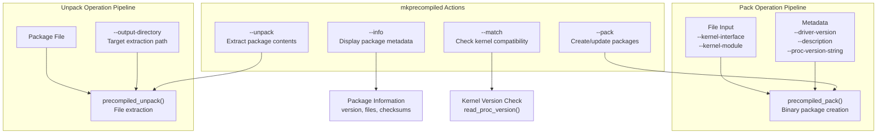
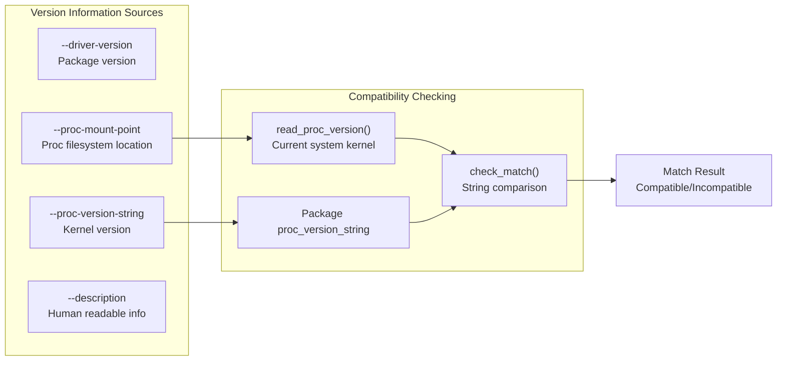

<!-- source: DeepWiki mcp.deepwiki.com · repo NVIDIA/nvidia-installer · page 8 Specialized Components · fetched 2026-10-26 -->

# Specialized Components

Relevant source files

The following files were used as context for generating this wiki page:

- [command-list.h](command-list.h)
- [conflicting-kernel-modules.c](conflicting-kernel-modules.c)
- [mkprecompiled.c](mkprecompiled.c)
- [precompiled.c](precompiled.c)
- [precompiled.h](precompiled.h)

This document covers specialized subsystems within the nvidia-installer that handle specific aspects of driver installation but operate independently from the main installation workflow. These components provide critical support functions including conflict detection, precompiled package management, and command execution infrastructure.

For information about the core installation workflow, see [Installation Process](#3). For details about the main kernel module management system, see [Kernel Module Management](#3.3).

## Conflicting Kernel Modules Management

The installer maintains a comprehensive system for detecting and managing kernel modules that conflict with NVIDIA driver installation. This system ensures clean installation by identifying modules that must be unloaded before proceeding.

### Module Conflict Detection

The conflict detection system relies on a statically defined list of known conflicting modules organized in reverse dependency order to enable safe unloading.

**Sources:** [conflicting-kernel-modules.c:29-46]()

### Module List Structure

The conflicting modules are organized in a specific order that allows safe sequential unloading:

| Module Category | Modules | Purpose |
|----------------|---------|---------|
| Peer Memory | `nv_peer_mem`, `nvidia-peermem` | GPU peer-to-peer memory access |
| Virtualization | `nvidia-vgpu-vfio` | Virtual GPU support |
| Unified Memory | `nvidia-uvm` | CUDA Unified Virtual Memory |
| Display Stack | `nvidia-drm`, `nvidia-modeset` | Display and modesetting |
| Core Driver | `nvidia`, `nvidia0-7` | Primary driver modules |
| Legacy Components | `nvidia-frontend`, `nvidia-kutils` | Older interface components |
| Debug Coverage | `libcov-lkm` | Code coverage (debug builds only) |

**Sources:** [conflicting-kernel-modules.c:29-44]()

## Precompiled Package System

The precompiled package system manages kernel interfaces and modules that have been pre-built for specific kernel versions, eliminating the need for on-target compilation in many cases.

### Package Format Architecture

**Sources:** [precompiled.h:151-160](), [precompiled.h:136-149]()

### Package Processing Pipeline

The precompiled system implements a complete pipeline for reading, validating, and extracting precompiled packages:

**Sources:** [precompiled.c:152-360](), [precompiled.c:367-419](), [precompiled.c:760-879]()

### File Type Management

The system supports two primary file types with different handling requirements:

| File Type | Constant | Description | Required Metadata |
|-----------|----------|-------------|-------------------|
| Interface | `PRECOMPILED_FILE_TYPE_INTERFACE` | Kernel interface objects requiring linking | `linked_module_name`, `core_object_name` |
| Module | `PRECOMPILED_FILE_TYPE_MODULE` | Complete kernel modules | None (self-contained) |

**Sources:** [precompiled.h:123-126]()

### Signature and Validation System

**Sources:** [precompiled.h:128-134](), [precompiled.c:826-851]()

## Command List Infrastructure

The command list system provides a structured approach to batching and executing installation operations with proper error handling and rollback capabilities.

### Command List Structure

**Sources:** [command-list.h:29-44](), [command-list.h:46-49]()

## Precompiled Package Utilities

The `mkprecompiled` utility provides comprehensive tools for creating, inspecting, and manipulating precompiled kernel interface packages outside of the main installer.

### Utility Operations

**Sources:** [mkprecompiled.c:48-54](), [mkprecompiled.c:429-433](), [mkprecompiled.c:604-702]()

### Package Creation Workflow

The utility supports creating packages with both kernel interfaces and complete modules:

| Component Type | Required Options | Optional Features |
|----------------|------------------|-------------------|
| Kernel Interface | `--kernel-interface`, `--linked-module-name`, `--core-object-name` | `--linked-module`, `--signed-module` (for detached signatures) |
| Kernel Module | `--kernel-module` | `--signed` (for embedded signatures) |

**Sources:** [mkprecompiled.c:150-187](), [mkprecompiled.c:320-343]()

### Version and Compatibility Management

**Sources:** [mkprecompiled.c:82-142](), [mkprecompiled.c:568-585]()