# Page: Overview

# Overview

<details>
<summary>Relevant source files</summary>

The following files were used as context for generating this wiki page:

- [install-from-cwd.c](install-from-cwd.c)
- [nvidia-installer.c](nvidia-installer.c)
- [nvidia-installer.h](nvidia-installer.h)

</details>


The **nvidia-installer** is a comprehensive tool for installing, upgrading, and uninstalling NVIDIA graphics drivers on Unix and Linux systems. This repository contains a sophisticated package installation system that handles kernel module compilation, file deployment, system integration, and recovery mechanisms.

The installer supports multiple installation scenarios including driver upgrades, kernel module-only installations, uninstallation, and integration with distribution package managers. For information about the specific installation workflow phases, see [Installation Process](#3). For details about kernel module building and management, see [Kernel Module Management](#3.3).

## Architecture Overview

The nvidia-installer follows a modular architecture centered around two primary data structures: the `Options` structure that controls installation behavior, and the `Package` structure that represents the driver package being installed.

### Core System Architecture

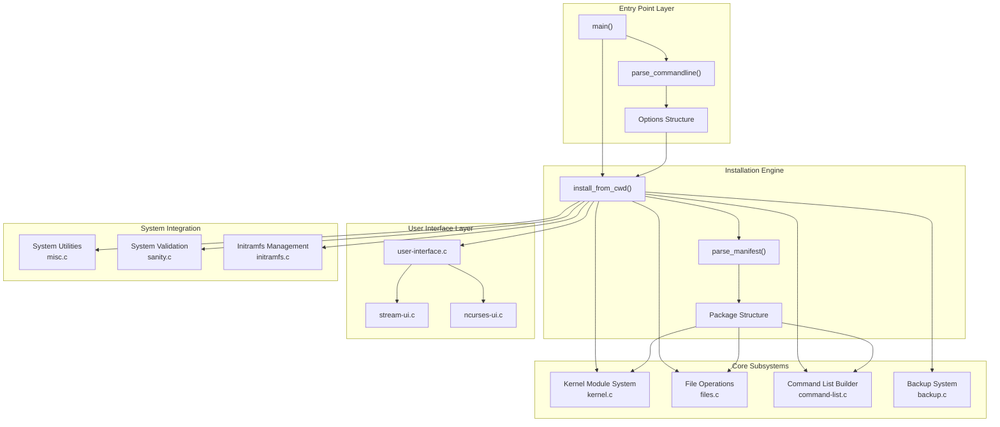

Sources: [nvidia-installer.c:648-761](), [install-from-cwd.c:96-454](), [nvidia-installer.h:185-342](), [nvidia-installer.h:457-471]()

### Data Structure Relationships

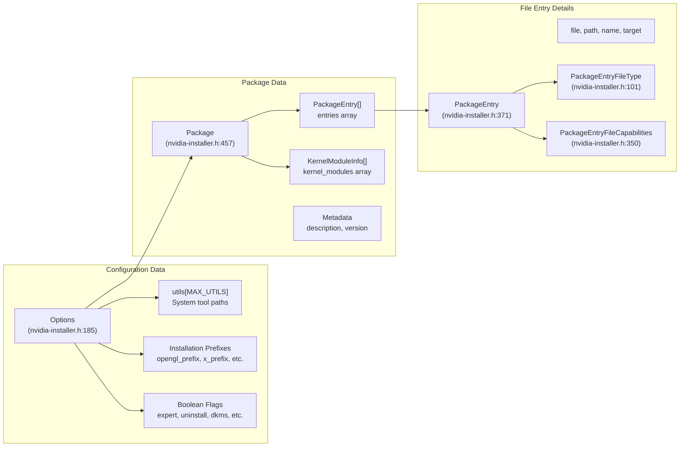

Sources: [nvidia-installer.h:185-342](), [nvidia-installer.h:457-471](), [nvidia-installer.h:371-418](), [nvidia-installer.h:101-169]()

## Core Components

### Options Structure
The `Options` structure serves as the central configuration hub, containing over 100 configuration parameters that control every aspect of the installation process. Key categories include:

| Category | Examples | Purpose |
|----------|----------|---------|
| Installation Paths | `opengl_prefix`, `x_prefix`, `utility_prefix` | Define where files are installed |
| Boolean Flags | `expert`, `uninstall`, `no_kernel_modules` | Control installation behavior |
| System Tools | `utils[MAX_UTILS]` | Paths to required system utilities |
| Kernel Configuration | `kernel_source_path`, `kernel_name` | Kernel module build settings |
| UI Configuration | `ui.name`, `silent`, `no_questions` | User interface behavior |

Sources: [nvidia-installer.h:185-342]()

### Package Structure
The `Package` structure represents the driver package being installed, containing:

- **Metadata**: Description, version, and build directory information
- **File Entries**: Array of `PackageEntry` structures describing each file to install
- **Kernel Modules**: Array of `KernelModuleInfo` structures for kernel components
- **Build Information**: Paths and configuration for kernel module compilation

Sources: [nvidia-installer.h:457-471]()

### File Type System
The installer uses a comprehensive file type system with over 60 different `PackageEntryFileType` values, including:

- `FILE_TYPE_KERNEL_MODULE` - Compiled kernel modules
- `FILE_TYPE_OPENGL_LIB` - OpenGL library files  
- `FILE_TYPE_UTILITY_BINARY` - NVIDIA utility programs
- `FILE_TYPE_DOCUMENTATION` - Documentation files
- `FILE_TYPE_SYSTEMD_UNIT` - systemd service files

Each file type has associated capabilities defined by `PackageEntryFileCapabilities` that determine how the file should be processed.

Sources: [nvidia-installer.h:101-169](), [nvidia-installer.h:350-360]()

## Installation Workflow

The installation process follows a well-defined sequence orchestrated by `install_from_cwd()`:

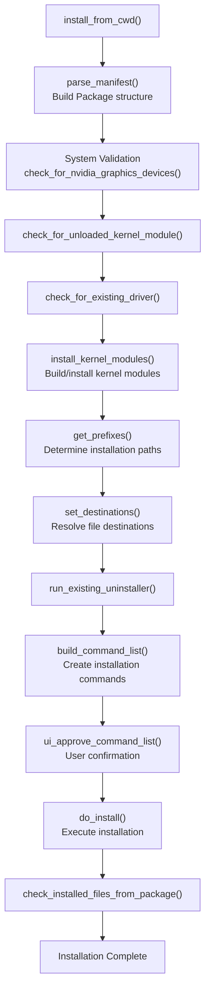

Sources: [install-from-cwd.c:96-454]()

## System Integration Points

The installer integrates with numerous system components:

### System Utilities
The installer requires and locates various system utilities defined in utility enums:
- **SystemUtils**: `LDCONFIG`, `GREP`, `DMESG`, `TAIL` 
- **ModuleUtils**: `MODPROBE`, `RMMOD`, `LSMOD`, `DEPMOD`
- **DevelopUtils**: `CC`, `MAKE`, `LD` for kernel module compilation

Sources: [nvidia-installer.h:37-95]()

### User Interface Abstraction
The installer supports multiple UI implementations through a common interface:
- **Stream UI**: Console-based output for scripted installations
- **Ncurses UI**: Interactive text-based interface for manual installations
- **None UI**: Silent operation for automated deployments

For detailed information about the UI system architecture, see [User Interface System](#4).

### Build and Packaging Integration
The installer includes sophisticated build system integration for:
- Kernel module compilation from source
- Precompiled kernel interface linking
- Module signing for secure boot systems
- DKMS integration for dynamic kernel support

For comprehensive build system documentation, see [Build System](#5).

Sources: [nvidia-installer.h:316-321](), [install-from-cwd.c:193-237]()

## Key Design Principles

1. **Robustness**: Comprehensive backup and rollback capabilities ensure system recovery
2. **Flexibility**: Extensive configuration options support diverse deployment scenarios  
3. **Modularity**: Clear separation between UI, installation logic, and system operations
4. **Validation**: Multi-layer validation from command-line parsing to post-install verification
5. **Integration**: Deep integration with Linux distribution package management and system services

The nvidia-installer represents a mature, production-ready installation system designed to handle the complexities of graphics driver deployment across diverse Linux environments while maintaining system stability and providing comprehensive error recovery mechanisms.

---

# Page: System Architecture

# System Architecture

<details>
<summary>Relevant source files</summary>

The following files were used as context for generating this wiki page:

- [backup.c](backup.c)
- [command-list.c](command-list.c)
- [install-from-cwd.c](install-from-cwd.c)
- [misc.c](misc.c)
- [nvidia-installer.h](nvidia-installer.h)

</details>


This document describes the overall architectural design of nvidia-installer, detailing how the major subsystems interact and how data flows through the system during installation operations. For specific implementation details of individual subsystems, see their respective dedicated pages such as [Installation Process](#3) and [User Interface System](#4).

## Overview

The nvidia-installer follows a modular, command-driven architecture centered around a comprehensive `Options` structure that carries configuration and state throughout the system. The architecture separates concerns into distinct subsystems: command-line processing, installation orchestration, system operations, user interface abstraction, and backup/recovery management.

## Core Data Structures

The architecture is built around several key data structures defined in [nvidia-installer.h:185-472]():

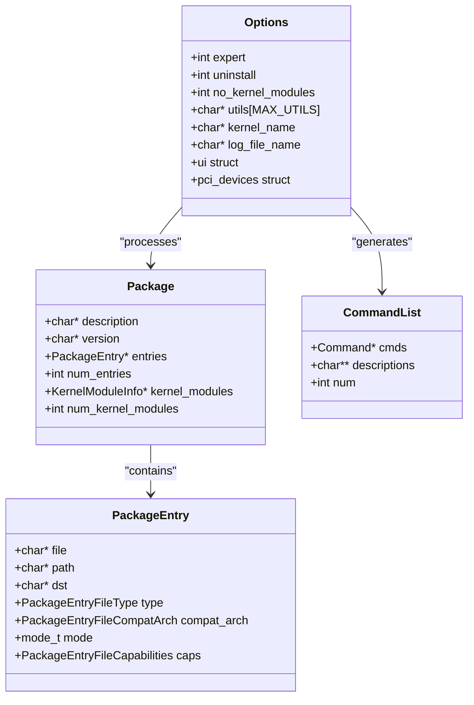

Sources: [nvidia-installer.h:185-342](), [nvidia-installer.h:457-471](), [nvidia-installer.h:371-418](), [command-list.c:99-106]()

## System Architecture Overview

The system is organized into distinct functional layers that interact through well-defined interfaces:

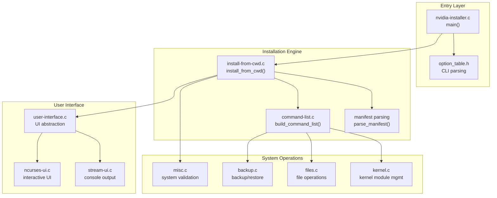

Sources: [nvidia-installer.c](), [install-from-cwd.c:96-454](), [command-list.c:255-519](), [misc.c:548-890]()

## Installation Flow Architecture

The installation process follows a structured flow with multiple validation and decision points:

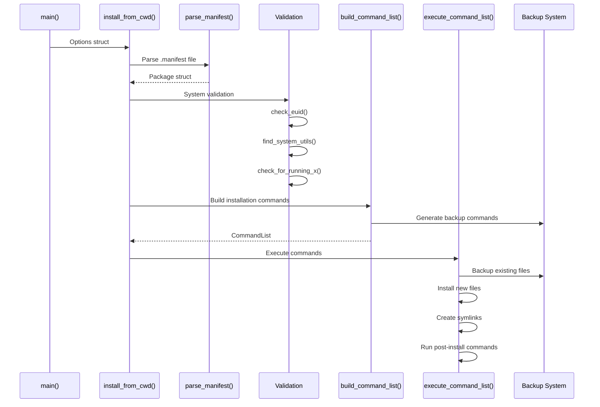

Sources: [install-from-cwd.c:96-454](), [install-from-cwd.c:726-1047](), [misc.c:100-113](), [misc.c:548-589](), [command-list.c:255-519](), [command-list.c:614-731]()

## Component Interaction Patterns

### Command List Pattern

The installer uses a command list pattern where all installation operations are first collected into a `CommandList` structure, then validated and executed atomically:

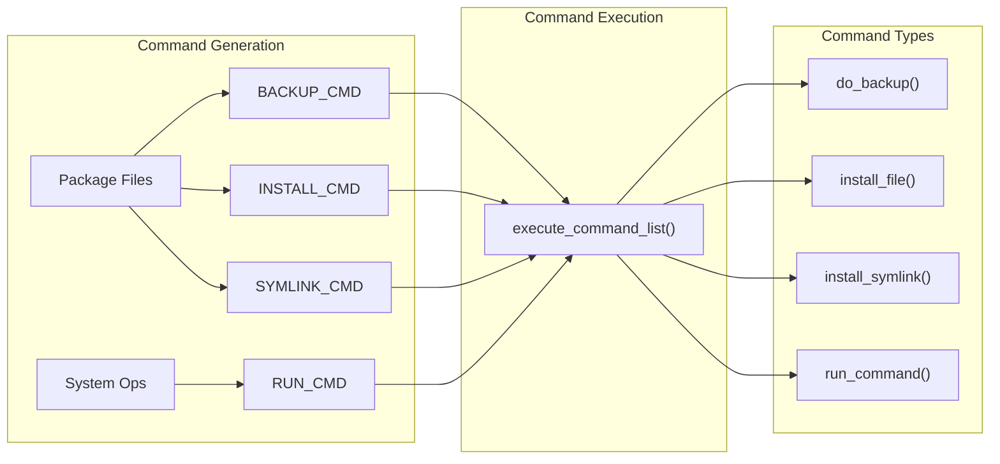

Sources: [command-list.c:77-87](), [command-list.c:255-519](), [command-list.c:614-731]()

### Options Structure Flow

The `Options` structure serves as the central configuration and state container that flows through all major subsystems:

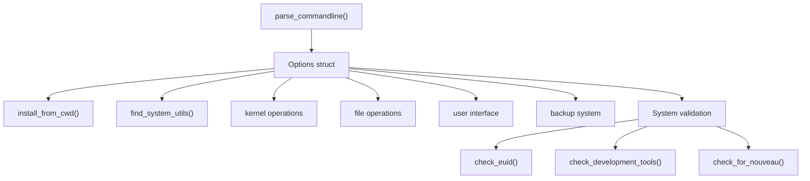

Sources: [nvidia-installer.h:185-342](), [misc.c:100-113](), [misc.c:548-589](), [misc.c:778-827]()

## Subsystem Responsibilities

| Subsystem | Primary Functions | Key Files |
|-----------|------------------|-----------|
| Installation Engine | Orchestrates entire installation process, manifest parsing | `install-from-cwd.c` |
| Command List | Builds and executes atomic installation operations | `command-list.c` |
| System Operations | Kernel module management, file operations, validation | `kernel.c`, `files.c`, `misc.c` |
| Backup System | Safe backup/restore for rollback capability | `backup.c` |
| User Interface | Abstracted UI with multiple implementations | `user-interface.c`, `stream-ui.c`, `ncurses-ui.c` |

## Error Handling and Recovery

The architecture implements comprehensive error handling through several mechanisms:

1. **Backup System**: All operations are logged in `/var/lib/nvidia/log` allowing complete rollback via [backup.c:137-198]()
2. **Validation Gates**: Multiple validation points prevent installation on incompatible systems via [misc.c:100-113](), [misc.c:778-827]()
3. **Command List Validation**: User approval required before execution via [command-list.c:614-731]()
4. **Graceful Degradation**: Continue-after-error prompts for non-critical failures via [misc.c:905-924]()

Sources: [backup.c:137-198](), [backup.c:631-889](), [misc.c:905-924](), [command-list.c:614-731]()

## Data Flow Summary

The system follows a clear data flow pattern:

1. **Input Processing**: CLI arguments → `Options` structure
2. **Package Analysis**: `.manifest` file → `Package` structure  
3. **Command Generation**: `Package` + `Options` → `CommandList`
4. **Execution**: `CommandList` → System operations with backup logging
5. **Validation**: Post-install verification and cleanup

This architecture provides modularity, testability, and robust error recovery while maintaining clear separation of concerns between user interface, business logic, and system operations.

Sources: [nvidia-installer.h:185-342](), [install-from-cwd.c:96-454](), [command-list.c:255-519](), [backup.c:137-198]()

---

# Page: Installation Process

# Installation Process

<details>
<summary>Relevant source files</summary>

The following files were used as context for generating this wiki page:

- [backup.c](backup.c)
- [command-list.c](command-list.c)
- [install-from-cwd.c](install-from-cwd.c)
- [misc.c](misc.c)

</details>


This document describes the comprehensive installation workflow implemented by nvidia-installer, covering all major phases from startup through completion. The installation process orchestrates manifest parsing, system validation, kernel module management, file operations, and recovery systems to safely install NVIDIA drivers.

For information about the command-line interface and option parsing, see [Command Line Interface](#3.1). For details about the core installation engine implementation, see [Installation Engine](#3.2). For kernel module-specific operations, see [Kernel Module Management](#3.3).

## Installation Workflow Overview

The nvidia-installer follows a multi-phase installation process designed to safely replace existing drivers while maintaining system stability through comprehensive backup and validation mechanisms.

### High-Level Installation Flow

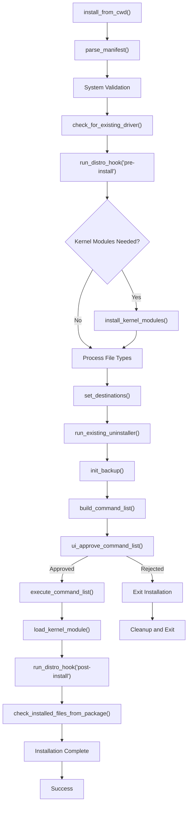

Sources: [install-from-cwd.c:96-454]()

### Core Installation Phases

The installation process consists of six distinct phases, each with specific responsibilities and error handling:

| Phase | Primary Functions | Purpose |
|-------|------------------|---------|
| **Initialization** | `parse_manifest()`, `ui_set_title()` | Parse package data and initialize UI |
| **Validation** | `check_for_nvidia_graphics_devices()`, `check_for_running_x()` | System compatibility checks |
| **Kernel Processing** | `install_kernel_modules()`, `assisted_module_signing()` | Handle kernel module building/linking |
| **File Processing** | `set_destinations()`, `process_dot_desktop_files()` | Prepare files for installation |
| **Command Execution** | `build_command_list()`, `execute_command_list()` | Execute installation operations |
| **Finalization** | `check_installed_files_from_package()`, `run_nvidia_xconfig()` | Verify and complete installation |

Sources: [install-from-cwd.c:96-454]()

## Manifest Processing and Package Structure

The installation begins by parsing a `.manifest` file that describes all components to be installed. This process builds the internal `Package` structure that drives the entire installation.

### Manifest Parsing Flow

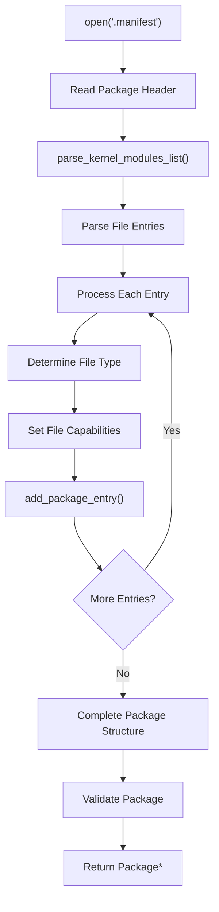

The manifest file structure includes:
- **Line 1**: Package description string
- **Line 2**: Version string  
- **Line 4**: Whitespace-separated list of kernel module names
- **Remaining lines**: File entries with permissions, types, and paths

Sources: [install-from-cwd.c:726-1047]()

### Package Entry Processing

Each file in the manifest becomes a `PackageEntry` with specific capabilities and installation behavior:

```mermaid
flowchart LR
    FileEntry["File Entry from Manifest"] --> ParseFields["Parse Fields"]
    ParseFields --> DetermineType["parse_manifest_file_type()"]
    DetermineType --> SetCapabilities["get_file_type_capabilities()"]
    
    SetCapabilities --> CheckArch{"Has Architecture?"}
    CheckArch -->|Yes| SetCompat["Set Compatibility Architecture"]
    CheckArch -->|No| CheckPath{"Has Path?"}
    SetCompat --> CheckPath
    
    CheckPath -->|Yes| SetPath["Set Installation Path"]
    CheckPath -->|No| CheckSymlink{"Is Symlink?"}
    SetPath --> CheckSymlink
    
    CheckSymlink -->|Yes| SetTarget["Set Symlink Target"]
    CheckSymlink -->|No| AddEntry["add_package_entry()"]
    SetTarget --> AddEntry
```

Sources: [install-from-cwd.c:838-1016](), [install-from-cwd.c:1056-1096]()

## Command List Building and Execution

The installation process builds a comprehensive list of operations to perform, allowing for user review and atomic execution with rollback capabilities.

### Command List Construction

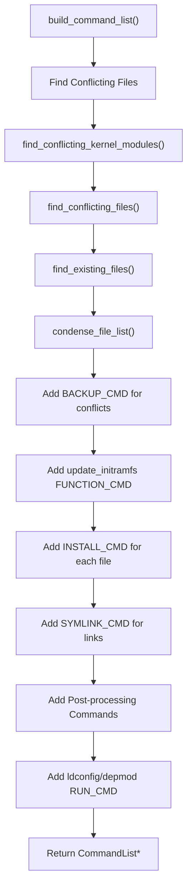

Sources: [command-list.c:255-519]()

### Command Execution Engine

The command execution system processes each operation with progress tracking and error handling:

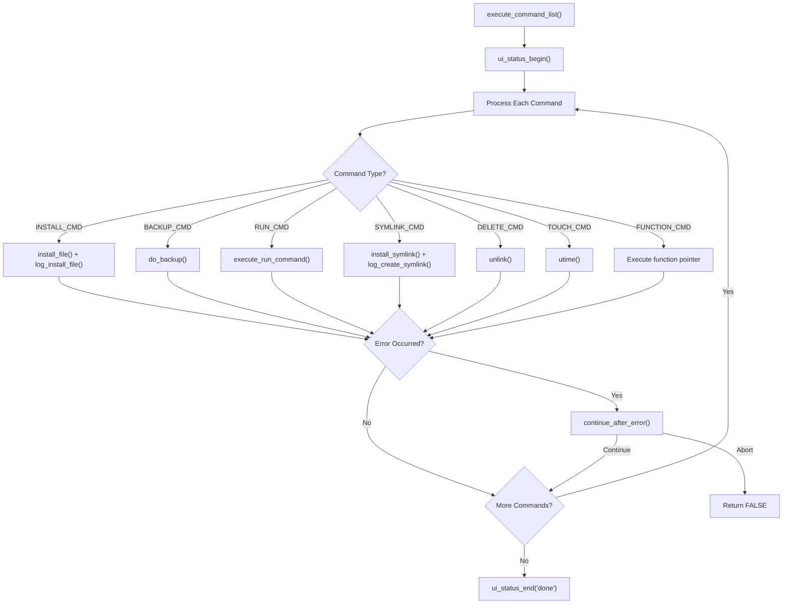

Sources: [command-list.c:614-731]()

## Integration with Backup System

The installation process is tightly integrated with the backup system to enable safe uninstallation and recovery from failed installations.

### Backup Integration Points

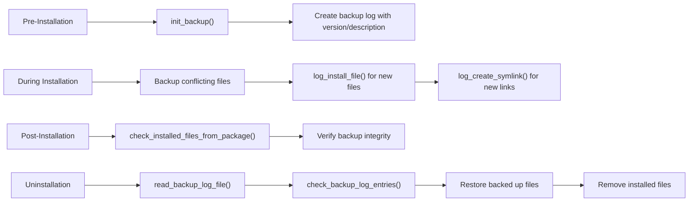

Sources: [backup.c:137-198](), [backup.c:302-332](), [backup.c:336-362]()

### Command Types and Operations

The installer supports multiple command types for different installation operations:

| Command Type | Purpose | Key Functions |
|--------------|---------|---------------|
| `INSTALL_CMD` | Install files with permissions | `install_file()`, `log_install_file()` |
| `BACKUP_CMD` | Backup existing files | `do_backup()` |
| `RUN_CMD` | Execute system commands | `run_command()` |
| `SYMLINK_CMD` | Create symbolic links | `install_symlink()`, `log_create_symlink()` |
| `DELETE_CMD` | Delete temporary files | `unlink()` |
| `FUNCTION_CMD` | Execute internal functions | Function pointer calls |

Sources: [command-list.c:77-87](), [command-list.c:626-724]()

## Error Handling and Recovery

The installation process includes comprehensive error handling with user interaction for recovery decisions:

### Error Recovery Flow

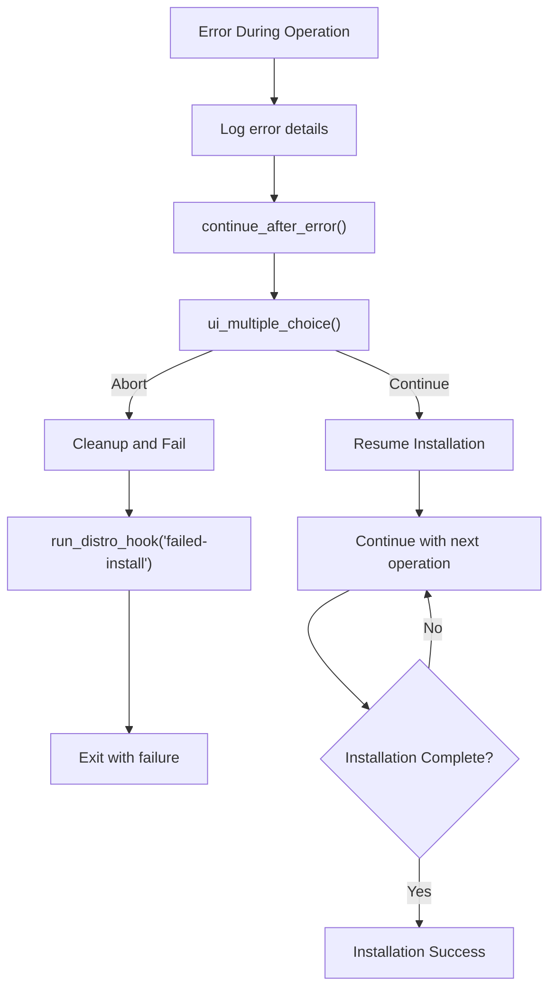

Sources: [misc.c:905-924](), [install-from-cwd.c:418-452]()

The installation process maintains transactional integrity through the backup system, allowing complete rollback of partial installations and providing detailed logging for troubleshooting failed installations.

---

# Page: Command Line Interface

# Command Line Interface

<details>
<summary>Relevant source files</summary>

The following files were used as context for generating this wiki page:

- [common-utils/nvgetopt.h](common-utils/nvgetopt.h)
- [nvidia-installer.c](nvidia-installer.c)
- [option_table.h](option_table.h)

</details>


## Purpose and Scope

This document covers the command-line interface (CLI) system of nvidia-installer, including argument parsing, option definitions, and how user preferences are processed and stored in the `Options` structure. The CLI system handles all user input from the command line and converts it into internal configuration data that drives the installation process.

For information about the core installation logic that uses these parsed options, see [Installation Engine](#3.2). For details about the data structures that store the parsed configuration, see [Data Structures and Configuration](#7).

## CLI Architecture Overview

The command-line interface follows a structured approach using the nvgetopt library for option parsing. The system separates option definitions from parsing logic and uses a centralized `Options` structure to store all configuration data.

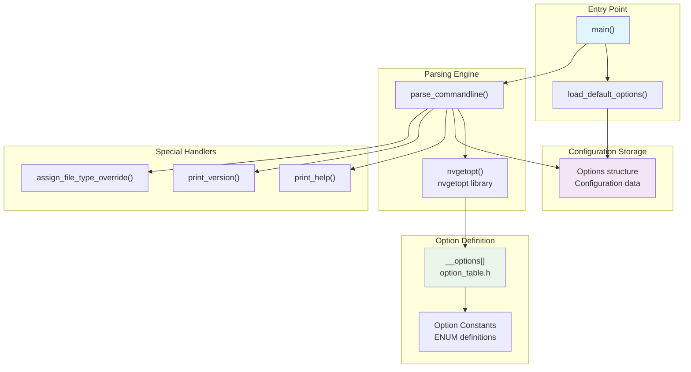

**Sources:** [nvidia-installer.c:648-761](), [nvidia-installer.c:119-157](), [nvidia-installer.c:225-640](), [option_table.h:126-789]()

## Option Definition System

The CLI uses a table-driven approach to define all available command-line options. Each option is defined using the `NVGetoptOption` structure, which specifies the option name, behavior flags, and help text.

### Option Table Structure

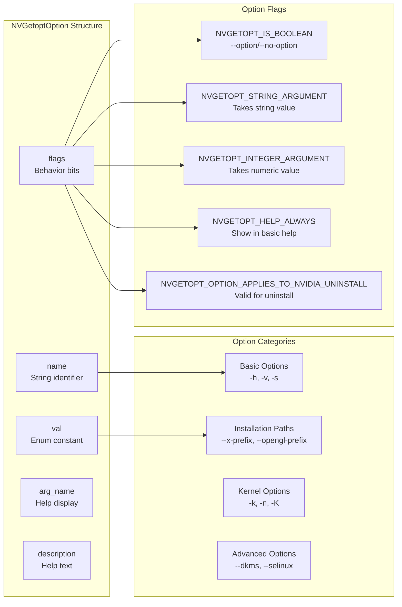

**Sources:** [option_table.h:126-789](), [common-utils/nvgetopt.h:135-141](), [common-utils/nvgetopt.h:46-113]()

## Command Line Parsing Flow

The parsing process follows a well-defined sequence that transforms command-line arguments into a populated `Options` structure.

### Parsing Workflow

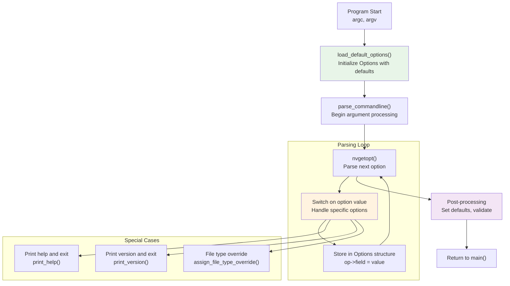

**Sources:** [nvidia-installer.c:225-640](), [nvidia-installer.c:246-585]()

## Key Functions and Their Roles

### Main Entry Point and Initialization

The `main` function orchestrates the CLI processing sequence:

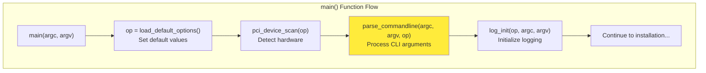

**Sources:** [nvidia-installer.c:648-670]()

### Default Options Loading

The `load_default_options` function creates and initializes the `Options` structure:

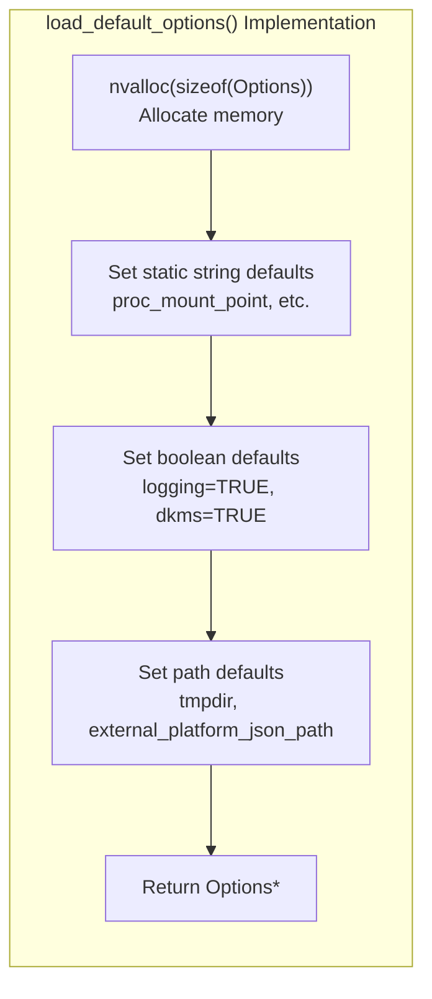

**Sources:** [nvidia-installer.c:119-157]()

### Command Line Parsing Implementation

The `parse_commandline` function contains the main parsing logic with a large switch statement handling each option:

| Option Category | Examples | Lines in Code |
|-----------------|----------|---------------|
| Basic Control | `-h`, `-v`, `-s`, `-q` | [257-283]() |
| Installation Paths | `--x-prefix`, `--opengl-prefix` | [299-347]() |
| Kernel Module Options | `-k`, `-n`, `-K`, `-M` | [285-297, 555-567]() |
| Advanced Features | `--dkms`, `--selinux`, `--systemd` | [456-554]() |
| Compatibility Options | `--compat32-*` | [316-327]() |

**Sources:** [nvidia-installer.c:255-583]()

## Option Categories and Types

### Boolean Options

Boolean options can be specified with `--option` (true) or `--no-option` (false):

```mermaid
graph LR
    subgraph "Boolean Option Examples"
        DKMS["--dkms / --no-dkms<br/>op->dkms = boolval"]
        Nouveau["--disable-nouveau / --no-disable-nouveau<br/>op->disable_nouveau = boolval"]  
        Questions["--no-questions<br/>op->no_questions = TRUE"]
        Systemd["--systemd / --no-systemd<br/>op->use_systemd = NV_OPTIONAL_BOOL_*"]
    end
```

**Sources:** [nvidia-installer.c:456-458](), [nvidia-installer.c:284](), [nvidia-installer.c:272](), [nvidia-installer.c:542-545]()

### String Argument Options

Options that accept string arguments for paths and configuration:

```mermaid
graph TB
    subgraph "String Options Processing"
        XPrefix["--x-prefix<br/>op->x_prefix = strval"]
        KernelName["--kernel-name<br/>op->kernel_name = strval"]
        LogFile["--log-file-name<br/>op->log_file_name = strval"]
        TmpDir["--tmpdir<br/>op->tmpdir = strval"]
    end
    
    subgraph "Path Resolution"
        DefaultPaths["Default path logic<br/>get_default_prefixes_and_paths()"]
        PostProcess["Post-processing<br/>Installer prefix defaulting"]
    end
    
    XPrefix --> DefaultPaths
    KernelName --> PostProcess
    LogFile --> PostProcess
    TmpDir --> DefaultPaths
```

**Sources:** [nvidia-installer.c:300-301](), [nvidia-installer.c:285-288](), [nvidia-installer.c:358-359](), [nvidia-installer.c:363-364]()

### Special Processing Options

Some options require custom processing logic:

```mermaid
graph LR
    subgraph "Special Option Handlers"
        FileOverride["--override-file-type-destination<br/>assign_file_type_override()"]
        ModuleType["--kernel-module-type<br/>override_kernel_module_type()"]
        ConcurrencyLevel["--concurrency-level<br/>Validation and limits"]
        Help["--help variations<br/>print_help() with flags"]
    end
```

**Sources:** [nvidia-installer.c:534-538](), [nvidia-installer.c:560-564](), [nvidia-installer.c:289-297](), [nvidia-installer.c:587-602]()

## Post-Processing and Validation

After parsing all arguments, the system performs validation and default resolution:

```mermaid
flowchart TD
    ParseComplete["Parsing Complete"]
    
    subgraph "Post-Processing Steps"
        HelpCheck["Check for help flags<br/>print_help_after"]
        RecommendedCheck["Check recommended module type<br/>print_recommended_kernel_module_after"]
        DefaultPrefix["Set installer_prefix default<br/>Use utility_prefix if not set"]
        LogFileName["Set default log file name<br/>Based on uninstall mode"]
    end
    
    Complete["Options structure ready"]
    
    ParseComplete --> HelpCheck
    HelpCheck --> RecommendedCheck
    RecommendedCheck --> DefaultPrefix
    DefaultPrefix --> LogFileName
    LogFileName --> Complete
    
    style Complete fill:#c8e6c9
```

**Sources:** [nvidia-installer.c:587-632]()

The CLI system provides a robust, extensible interface that handles the complexity of nvidia-installer's many configuration options while maintaining clean separation between option definitions, parsing logic, and configuration storage.

---

# Page: Installation Engine

# Installation Engine

<details>
<summary>Relevant source files</summary>

The following files were used as context for generating this wiki page:

- [install-from-cwd.c](install-from-cwd.c)
- [manifest.c](manifest.c)
- [misc.c](misc.c)

</details>


The Installation Engine is the core orchestration system that manages the complete NVIDIA driver installation process. It handles manifest parsing, package validation, file processing, and coordinates with all other subsystems to perform the actual installation. This system is primarily implemented in `install-from-cwd.c` and serves as the central coordinator for the entire installation workflow.

For information about the command-line interface that feeds into this engine, see [Command Line Interface](#3.1). For details about individual subsystems like kernel module management and file operations, see [Kernel Module Management](#3.3) and [File System Operations](#3.4).

## Core Architecture

The Installation Engine follows a structured workflow that processes packages from the current working directory and orchestrates all installation activities through a central function.

```mermaid
graph TD
    A[install_from_cwd] --> B[parse_manifest]
    B --> C[Package_struct]
    C --> D[check_for_nvidia_graphics_devices]
    D --> E[check_for_running_x]
    E --> F[run_distro_hook_pre_unload]
    F --> G[check_for_unloaded_kernel_module]
    G --> H[check_for_existing_driver]
    H --> I[install_kernel_modules]
    I --> J[set_destinations]
    J --> K[build_command_list]
    K --> L[do_install]
    L --> M[check_installed_files_from_package]
    
    B --> N[KernelModuleInfo_array]
    B --> O[PackageEntry_array]
    
    style A fill:#e1f5fe
    style C fill:#f3e5f5
    style K fill:#e8f5e8
```

**Installation Engine Core Flow**

The engine processes installations through discrete phases, each with specific responsibilities and validation points.

Sources: [install-from-cwd.c:96-454]()

## Manifest Processing System

The manifest processing system parses `.manifest` files that describe package contents and converts them into structured data for installation processing.

```mermaid
graph TB
    A[".manifest_file"] --> B[parse_manifest]
    B --> C[get_next_line_iterations]
    C --> D[Package_description]
    C --> E[Package_version] 
    C --> F[parse_kernel_modules_list]
    C --> G[PackageEntry_parsing_loop]
    
    F --> H[KernelModuleInfo_structs]
    G --> I[PackageEntry_array]
    
    G --> J[parse_manifest_file_type]
    J --> K[PackageEntryFileCapabilities]
    
    H --> L[Package_struct]
    I --> L
    K --> L
    
    style A fill:#fff3e0
    style B fill:#e1f5fe
    style L fill:#f3e5f5
```

**Manifest to Package Structure Transformation**

The manifest file contains package metadata and file listings that get parsed into structured C data types for processing.

Sources: [install-from-cwd.c:726-1047](), [manifest.c:165-180]()

## Package Data Structure

The `Package` structure serves as the central data container for all installation information, holding both metadata and file entries.

| Field | Type | Purpose |
|-------|------|---------|
| `description` | `char*` | Human-readable package description |
| `version` | `char*` | Package version string |
| `kernel_modules` | `KernelModuleInfo*` | Array of kernel module information |
| `num_kernel_modules` | `int` | Count of kernel modules |
| `entries` | `PackageEntry*` | Array of all files to install |
| `num_entries` | `int` | Count of package entries |
| `kernel_module_build_directory` | `char*` | Build directory path |

```mermaid
graph LR
    A[Package] --> B[metadata_fields]
    A --> C[KernelModuleInfo_array]
    A --> D[PackageEntry_array]
    
    B --> E[description]
    B --> F[version]
    B --> G[kernel_module_build_directory]
    
    C --> H[module_name]
    C --> I[module_filename]
    C --> J[has_separate_interface_file]
    
    D --> K[file_path]
    D --> L[PackageEntryFileType]
    D --> M[mode_permissions]
    D --> N[dst_path]
    
    style A fill:#f3e5f5
    style C fill:#e8f5e8
    style D fill:#fff3e0
```

**Package Structure Component Relationships**

Sources: [nvidia-installer.h](), [install-from-cwd.c:1056-1096]()

## Installation Orchestration

The installation process follows a well-defined sequence of phases, each with specific validation and processing steps.

```mermaid
sequenceDiagram
    participant Main as install_from_cwd
    participant Manifest as parse_manifest
    participant Validation as System_Validation
    participant KernelMods as install_kernel_modules
    participant Files as File_Processing
    participant Commands as build_command_list
    participant Execution as do_install
    
    Main->>Manifest: Parse package manifest
    Manifest-->>Main: Package structure
    
    Main->>Validation: check_for_nvidia_graphics_devices
    Main->>Validation: check_for_running_x
    Main->>Validation: check_for_unloaded_kernel_module
    
    Main->>KernelMods: Build/install kernel modules
    KernelMods-->>Main: Kernel modules ready
    
    Main->>Files: set_destinations
    Main->>Files: Process file entries
    
    Main->>Commands: build_command_list
    Commands-->>Main: CommandList structure
    
    Main->>Execution: do_install
    Execution-->>Main: Installation complete
```

**Installation Phase Sequence**

The orchestration ensures proper dependency ordering and validation before proceeding to irreversible operations.

Sources: [install-from-cwd.c:96-454](), [misc.c:932-952]()

## File Type Classification System

The installation engine uses a comprehensive file type system to categorize and process different kinds of files with appropriate handling logic.

```mermaid
graph TB
    A[parse_manifest_file_type] --> B[packageEntryFileTypeTable]
    B --> C[FILE_TYPE_KERNEL_MODULE]
    B --> D[FILE_TYPE_OPENGL_LIB]
    B --> E[FILE_TYPE_CUDA_LIB]
    B --> F[FILE_TYPE_UTILITY_BINARY]
    B --> G[FILE_TYPE_DOCUMENTATION]
    
    C --> H[PackageEntryFileCapabilities]
    D --> H
    E --> H
    F --> H
    G --> H
    
    H --> I[has_arch]
    H --> J[installable]
    H --> K[has_path]
    H --> L[is_symlink]
    H --> M[is_shared_lib]
    
    style B fill:#f3e5f5
    style H fill:#e8f5e8
```

**File Type to Capabilities Mapping**

Each file type has associated capabilities that determine how it should be processed during installation.

| Capability | Purpose |
|------------|---------|
| `has_arch` | File supports architecture-specific variants |
| `installable` | File should be installed to the system |
| `has_path` | File has an explicit installation path |
| `is_symlink` | File is a symbolic link |
| `is_shared_lib` | File is a shared library requiring special handling |

Sources: [manifest.c:55-138](), [manifest.c:144-158]()

## Kernel Module Integration

The Installation Engine coordinates closely with the kernel module management system to handle the specialized requirements of kernel module installation.

```mermaid
graph TD
    A[install_kernel_modules] --> B[process_dkms_conf]
    A --> C[determine_kernel_module_installation_path]
    A --> D[find_precompiled_kernel_interface]
    
    D --> E{Precompiled_Available}
    E -->|Yes| F[unpack_kernel_modules]
    E -->|No| G[build_kernel_modules]
    
    F --> H[assisted_module_signing]
    G --> H
    
    H --> I[test_kernel_modules]
    I --> J[add_kernel_modules_to_package]
    
    style A fill:#e1f5fe
    style E fill:#fff3e0
    style J fill:#e8f5e8
```

**Kernel Module Processing Flow**

The engine handles both precompiled and source-built kernel modules through a unified interface.

Sources: [install-from-cwd.c:469-551](), [install-from-cwd.c:1148-1491]()

## Command List Generation

The Installation Engine builds a comprehensive list of operations to be executed, allowing for user review and atomic execution.

```mermaid
graph LR
    A[build_command_list] --> B[CommandList]
    B --> C[INSTALL_CMD]
    B --> D[BACKUP_CMD] 
    B --> E[RUN_CMD]
    B --> F[RESTORE_CMD]
    
    C --> G[file_operations]
    D --> H[backup_operations]
    E --> I[system_commands]
    F --> J[restore_operations]
    
    B --> K[ui_approve_command_list]
    K --> L[execute_command_list]
    
    style B fill:#f3e5f5
    style K fill:#fff3e0
    style L fill:#e8f5e8
```

**Command List Structure and Execution**

The command list provides a structured way to batch operations and allow user approval before execution.

Sources: [command-list.c](), [install-from-cwd.c:337-347]()

## Optional Module Processing

The Installation Engine handles optional kernel modules through a flexible configuration system that allows users to selectively install components.

```mermaid
graph TD
    A[should_install_optional_modules] --> B[optional_modules_array]
    B --> C[nvidia-uvm]
    B --> D[nvidia-drm] 
    B --> E[nvidia-peermem]
    
    C --> F[CUDA_dependency]
    D --> G[DRM-KMS_dependency]
    E --> H[GPUDirect_RDMA_dependency]
    
    F --> I[package_includes_kernel_module]
    G --> I
    H --> I
    
    I --> J{User_Choice}
    J -->|Install| K[Keep_in_package]
    J -->|Skip| L[remove_kernel_module_from_package]
    
    style B fill:#f3e5f5
    style J fill:#fff3e0
```

**Optional Module Decision Flow**

The system presents users with choices about optional components based on their intended use cases.

Sources: [install-from-cwd.c:59-78](), [misc.c:1189-1234]()

---

# Page: Kernel Module Management

# Kernel Module Management

<details>
<summary>Relevant source files</summary>

The following files were used as context for generating this wiki page:

- [kernel.c](kernel.c)
- [kernel.h](kernel.h)
- [mkprecompiled.c](mkprecompiled.c)
- [precompiled.c](precompiled.c)
- [precompiled.h](precompiled.h)

</details>


## Purpose and Scope

The Kernel Module Management system handles the building, signing, testing, and installation of NVIDIA kernel modules. This system supports both building kernel modules from source code and using precompiled kernel interfaces when available. It manages the entire kernel module lifecycle from path detection through installation validation.

For information about the broader installation workflow, see [Installation Process](#3). For details about file system operations during module installation, see [File System Operations](#3.4).

## System Architecture

The kernel module management system operates through several coordinated subsystems that handle different aspects of module preparation and installation.

### Core Components Flow

```mermaid
flowchart TD
    A["determine_kernel_module_installation_path()"] --> B["determine_kernel_source_path()"]
    B --> C["determine_kernel_output_path()"]
    C --> D["find_precompiled_kernel_interface()"]
    D --> E{Precompiled Available?}
    E -->|Yes| F["unpack_kernel_modules()"]
    E -->|No| G["build_kernel_interfaces()"]
    F --> H["sign_kernel_module()"]
    G --> H
    H --> I["test_kernel_modules()"]
    I --> J["load_kernel_module()"]
    
    K["PrecompiledInfo"] --> F
    L["build_kernel_modules()"] --> G
    M["run_conftest()"] --> G
    N["run_make()"] --> G
```

Sources: [kernel.c:99-146](), [kernel.c:205-325](), [kernel.c:334-407](), [kernel.c:672-675](), [kernel.c:937-1078]()

### Data Structure Relationships

```mermaid
classDiagram
    class Options {
        +char* kernel_module_installation_path
        +char* kernel_source_path
        +char* kernel_output_path
        +char* module_signing_script
        +char* module_signing_hash
        +int kernel_module_signed
    }
    
    class Package {
        +int num_kernel_modules
        +KernelModuleInfo* kernel_modules
        +char* kernel_module_build_directory
        +char* excluded_kernel_modules
    }
    
    class KernelModuleInfo {
        +char* module_name
        +char* module_filename
        +char* interface_filename
        +char* core_object_name
        +int has_separate_interface_file
        +int is_optional
    }
    
    class PrecompiledInfo {
        +char* version
        +char* proc_version_string
        +char* description
        +int num_files
        +PrecompiledFileInfo* files
    }
    
    class PrecompiledFileInfo {
        +uint32 type
        +uint32 attributes
        +char* name
        +char* linked_module_name
        +uint32 crc
        +uint8* data
        +char* signature
    }
    
    Options --> Package
    Package --> KernelModuleInfo
    PrecompiledInfo --> PrecompiledFileInfo
```

Sources: [nvidia-installer.h](), [kernel.h:26-45](), [precompiled.h:136-160]()

## Path Resolution System

The system must determine three critical paths before any kernel module operations can proceed: installation path, source path, and output path.

### Path Determination Workflow

```mermaid
flowchart TD
    A["determine_kernel_module_installation_path()"] --> B{Command line path set?}
    B -->|Yes| C["Use command line path"]
    B -->|No| D["default_kernel_module_installation_path()"]
    D --> E{Expert mode?}
    E -->|Yes| F["ui_get_input() for path"]
    E -->|No| G["Use default path"]
    F --> H["confirm_path()"]
    G --> I["mkdir_with_log()"]
    H --> I
    C --> I
    
    J["determine_kernel_source_path()"] --> K["default_kernel_source_path()"]
    K --> L{Expert mode?}
    L -->|Yes| M["ui_get_input() for source"]
    L -->|No| N["Validate default source"]
    M --> O["directory_exists() check"]
    N --> O
    O --> P["Check kernel.h exists"]
    P --> Q["determine_kernel_output_path()"]
    
    Q --> R{--kernel-output-path set?}
    R -->|Yes| S["Use specified output path"]
    R -->|No| T["Check SYSOUT environment"]
    T --> U["Check /lib/modules/build symlink"]
    U --> V["Default to source path"]
```

Sources: [kernel.c:99-146](), [kernel.c:205-325](), [kernel.c:334-407]()

The path resolution system handles several scenarios:
- **Installation Path**: Defaults to `/lib/modules/$(uname -r)/kernel/drivers/video` but can be overridden
- **Source Path**: Searches `/lib/modules/$(uname -r)/source`, `/usr/src/linux`, and other common locations
- **Output Path**: Usually the same as source path, but can differ for out-of-tree builds

## Build System Integration

When precompiled interfaces are unavailable, the system builds kernel modules from source using the kernel's build system.

### Build Process Flow

```mermaid
flowchart TD
    A["build_kernel_interfaces()"] --> B["kernel_configuration_conflict()"]
    B --> C{Configuration conflicts?}
    C -->|Yes| D["Return error"]
    C -->|No| E["Sanity checks array"]
    E --> F["run_conftest() for each check"]
    F --> G["Compiler sanity check"]
    G --> H["Dom0 sanity check"]
    H --> I["Xen sanity check"]
    I --> J["PREEMPT_RT sanity check"]
    J --> K["vgpu_kvm sanity check"]
    K --> L["Clean build directory"]
    L --> M["count_lines() for progress"]
    M --> N["run_make() with empty target"]
    N --> O["check_file() for each module"]
    O --> P{All modules built?}
    P -->|No| Q["handle_optional_module_failure()"]
    P -->|Yes| R["pack_kernel_interface()"]
    
    S["run_make()"] --> T["Execute make command"]
    T --> U["Monitor output with RunCommandOutputMatch"]
    U --> V["Update UI progress"]
```

Sources: [kernel.c:937-1078](), [kernel.c:556-627](), [kernel.c:62-64](), [kernel.c:945-954]()

The build system performs comprehensive validation before attempting to build:
- **Compiler Sanity Check**: Verifies the compiler can build kernel modules
- **Hypervisor Checks**: Tests for Dom0, Xen, and other virtualization conflicts
- **Kernel Configuration**: Validates kernel config options are compatible

## Precompiled Interface System

The precompiled interface system allows distribution of pre-built kernel interfaces that can be linked with core binary objects, avoiding the need to build from source.

### Precompiled Package Format

```mermaid
flowchart TD
    A["Package Header: \\aNVIDIA\\a"] --> B["Package Version: uint32"]
    B --> C["Driver Version Length + String"]
    C --> D["Description Length + String"]
    D --> E["Proc Version Length + String"]
    E --> F["Number of Files: uint32"]
    F --> G["For each file:"]
    
    G --> H["File Header: FILE"]
    H --> I["File Index: uint32"]
    I --> J["File Type: uint32"]
    J --> K["Attributes Mask: uint32"]
    K --> L["Filename Length + String"]
    L --> M["Linked Module Name Length + String"]
    M --> N["Core Object Name Length + String"]
    N --> O["Target Directory Length + String"]
    O --> P["File CRC: uint32"]
    P --> Q["File Size + Data"]
    Q --> R["Redundant CRC: uint32"]
    R --> S["Linked Module CRC: uint32"]
    S --> T["Signature Size + Data"]
    T --> U["Redundant File Index"]
    U --> V["File Footer: END."]
```

Sources: [precompiled.h:22-88](), [precompiled.c:467-626]()

### Precompiled Interface Workflow

```mermaid
flowchart TD
    A["find_precompiled_kernel_interface()"] --> B["scan_dir() for packages"]
    B --> C["get_precompiled_info()"]
    C --> D["Validate package header"]
    D --> E["Check version compatibility"]
    E --> F["Compare proc_version_string"]
    F --> G{Match found?}
    
    G -->|Yes| H["precompiled_unpack()"]
    H --> I["precompiled_file_unpack() for each file"]
    I --> J["unpack_kernel_modules()"]
    J --> K{Interface or Module?}
    K -->|Interface| L["Link with core object using ld"]
    K -->|Module| M["Module ready for installation"]
    L --> N["attach_signature() if present"]
    M --> O["Module ready for installation"]
    N --> O
    
    G -->|No| P["Build from source"]
```

Sources: [kernel.c:1112-1272](), [kernel.c:502-549](), [kernel.c:414-488](), [precompiled.c:151-360]()

The precompiled system supports two file types:
- **PRECOMPILED_FILE_TYPE_INTERFACE**: Kernel interface files that need linking with core objects
- **PRECOMPILED_FILE_TYPE_MODULE**: Complete kernel modules ready for installation

## Module Signing and Security

For systems with secure boot enabled, kernel modules must be cryptographically signed before they can be loaded.

### Module Signing Process

```mermaid
flowchart TD
    A["sign_kernel_module()"] --> B{module_signing_script set?}
    B -->|No| C["test_sign_file() on kernel paths"]
    C --> D["Set default signing script path"]
    B -->|Yes| E["Use existing script path"]
    D --> E
    E --> F{Signing script found?}
    F -->|No| G["Return error - no signing capability"]
    F -->|Yes| H{module_signing_hash set?}
    H -->|No| I["guess_module_signing_hash()"]
    H -->|Yes| J["Use existing hash"]
    I --> J
    J --> K["Execute signing script"]
    K --> L["script hash secret_key public_key module"]
    L --> M{Signing successful?}
    M -->|Yes| N["Set kernel_module_signed = TRUE"]
    M -->|No| O["Set kernel_module_signed = FALSE"]
    
    P["create_detached_signature()"] --> Q["unpack_kernel_modules()"]
    Q --> R["compute_crc() of linked module"]
    R --> S["sign_kernel_module()"]
    S --> T["byte_tail() to extract signature"]
    T --> U["Store signature in PrecompiledFileInfo"]
```

Sources: [kernel.c:703-762](), [kernel.c:771-839](), [kernel.c:682-694]()

The signing system supports both embedded and detached signatures:
- **Embedded Signatures**: Signature is part of the module file
- **Detached Signatures**: Signature is stored separately and attached during installation

## Testing and Validation

Before finalizing installation, the system tests that kernel modules can be successfully loaded and unloaded.

### Module Testing Workflow

```mermaid
flowchart TD
    A["test_kernel_modules()"] --> B["For each kernel module:"]
    B --> C["check_for_loaded_kernel_module()"]
    C --> D{Module already loaded?}
    D -->|Yes| E["rmmod_kernel_module()"]
    D -->|No| F["load_kernel_module()"]
    E --> F
    F --> G{Load successful?}
    G -->|No| H["handle_optional_module_failure()"]
    G -->|Yes| I["rmmod_kernel_module()"]
    I --> J{Unload successful?}
    J -->|No| K["Log warning but continue"]
    J -->|Yes| L["Module test passed"]
    H --> M{Is optional module?}
    M -->|Yes| N["Continue with warning"]
    M -->|No| O["Abort installation"]
    
    P["load_kernel_module()"] --> Q["insmod module_path"]
    Q --> R["Check /proc/modules for module"]
    R --> S["load_kernel_module_quiet() fallback"]
    
    T["rmmod_kernel_module()"] --> U["rmmod module_name"]
    U --> V["modprobe_remove_kernel_module_quiet() fallback"]
```

Sources: [kernel.c:1274-1361](), [kernel.c:1363-1432](), [kernel.c:1579-1642](), [kernel.c:878-889]()

The testing system ensures that:
- Modules can be loaded without conflicts
- Modules can be cleanly unloaded
- Optional modules don't block installation if they fail
- Core modules must pass testing for installation to proceed

---

# Page: File System Operations

# File System Operations

<details>
<summary>Relevant source files</summary>

The following files were used as context for generating this wiki page:

- [files.c](files.c)
- [files.h](files.h)
- [manifest.c](manifest.c)

</details>


## Purpose and Scope

This document covers the file system operations subsystem of nvidia-installer, which handles the installation, organization, and management of files during the driver installation process. This includes file type classification, path resolution, template processing, and the actual file system operations required to install NVIDIA driver components.

For information about the overall installation workflow, see [Installation Engine](#3.2). For details about the backup and recovery mechanisms that work with these file operations, see [Backup and Recovery System](#3.5).

## Package Entry System

The file system operations are built around the `PackageEntry` data structure, which represents individual files to be installed. Each entry contains metadata about the file type, destination path, permissions, and installation capabilities.

```mermaid
graph TB
    subgraph "Package Entry Structure"
        PackageEntry["PackageEntry"]
        PackageEntry --> file["file: source path"]
        PackageEntry --> dst["dst: destination path"]
        PackageEntry --> name["name: filename"]
        PackageEntry --> target["target: symlink target"]
        PackageEntry --> type["type: PackageEntryFileType"]
        PackageEntry --> caps["caps: PackageEntryFileCapabilities"]
        PackageEntry --> mode["mode: file permissions"]
    end
    
    subgraph "File Type System"
        type --> FileTypeTable["packageEntryFileTypeTable[]"]
        FileTypeTable --> KernelModule["FILE_TYPE_KERNEL_MODULE"]
        FileTypeTable --> OpenGLLib["FILE_TYPE_OPENGL_LIB"]
        FileTypeTable --> UtilityBin["FILE_TYPE_UTILITY_BINARY"]
        FileTypeTable --> Documentation["FILE_TYPE_DOCUMENTATION"]
        FileTypeTable --> Symlinks["FILE_TYPE_*_SYMLINK"]
    end
    
    subgraph "Capabilities"
        caps --> installable["installable: can be installed"]
        caps --> has_arch["has_arch: architecture specific"]
        caps --> is_symlink["is_symlink: symbolic link"]
        caps --> is_opengl["is_opengl: OpenGL component"]
        caps --> is_temporary["is_temporary: temp during install"]
    end
```

**Sources:** [files.c:528-894](), [manifest.c:55-138](), [nvidia-installer.h]()

## File Type Classification

The installer categorizes files into specific types, each with different installation behaviors and destination paths. The classification system is defined in `manifest.c` and drives the entire file installation process.

```mermaid
graph LR
    subgraph "Core File Types"
        KernelMod["FILE_TYPE_KERNEL_MODULE<br/>kernel driver modules"]
        KernelSrc["FILE_TYPE_KERNEL_MODULE_SRC<br/>kernel source files"]
        OpenGLLib["FILE_TYPE_OPENGL_LIB<br/>graphics libraries"]
        CUDALib["FILE_TYPE_CUDA_LIB<br/>CUDA runtime libraries"]
        Utilities["FILE_TYPE_UTILITY_BINARY<br/>command-line tools"]
    end
    
    subgraph "Supporting Files"
        Docs["FILE_TYPE_DOCUMENTATION<br/>user documentation"]
        ManPages["FILE_TYPE_MANPAGE<br/>manual pages"]
        Desktop["FILE_TYPE_DOT_DESKTOP<br/>desktop integration"]
        Configs["FILE_TYPE_XORG_OUTPUTCLASS_CONFIG<br/>X.Org configuration"]
    end
    
    subgraph "System Integration"
        SystemdUnit["FILE_TYPE_SYSTEMD_UNIT<br/>systemd service files"]
        VulkanICD["FILE_TYPE_VULKAN_ICD_JSON<br/>Vulkan driver metadata"]
        DKMS["FILE_TYPE_DKMS_CONF<br/>DKMS configuration"]
    end
    
    ParseFunc["parse_manifest_file_type()"] --> KernelMod
    ParseFunc --> OpenGLLib
    ParseFunc --> Utilities
    GetCapsFunc["get_file_type_capabilities()"] --> KernelMod
    GetCapsFunc --> OpenGLLib
    GetCapsFunc --> Utilities
```

The `get_installable_file_type_list()` function filters file types based on installation options, while `parse_manifest_file_type()` maps string names to type enumerations during manifest parsing.

**Sources:** [manifest.c:144-180](), [manifest.c:185-225](), [files.c:549-862]()

## Path Resolution and Destination Assignment

The `set_destinations()` function is the core of the path resolution system, determining where each file should be installed based on its type, architecture, and user-specified installation prefixes.

```mermaid
flowchart TD
    SetDest["set_destinations()"] --> CheckOverride{"file_type_destination_overrides[]?"}
    CheckOverride -->|Yes| UseOverride["Use override path"]
    CheckOverride -->|No| TypeSwitch["Switch on file type"]
    
    TypeSwitch --> KernelPath["Kernel modules:<br/>kernel_module_installation_path"]
    TypeSwitch --> OpenGLPath["OpenGL libraries:<br/>opengl_prefix + opengl_libdir"]
    TypeSwitch --> UtilPath["Utilities:<br/>utility_prefix + utility_bindir"]
    TypeSwitch --> DocPath["Documentation:<br/>documentation_prefix + documentation_docdir"]
    TypeSwitch --> X11Path["X11 modules:<br/>x_module_path"]
    
    subgraph "Architecture Handling"
        ArchCheck{"compat_arch == COMPAT32?"}
        ArchCheck -->|Yes| Compat32["compat32_prefix + compat32_libdir"]
        ArchCheck -->|No| Native["Native architecture paths"]
    end
    
    OpenGLPath --> ArchCheck
    
    subgraph "Path Construction"
        BuildPath["nvstrcat(prefix, '/', dir, '/', path, '/', name)"]
        BuildPath --> Collapse["collapse_multiple_slashes()"]
        Collapse --> FinalDst["entries[i].dst"]
    end
    
    KernelPath --> BuildPath
    OpenGLPath --> BuildPath
    UtilPath --> BuildPath
```

The path resolution system handles multiple installation prefixes, architecture-specific paths for 32-bit compatibility libraries, and user overrides for expert installations.

**Sources:** [files.c:528-894](), [files.c:904-1072]()

## Core File Operations

The installer provides a comprehensive set of file system operations, implemented as robust functions with error handling and logging.

```mermaid
graph TB
    subgraph "File Copy Operations"
        CopyFile["copy_file()"]
        CopyFile --> SrcFD["open(srcfile, O_RDONLY)"]
        CopyFile --> DstFD["open(dstfile, O_RDWR|O_CREAT)"]
        CopyFile --> MMap["mmap() both files"]
        CopyFile --> MemCpy["memcpy(dst, src, size)"]
        CopyFile --> Cleanup["munmap() and close()"]
    end
    
    subgraph "Installation Operations"
        InstallFile["install_file()"]
        InstallFile --> ExtractDir["dirname(dstfile)"]
        InstallFile --> MkdirLog["mkdir_with_log()"]
        InstallFile --> CopyFile
        
        InstallSymlink["install_symlink()"]
        InstallSymlink --> ExtractDir2["dirname(dstfile)"]
        InstallSymlink --> MkdirLog2["mkdir_with_log()"]
        InstallSymlink --> SymlinkCall["symlink(linkname, dstfile)"]
    end
    
    subgraph "Directory Operations"
        RemoveDir["remove_directory()"]
        RemoveDir --> Recurse["Recursive deletion"]
        RemoveDir --> Unlink["unlink() files"]
        RemoveDir --> RmDir["rmdir() directories"]
        
        MkdirRec["mkdir_recursive()"]
        MkdirRec --> NvMkdir["nv_mkdir_recursive()"]
        MkdirRec --> LogMkdir["log_mkdir()"]
    end
```

The file operations use memory mapping for efficient copying and provide atomic file replacement by unlinking existing files before creating new ones.

**Sources:** [files.c:218-312](), [files.c:1467-1515](), [files.c:56-116](), [files.c:1344-1375]()

## Template File Processing

The installer processes template files that contain placeholder tokens, replacing them with runtime-determined values. This is primarily used for `.desktop` files and configuration files.

```mermaid
flowchart LR
    subgraph "Template Processing Pipeline"
        TemplateFile["Template file with tokens"]
        ProcessTemplate["process_template_file()"]
        TempFile["Temporary processed file"]
        
        TemplateFile --> ProcessTemplate
        ProcessTemplate --> TempFile
    end
    
    subgraph "Token Replacement"
        MmapSrc["mmap(template_file)"]
        TokenLoop["For each token/replacement pair"]
        StrReplace["nv_strreplace(content, token, replacement)"]
        MmapDst["mmap(temp_file)"]
        MemcpyOut["memcpy(processed_content)"]
        
        MmapSrc --> TokenLoop
        TokenLoop --> StrReplace
        StrReplace --> TokenLoop
        TokenLoop --> MmapDst
        MmapDst --> MemcpyOut
    end
    
    subgraph "Desktop File Processing"
        ProcessDesktop["process_dot_desktop_files()"]
        UtilsPath["__UTILS_PATH__ → utility_prefix/utility_bindir"]
        InvalidateOrig["invalidate_package_entry(original)"]
        AddProcessed["add_package_entry(processed)"]
        
        ProcessDesktop --> UtilsPath
        ProcessDesktop --> InvalidateOrig
        ProcessDesktop --> AddProcessed
    end
    
    ProcessTemplate --> TokenLoop
```

The `nv_strreplace()` function implements string replacement without relying on external tools like `sed`, ensuring the installer works on minimal systems.

**Sources:** [files.c:1914-2054](), [files.c:2064-2118](), [files.c:1845-1903]()

## Directory and Path Management

The installer manages a complex directory structure with multiple installation prefixes and architecture-specific paths. The directory management system ensures paths exist and handles permission setting.

```mermaid
graph TB
    subgraph "Installation Prefixes"
        Prefixes["Installation Prefixes"]
        Prefixes --> OpenGLPrefix["opengl_prefix<br/>/usr/lib"]
        Prefixes --> UtilityPrefix["utility_prefix<br/>/usr/bin"]
        Prefixes --> X11Prefix["x_prefix<br/>/usr/X11R6"]
        Prefixes --> DocPrefix["documentation_prefix<br/>/usr/share/doc"]
        Prefixes --> KernelPrefix["kernel_module_src_prefix<br/>/usr/src"]
    end
    
    subgraph "Path Confirmation"
        ConfirmPath["confirm_path()"]
        DirExists{"directory_exists()?"}
        UserPrompt["UI prompt: Create directory?"]
        MkdirLog["mkdir_with_log(path, 0755)"]
        
        ConfirmPath --> DirExists
        DirExists -->|No| UserPrompt
        UserPrompt -->|Yes| MkdirLog
        DirExists -->|Yes| Return["return TRUE"]
        MkdirLog --> Return
    end
    
    subgraph "Temporary Directory Management"
        GetTmpdir["get_tmpdir()"]
        CheckEnv["Check TMPDIR, /tmp, ., HOME"]
        MakeTmpdir["make_tmpdir()"]
        PidUnique["nvidia-{pid} directory"]
        
        GetTmpdir --> CheckEnv
        CheckEnv --> MakeTmpdir
        MakeTmpdir --> PidUnique
    end
```

The system uses a hierarchical approach to find suitable temporary directories and always confirms with users before creating new directories in expert mode.

**Sources:** [files.c:1308-1334](), [files.c:1551-1594](), [files.c:904-1072]()

## Symlink Management

The installer handles symbolic links extensively, both for creating new links and resolving existing ones. This is critical for library management and maintaining compatibility.

```mermaid
flowchart TD
    subgraph "Symlink Operations"
        GetSymTarget["get_symlink_target()"]
        ReadlinkLoop["readlink() with growing buffer"]
        ResolvedTarget["get_resolved_symlink_target()"]
        
        GetSymTarget --> ReadlinkLoop
        ReadlinkLoop --> ResolvedTarget
    end
    
    subgraph "libGLX_indirect Handling"
        CheckIndirect["check_libGLX_indirect_links()"]
        CheckTarget["check_libGLX_indirect_target()"]
        FollowLinks["Follow symlink chain"]
        BasenameCmp["Compare basename to 'libGLX_indirect'"]
        InvalidateEntry["invalidate_package_entry()"]
        
        CheckIndirect --> CheckTarget
        CheckTarget --> FollowLinks
        FollowLinks --> BasenameCmp
        BasenameCmp -->|Different| InvalidateEntry
    end
    
    subgraph "Symlink Installation"
        InstallSym["install_symlink()"]
        MakeDir["mkdir_with_log(dirname)"]
        CreateLink["symlink(target, destination)"]
        
        InstallSym --> MakeDir
        MakeDir --> CreateLink
    end
```

The symlink handling includes special logic for `libGLX_indirect.so.0` to avoid conflicts with existing indirect rendering libraries from other vendors.

**Sources:** [files.c:1386-1457](), [files.c:418-518](), [files.c:1489-1515]()

## Integration Points

The file system operations integrate closely with other installer subsystems:

| Integration Point | Description | Key Functions |
|------------------|-------------|---------------|
| Command List System | File operations generate commands for backup/restore | `add_package_entry()` creates install commands |
| Package Management | Files are organized into installable packages | `set_destinations()` assigns installation paths |
| User Interface | Progress reporting and error messages | All functions use `ui_*()` for user communication |
| Kernel Module System | Special handling for kernel files | `add_kernel_modules_to_package()` |
| Template Processing | Runtime configuration generation | `process_dot_desktop_files()`, `process_dkms_conf()` |

**Sources:** [files.c:1115-1122](), [backup.c](), [command-list.c](), [user-interface.h]()

---

# Page: Backup and Recovery System

# Backup and Recovery System

<details>
<summary>Relevant source files</summary>

The following files were used as context for generating this wiki page:

- [backup.c](backup.c)
- [command-list.c](command-list.c)

</details>


## Purpose and Scope

The Backup and Recovery System provides safe installation and complete uninstallation capabilities for the NVIDIA driver installer. This system ensures that any existing files that conflict with the driver installation are safely backed up before being replaced, and can be restored during uninstallation. The system also tracks all files installed by the driver to enable complete removal.

For information about the overall installation workflow, see [Installation Process](#3). For details about file system operations, see [File System Operations](#3.4).

## System Architecture

The backup system is built around a centralized backup directory and logging mechanism that coordinates with the command execution system to provide transactional installation operations.

```mermaid
graph TB
    subgraph "Backup Directory Structure"
        BackupDir["/var/lib/nvidia<br/>BACKUP_DIRECTORY"]
        BackupLog["/var/lib/nvidia/log<br/>BACKUP_LOG"]
        MkdirLog["/var/lib/nvidia/dirs<br/>BACKUP_MKDIR_LOG"]
        BackupFiles["Numbered backup files<br/>1, 2, 3, ..."]
    end
    
    subgraph "Command System Integration"
        CommandList["CommandList structure<br/>command-list.c"]
        BackupCmd["BACKUP_CMD<br/>do_backup()"]
        InstallCmd["INSTALL_CMD<br/>install_file()"]
        DeleteCmd["DELETE_CMD<br/>unlink()"]
    end
    
    subgraph "Core Functions"
        InitBackup["init_backup()<br/>Initialize backup system"]
        DoBackup["do_backup()<br/>Backup individual files"]
        DoUninstall["do_uninstall()<br/>Restore and cleanup"]
        LogInstall["log_install_file()<br/>Track installed files"]
    end
    
    BackupDir --> BackupLog
    BackupDir --> MkdirLog
    BackupDir --> BackupFiles
    
    CommandList --> BackupCmd
    CommandList --> InstallCmd
    CommandList --> DeleteCmd
    
    BackupCmd --> DoBackup
    InstallCmd --> LogInstall
    DoBackup --> BackupLog
    DoBackup --> BackupFiles
    
    InitBackup --> BackupDir
    DoUninstall --> BackupLog
    DoUninstall --> BackupFiles
```

Sources: [backup.c:46-48](), [command-list.c:77-87](), [backup.c:137-198](), [backup.c:207-298]()

## Command List Integration

The backup system integrates with the command execution system through specific command types that handle backup and installation operations in a coordinated manner.

```mermaid
graph LR
    subgraph "Command Types"
        BackupCmdEnum["BACKUP_CMD<br/>enum value"]
        InstallCmdEnum["INSTALL_CMD<br/>enum value"] 
        DeleteCmdEnum["DELETE_CMD<br/>enum value"]
        SymlinkCmdEnum["SYMLINK_CMD<br/>enum value"]
    end
    
    subgraph "Command Execution Flow"
        ExecuteList["execute_command_list()<br/>Process all commands"]
        BackupExec["case BACKUP_CMD:<br/>do_backup()"]
        InstallExec["case INSTALL_CMD:<br/>install_file() + log_install_file()"]
        DeleteExec["case DELETE_CMD:<br/>unlink()"]
        SymlinkExec["case SYMLINK_CMD:<br/>install_symlink() + log_create_symlink()"]
    end
    
    subgraph "Backup Operations"
        DoBackupFunc["do_backup()<br/>Move file to backup dir"]
        LogInstallFunc["log_install_file()<br/>Record CRC and path"]
        LogSymlinkFunc["log_create_symlink()<br/>Record target"]
    end
    
    BackupCmdEnum --> BackupExec
    InstallCmdEnum --> InstallExec
    DeleteCmdEnum --> DeleteExec
    SymlinkCmdEnum --> SymlinkExec
    
    ExecuteList --> BackupExec
    ExecuteList --> InstallExec
    ExecuteList --> DeleteExec
    ExecuteList --> SymlinkExec
    
    BackupExec --> DoBackupFunc
    InstallExec --> LogInstallFunc
    SymlinkExec --> LogSymlinkFunc
```

Sources: [command-list.c:614-731](), [command-list.c:681-691](), [command-list.c:628-651](), [backup.c:302-332]()

## Backup Operations

The backup system handles different types of files and maintains detailed metadata for reliable restoration.

### Backup Process Flow

```mermaid
flowchart TD
    Start["do_backup(filename)"] --> StatFile["lstat(filename, &stat_buf)"]
    StatFile --> CheckType{"File type?"}
    
    CheckType -->|Regular File| RegFile["S_ISREG(stat_buf.st_mode)"]
    CheckType -->|Symbolic Link| SymLink["S_ISLNK(stat_buf.st_mode)"]
    CheckType -->|Directory| DirFile["S_ISDIR(stat_buf.st_mode)"]
    CheckType -->|Other| Error["Return error"]
    
    RegFile --> ComputeCRC["compute_crc(filename)"]
    ComputeCRC --> MoveFile["nvrename(filename, backup_dir/number)"]
    MoveFile --> LogRegFile["Log: number, filename, crc, mode, uid, gid"]
    
    SymLink --> GetTarget["get_symlink_target(filename)"]
    GetTarget --> UnlinkSym["unlink(filename)"]
    UnlinkSym --> LogSymFile["Log: BACKED_UP_SYMLINK, filename, target, mode, uid, gid"]
    
    DirFile --> DirError["Error: Directory backup not implemented"]
    
    LogRegFile --> Success["Return TRUE"]
    LogSymFile --> Success
    DirError --> Error
    Error --> Fail["Return FALSE"]
```

Sources: [backup.c:207-298](), [backup.c:239-255](), [backup.c:256-270](), [backup.c:271-280]()

### Backup Log Format

The backup log uses a structured format to track different types of operations:

| Entry Type | Format | Description |
|------------|--------|-------------|
| `INSTALLED_FILE` | `1: /path/to/file`<br/>`<crc>` | Files installed by the driver |
| `INSTALLED_SYMLINK` | `2: /path/to/symlink`<br/>`<target>` | Symlinks created by the driver |
| `BACKED_UP_SYMLINK` | `3: /path/to/symlink`<br/>`<target>`<br/>`<mode> <uid> <gid>` | Original symlinks that were backed up |
| `BACKED_UP_FILE_NUM` | `<num>: /path/to/file`<br/>`<crc> <mode> <uid> <gid>` | Original files moved to backup directory |

Sources: [backup.c:54-78](), [backup.c:216](), [backup.c:249-254](), [backup.c:266-269]()

## Recovery Operations

The recovery system reads the backup log and reverses all installation operations, restoring the system to its pre-installation state.

### Uninstallation Process

```mermaid
graph TD
    subgraph "Uninstallation Phases"
        ReadLog["read_backup_log_file()<br/>Parse backup log"]
        ValidateLog["check_backup_log_entries()<br/>Verify file integrity"]
        RemovePhase["Phase 1: Remove installed files"]
        RestorePhase["Phase 2: Restore backed up files"]
        CleanupPhase["Phase 3: Remove backup directory"]
    end
    
    subgraph "File Operations"
        RemoveInstalled["Remove INSTALLED_FILE<br/>Remove INSTALLED_SYMLINK"]
        RestoreBacked["Restore BACKED_UP_FILE_NUM<br/>Restore BACKED_UP_SYMLINK"]
        RestorePerms["Restore permissions, owner, group"]
    end
    
    subgraph "Directory Management"
        ReadMkdirLog["Read BACKUP_MKDIR_LOG"]
        SortDirs["Sort by length (deepest first)"]
        RemoveDirs["rmdir() in reverse order"]
    end
    
    ReadLog --> ValidateLog
    ValidateLog --> RemovePhase
    RemovePhase --> RemoveInstalled
    RemoveInstalled --> RestorePhase
    RestorePhase --> RestoreBacked
    RestoreBacked --> RestorePerms
    RestorePerms --> ReadMkdirLog
    ReadMkdirLog --> SortDirs
    SortDirs --> RemoveDirs
    RemoveDirs --> CleanupPhase
```

Sources: [backup.c:631-889](), [backup.c:697-728](), [backup.c:730-799](), [backup.c:558-622]()

## Data Structures

The backup system uses several key data structures to manage file tracking and restoration metadata.

### Core Data Structures

```mermaid
classDiagram
    class BackupInfo {
        +char* version
        +char* description
        +BackupLogEntry* e
        +int n
    }
    
    class BackupLogEntry {
        +int num
        +char* filename
        +char* target
        +uint32 crc
        +mode_t mode
        +uid_t uid
        +gid_t gid
        +int ok
    }
    
    class Command {
        +CommandID cmd
        +char* path
        +char* target
        +char* command
        +mode_t mode
        +CommandFunction function
    }
    
    class CommandList {
        +Command* cmds
        +char** descriptions
        +int num
    }
    
    BackupInfo --> BackupLogEntry : "contains array"
    CommandList --> Command : "contains array"
    Command --> CommandID : "uses enum"
```

Sources: [backup.c:90-110](), [command-list.c:99-106](), [command-list.c:77-87]()

### Entry Type Constants

The system uses specific constants to identify different types of backup log entries:

| Constant | Value | Purpose |
|----------|-------|---------|
| `INSTALLED_FILE` | 1 | Files installed by the driver |
| `INSTALLED_SYMLINK` | 2 | Symlinks created by the driver |
| `BACKED_UP_SYMLINK` | 3 | Original symlinks that were backed up |
| `BACKED_UP_FILE_NUM` | ≥4 | Sequential numbers for backed up files |

Sources: [backup.c:216](), [backup.c:266](), [backup.c:1034]()

## File Tracking and Validation

The system implements comprehensive file validation to ensure installation integrity and safe uninstallation.

### Validation Process

```mermaid
graph TB
    subgraph "Installation Validation"
        CheckInstalled["check_installed_file()<br/>Verify CRC matches"]
        ValidateSym["Validate symlink targets"]
        CheckBacked["Verify backed up files exist"]
        ComputeCRCs["compute_crc() validation"]
    end
    
    subgraph "Uninstallation Safety"
        SanityCheck["sanity_check_backup_log_entries()"]
        FileExists["access(filename, F_OK)"]
        CRCMatch["Compare stored vs current CRC"]
        SymTarget["Compare symlink targets"]
    end
    
    subgraph "Error Handling"
        LogErrors["ui_log() detailed errors"]
        ContinueChoice["continue_after_error()"]
        MarkInvalid["Set entry->ok = FALSE"]
    end
    
    CheckInstalled --> ComputeCRCs
    ValidateSym --> SymTarget
    CheckBacked --> FileExists
    
    SanityCheck --> FileExists
    SanityCheck --> CRCMatch
    SanityCheck --> SymTarget
    
    FileExists -->|Fail| LogErrors
    CRCMatch -->|Fail| LogErrors
    SymTarget -->|Fail| LogErrors
    
    LogErrors --> MarkInvalid
    MarkInvalid --> ContinueChoice
```

Sources: [backup.c:1108-1227](), [backup.c:1619-1727](), [backup.c:1126-1135](), [backup.c:1145-1181]()

### CRC-Based File Integrity

The system uses CRC checksums to verify file integrity throughout the installation and uninstallation process:

- **During backup**: CRC is computed and stored for each backed up file
- **During installation**: CRC is computed and logged for each installed file  
- **During validation**: Current file CRC is compared against stored CRC
- **During uninstallation**: Backed up files are verified before restoration

Sources: [backup.c:240](), [backup.c:318-320](), [backup.c:1207-1215](), [backup.c:1644-1652]()

---

# Page: User Interface System

# User Interface System

<details>
<summary>Relevant source files</summary>

The following files were used as context for generating this wiki page:

- [Makefile](Makefile)
- [ncurses-ui.c](ncurses-ui.c)
- [nvidia-installer-ui.h](nvidia-installer-ui.h)
- [stream-ui.c](stream-ui.c)
- [user-interface.c](user-interface.c)
- [user-interface.h](user-interface.h)

</details>


## Purpose and Scope

The User Interface System provides a unified abstraction layer for displaying information and collecting user input during NVIDIA driver installation. The system supports multiple UI implementations including a built-in console interface and dynamically-loaded ncurses-based graphical text interfaces, allowing the installer to adapt to different terminal environments while maintaining a consistent API for the installation engine.

For information about the overall installation workflow that drives this UI system, see [Installation Process](#3). For build system details on how UI libraries are embedded and generated, see [Build System](#5).

## Architecture Overview

The UI system implements a dispatch table pattern that allows runtime selection between different user interface implementations while providing a uniform API to the installation engine.

### UI Dispatch Table Architecture

```mermaid
graph TB
    subgraph "Installation Engine"
        InstallCore["install-from-cwd.c<br/>Installation Logic"]
    end
    
    subgraph "UI Abstraction Layer"
        UICore["user-interface.c<br/>ui_init(), ui_message(), etc."]
        GlobalUI["__ui<br/>Global InstallerUI pointer"]
    end
    
    subgraph "UI Implementations"
        StreamDispatch["stream_ui_dispatch_table<br/>Built-in fallback UI"]
        NcursesDispatch["ui_dispatch_table<br/>ncurses-ui.so"]
        Ncurses6Dispatch["ui_dispatch_table<br/>ncurses6-ui.so"]
        NcursesW6Dispatch["ui_dispatch_table<br/>ncursesw6-ui.so"]
    end
    
    subgraph "UI Implementation Functions"
        StreamFuncs["stream_detect()<br/>stream_init()<br/>stream_message()"]
        NcursesFuncs["nv_ncurses_detect()<br/>nv_ncurses_init()<br/>nv_ncurses_message()"]
    end
    
    InstallCore --> UICore
    UICore --> GlobalUI
    GlobalUI --> StreamDispatch
    GlobalUI --> NcursesDispatch
    GlobalUI --> Ncurses6Dispatch
    GlobalUI --> NcursesW6Dispatch
    
    StreamDispatch --> StreamFuncs
    NcursesDispatch --> NcursesFuncs
    Ncurses6Dispatch --> NcursesFuncs
    NcursesW6Dispatch --> NcursesFuncs
```

**Sources:** [user-interface.c:39-65](), [nvidia-installer-ui.h:39-176](), [stream-ui.c:59-75](), [ncurses-ui.c:245-261]()

The `InstallerUI` structure defines the complete interface that each UI implementation must provide:

| Function Pointer | Purpose | Example Usage |
|------------------|---------|---------------|
| `detect()` | Check if UI can be used | Terminal size validation |
| `init()` | Initialize UI resources | Setup ncurses, colors |
| `message()` | Display messages | Error/warning dialogs |
| `get_input()` | Collect user input | Configuration prompts |
| `yes_no()` | Binary choice prompts | Confirmation dialogs |
| `status_begin/update/end()` | Progress indication | Installation progress |
| `approve_command_list()` | Expert mode approval | Show planned operations |

**Sources:** [nvidia-installer-ui.h:39-176]()

## UI Implementation Selection

The system attempts to load UI implementations in priority order, falling back to simpler interfaces if advanced ones fail to initialize.

### UI Selection Flow

```mermaid
flowchart TD
    Start["ui_init() called"] --> UserSpecified{"User specified --ui option?"}
    
    UserSpecified -->|Yes| FindSpecified["Find specified UI in ui_list[]"]
    UserSpecified -->|No| StartFirst["Start with first UI in list"]
    
    FindSpecified --> ExtractUI["extract_user_interface()"]
    StartFirst --> ExtractUI
    
    ExtractUI --> ExtractSuccess{"Extraction successful?"}
    ExtractSuccess -->|No| NextUI["Try next UI in list"]
    ExtractSuccess -->|Yes| DLOpen["dlopen() the .so file"]
    
    DLOpen --> DLOpenSuccess{"dlopen() successful?"}
    DLOpenSuccess -->|No| NextUI
    DLOpenSuccess -->|Yes| GetSymbol["dlsym() ui_dispatch_table"]
    
    GetSymbol --> DetectUI["Call ui->detect()"]
    DetectUI --> DetectSuccess{"detect() returns TRUE?"}
    DetectSuccess -->|No| NextUI
    DetectSuccess -->|Yes| InitUI["Call ui->init()"]
    
    InitUI --> StreamFallback["Use stream_ui_dispatch_table"]
    NextUI --> MoreUIs{"More UIs to try?"}
    MoreUIs -->|Yes| ExtractUI
    MoreUIs -->|No| StreamFallback
    
    StreamFallback --> SetupSignals["Setup signal handlers"]
    SetupSignals --> ProcessDeferred["Process deferred messages"]
    ProcessDeferred --> Success["UI initialization complete"]
```

**Sources:** [user-interface.c:116-238]()

The UI selection process follows this priority order defined in `ui_list[]`:

1. **ncurses6** - Modern ncurses v6 implementation
2. **ncurses** - Standard ncurses implementation  
3. **ncursesw6** - Wide character ncurses v6 implementation
4. **stream** - Built-in console fallback (always available)

**Sources:** [user-interface.c:120-140]()

## UI Library Embedding System

Advanced UI implementations are embedded as binary data within the main installer executable to ensure single-file distribution without external dependencies.

### Embedded Library Architecture

```mermaid
graph LR
    subgraph "Build Process"
        NcursesSO["ncurses-ui.so<br/>Shared library"]
        BinaryData["Binary data arrays<br/>_binary_*_start/_end"]
        HeaderGen["Header generation<br/>.so.h files"]
    end
    
    subgraph "Runtime Extraction"
        TempFile["Temporary file<br/>mkstemp()"]
        MMapWrite["mmap() + memcpy()"]
        DLOpen["dlopen() extracted file"]
    end
    
    subgraph "UI Attributes"
        UIAttr["user_interface_attribute_t<br/>name, data_array, size"]
    end
    
    NcursesSO --> BinaryData
    BinaryData --> HeaderGen
    HeaderGen --> UIAttr
    UIAttr --> TempFile
    TempFile --> MMapWrite
    MMapWrite --> DLOpen
```

**Sources:** [user-interface.c:67-75](), [user-interface.c:683-754](), [Makefile:229-233]()

The extraction process in `extract_user_interface()`:

1. **Create temporary file** using `mkstemp()` in `op->tmpdir`
2. **Set file size** with `lseek()` and single byte write
3. **Memory map file** using `mmap()` with `PROT_READ | PROT_WRITE`
4. **Copy binary data** with `memcpy()` from embedded array
5. **Unmap and close** file, ready for `dlopen()`

**Sources:** [user-interface.c:683-754]()

## Message Handling System

The UI system includes a sophisticated message deferral mechanism to handle messages that arrive before UI initialization is complete.

### Message Deferral Flow

```mermaid
flowchart TD
    MessageCall["ui_message() called"] --> UIReady{"__ui != NULL?"}
    
    UIReady -->|Yes| DirectDisplay["do_print_message()"]
    UIReady -->|No| DeferMessage["defer_message()"]
    
    DeferMessage --> StoreMessage["Store in op->ui_deferred_messages[]"]
    StoreMessage --> PrintStderr["Print to stdout/stderr immediately"]
    
    DirectDisplay --> LogMessage["log_printf()"]
    
    subgraph "UI Initialization"
        UIInit["ui_init() completes"] --> ProcessDeferred["Process deferred messages"]
        ProcessDeferred --> ReplayMessages["Replay messages to UI"]
        ReplayMessages --> FreeDeferred["Free deferred message storage"]
    end
    
    PrintStderr --> UIInit
    LogMessage --> Continue["Continue execution"]
    FreeDeferred --> Continue
```

**Sources:** [user-interface.c:290-318](), [user-interface.c:216-233]()

The message level hierarchy determines how messages are displayed:

| Level | Constant | Stream Output | UI Behavior |
|-------|----------|---------------|-------------|
| Log | `NV_MSG_LEVEL_LOG` | None during status | Background logging only |
| Message | `NV_MSG_LEVEL_MESSAGE` | stdout | Standard info display |
| Warning | `NV_MSG_LEVEL_WARNING` | stderr | Warning indicators |
| Error | `NV_MSG_LEVEL_ERROR` | stderr | Error dialog/emphasis |

**Sources:** [nvidia-installer-ui.h:29-32](), [user-interface.c:290-318]()

## Stream UI Implementation

The stream UI provides a robust console-based interface that serves as the system's fallback implementation and is always compiled into the main binary.

### Stream UI Components

```mermaid
graph TB
    subgraph "Stream UI Functions"
        StreamDetect["stream_detect()<br/>Always returns TRUE"]
        StreamInit["stream_init()<br/>Welcome message + SIGWINCH"]
        StreamMessage["stream_message()<br/>stdout/stderr output"]
        StreamInput["stream_get_input()<br/>readline from stdin"]
        StreamYN["stream_yes_no()<br/>Y/N prompts"]
        StreamChoice["stream_multiple_choice()<br/>Numbered options"]
        StreamStatus["stream_status_*()<br/>ASCII progress bars"]
    end
    
    subgraph "Progress Bar System"
        StatusData["Data struct<br/>percent tracking"]
        ProgressBar["print_status_bar()<br/>30-char ASCII bar"]
        Indeterminate["Sliding hash pattern"]
    end
    
    StreamStatus --> StatusData
    StatusData --> ProgressBar
    ProgressBar --> Indeterminate
```

**Sources:** [stream-ui.c:39-75](), [stream-ui.c:95-147]()

### Stream UI Progress Bar Implementation

The stream UI renders progress using a 30-character ASCII bar with percentage display:

```
Installing kernel modules: 

  [##########                    ]  33%
```

The progress bar implementation in `print_status_bar()`:
- **Normal progress**: `#` characters fill left-to-right based on percentage
- **Indeterminate mode**: Single `#` character slides across the bar
- **Status management**: Carriage return (`\r`) for updates, newline on completion

**Sources:** [stream-ui.c:95-147]()

## NCurses UI Implementation

The ncurses UI provides a sophisticated terminal-based interface with windows, colors, and interactive elements.

### NCurses UI Architecture

```mermaid
graph TB
    subgraph "NCurses Data Structures"
        DataStruct["DataStruct<br/>UI state management"]
        RegionStruct["RegionStruct<br/>Window-like regions"]
        PagerStruct["PagerStruct<br/>Scrollable text display"]
    end
    
    subgraph "Screen Layout"
        Header["Header region<br/>Title display"]
        Message["Message region<br/>Dynamic content"]
        Footer["Footer region<br/>Status/branding"]
    end
    
    subgraph "Interactive Elements"
        Buttons["Button drawing<br/>nv_ncurses_draw_button()"]
        Input["Text input<br/>nv_ncurses_get_input()"]
        Pager["Text pager<br/>Less-like navigation"]
        Progress["Progress bars<br/>Visual progress display"]
    end
    
    DataStruct --> RegionStruct
    RegionStruct --> Header
    RegionStruct --> Message
    RegionStruct --> Footer
    
    Message --> Buttons
    Message --> Input
    Message --> Pager
    Message --> Progress
```

**Sources:** [ncurses-ui.c:74-96](), [ncurses-ui.c:44-50](), [ncurses-ui.c:59-65]()

### NCurses Color and Display System

The ncurses UI supports both color and monochrome terminals with fallback display modes:

| Element | Color Mode | No-Color Mode |
|---------|------------|---------------|
| Header | Green on Black | Reverse video |
| Footer | Reverse video | Reverse video |
| Messages | White on Blue | Normal |
| Buttons | White on Red | Reverse (if highlighted) |
| Input | Green on Black | Reverse video |

**Sources:** [ncurses-ui.c:108-125](), [ncurses-ui.c:333-338]()

The ncurses initialization sequence:
1. **Terminal detection** - Check minimum size requirements (40x10)
2. **Color initialization** - Setup color pairs if supported
3. **Screen setup** - Clear, disable echo, enable cbreak mode
4. **Region creation** - Initialize header, footer regions
5. **Signal handling** - Setup resize handlers

**Sources:** [ncurses-ui.c:281-374]()

## Status and Progress System

Both UI implementations provide progress indication through a common interface supporting determinate and indeterminate progress modes.

### Progress System Flow

```mermaid
sequenceDiagram
    participant Engine as "Installation Engine"
    participant UI as "UI Abstraction"
    participant Impl as "UI Implementation"
    
    Engine->>UI: ui_status_begin(title, msg)
    UI->>Impl: status_begin(title, msg)
    Impl->>Impl: Setup progress display
    
    loop Progress Updates
        Engine->>UI: ui_status_update(percent, msg)
        UI->>Impl: status_update(percent, msg)
        Impl->>Impl: Update progress bar
    end
    
    opt Indeterminate Operation
        Engine->>UI: ui_indeterminate_begin(msg)
        UI->>UI: Start worker thread
        loop Worker Thread
            UI->>Impl: update_indeterminate(msg)
            Impl->>Impl: Animate indeterminate display
        end
        Engine->>UI: ui_indeterminate_end()
        UI->>UI: Stop worker thread
    end
    
    Engine->>UI: ui_status_end(msg)
    UI->>Impl: status_end(msg)
    Impl->>Impl: Complete progress display
```

**Sources:** [user-interface.c:538-642](), [user-interface.c:575-626]()

### Indeterminate Progress Implementation

The indeterminate progress system uses a separate worker thread to animate progress indicators when completion time is unknown:

```c
// Indeterminate worker thread function
static void *indeterminate_worker(void *p) {
    while (indeterminate_get(id) == INDETERMINATE_ACTIVE) {
        __ui->update_indeterminate(op, msg);
    }
    return NULL;
}
```

**Sources:** [user-interface.c:580-593]()

## Signal Handling and Cleanup

The UI system includes comprehensive signal handling to ensure clean shutdown and proper terminal restoration.

### UI Signal Management

```mermaid
graph TB
    subgraph "Signal Setup"
        SignalReg["signal() registration<br/>SIGHUP, SIGINT, SIGTERM, etc."]
        Handler["ui_signal_handler()"]
    end
    
    subgraph "Cleanup Process"
        UIClose["ui_close(NULL)"]
        TermRestore["Terminal restoration"]
        ErrorMsg["Write error to stderr"]
        Exit["exit(128 + signal)"]
    end
    
    SignalReg --> Handler
    Handler --> UIClose
    UIClose --> TermRestore
    TermRestore --> ErrorMsg
    ErrorMsg --> Exit
```

**Sources:** [user-interface.c:205-215](), [user-interface.c:763-821]()

The signal handler performs cleanup without relying on potentially corrupted state:
- **UI cleanup** - Call `ui_close(NULL)` to restore terminal
- **Safe output** - Use `write(2, ...)` instead of `fprintf()` for reentrancy
- **Signal identification** - Map signal numbers to names for error reporting
- **Exit code** - Use standard `128 + signal_number` exit convention

**Sources:** [user-interface.c:763-821]()

## Build System Integration

The UI system integrates closely with the build system to support multiple ncurses variants and embed UI libraries as binary data.

### UI Library Build Process

```mermaid
graph TB
    subgraph "Source Files"
        NcursesC["ncurses-ui.c"]
        ConfigH["config.h<br/>Feature detection"]
    end
    
    subgraph "Variant Builds"
        NcursesSO["ncurses-ui.so<br/>Standard ncurses"]
        Ncurses6SO["ncurses6-ui.so<br/>ncurses v6"]
        NcursesW6SO["ncursesw6-ui.so<br/>Wide char v6"]
    end
    
    subgraph "Binary Embedding"
        ReadOnlyObj["read-only object files<br/>Binary data arrays"]
        HeaderGen["Binary data headers<br/>.so.h files"]
    end
    
    subgraph "Main Binary"
        UserInterfaceO["user-interface.o<br/>Depends on UI headers"]
        NvidiaInstaller["nvidia-installer<br/>Final executable"]
    end
    
    NcursesC --> NcursesSO
    NcursesC --> Ncurses6SO
    NcursesC --> NcursesW6SO
    ConfigH --> NcursesSO
    ConfigH --> Ncurses6SO
    ConfigH --> NcursesW6SO
    
    NcursesSO --> ReadOnlyObj
    Ncurses6SO --> ReadOnlyObj
    NcursesW6SO --> ReadOnlyObj
    
    ReadOnlyObj --> HeaderGen
    HeaderGen --> UserInterfaceO
    UserInterfaceO --> NvidiaInstaller
```

**Sources:** [Makefile:61-77](), [Makefile:201-211](), [Makefile:229-233]()

The build system handles UI library variants through feature detection:
- **Feature flags** - `BUILD_NCURSES6`, `BUILD_NCURSESW6` control which variants are built
- **Compiler flags** - `NV_INSTALLER_NCURSES6`, `NV_INSTALLER_NCURSESW6` enable conditional compilation
- **Dependency tracking** - `user-interface.o` depends on generated UI headers
- **Binary embedding** - UI shared libraries converted to object files with binary data

**Sources:** [Makefile:45-46](), [Makefile:117-118](), [Makefile:69-73]()

---

# Page: Build System

# Build System

<details>
<summary>Relevant source files</summary>

The following files were used as context for generating this wiki page:

- [Makefile](Makefile)
- [dist-files.mk](dist-files.mk)
- [user-interface.c](user-interface.c)
- [utils.mk](utils.mk)
- [version.mk](version.mk)

</details>


The nvidia-installer build system is responsible for compiling the installer binary and its dependencies, managing version information, and embedding UI libraries as binary data. This system supports cross-platform compilation, multiple UI variants, and generates several utility programs alongside the main installer.

For information about the actual installation process that this build system creates binaries for, see [Installation Process](#3).

## Architecture Overview

The build system consists of three main makefile components that work together to produce the final installer binaries:

```mermaid
flowchart TD
    subgraph "Build Configuration"
        VM["version.mk<br/>NVIDIA_VERSION definition"]
        UM["utils.mk<br/>Cross-platform build rules"]
        DFM["dist-files.mk<br/>Source file manifest"]
    end
    
    subgraph "Main Build Control"
        MF["Makefile<br/>Target definitions"]
    end
    
    subgraph "Generated Files"
        VH["version.h<br/>Version constants"]
        CH["config.h<br/>Build configuration"]
        UISO["UI .so files<br/>ncurses variants"]
        UIO["UI .o files<br/>Embedded binary data"]
    end
    
    subgraph "Build Targets"
        NI["nvidia-installer<br/>Main executable"]
        MPC["mkprecompiled<br/>Package utility"]
        MHS["makeself-help-script<br/>Help generator"]
        MANP["Manual page"]
    end
    
    VM --> VH
    VM --> MF
    UM --> MF
    DFM --> MF
    
    MF --> CH
    MF --> UISO
    UISO --> UIO
    
    VH --> NI
    CH --> NI
    UIO --> NI
    
    MF --> MPC
    MF --> MHS
    MF --> MANP
```

Sources: [version.mk:1-12](), [utils.mk:23-25](), [Makefile:25-29](), [dist-files.mk:20-27]()

## Version Management System

Version information is centrally managed through `version.mk`, which defines the NVIDIA driver version and automatically generates corresponding header files:

| Variable | Purpose | Example Value |
|----------|---------|---------------|
| `NVIDIA_VERSION` | Main driver version | `575.64.05` |
| `NVIDIA_NVID_VERSION` | Build identification version | `575.64.05` |
| `NVIDIA_NVID_EXTRA` | Additional version suffix | (empty) |

The version system automatically generates `version.h` with preprocessor definitions that are included throughout the codebase. The build rule ensures that any changes to version information trigger recompilation of dependent files.

Sources: [version.mk:1-12](), [Makefile:240-249]()

## Cross-Platform Build Configuration

The `utils.mk` file provides comprehensive cross-platform build support with automatic platform detection and appropriate compiler flag configuration:

```mermaid
flowchart LR
    subgraph "Platform Detection"
        TO["TARGET_OS<br/>uname detection"]
        TA["TARGET_ARCH<br/>Architecture detection"]
        TAA["TARGET_ARCH_ABI<br/>ARM ABI selection"]
    end
    
    subgraph "Compiler Configuration"
        CC["Compiler Selection<br/>CC, CXX, LD, AR"]
        CF["CFLAGS Assembly<br/>Platform-specific flags"]
        LF["LDFLAGS Assembly<br/>Linker configuration"]
    end
    
    subgraph "Build Modes"
        DBG["DEBUG=1<br/>-O0 -g debugging"]
        DEV["DEVELOP=1<br/>Development build"]
        REL["Release<br/>-O2 optimization"]
    end
    
    TO --> CF
    TA --> CF
    TAA --> CF
    
    CC --> CF
    CF --> LF
    
    DBG --> CF
    DEV --> CF
    REL --> CF
```

The system supports multiple architectures (`x86`, `x86_64`, `aarch64`, `armv7l`, `ppc64le`) and operating systems (`Linux`, `FreeBSD`, `SunOS`), automatically setting appropriate preprocessor definitions and compiler flags.

Sources: [utils.mk:125-196](), [utils.mk:74-96]()

## UI Library Embedding System

One of the most sophisticated aspects of the build system is the UI library embedding mechanism, which allows the installer to be distributed as a single binary while supporting multiple UI implementations:

```mermaid
flowchart TD
    subgraph "UI Source Compilation"
        NCUI["ncurses-ui.c"]
        NCBUILD["Compile with<br/>different ncurses flags"]
        NCSO1["nvidia-installer-ncurses-ui.so"]
        NCSO2["nvidia-installer-ncurses6-ui.so"]
        NCSO3["nvidia-installer-ncursesw6-ui.so"]
    end
    
    subgraph "Binary Data Embedding"
        ROOR["READ_ONLY_OBJECT_FROM_FILE_RULE"]
        BDH["BINARY_DATA_HEADER_RULE"]
        OBJ1["ncurses-ui.so.o<br/>Binary object file"]
        HDR1["ncurses-ui.so.h<br/>Symbol declarations"]
    end
    
    subgraph "UI Integration"
        UIC["user-interface.c<br/>UI loader logic"]
        UIATTR["user_interface_attribute_t<br/>UI metadata struct"]
        EXTRACT["extract_user_interface()<br/>Runtime extraction"]
    end
    
    NCUI --> NCBUILD
    NCBUILD --> NCSO1
    NCBUILD --> NCSO2
    NCBUILD --> NCSO3
    
    NCSO1 --> ROOR
    NCSO2 --> ROOR
    NCSO3 --> ROOR
    
    ROOR --> OBJ1
    ROOR --> HDR1
    
    OBJ1 --> UIC
    HDR1 --> UIATTR
    UIATTR --> EXTRACT
```

The embedding process uses `objcopy` to convert shared library files into ELF object files with symbols like `_binary_nvidia_installer_ncurses_ui_so_start` and `_binary_nvidia_installer_ncurses_ui_so_end`, which are then linked directly into the main executable.

Sources: [utils.mk:599-619](), [Makefile:201-211](), [Makefile:229-234](), [user-interface.c:120-140]()

## Build Targets and Dependencies

The build system produces several executables, each with specific purposes:

| Target | Purpose | Key Dependencies |
|--------|---------|------------------|
| `nvidia-installer` | Main installation program | UI objects, all source files, embedded libraries |
| `mkprecompiled` | Precompiled package creation utility | CRC, precompiled handling code |
| `makeself-help-script` | Help text generator for driver packages | Common utilities, option parsing |
| `makeself-help-script.sh` | Shell script wrapper | Output from makeself-help-script |

The dependency management system uses automatic dependency generation through compiler flags (`-MMD`, `-MF`, `-MP`) to track header file dependencies and ensure proper incremental builds.

Sources: [Makefile:52-55](), [Makefile:186-199](), [utils.mk:337-342]()

## Generated Files and Configuration

Several files are generated during the build process to embed configuration and version information:

```mermaid
flowchart LR
    subgraph "Input Sources"
        VMK["version.mk<br/>Version definitions"]
        M4T["nvidia-installer.1.m4<br/>Manual template"]
        GMOC["gen-manpage-opts.c<br/>Option documentation"]
    end
    
    subgraph "Generated Headers"
        VH["version.h<br/>#define NVIDIA_VERSION"]
        CH["config.h<br/>Build-time configuration"]
        OPT1["options.1.inc<br/>Manual page options"]
    end
    
    subgraph "Generated Outputs"
        GMOE["gen-manpage-opts<br/>Documentation generator"]
        MANP["nvidia-installer.1.gz<br/>Compressed manual"]
    end
    
    VMK --> VH
    VMK --> CH
    VMK --> MANP
    
    GMOC --> GMOE
    GMOE --> OPT1
    OPT1 --> MANP
    M4T --> MANP
    
    CH --> GMOE
```

The `config.h` file contains essential build-time definitions including target OS, architecture, version information, and program name that are used throughout the codebase.

Sources: [Makefile:240-249](), [Makefile:297-324](), [version.mk:7-11]()

## Build Rules and Object Generation

The build system uses sophisticated makefile functions to generate compilation rules dynamically. The `DEFINE_OBJECT_RULE` family of functions creates individual build rules for each source file, supporting both target and host compilation scenarios:

- **Target compilation**: For code that runs on the destination system
- **Host compilation**: For build-time utilities like `gen-manpage-opts`
- **Makeself compilation**: Special variant for the help script generator

The system also handles special compilation requirements, such as position-independent code (`-fPIC`) for shared libraries and architecture-specific thread-local storage models.

Sources: [utils.mk:463-499](), [Makefile:224-228](), [Makefile:235-238]()

---

# Page: Utilities and Support Systems

# Utilities and Support Systems

<details>
<summary>Relevant source files</summary>

The following files were used as context for generating this wiki page:

- [common-utils/common-utils.c](common-utils/common-utils.c)
- [common-utils/common-utils.h](common-utils/common-utils.h)
- [log.c](log.c)
- [misc.c](misc.c)
- [misc.h](misc.h)

</details>


This page documents the various utility systems that support the nvidia-installer's core functionality, including system validation, logging, memory management, and common utility functions. These systems provide foundational services used throughout the installer.

For information about the core installation workflow, see [Installation Process](#3). For details about specific validation subsystems, see [System Validation and Detection](#6.1), [Initramfs Management](#6.2), and [Common Utilities Library](#6.3).

## Overview

The nvidia-installer relies on several interconnected utility subsystems that provide essential services ranging from system validation to memory management. These utilities are primarily implemented in `misc.c` and the shared `common-utils` library, with specialized logging functionality in `log.c`.

```mermaid
graph TB
    subgraph "Core Utility Systems"
        A[SystemUtils] --> B["System Tool Detection<br/>find_system_utils()"]
        A --> C["Development Tools<br/>check_development_tools()"]
        
        D[MemoryMgmt] --> E["Memory Allocation<br/>nvalloc(), nvfree()"]
        D --> F["String Operations<br/>nvstrcat(), nvstrdup()"]
        
        G[FileOps] --> H["File I/O<br/>read_text_file(), nv_open()"]
        G --> I["Path Operations<br/>nv_basename(), nv_dirname()"]
        
        J[CommandExecution] --> K["Command Runner<br/>run_command()"]
        J --> L["Output Processing<br/>RunCommandOutputMatch"]
        
        M[SystemValidation] --> N["Privilege Check<br/>check_euid()"]
        M --> O["Hardware Detection<br/>pci_device_scan()"]
        
        P[LoggingSystem] --> Q["Log Initialization<br/>log_init()"]
        P --> R["Log Output<br/>log_printf()"]
    end
    
    subgraph "Installation Engine Interface"
        S[InstallationCore] --> A
        S --> D
        S --> G
        S --> J
        S --> M
        S --> P
    end
```

Sources: [misc.c:1-2775](), [misc.h:1-121](), [common-utils/common-utils.h:1-144](), [common-utils/common-utils.c:1-839](), [log.c:1-157]()

## System Detection and Validation

The installer performs comprehensive system validation before beginning installation, ensuring all required tools and conditions are met.

### System Utility Detection

The system utility detection process identifies and validates required system tools, organizing them into categories based on their purpose and requirement level.

```mermaid
graph LR
    A[UtilityDetection] --> B["SystemUtils<br/>MIN_SYSTEM_UTILS to MAX_SYSTEM_UTILS"]
    A --> C["SystemOptionalUtils<br/>MIN_SYSTEM_OPTIONAL_UTILS to MAX_SYSTEM_OPTIONAL_UTILS"]
    A --> D["ModuleUtils<br/>MIN_MODULE_UTILS to MAX_MODULE_UTILS"]
    A --> E["DevelopUtils<br/>MIN_DEVELOP_UTILS to MAX_DEVELOP_UTILS"]
    
    B --> F["Required Tools<br/>ldconfig, grep, dmesg, tail"]
    C --> G["Optional Tools<br/>objcopy, chcon, selinuxenabled, pkg-config"]
    D --> H["Module Tools<br/>modprobe, rmmod, lsmod, depmod"]
    E --> I["Development Tools<br/>cc, make, ld, tr, sed"]
    
    F --> J["find_system_util()"]
    G --> J
    H --> J
    I --> J
    
    J --> K["PATH Search<br/>+ EXTRA_PATH"]
```

The utility detection system uses a structured approach defined in `__utils[]` array:

| Utility Type | Examples | Purpose |
|-------------|----------|---------|
| SystemUtils | `ldconfig`, `grep`, `dmesg` | Core system operations |
| SystemOptionalUtils | `selinuxenabled`, `pkg-config` | Feature-specific tools |
| ModuleUtils | `modprobe`, `rmmod`, `lsmod` | Kernel module management |
| DevelopUtils | `cc`, `make`, `ld` | Kernel module compilation |

Sources: [misc.c:500-590](), [misc.c:512-546](), [misc.c:548-590](), [misc.c:600-625]()

### Development Tools Validation

The development tools validation ensures the system can build kernel modules by checking compiler availability and performing sanity tests.

```mermaid
flowchart TD
    A["check_development_tools()"] --> B{"CC environment variable set?"}
    B -->|Yes| C["Skip CC path search"]
    B -->|No| D["Search for 'cc' in PATH"]
    
    C --> E["Find remaining tools<br/>make, ld, tr, sed"]
    D --> E
    
    E --> F["Check libc headers<br/>/usr/include/stdio.h"]
    F --> G["Set default CC if needed"]
    G --> H["Perform CC sanity check<br/>conftest_sanity_check()"]
    
    H --> I{"Sanity check passed?"}
    I -->|Yes| J["Tools validated"]
    I -->|No| K["Tool validation failed"]
```

Sources: [misc.c:778-827](), [misc.c:760-776](), [misc.c:835-844]()

## Memory and String Management

The common utilities library provides robust memory management and string manipulation functions that handle error conditions gracefully.

### Memory Allocation System

```mermaid
graph TB
    subgraph "Memory Management Functions"
        A["nvalloc()"] --> B["calloc() wrapper<br/>with error checking"]
        C["nvrealloc()"] --> D["realloc() wrapper<br/>with error checking"]
        E["nvfree()"] --> F["NULL-safe free()"]
        
        G["nvstrdup()"] --> H["strdup() wrapper<br/>with error checking"]
        I["nvstrndup()"] --> J["strndup() implementation<br/>with error checking"]
    end
    
    subgraph "String Operations"
        K["nvstrcat()"] --> L["Variadic string concatenation"]
        M["nvvstrcat()"] --> N["va_list string concatenation"]
        O["nvasprintf()"] --> P["Safe asprintf() implementation"]
        Q["nv_append_sprintf()"] --> R["Dynamic string appending"]
    end
    
    subgraph "Error Handling"
        B --> S["Memory allocation failure"]
        D --> S
        H --> S
        J --> S
        S --> T["Print error to stderr"]
        T --> U["exit(1)"]
    end
```

All memory allocation functions in the common utilities library follow a consistent pattern: they wrap standard library functions with comprehensive error checking and terminate the program if allocation fails, ensuring memory errors are caught immediately rather than causing undefined behavior later.

Sources: [common-utils/common-utils.c:52-63](), [common-utils/common-utils.c:130-144](), [common-utils/common-utils.c:154-169](), [common-utils/common-utils.c:179-198]()

### String Processing Utilities

The installer provides specialized string processing functions for parsing configuration files, command output, and version strings.

| Function | Purpose | Key Features |
|----------|---------|--------------|
| `read_next_word()` | Extract whitespace-delimited words | Handles multiple whitespace types |
| `get_next_line()` | Parse lines with length limits | EOF detection, bounded reading |
| `extract_version_string()` | Parse NVIDIA version formats | Supports both old and new formats |
| `nvstrtolower()`/`nvstrtoupper()` | Case conversion | In-place modification |

Sources: [misc.c:67-90](), [misc.c:176-223](), [misc.c:976-1121](), [common-utils/common-utils.c:203-241]()

## File and Path Operations

The file operations system provides robust file handling with comprehensive error checking and path manipulation utilities.

### File I/O System

```mermaid
graph LR
    subgraph "File Operations"
        A["nv_open()"] --> B["open() with error handling"]
        C["nv_get_file_length()"] --> D["stat() wrapper"]
        E["nv_mmap()"] --> F["mmap() with error handling"]
        G["read_text_file()"] --> H["Read entire file to buffer"]
    end
    
    subgraph "Path Operations"
        I["nv_basename()"] --> J["Extract filename"]
        K["nv_dirname()"] --> L["Extract directory path"]
        M["tilde_expansion()"] --> N["Expand ~ to home directory"]
        O["nvdircat()"] --> P["Concatenate path components"]
    end
    
    subgraph "Directory Operations"
        Q["nv_mkdir_recursive()"] --> R["Create directory tree"]
        S["directory_exists()"] --> T["Test directory existence"]
        U["remove_trailing_slashes()"] --> V["Clean path strings"]
        W["collapse_multiple_slashes()"] --> X["Normalize path separators"]
    end
```

Sources: [common-utils/common-utils.c:455-465](), [common-utils/common-utils.c:476-489](), [common-utils/common-utils.c:516-528](), [misc.c:448-489]()

### Path Manipulation

The path manipulation system handles cross-platform path operations and user home directory expansion:

```mermaid
flowchart TD
    A["tilde_expansion()"] --> B{"Path starts with '~'?"}
    B -->|No| C["Return path unchanged"]
    B -->|Yes| D{"Followed by '/' or end?"}
    
    D -->|Yes| E["Get current user home<br/>$HOME or getpwuid()"]
    D -->|No| F["Extract username<br/>Parse until '/' or end"]
    
    F --> G["Look up user<br/>getpwnam()"]
    E --> H["Build expanded path"]
    G --> H
    
    H --> I["Return expanded path"]
```

Sources: [common-utils/common-utils.c:311-362](), [common-utils/common-utils.c:616-636](), [common-utils/common-utils.c:644-652]()

## Command Execution System

The command execution system provides sophisticated command running capabilities with output capture, progress tracking, and error handling.

### Command Runner Architecture

```mermaid
graph TB
    subgraph "run_command() System"
        A["run_command()"] --> B["Build command string<br/>nvvstrcat() with va_args"]
        B --> C["Setup environment<br/>Clear LANG, LC_ALL"]
        C --> D["Handle SIGWINCH<br/>Temporary ignore"]
        
        D --> E["popen() command"]
        E --> F["Process output loop"]
        
        F --> G["Read line with fgets()"]
        G --> H{"Output requested?"}
        H -->|Yes| I["Send to UI<br/>ui_command_output()"]
        
        G --> J{"Progress tracking?"}
        J -->|Yes| K["Match against patterns<br/>RunCommandOutputMatch"]
        K --> L["Update progress<br/>ui_status_update()"]
        
        F --> M{"More output?"}
        M -->|Yes| F
        M -->|No| N["pclose() and cleanup"]
        
        N --> O["Restore SIGWINCH"]
        O --> P["Return exit code"]
    end
```

The `RunCommandOutputMatch` structure allows callers to provide progress estimation by specifying expected output patterns:

```c
typedef struct {
    int lines;              // Expected number of matching lines
    char *initial_match;    // Optional line prefix to match
} RunCommandOutputMatch;
```

Sources: [misc.c:252-438](), [misc.h:57-65]()

### Output Processing Flow

The command execution system supports sophisticated output processing with pattern matching for progress tracking:

| Feature | Implementation | Purpose |
|---------|---------------|---------|
| Output Capture | Dynamic buffer with `nvrealloc()` | Collect all command output |
| Progress Tracking | `RunCommandOutputMatch` array | Estimate completion percentage |
| UI Integration | `ui_command_output()` calls | Real-time output display |
| Signal Handling | Temporary `SIGWINCH` ignore | Prevent child process abort |

Sources: [misc.c:340-415](), [misc.c:277-315]()

## Logging System

The logging system provides comprehensive logging capabilities with automatic initialization and structured output formatting.

### Logging Architecture

```mermaid
flowchart TD
    A["log_init()"] --> B{"Logging enabled?"}
    B -->|No| C["Return immediately"]
    B -->|Yes| D{"Running as root?"}
    
    D -->|No| E["Use alternative log path<br/>tmpdir + basename"]
    D -->|Yes| F["Use default path<br/>DEFAULT_LOG_FILE_NAME"]
    
    E --> G["Open log file<br/>fopen() for writing"]
    F --> G
    
    G --> H{"File opened successfully?"}
    H -->|No| I["Print error to stderr<br/>Disable logging"]
    H -->|Yes| J["Write log header<br/>Timestamp, version, PATH"]
    
    J --> K["Log command line arguments"]
    K --> L["Logging system ready"]
    
    subgraph "Runtime Logging"
        M["log_printf()"] --> N{"Logging enabled?"}
        N -->|Yes| O["Format message<br/>Handle prefix and newlines"]
        O --> P["Write to log_file_stream"]
        P --> Q["fflush() for safety"]
    end
```

Sources: [log.c:65-117](), [log.c:127-156]()

### Log File Structure

The logging system creates structured log files with standardized headers and consistent formatting:

| Section | Content | Purpose |
|---------|---------|---------|
| Header | Program name, log file path | Identify log session |
| Timestamp | Creation time with `ctime()` | Session timing |
| Version Info | `NVIDIA_INSTALLER_VERSION` | Debugging context |
| Environment | `PATH` environment variable | Tool resolution context |
| Command Line | Full `argv[]` array | Reproduce installation |

Sources: [log.c:97-116](), [log.c:127-156]()

## Hardware Detection System

The hardware detection system identifies NVIDIA graphics hardware and validates system compatibility before installation proceeds.

### PCI Device Scanning

```mermaid
graph TB
    A["pci_device_scan()"] --> B["Initialize libpciaccess<br/>pci_system_init()"]
    B --> C["Get PCI device iterator<br/>pci_slot_match_iterator_create()"]
    C --> D["Iterate through devices<br/>pci_device_next()"]
    
    D --> E{"Device found?"}
    E -->|Yes| F["Check vendor ID<br/>NVIDIA_PCI_VENDOR_ID"]
    F --> G{"NVIDIA device?"}
    G -->|Yes| H["Store device info<br/>Add to op->pci_device_list"]
    G -->|No| I["Continue iteration"]
    H --> I
    I --> E
    
    E -->|No| J["Cleanup iterator<br/>pci_iterator_destroy()"]
    J --> K["Log device count"]
```

Sources: [misc.c:1547-1595]()

### Graphics Device Validation

The graphics device validation system ensures compatible NVIDIA hardware is present and accessible:

| Validation Step | Function | Purpose |
|----------------|----------|---------|
| PCI Scanning | `pci_device_scan()` | Enumerate all NVIDIA devices |
| Device Filtering | `check_for_nvidia_graphics_devices()` | Identify graphics-capable devices |
| Driver Conflict | `check_for_nouveau()` | Detect conflicting open-source driver |
| Module Status | `nouveau_is_present()` | Check if nouveau is loaded |

Sources: [misc.c:1598-1733](), [misc.c:2201-2224](), [misc.c:2761-2775]()

---

# Page: System Validation and Detection

# System Validation and Detection

<details>
<summary>Relevant source files</summary>

The following files were used as context for generating this wiki page:

- [detect-self-hosted.h](detect-self-hosted.h)
- [misc.c](misc.c)
- [nvGpus.h](nvGpus.h)

</details>


This document covers the comprehensive system validation and hardware detection performed by the nvidia-installer before beginning the installation process. The system performs extensive checks to ensure the environment is suitable for driver installation, detects NVIDIA hardware, validates required tools, and assesses system compatibility.

For information about the main installation workflow that follows these validation steps, see [Installation Process](#3). For details about the kernel module building process that depends on these validation results, see [Kernel Module Management](#3.3).

## Overview

The system validation and detection subsystem performs pre-installation checks across multiple categories:

- **Privilege Validation**: Ensures the installer runs with appropriate permissions
- **Hardware Detection**: Scans PCI bus for NVIDIA GPUs and determines their capabilities
- **Tool Validation**: Locates and validates required system utilities and development tools
- **Environment Assessment**: Checks system state including running processes and configurations
- **Version Detection**: Queries X server and other component versions

## Validation Workflow

```mermaid
flowchart TD
    Start["Installation Start"] --> PrivCheck["check_euid()"]
    PrivCheck --> UtilSearch["find_system_utils()"]
    UtilSearch --> ModUtils["find_module_utils()"]
    ModUtils --> ModprobePath["check_proc_modprobe_path()"]
    ModprobePath --> PCIScan["pci_device_scan()"]
    PCIScan --> GPUCheck["check_for_nvidia_graphics_devices()"]
    GPUCheck --> XQuery["query_xorg_version()"]
    XQuery --> XRunning["check_for_running_x()"]
    XRunning --> DevTools["check_development_tools()"]
    DevTools --> PrecompTools["check_precompiled_kernel_interface_tools()"]
    PrecompTools --> ValidationComplete["Validation Complete"]
    
    PrivCheck -->|"Fail"| Abort["Abort Installation"]
    UtilSearch -->|"Missing Utils"| Abort
    ModUtils -->|"Missing Module Utils"| Abort
    DevTools -->|"Missing Dev Tools"| Abort
```

Sources: [misc.c:100-113](), [misc.c:548-590](), [misc.c:600-625](), [misc.c:637-752](), [misc.c:1795-1912](), [misc.c:1923-1963](), [misc.c:1544-1582](), [misc.c:1597-1663](), [misc.c:778-827](), [misc.c:835-844]()

## Hardware Detection System

The hardware detection system uses libpciaccess to scan the PCI bus and identify NVIDIA GPUs, categorizing them by capabilities and legacy status.

### PCI Device Scanning

```mermaid
flowchart TD
    PCIInit["pci_system_init()"] --> GPUSearch["nvpci_find_gpu_by_vendor()"]
    GPUSearch --> DeviceLoop["For each PCI device"]
    DeviceLoop --> LegacyCheck["Check LegacyList[]"]
    LegacyCheck -->|"Legacy GPU"| AddLegacy["Add to op->pci_devices.legacy[]"]
    LegacyCheck -->|"Modern GPU"| CheckSupported["Set found_supported = TRUE"]
    CheckSupported --> CheckVGA["nvpci_dev_is_vga()"]
    CheckVGA -->|"VGA Device"| SetVGA["Set found_vga = TRUE"]
    CheckVGA --> CheckSelfHosted["pci_devid_is_self_hosted()"]
    CheckSelfHosted -->|"Self-Hosted"| SetOpenRequired["Set open_modules.required = TRUE"]
    CheckSelfHosted --> CheckVGPU["Check vGPU host package"]
    CheckVGPU --> CheckGSP["Determine GSP support"]
    CheckGSP --> SetModuleFlags["Set open_modules flags"]
    AddLegacy --> NextDevice["Next Device"]
    SetModuleFlags --> NextDevice
    NextDevice --> DeviceLoop
    NextDevice --> PCICleanup["pci_system_cleanup()"]
```

Sources: [misc.c:1795-1812](), [misc.c:1826-1909](), [nvGpus.h:27-34](), [detect-self-hosted.h:38-42]()

### GPU Classification

The system categorizes detected GPUs into several categories:

| GPU Category | Detection Method | Data Structure |
|--------------|------------------|----------------|
| Legacy GPUs | `LegacyList[]` lookup | `op->pci_devices.legacy[]` |
| Self-Hosted | `pci_devid_is_self_hosted()` | `op->open_modules.required` |
| vGPU GSP | `nvpci_dev_is_vgpu_gsp()` | `op->open_modules.supported_gpu_present` |
| Standard Modern | Default classification | `op->pci_devices.found_supported` |

## System Utilities Validation

The installer requires various system utilities and validates their availability before proceeding.

### Utility Categories

```mermaid
flowchart TD
    UtilValidation["Utility Validation"] --> SystemUtils["System Utils (MIN_SYSTEM_UTILS)"]
    UtilValidation --> SystemOptional["Optional System Utils"]
    UtilValidation --> ModuleUtils["Module Utils (MIN_MODULE_UTILS)"]
    UtilValidation --> DevelopUtils["Development Utils (MIN_DEVELOP_UTILS)"]
    
    SystemUtils --> RequiredUtils["ldconfig, grep, dmesg, tail"]
    SystemOptional --> OptionalUtils["objcopy, chcon, selinuxenabled, etc."]
    ModuleUtils --> ModUtils["modprobe, rmmod, lsmod, depmod"]
    DevelopUtils --> DevUtils["cc, make, ld, tr, sed"]
    
    RequiredUtils --> UtilSearch["find_system_util()"]
    OptionalUtils --> UtilSearch
    ModUtils --> UtilSearch
    DevUtils --> UtilSearch
    
    UtilSearch --> PathSearch["Search PATH + EXTRA_PATH"]
    PathSearch --> ValidateAccess["Check executable permissions"]
```

Sources: [misc.c:512-546](), [misc.c:548-590](), [misc.c:600-625](), [misc.c:778-827](), [misc.c:853-894]()

### Tool Validation Functions

| Function | Purpose | Required Tools |
|----------|---------|----------------|
| `find_system_utils()` | Core system utilities | ldconfig, grep, dmesg, tail |
| `find_module_utils()` | Kernel module tools | modprobe, rmmod, lsmod, depmod |
| `check_development_tools()` | Compilation toolchain | cc, make, ld, tr, sed |
| `check_precompiled_kernel_interface_tools()` | Precompiled interface linking | ld (linker only) |

## Environment State Detection

### X Server Detection and Validation

```mermaid
flowchart TD
    XValidation["X Server Validation"] --> FindXServer["Locate X server binary"]
    FindXServer --> QueryVersion["Run 'X -version'"]
    QueryVersion --> ParseVersion["get_xserver_information()"]
    ParseVersion --> SetModular["Determine if modular X.Org"]
    SetModular --> SetOutputClass["Check OutputClass support"]
    SetOutputClass --> CheckRunning["check_for_running_x()"]
    
    CheckRunning --> ScanLockFiles["Scan /tmp/.X[0-7]-lock"]
    ScanLockFiles --> ReadPID["Read PID from lock file"]
    ReadPID --> CheckProcess["Check /proc/[PID]"]
    CheckProcess -->|"Process exists"| WarnRunning["Warn about running X"]
    CheckProcess -->|"No process"| NextLock["Check next lock file"]
    WarnRunning --> UserChoice["User choice: continue or abort"]
    NextLock --> ScanLockFiles
```

Sources: [misc.c:1544-1582](), [misc.c:1597-1663](), [misc.c:1462-1526]()

### Development Environment Validation

The system performs comprehensive validation of the development environment needed for kernel module compilation:

```mermaid
flowchart TD
    DevCheck["Development Tools Check"] --> CCEnv["Check CC environment variable"]
    CCEnv --> FindTools["Find toolchain binaries"]
    FindTools --> LibcCheck["Check /usr/include/stdio.h"]
    LibcCheck --> SanityTest["conftest_sanity_check()"]
    
    SanityTest --> CompileTest["Compile test program"]
    CompileTest -->|"Success"| ValidationPass["Validation Passed"]
    CompileTest -->|"Fail"| ValidationFail["Validation Failed"]
    
    FindTools --> CheckBinaries["Validate: cc, make, ld, tr, sed"]
    CheckBinaries --> PathValidation["Verify executables in PATH"]
```

Sources: [misc.c:778-827](), [misc.c:760-776](), [misc.c:809-827]()

## Data Structures and Configuration

### Core Validation Structures

The validation system populates several key data structures in the `Options` structure:

```mermaid
flowchart LR
    Options["Options Structure"] --> Utils["utils[] array"]
    Options --> PCIDevices["pci_devices"]
    Options --> OpenModules["open_modules"]
    Options --> XorgFlags["X.Org flags"]
    
    Utils --> SystemUtils["System utilities paths"]
    Utils --> ModuleUtils["Module utilities paths"] 
    Utils --> DevUtils["Development tools paths"]
    
    PCIDevices --> Legacy["legacy[] - Legacy GPU indices"]
    PCIDevices --> FoundSupported["found_supported - Modern GPUs detected"]
    PCIDevices --> FoundVGA["found_vga - VGA devices detected"]
    
    OpenModules --> Required["required - Force open modules"]
    OpenModules --> SupportedPresent["supported_gpu_present - GSP capable"]
    OpenModules --> UnsupportedPresent["unsupported_gpu_present - Non-GSP"]
    
    XorgFlags --> ModularXorg["modular_xorg - Modular X server"]
    XorgFlags --> OutputClassSupport["xorg_supports_output_class - OutputClass sections"]
```

Sources: [misc.c:1870-1906](), [misc.c:1576-1578](), [misc.c:1508-1522]()

### GPU Detection Data

| Data Structure | Purpose | Population Method |
|----------------|---------|-------------------|
| `LegacyList[]` | Legacy GPU database | Static table in nvGpus.h |
| `GpuFlagList[]` | GPU capability flags | Static table in nvGpus.h |
| `GpuSubDeviceFlagList[]` | Subvendor-specific flags | Static table in nvGpus.h |
| `op->pci_devices.legacy[]` | Detected legacy GPUs | Runtime PCI scan |

## Validation Results and Decision Making

The validation system produces results that influence installation behavior:

### Module Type Selection

```mermaid
flowchart TD
    ModuleDecision["Module Type Decision"] --> CheckRequired["open_modules.required?"]
    CheckRequired -->|"True"| ForceOpen["Force open kernel modules"]
    CheckRequired -->|"False"| CheckSupported["supported_gpu_present?"]
    CheckSupported -->|"True"| AllowChoice["Allow user choice"]
    CheckSupported -->|"False"| CheckUnsupported["unsupported_gpu_present?"]
    CheckUnsupported -->|"True"| ForceProprietary["Force proprietary modules"]
    CheckUnsupported -->|"False"| DefaultChoice["Use default selection"]
```

### Legacy GPU Handling

When legacy GPUs are detected, the system:

1. Builds warning messages using `LegacyStrings[]` table
2. Provides download URLs for appropriate legacy drivers
3. Offers option to continue with potential incompatibility
4. Documents the detected legacy devices in installation logs

Sources: [misc.c:1925-1963](), [nvGpus.h:57-66](), [nvGpus.h:69-1181]()

---

# Page: Initramfs Management

# Initramfs Management

<details>
<summary>Relevant source files</summary>

The following files were used as context for generating this wiki page:

- [conflicting-kernel-modules.c](conflicting-kernel-modules.c)
- [initramfs.c](initramfs.c)

</details>


The Initramfs Management system handles detection, scanning, and rebuilding of initramfs images during NVIDIA driver installation. This system ensures that conflicting kernel modules (particularly Nouveau and old NVIDIA modules) are properly handled in the initramfs to prevent driver conflicts during boot.

The system operates independently from other installation components and provides both automatic detection and user-interactive modes for handling initramfs-related tasks. For general kernel module management, see [Kernel Module Management](#3.3).

## System Architecture

The initramfs management system consists of four main components: image detection, tool management, content scanning, and rebuilding coordination.

```mermaid
graph TB
    subgraph "Image Detection"
        find_initramfs_images["find_initramfs_images()"]
        get_initramfs_path["get_initramfs_path()"]
    end
    
    subgraph "Tool Management"
        initramfs_tools["initramfs_tools[]<br/>Tool Configuration Table"]
        find_initramfs_tool["find_initramfs_tool()"]
        run_initramfs_tool["run_initramfs_tool()"]
    end
    
    subgraph "Content Scanning"
        scan_initramfs["scan_initramfs()"]
        begin_initramfs_scan["begin_initramfs_scan()"]
        initramfs_scan_worker["initramfs_scan_worker()"]
    end
    
    subgraph "Rebuilding Coordination"
        update_initramfs["update_initramfs()"]
        ScanThreadData["ScanThreadData<br/>Scan Results"]
    end
    
    find_initramfs_images --> get_initramfs_path
    get_initramfs_path --> run_initramfs_tool
    
    initramfs_tools --> find_initramfs_tool
    find_initramfs_tool --> run_initramfs_tool
    
    begin_initramfs_scan --> initramfs_scan_worker
    initramfs_scan_worker --> scan_initramfs
    scan_initramfs --> ScanThreadData
    
    ScanThreadData --> update_initramfs
    run_initramfs_tool --> update_initramfs
    
    style find_initramfs_images fill:#e1f5fe
    style initramfs_tools fill:#fff3e0
    style scan_initramfs fill:#f3e5f5
    style update_initramfs fill:#e8f5e8
```

Sources: [initramfs.c:1-704]()

## Initramfs Image Detection

The system locates initramfs images using well-known naming patterns across different Linux distributions. It searches `/boot` for files matching various templates.

### Detection Patterns

| Pattern | Example | Distribution |
|---------|---------|--------------|
| `initramfs-{kernel}.img` | `initramfs-5.15.0-generic.img` | Red Hat, CentOS |
| `initrd-{kernel}` | `initrd-5.15.0-generic` | SUSE |
| `initrd.img-{kernel}` | `initrd.img-5.15.0-generic` | Ubuntu, Debian |
| `initramfs-linux.img` | `initramfs-linux.img` | Arch Linux |

The detection process handles kernel version parsing and architecture-specific naming:

```mermaid
flowchart TD
    A["get_kernel_name()"] --> B["find_initramfs_images()"]
    B --> C{"Multiple images found?"}
    C -->|No| D["Return single path"]
    C -->|Yes + Interactive| E["ui_multiple_choice()"]
    C -->|Yes + Non-interactive| F["Return NULL"]
    E --> G["User selects image"]
    G --> H["Return selected path"]
    F --> I["Cache result"]
    D --> I
    H --> I
    I --> J["get_initramfs_path()"]
```

Sources: [initramfs.c:34-100](), [initramfs.c:112-160]()

## Tool Management System

The system supports multiple initramfs tools across different Linux distributions through a unified interface. Tools are categorized by their primary function: listing contents or rebuilding images.

### Tool Configuration

The `initramfs_tools[]` table defines supported tools and their parameters:

```mermaid
graph LR
    subgraph "Tool Types"
        LIST["INITRAMFS_LIST_TOOL<br/>lsinitramfs, lsinitrd, lsinitcpio"]
        REBUILD["INITRAMFS_REBUILD_TOOL<br/>dracut, update-initramfs, mkinitcpio"]
    end
    
    subgraph "Tool Properties"
        common_args["common_args<br/>Always-set arguments"]
        kernel_specific_args["kernel_specific_args<br/>Kernel version handling"]
        path_specific_args["path_specific_args<br/>File path handling"]
        requires_kernel["requires_kernel<br/>Mandatory kernel parameter"]
        requires_path["requires_path<br/>Mandatory path parameter"]
    end
    
    LIST --> common_args
    LIST --> kernel_specific_args
    LIST --> path_specific_args
    
    REBUILD --> common_args
    REBUILD --> kernel_specific_args
    REBUILD --> path_specific_args
    
    common_args --> requires_kernel
    kernel_specific_args --> requires_path
```

### Tool Selection Process

Tool selection follows a priority-based approach with fallback mechanisms:

| Tool | Purpose | Common Args | Kernel Args | Path Args |
|------|---------|-------------|-------------|-----------|
| `dracut` | Rebuild | `--force` | `--kver` | Optional |
| `update-initramfs` | Rebuild | `-u` | `-k` | Not supported |
| `mkinitcpio` | Rebuild | `-P` | Optional | Optional |
| `lsinitramfs` | List | None | Not supported | `-l` (required) |
| `lsinitrd` | List | None | `-k` (optional) | Optional |

Sources: [initramfs.c:162-248](), [initramfs.c:277-325]()

## Content Scanning System

The scanning system detects conflicting kernel modules within initramfs images using a background thread approach. It searches for both Nouveau modules and existing NVIDIA modules that could interfere with the new installation.

### Scan Data Structure

The `ScanThreadData` structure tracks scan progress and results:

```mermaid
classDiagram
    class ScanThreadData {
        -int tool
        -int nouveau_ko_detected
        -int nvidia_ko_detected
        -int try_scan_again
        -int scan_complete
    }
    
    class ConflictingModules {
        +nv_peer_mem
        +nvidia-peermem
        +nvidia-vgpu-vfio
        +nvidia-uvm
        +nvidia-drm
        +nvidia-modeset
        +nvidia
        +nvidia0-nvidia7
        +nvidia-frontend
        +nvidia-kutils
    }
    
    ScanThreadData --> ConflictingModules : "scans for"
```

### Threading Model

Scanning operates asynchronously to avoid blocking the main installation process:

```mermaid
sequenceDiagram
    participant Main as "Main Thread"
    participant Worker as "initramfs_scan_worker"
    participant Scanner as "scan_initramfs()"
    
    Main->>Worker: pthread_create()
    Worker->>Scanner: find_initramfs_tool(NON_INTERACTIVE)
    Scanner->>Scanner: run_initramfs_tool()
    Scanner->>Scanner: Parse module list
    Note over Scanner: Check for /nouveau.ko<br/>Check for NVIDIA modules
    Scanner-->>Worker: ScanThreadData results
    
    Main->>Main: Continue installation...
    Main->>Worker: pthread_join()
    Worker-->>Main: Return scan results
    
    alt Scan needs retry
        Main->>Scanner: scan_initramfs(INTERACTIVE)
        Scanner-->>Main: Updated results
    end
```

Sources: [initramfs.c:482-567](), [initramfs.c:569-586](), [conflicting-kernel-modules.c:29-46]()

## Rebuilding Workflow

The `update_initramfs()` function coordinates the complete rebuilding process, integrating scan results with user preferences and tool availability.

### Decision Flow

```mermaid
flowchart TD
    A["update_initramfs()"] --> B{"Explicit user preference?"}
    B -->|Yes| C["Honor user choice"]
    B -->|No| D["pthread_join(scan_thread)"]
    
    D --> E{"Scan needs retry?"}
    E -->|Yes| F["scan_initramfs(INTERACTIVE)"]
    E -->|No| G["Process scan results"]
    F --> G
    
    G --> H["Build reason list"]
    H --> I{"Rebuild tool available?"}
    I -->|No| J["Warn user - manual rebuild needed"]
    I -->|Yes| K{"Rebuild needed?"}
    
    K -->|No| L["Skip rebuild"]
    K -->|Yes| M["ui_multiple_choice()"]
    M --> N{"User approves?"}
    N -->|Yes| O["run_initramfs_tool(REBUILD)"]
    N -->|No| L
    
    O --> P{"Success?"}
    P -->|Yes| Q["Installation continues"]
    P -->|No| R["ui_error() - rebuild failed"]
```

### Rebuild Triggers

The system identifies several conditions that warrant initramfs rebuilding:

| Condition | Detection Method | Reason |
|-----------|------------------|---------|
| Nouveau disabled | `nouveau_is_present()` | Nouveau blacklisting requires initramfs update |
| Nouveau in initramfs | String search for `/nouveau.ko` | Remove conflicting driver |
| NVIDIA modules present | Search for conflicting module patterns | Remove old NVIDIA modules |
| Scan inconclusive | Tool failure or missing tools | Precautionary rebuild |

Sources: [initramfs.c:591-703]()

## Tool Execution Framework

The `run_initramfs_tool()` function provides a robust execution framework with multiple fallback strategies for different argument combinations.

### Execution Strategy

```mermaid
graph TD
    A["run_initramfs_tool()"] --> B{"Kernel required?"}
    B -->|No| C["Try: tool + common_args"]
    B -->|Yes| D["Skip minimal execution"]
    
    C --> E{"Success?"}
    E -->|Yes| F["Return success"]
    E -->|No| G["Try: tool + common_args + path"]
    
    G --> H{"Success?"}
    H -->|Yes| F
    H -->|No| I["Try: tool + common_args + kernel"]
    
    I --> J{"Success?"}
    J -->|Yes| F
    J -->|No| K["Try: tool + common_args + kernel + path"]
    
    K --> L{"Success?"}
    L -->|Yes| F
    L -->|No| M["Return failure"]
    
    D --> I
```

### Command Construction

The system builds command lines dynamically based on tool capabilities:

```mermaid
graph LR
    subgraph "Command Components"
        A["tool_path"]
        B["common_args"]
        C["kernel_args"]
        D["path_args"]
    end
    
    subgraph "Construction Process"
        E["find_system_util()"]
        F["Build kernel args"]
        G["Build path args"]
        H["nvstrcat() combination"]
    end
    
    A --> E
    C --> F
    D --> G
    
    E --> H
    F --> H
    G --> H
    B --> H
    
    H --> I["run_command()"]
```

Sources: [initramfs.c:426-480](), [initramfs.c:331-423]()

---

# Page: Common Utilities Library

# Common Utilities Library

<details>
<summary>Relevant source files</summary>

The following files were used as context for generating this wiki page:

- [common-utils/common-utils.c](common-utils/common-utils.c)
- [common-utils/common-utils.h](common-utils/common-utils.h)
- [common-utils/src.mk](common-utils/src.mk)

</details>


The Common Utilities Library provides a shared collection of utility functions used across multiple NVIDIA tools including nvidia-installer, nvidia-xconfig, and nvidia-settings. This library standardizes common operations like memory management, string manipulation, file operations, and system utilities with consistent error handling and behavior across all NVIDIA tools.

For information about the build system that integrates this library, see [Build System](#5). For system validation utilities specific to the installer, see [System Validation and Detection](#6.1).

## Purpose and Architecture

The common utilities library serves as a foundational layer providing safe, error-checked implementations of common operations. All memory allocation functions include automatic error handling that terminates the program on failure, eliminating the need for null-pointer checks throughout the codebase.

### Library Integration Architecture

```mermaid
graph TB
    subgraph "NVIDIA Tools"
        A["nvidia-installer"]
        B["nvidia-xconfig"] 
        C["nvidia-settings"]
    end
    
    subgraph "Common Utilities Library"
        D["common-utils.h<br/>Main Interface"]
        E["common-utils.c<br/>Core Implementation"]
        F["nvgetopt.c<br/>Option Parsing"]
        G["msg.c<br/>Message System"]
        H["nvpci-utils.c<br/>PCI Access (Optional)"]
    end
    
    subgraph "Build System Integration"
        I["src.mk<br/>Build Fragment"]
        J["COMMON_UTILS_SRC<br/>Source List"]
        K["COMMON_UTILS_PCIACCESS<br/>Optional PCI Support"]
    end
    
    A --> D
    B --> D
    C --> D
    
    D --> E
    D --> F
    D --> G
    D --> H
    
    I --> J
    I --> K
    J --> E
    J --> F
    J --> G
    K --> H
```

Sources: [common-utils/src.mk:1-41](), [common-utils/common-utils.h:23-143]()

## Memory Management System

The library provides a comprehensive set of memory management functions that wrap standard C library functions with automatic error checking and program termination on failure.

### Memory Management Functions

```mermaid
graph LR
    subgraph "Standard C Functions"
        A["calloc()"]
        B["realloc()"]
        C["strdup()"]
        D["malloc()"]
        E["free()"]
    end
    
    subgraph "Safe Wrapper Functions"
        F["nvalloc()<br/>Zero-initialized allocation"]
        G["nvrealloc()<br/>Checked reallocation"] 
        H["nvstrdup()<br/>Checked string duplication"]
        I["nvstrndup()<br/>Checked bounded duplication"]
        J["nvfree()<br/>Null-safe deallocation"]
    end
    
    A --> F
    B --> G
    C --> H
    D --> I
    E --> J
    
    subgraph "Error Handling"
        K["fprintf(stderr)<br/>Error message"]
        L["exit(1)<br/>Program termination"]
    end
    
    F --> K
    G --> K
    H --> K
    I --> K
    K --> L
```

| Function | Purpose | Error Behavior |
|----------|---------|----------------|
| `nvalloc()` | Zero-initialized allocation | Print error and exit |
| `nvrealloc()` | Resize existing allocation | Print error and exit |
| `nvstrdup()` | Duplicate string | Print error and exit |
| `nvstrndup()` | Duplicate bounded string | Print error and exit |
| `nvfree()` | Safe deallocation | Ignores NULL pointers |

Sources: [common-utils/common-utils.c:52-291](), [common-utils/common-utils.h:54-65]()

## String Manipulation System

The library provides advanced string manipulation capabilities including concatenation, formatting, case conversion, and path processing.

### String Operations Architecture

```mermaid
graph TB
    subgraph "String Construction"
        A["nvstrcat()<br/>Variadic concatenation"]
        B["nvvstrcat()<br/>va_list concatenation"]
        C["nvasprintf()<br/>Formatted allocation"]
        D["nv_append_sprintf()<br/>Append formatted text"]
    end
    
    subgraph "String Transformation"
        E["nvstrtolower()<br/>Convert to lowercase"]
        F["nvstrtoupper()<br/>Convert to uppercase"]
        G["nv_trim_space()<br/>Remove whitespace"]
        H["nv_trim_char()<br/>Remove character"]
        I["nv_trim_char_strict()<br/>Strict character removal"]
    end
    
    subgraph "Path Processing"
        J["tilde_expansion()<br/>Expand ~ paths"]
        K["nvdircat()<br/>Concatenate paths"]
        L["nv_basename()<br/>Extract filename"]
        M["nv_dirname()<br/>Extract directory"]
        N["remove_trailing_slashes()<br/>Clean path endings"]
        O["collapse_multiple_slashes()<br/>Normalize separators"]
    end
    
    subgraph "Utility Functions"
        P["nvstrchrnul()<br/>Find char or end"]
        Q["nv_prepend_to_string_list()<br/>Add to delimited list"]
        R["fget_next_line()<br/>Read file lines"]
    end
    
    A --> B
    C --> D
    E --> F
    G --> H
    H --> I
    J --> K
    K --> L
    L --> M
    N --> O
```

Sources: [common-utils/common-utils.c:72-444](), [common-utils/common-utils.h:55-84]()

## File System Operations

The library provides comprehensive file system utilities with error checking and cross-platform compatibility.

### File System Function Categories

```mermaid
graph LR
    subgraph "Basic File Operations"
        A["nv_open()<br/>Safe file opening"]
        B["nv_get_file_length()<br/>Get file size"]
        C["nv_set_file_length()<br/>Set file size"]
        D["nv_mmap()<br/>Safe memory mapping"]
    end
    
    subgraph "Directory Operations"
        E["nv_mkdir_recursive()<br/>Create directory tree"]
        F["directory_exists()<br/>Check directory"]
    end
    
    subgraph "Path Utilities"
        G["nv_basename()<br/>Extract filename"]
        H["nv_dirname()<br/>Extract directory"]
        I["nvdircat()<br/>Join path components"]
    end
    
    subgraph "High-Level Operations"
        J["nv_string_to_file()<br/>Write string to file"]
    end
    
    A --> B
    B --> C
    C --> D
    E --> F
    G --> H
    H --> I
    J --> E
    J --> A
```

Key features of the file system operations:
- All functions include comprehensive error checking
- Path utilities never modify original strings
- `nv_mkdir_recursive()` can optionally return a list of created directories
- `nv_string_to_file()` automatically creates parent directories

Sources: [common-utils/common-utils.c:455-689](), [common-utils/common-utils.h:72-81]()

## Version Management System

The library provides utilities for encoding and comparing version numbers across different formats.

### Version Encoding Implementation

```mermaid
graph TB
    subgraph "Version Components"
        A["major (16 bits)"]
        B["minor (16 bits)"]
        C["micro (16 bits)"]
        D["nano (16 bits)"]
    end
    
    subgraph "Encoding Function"
        E["nv_encode_version()<br/>Combine into uint64_t"]
    end
    
    subgraph "Convenience Macros"
        F["NV_VERSION2(major, minor)<br/>2-part version"]
        G["NV_VERSION3(major, minor, micro)<br/>3-part version"]
        H["NV_VERSION4(major, minor, micro, nano)<br/>4-part version"]
    end
    
    A --> E
    B --> E
    C --> E
    D --> E
    
    E --> F
    E --> G
    E --> H
    
    subgraph "Usage"
        I["Direct comparison<br/>of encoded versions"]
    end
    
    F --> I
    G --> I
    H --> I
```

The encoding scheme uses bit shifting to pack version components:
- Bits 48-63: Major version (16 bits)
- Bits 32-47: Minor version (16 bits)  
- Bits 16-31: Micro version (16 bits)
- Bits 0-15: Nano version (16 bits)

Sources: [common-utils/common-utils.h:103-123]()

## Build System Integration

The common utilities library integrates with the build system through a makefile fragment that provides conditional compilation and dependency management.

### Build Configuration Structure

```mermaid
graph TB
    subgraph "Build Variables"
        A["COMMON_UTILS_SRC<br/>Core source files"]
        B["COMMON_UTILS_EXTRA_DIST<br/>Distribution files"]
        C["COMMON_UTILS_PCIACCESS<br/>Optional PCI support"]
    end
    
    subgraph "Core Sources"
        D["nvgetopt.c<br/>Option parsing"]
        E["common-utils.c<br/>Core utilities"]
        F["msg.c<br/>Message system"]
    end
    
    subgraph "Optional Sources"
        G["nvpci-utils.c<br/>PCI utilities"]
    end
    
    subgraph "Build Tools"
        H["gen-manpage-opts-helper.c<br/>Man page generation"]
    end
    
    subgraph "Package Config Integration"
        I["PKG_CONFIG<br/>pciaccess detection"]
        J["PCIACCESS_CFLAGS<br/>Compile flags"]
        K["PCIACCESS_LDFLAGS<br/>Link flags"]
    end
    
    A --> D
    A --> E
    A --> F
    
    C --> G
    C --> I
    I --> J
    I --> K
    
    B --> H
```

| Variable | Purpose | Files |
|----------|---------|-------|
| `COMMON_UTILS_SRC` | Source files to compile | nvgetopt.c, common-utils.c, msg.c |
| `COMMON_UTILS_EXTRA_DIST` | Files for distribution | Headers and helper utilities |
| `COMMON_UTILS_PCIACCESS` | Enable PCI access support | nvpci-utils.c when set |

Sources: [common-utils/src.mk:1-41]()

## Utility Types and Constants

The library defines several utility types and constants used throughout NVIDIA tools.

### Core Definitions and Macros

```mermaid
graph LR
    subgraph "Boolean Definitions"
        A["TRUE (1)"]
        B["FALSE (0)"]
        C["NVOptionalBool enum<br/>DEFAULT/FALSE/TRUE"]
    end
    
    subgraph "Utility Macros"
        D["ARRAY_LEN(arr)<br/>Array length calculation"]
        E["NV_MIN(x,y)<br/>Minimum value"]
        F["NV_MAX(x,y)<br/>Maximum value"]
    end
    
    subgraph "Formatting Constants"
        G["TAB (\"  \")<br/>Standard indentation"]
        H["BIGTAB (\"      \")<br/>Large indentation"]
    end
    
    subgraph "Compiler Support"
        I["NV_INLINE<br/>Inline function support"]
        J["NV_ATTRIBUTE_PRINTF<br/>Printf format checking"]
    end
    
    subgraph "Version Identification"
        K["NV_ID_STRING<br/>Program identification"]
    end
```

The `NVOptionalBool` enum provides three-state boolean logic:
- `NV_OPTIONAL_BOOL_DEFAULT (-1)`: Unset state
- `NV_OPTIONAL_BOOL_FALSE (0)`: Explicitly false
- `NV_OPTIONAL_BOOL_TRUE (1)`: Explicitly true

Sources: [common-utils/common-utils.h:34-142]()

## Error Handling Philosophy

The common utilities library implements a consistent error handling philosophy where memory allocation failures and critical system errors result in immediate program termination with descriptive error messages.

### Error Handling Pattern

```mermaid
graph TB
    subgraph "Function Call"
        A["Application calls utility function"]
    end
    
    subgraph "System Call"
        B["Utility calls system function<br/>(malloc, open, stat, etc.)"]
    end
    
    subgraph "Error Detection"
        C["Check return value<br/>for error condition"]
    end
    
    subgraph "Error Response"
        D["fprintf(stderr)<br/>Descriptive error message"]
        E["exit(1)<br/>Terminate program"]
    end
    
    subgraph "Success Path"
        F["Return result to application"]
    end
    
    A --> B
    B --> C
    C --> D
    C --> F
    D --> E
```

This approach eliminates the need for extensive error checking throughout the codebase, as utility functions either succeed or terminate the program with a clear error message.

Sources: [common-utils/common-utils.c:52-63](), [common-utils/common-utils.c:455-466](), [common-utils/common-utils.c:476-489]()

---

# Page: Data Structures and Configuration

# Data Structures and Configuration

<details>
<summary>Relevant source files</summary>

The following files were used as context for generating this wiki page:

- [manifest.c](manifest.c)
- [nvidia-installer.h](nvidia-installer.h)

</details>


This document provides a comprehensive reference for the core data structures that drive the nvidia-installer's configuration and package management systems. It covers the primary `Options` structure that holds installation configuration, the `Package` and `PackageEntry` structures that represent the driver package contents, and the file type classification system that determines how different components are handled during installation.

For information about how these structures are populated during command line parsing, see [Command Line Interface](#3.1). For details on how the installation engine uses these structures, see [Installation Engine](#3.2).

## Core Configuration Structure

The `Options` structure serves as the central configuration hub for the entire installation process. It contains all user preferences, system detection results, and runtime state information needed to coordinate the installation.

### Options Structure Overview

```mermaid
graph TB
    subgraph "Options Structure Components"
        A[Options] --> B["Installation Flags<br/>(expert, uninstall, silent, etc.)"]
        A --> C["System Paths<br/>(opengl_prefix, x_prefix, etc.)"]
        A --> D["Module Configuration<br/>(kernel_source_path, dkms, etc.)"]
        A --> E["UI State<br/>(ui.name, ui.priv, etc.)"]
        A --> F["System Detection<br/>(pci_devices, utils[MAX_UTILS])"]
        A --> G["File Type Overrides<br/>(file_type_destination_overrides[])"]
    end
    
    subgraph "Key Configuration Categories"
        H["Boolean Flags<br/>expert, debug, no_questions"]
        I["Path Configuration<br/>opengl_prefix, utility_prefix"]
        J["Optional Features<br/>NVOptionalBool enums"]
        K["Runtime State<br/>loaded_kernel_module_detected"]
    end
    
    B --> H
    C --> I
    D --> J
    F --> K
```

**Options Structure Categories**

The `Options` structure is organized into several logical categories:

| Category | Purpose | Key Fields |
|----------|---------|------------|
| Installation Control | Basic installation behavior | `expert`, `uninstall`, `silent`, `no_questions` |
| Path Configuration | Directory and file locations | `opengl_prefix`, `x_prefix`, `utility_prefix` |
| Module Management | Kernel module handling | `kernel_source_path`, `dkms`, `no_kernel_modules` |
| Feature Toggles | Optional component installation | `install_libglvnd_libraries`, `install_compat32_libs` |
| System Detection | Runtime environment information | `pci_devices`, `utils[]`, `modular_xorg` |
| UI Configuration | User interface state | `ui.name`, `ui.priv`, `ui.status_active` |

**Sources:** [nvidia-installer.h:185-342]()

### Configuration Flow Architecture

```mermaid
flowchart TD
    A["Command Line Parsing<br/>option_table.h"] --> B["Options Structure<br/>nvidia-installer.h:185-342"]
    
    B --> C["System Detection<br/>misc.c utilities"]
    C --> D["Path Resolution<br/>files.c:set_destinations()"]
    D --> E["Package Processing<br/>manifest.c parsing"]
    
    B --> F["UI Initialization<br/>user-interface.c"]
    B --> G["Kernel Module Config<br/>kernel.c"]
    B --> H["File Type Overrides<br/>file_type_destination_overrides[]"]
    
    E --> I["Installation Execution<br/>install-from-cwd.c"]
    F --> I
    G --> I
    H --> I
    
    subgraph "Configuration Categories"
        J["Boolean Flags<br/>(silent, expert, debug)"]
        K["Path Configurations<br/>(prefixes, libdirs)"]
        L["Feature Selections<br/>(NVOptionalBool values)"]
        M["System State<br/>(detected hardware/tools)"]
    end
    
    B --> J
    B --> K  
    B --> L
    B --> M
```

**Sources:** [nvidia-installer.h:185-342](), [option_table.h](), [install-from-cwd.c](), [misc.c]()

## Package Data Structures

The package system uses a hierarchical structure to represent the driver package contents, with the `Package` structure containing metadata and an array of `PackageEntry` structures representing individual files.

### Package Structure Hierarchy

```mermaid
graph TB
    A["Package<br/>nvidia-installer.h:457-471"] --> B["Package Metadata<br/>(description, version)"]
    A --> C["Build Information<br/>(kernel_module_build_directory)"]
    A --> D["PackageEntry Array<br/>(entries[], num_entries)"]
    A --> E["Kernel Module Info<br/>(kernel_modules[], num_kernel_modules)"]
    
    D --> F["PackageEntry<br/>nvidia-installer.h:371-418"]
    E --> G["KernelModuleInfo<br/>nvidia-installer.h:444-454"]
    
    F --> H["File Information<br/>(file, path, name, target)"]
    F --> I["Installation Data<br/>(dst, type, mode)"]
    F --> J["File Capabilities<br/>(PackageEntryFileCapabilities)"]
    F --> K["Architecture Info<br/>(compat_arch, inherit_path_depth)"]
    
    G --> L["Module Properties<br/>(module_name, module_filename)"]
    G --> M["Build Configuration<br/>(interface_filename, core_object_name)"]
    G --> N["Optional Features<br/>(is_optional, disable_option)"]
```

**Package Entry File Lifecycle**

| Field | Purpose | Set By | Used By |
|-------|---------|--------|---------|
| `file` | Source filename in package | Manifest parser | File operations |
| `path` | Template path pattern | Manifest parser | Path resolution |
| `dst` | Final installation destination | `set_destinations()` | Installation execution |
| `type` | File type classification | Manifest parser | Installation logic |
| `caps` | File capabilities/properties | `parse_manifest_file_type()` | Feature decisions |

**Sources:** [nvidia-installer.h:457-471](), [nvidia-installer.h:371-418](), [nvidia-installer.h:444-454]()

## File Type Classification System

The installer uses a comprehensive file type system to determine how different components should be handled during installation. Each file type has associated capabilities that control installation behavior.

### File Type Capabilities Matrix

```mermaid
graph LR
    A["PackageEntryFileType<br/>nvidia-installer.h:101-169"] --> B["packageEntryFileTypeTable<br/>manifest.c:59-138"]
    
    B --> C["File Type Properties"]
    
    subgraph "Capability Flags"
        D["has_arch<br/>(architecture-specific)"]
        E["installable<br/>(should be installed)"]
        F["has_path<br/>(uses path templates)"]
        G["is_symlink<br/>(symbolic link)"]
        H["is_shared_lib<br/>(shared library)"]
        I["is_opengl<br/>(OpenGL component)"]
        J["is_temporary<br/>(temporary file)"]
        K["is_conflicting<br/>(may conflict)"]
        L["inherit_path<br/>(inherit parent path)"]
    end
    
    C --> D
    C --> E
    C --> F
    C --> G
    C --> H
    C --> I
    C --> J
    C --> K
    C --> L
```

**Key File Type Categories**

| Category | File Types | Capabilities | Installation Behavior |
|----------|------------|--------------|----------------------|
| Kernel Components | `KERNEL_MODULE`, `KERNEL_MODULE_SRC` | `installable`, `is_conflicting` | Module building/loading |
| OpenGL Libraries | `OPENGL_LIB`, `TLS_LIB`, `GLVND_LIB` | `has_arch`, `is_shared_lib`, `is_opengl` | Library installation with arch handling |
| Symbolic Links | `OPENGL_SYMLINK`, `CUDA_SYMLINK` | `is_symlink`, `has_arch` | Link creation with architecture paths |
| System Integration | `SYSTEMD_UNIT`, `XORG_OUTPUTCLASS_CONFIG` | `installable` | System service integration |
| Documentation | `DOCUMENTATION`, `MANPAGE` | `installable`, `has_path` | Documentation installation |

**Sources:** [nvidia-installer.h:101-169](), [manifest.c:59-138]()

### File Type Processing Pipeline

```mermaid
flowchart TD
    A["Manifest Parsing<br/>parse_manifest_file_type()"] --> B["File Type Lookup<br/>packageEntryFileTypeTable[]"]
    
    B --> C["Capability Assignment<br/>PackageEntryFileCapabilities"]
    C --> D["Installability Check<br/>get_installable_file_type_list()"]
    
    D --> E{"Installable?"}
    E -->|Yes| F["Path Resolution<br/>set_destinations()"]
    E -->|No| G["Skip File"]
    
    F --> H["Architecture Handling<br/>(if has_arch)"]
    H --> I["Conflict Detection<br/>(if is_conflicting)"]
    I --> J["Installation Execution<br/>command-list.c"]
    
    subgraph "File Type Properties"
        K["OPENGL_LIB<br/>has_arch=T, is_shared_lib=T"]
        L["KERNEL_MODULE<br/>installable=T, is_conflicting=T"]
        M["DOCUMENTATION<br/>installable=T, has_path=T"]
    end
    
    B --> K
    B --> L
    B --> M
```

**Sources:** [manifest.c:165-180](), [manifest.c:185-225](), [files.c]()

## System Utility Management

The installer maintains comprehensive tracking of system utilities required for various operations. These are organized into categorized enumerations that drive system validation and feature availability.

### Utility Classification System

```mermaid
graph TB
    A["System Utilities<br/>nvidia-installer.h:37-95"] --> B["SystemUtils<br/>(LDCONFIG, GREP, DMESG, TAIL)"]
    A --> C["SystemOptionalUtils<br/>(OBJCOPY, CHCON, PKG_CONFIG, etc.)"]
    A --> D["ModuleUtils<br/>(MODPROBE, RMMOD, LSMOD, DEPMOD)"]  
    A --> E["DevelopUtils<br/>(CC, MAKE, LD, TR, SED)"]
    
    F["Options.utils[MAX_UTILS]<br/>nvidia-installer.h:284"] --> G["Utility Path Storage"]
    
    B --> G
    C --> G
    D --> G
    E --> G
    
    H["System Detection<br/>misc.c:find_system_utils()"] --> F
    I["Feature Availability<br/>Based on detected utilities"] --> J["Installation Behavior<br/>Conditional features"]
```

**Utility Categories and Usage**

| Category | Purpose | Key Utilities | Impact on Installation |
|----------|---------|---------------|----------------------|
| SystemUtils | Core system operations | `LDCONFIG`, `GREP`, `DMESG` | Required for basic functionality |
| SystemOptionalUtils | Enhanced features | `OBJCOPY`, `SYSTEMCTL`, `DKMS` | Enable optional capabilities |
| ModuleUtils | Kernel module management | `MODPROBE`, `DEPMOD`, `LSMOD` | Required for module installation |
| DevelopUtils | Kernel compilation | `CC`, `MAKE`, `LD` | Required for building modules |

**Sources:** [nvidia-installer.h:37-95](), [nvidia-installer.h:284](), [misc.c]()

## Configuration State Management

The installer maintains several categories of runtime state that influence installation decisions and track system conditions discovered during execution.

### Runtime State Tracking

```mermaid
graph TB
    subgraph "Detection Results"
        A["pci_devices<br/>nvidia-installer.h:323-329"] --> B["GPU Hardware Detection"]
        C["loaded_kernel_module_detected<br/>nvidia-installer.h:231"] --> D["Driver State"]
        E["running_x_server_detected<br/>nvidia-installer.h:232"] --> F["X11 State"]
    end
    
    subgraph "System Capabilities"
        G["modular_xorg<br/>nvidia-installer.h:275"] --> H["X.Org Architecture"]
        I["xorg_supports_output_class<br/>nvidia-installer.h:276"] --> J["Modern X11 Features"]
        K["selinux_enabled<br/>nvidia-installer.h:208"] --> L["Security Framework"]
    end
    
    subgraph "Installation Decisions"
        M["NVOptionalBool Values<br/>nvidia-installer.h:234-237"] --> N["Feature Installation"]
        O["file_type_destination_overrides<br/>nvidia-installer.h:239"] --> P["Custom Path Mapping"]
    end
    
    B --> Q["Installation Logic<br/>install-from-cwd.c"]
    D --> Q
    F --> Q
    H --> Q
    J --> Q
    L --> Q
    N --> Q
    P --> Q
```

**Configuration Categories**

| State Category | Fields | Purpose |
|----------------|--------|---------|
| Hardware Detection | `pci_devices.found_supported`, `pci_devices.found_vga` | GPU compatibility validation |
| Driver State | `loaded_kernel_module_detected`, `kernel_module_signed` | Existing installation detection |
| System Architecture | `modular_xorg`, `xorg_supports_output_class` | Feature capability determination |
| Optional Features | `install_libglvnd_libraries`, `install_compat32_libs` | User/auto-detected preferences |
| Path Customization | `file_type_destination_overrides[]` | Custom installation locations |

**Sources:** [nvidia-installer.h:323-329](), [nvidia-installer.h:231-232](), [nvidia-installer.h:275-276](), [nvidia-installer.h:234-237](), [nvidia-installer.h:239]()

---

# Page: Specialized Components

# Specialized Components

<details>
<summary>Relevant source files</summary>

The following files were used as context for generating this wiki page:

- [command-list.h](command-list.h)
- [conflicting-kernel-modules.c](conflicting-kernel-modules.c)
- [mkprecompiled.c](mkprecompiled.c)
- [precompiled.c](precompiled.c)
- [precompiled.h](precompiled.h)

</details>


This document covers specialized subsystems within the nvidia-installer that handle specific aspects of driver installation but operate independently from the main installation workflow. These components provide critical support functions including conflict detection, precompiled package management, and command execution infrastructure.

For information about the core installation workflow, see [Installation Process](#3). For details about the main kernel module management system, see [Kernel Module Management](#3.3).

## Conflicting Kernel Modules Management

The installer maintains a comprehensive system for detecting and managing kernel modules that conflict with NVIDIA driver installation. This system ensures clean installation by identifying modules that must be unloaded before proceeding.

### Module Conflict Detection

The conflict detection system relies on a statically defined list of known conflicting modules organized in reverse dependency order to enable safe unloading.

```mermaid
graph TB
    subgraph "Conflict Detection System"
        ModuleList["conflicting_kernel_modules[]<br/>Static module list"]
        NumModules["num_conflicting_kernel_modules<br/>Array length"]
        
        ModuleList --> CheckProcess["Module Check Process"]
        NumModules --> CheckProcess
        
        CheckProcess --> UnloadOrder["Reverse Dependency Order<br/>Safe unloading sequence"]
    end
    
    subgraph "Conflicting Modules"
        PeerMem["nv_peer_mem<br/>nvidia-peermem"]
        VGPU["nvidia-vgpu-vfio"]
        UVM["nvidia-uvm"]
        Display["nvidia-drm<br/>nvidia-modeset"]
        Core["nvidia<br/>nvidia0-7"]
        Legacy["nvidia-frontend<br/>nvidia-kutils"]
        Coverage["libcov-lkm<br/>(BULLSEYE_BUILD only)"]
        
        PeerMem --> VGPU
        VGPU --> UVM
        UVM --> Display
        Display --> Core
        Core --> Legacy
        Legacy --> Coverage
    end
    
    UnloadOrder --> PeerMem
```

**Sources:** [conflicting-kernel-modules.c:29-46]()

### Module List Structure

The conflicting modules are organized in a specific order that allows safe sequential unloading:

| Module Category | Modules | Purpose |
|----------------|---------|---------|
| Peer Memory | `nv_peer_mem`, `nvidia-peermem` | GPU peer-to-peer memory access |
| Virtualization | `nvidia-vgpu-vfio` | Virtual GPU support |
| Unified Memory | `nvidia-uvm` | CUDA Unified Virtual Memory |
| Display Stack | `nvidia-drm`, `nvidia-modeset` | Display and modesetting |
| Core Driver | `nvidia`, `nvidia0-7` | Primary driver modules |
| Legacy Components | `nvidia-frontend`, `nvidia-kutils` | Older interface components |
| Debug Coverage | `libcov-lkm` | Code coverage (debug builds only) |

**Sources:** [conflicting-kernel-modules.c:29-44]()

## Precompiled Package System

The precompiled package system manages kernel interfaces and modules that have been pre-built for specific kernel versions, eliminating the need for on-target compilation in many cases.

### Package Format Architecture

```mermaid
graph TB
    subgraph "PrecompiledInfo Structure"
        Info["PrecompiledInfo"]
        Info --> PackageSize["package_size<br/>Total package bytes"]
        Info --> Version["version<br/>Driver version string"]
        Info --> ProcVersion["proc_version_string<br/>Kernel version"]
        Info --> Description["description<br/>Human readable info"]
        Info --> NumFiles["num_files<br/>File count"]
        Info --> Files["files[]<br/>PrecompiledFileInfo array"]
    end
    
    subgraph "PrecompiledFileInfo Structure"
        FileInfo["PrecompiledFileInfo"]
        FileInfo --> Type["type<br/>INTERFACE/MODULE"]
        FileInfo --> Attributes["attributes<br/>Signature flags"]
        FileInfo --> Name["name<br/>Filename"]
        FileInfo --> LinkedModule["linked_module_name<br/>Target module"]
        FileInfo --> CoreObject["core_object_name<br/>Core object file"]
        FileInfo --> TargetDir["target_directory<br/>Install path"]
        FileInfo --> CRC["crc<br/>File checksum"]
        FileInfo --> Size["size<br/>File size in bytes"]
        FileInfo --> Data["data<br/>Raw file content"]
        FileInfo --> Signature["signature<br/>Detached signature"]
    end
    
    Files --> FileInfo
```

**Sources:** [precompiled.h:151-160](), [precompiled.h:136-149]()

### Package Processing Pipeline

The precompiled system implements a complete pipeline for reading, validating, and extracting precompiled packages:

```mermaid
flowchart TD
    PackageFile["Package File<br/>.run format"] --> GetInfo["get_precompiled_info()"]
    
    GetInfo --> ValidateHeader["Validate Package Header<br/>PRECOMPILED_PKG_HEADER"]
    ValidateHeader --> CheckVersion["Check Format Version<br/>PRECOMPILED_PKG_VERSION"]
    CheckVersion --> ReadMetadata["Read Package Metadata<br/>version, description, proc_version"]
    
    ReadMetadata --> VersionMatch{"Kernel Version<br/>Match?"}
    VersionMatch -->|No| Reject["Package Rejected"]
    VersionMatch -->|Yes| ReadFiles["Read File Entries<br/>precompiled_read_fileinfo()"]
    
    ReadFiles --> ValidateCRC["Validate File CRCs<br/>compute_crc_from_buffer()"]
    ValidateCRC --> UnpackFiles["Unpack Files<br/>precompiled_file_unpack()"]
    
    UnpackFiles --> InstallTarget["Target Installation<br/>Directory"]
```

**Sources:** [precompiled.c:152-360](), [precompiled.c:367-419](), [precompiled.c:760-879]()

### File Type Management

The system supports two primary file types with different handling requirements:

| File Type | Constant | Description | Required Metadata |
|-----------|----------|-------------|-------------------|
| Interface | `PRECOMPILED_FILE_TYPE_INTERFACE` | Kernel interface objects requiring linking | `linked_module_name`, `core_object_name` |
| Module | `PRECOMPILED_FILE_TYPE_MODULE` | Complete kernel modules | None (self-contained) |

**Sources:** [precompiled.h:123-126]()

### Signature and Validation System

```mermaid
graph LR
    subgraph "File Attributes"
        DetachedSig["PRECOMPILED_ATTR<br/>(DETACHED_SIGNATURE)"]
        LinkedCRC["PRECOMPILED_ATTR<br/>(LINKED_MODULE_CRC)"]
        EmbeddedSig["PRECOMPILED_ATTR<br/>(EMBEDDED_SIGNATURE)"]
    end
    
    subgraph "Validation Process"
        CRCCheck["CRC Validation<br/>compute_crc_from_buffer()"]
        SigVerify["Signature Verification<br/>detached/embedded"]
        LinkedCheck["Linked Module Check<br/>linked_module_crc"]
    end
    
    DetachedSig --> SigVerify
    LinkedCRC --> LinkedCheck
    EmbeddedSig --> SigVerify
    
    CRCCheck --> ValidationResult["Validation Result"]
    SigVerify --> ValidationResult
    LinkedCheck --> ValidationResult
```

**Sources:** [precompiled.h:128-134](), [precompiled.c:826-851]()

## Command List Infrastructure

The command list system provides a structured approach to batching and executing installation operations with proper error handling and rollback capabilities.

### Command List Structure

```mermaid
graph TB
    subgraph "CommandList Structure"
        CmdList["CommandList"]
        CmdList --> NumCommands["num<br/>Command count"]
        CmdList --> Descriptions["descriptions[]<br/>Human readable descriptions"]
        CmdList --> Commands["cmds[]<br/>Opaque command structures"]
    end
    
    subgraph "FileList Structure"
        FileList["FileList"]
        FileList --> NumFiles["num<br/>File count"]
        FileList --> Filenames["filename[]<br/>File path array"]
    end
    
    subgraph "Command Processing"
        BuildList["build_command_list()<br/>Package → CommandList"]
        ExecuteList["execute_command_list()<br/>CommandList → System"]
        FreeList["free_command_list()<br/>Cleanup"]
        
        BuildList --> ExecuteList
        ExecuteList --> FreeList
    end
    
    CmdList --> BuildList
    FileList --> BuildList
```

**Sources:** [command-list.h:29-44](), [command-list.h:46-49]()

## Precompiled Package Utilities

The `mkprecompiled` utility provides comprehensive tools for creating, inspecting, and manipulating precompiled kernel interface packages outside of the main installer.

### Utility Operations

```mermaid
flowchart TD
    subgraph "mkprecompiled Actions"
        Pack["--pack<br/>Create/update packages"]
        Unpack["--unpack<br/>Extract package contents"]
        Info["--info<br/>Display package metadata"]
        Match["--match<br/>Check kernel compatibility"]
    end
    
    subgraph "Pack Operation Pipeline"
        PackFiles["File Input<br/>--kernel-interface<br/>--kernel-module"]
        PackMeta["Metadata<br/>--driver-version<br/>--description<br/>--proc-version-string"]
        PackProcess["precompiled_pack()<br/>Binary package creation"]
        
        PackFiles --> PackProcess
        PackMeta --> PackProcess
    end
    
    subgraph "Unpack Operation Pipeline"
        UnpackInput["Package File"]
        UnpackOutput["--output-directory<br/>Target extraction path"]
        UnpackProcess["precompiled_unpack()<br/>File extraction"]
        
        UnpackInput --> UnpackProcess
        UnpackOutput --> UnpackProcess
    end
    
    Pack --> PackProcess
    Unpack --> UnpackProcess
    Info --> InfoDisplay["Package Information<br/>version, files, checksums"]
    Match --> VersionCheck["Kernel Version Check<br/>read_proc_version()"]
```

**Sources:** [mkprecompiled.c:48-54](), [mkprecompiled.c:429-433](), [mkprecompiled.c:604-702]()

### Package Creation Workflow

The utility supports creating packages with both kernel interfaces and complete modules:

| Component Type | Required Options | Optional Features |
|----------------|------------------|-------------------|
| Kernel Interface | `--kernel-interface`, `--linked-module-name`, `--core-object-name` | `--linked-module`, `--signed-module` (for detached signatures) |
| Kernel Module | `--kernel-module` | `--signed` (for embedded signatures) |

**Sources:** [mkprecompiled.c:150-187](), [mkprecompiled.c:320-343]()

### Version and Compatibility Management

```mermaid
graph LR
    subgraph "Version Information Sources"
        DriverVersion["--driver-version<br/>Package version"]
        ProcVersion["--proc-version-string<br/>Kernel version"]
        ProcMount["--proc-mount-point<br/>Proc filesystem location"]
        Description["--description<br/>Human readable info"]
    end
    
    subgraph "Compatibility Checking"
        CurrentKernel["read_proc_version()<br/>Current system kernel"]
        PackageKernel["Package proc_version_string"]
        MatchCheck["check_match()<br/>String comparison"]
        
        CurrentKernel --> MatchCheck
        PackageKernel --> MatchCheck
    end
    
    ProcVersion --> PackageKernel
    ProcMount --> CurrentKernel
    MatchCheck --> Result["Match Result<br/>Compatible/Incompatible"]
```

**Sources:** [mkprecompiled.c:82-142](), [mkprecompiled.c:568-585]()