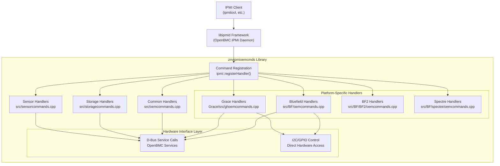
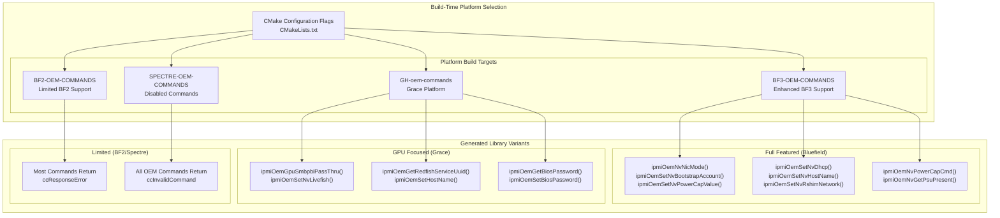
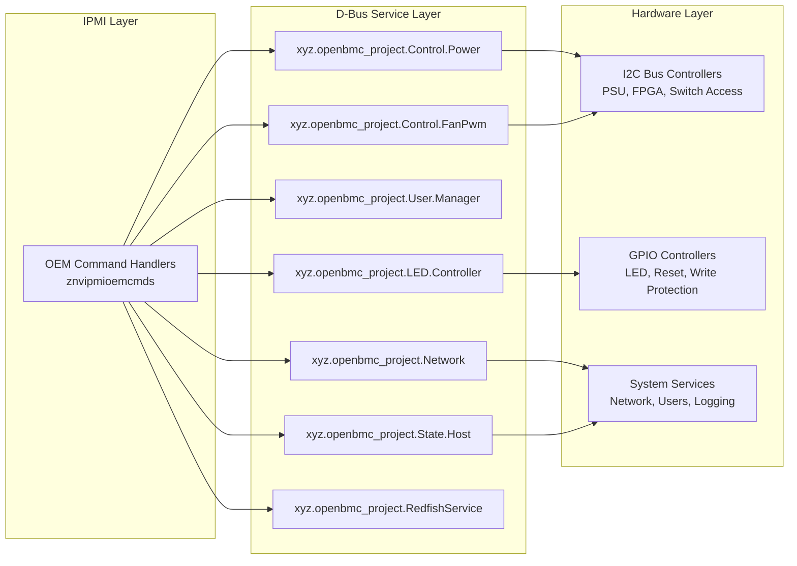

<!-- source: DeepWiki mcp.deepwiki.com · repo NVIDIA/nvidia-ipmi-oem · page 1 Overview · fetched 2026-10-26 -->

# Overview

Relevant source files

The following files were used as context for generating this wiki page:

- [.gitignore](.gitignore)
- [CMakeLists.txt](CMakeLists.txt)
- [README.md](README.md)
- [src/BF/chassiscommands.cpp](src/BF/chassiscommands.cpp)

This document provides an overview of the NVIDIA IPMI OEM Commands library, a platform-specific extension to the OpenBMC IPMI implementation that enables hardware management and control for NVIDIA server platforms including Bluefield DPUs and Grace systems.

## Purpose and Scope

The NVIDIA IPMI OEM Commands library (`znvipmioemcmds`) extends the standard IPMI command set with platform-specific OEM commands tailored for NVIDIA hardware platforms. The library integrates with the OpenBMC ecosystem, providing out-of-band management capabilities for system monitoring, power control, thermal management, and hardware configuration across different NVIDIA platform variants.

The library serves as an IPMI provider that registers custom command handlers with the OpenBMC `libipmid` framework, enabling remote management through standard IPMI interfaces while exposing NVIDIA-specific functionality. For detailed information about specific platform implementations, see [Bluefield Platform](#3.1) and [Grace Platform](#3.2). For architecture details, see [System Architecture](#2).

## Library Architecture

The library is structured around a platform-differentiated architecture that provides common infrastructure while enabling platform-specific customizations:

### IPMI Command Registration and Processing Flow

*Sources: [CMakeLists.txt:114-189](), [src/BF/chassiscommands.cpp:76-151]()*

### Platform Differentiation Strategy

The library implements a graduated feature support model where different platforms receive different levels of OEM command functionality:

*Sources: [CMakeLists.txt:120-150](), [CMakeLists.txt:185-189]()*

## Core Functional Areas

The library provides management capabilities across several key functional domains:

| Functional Area | Primary Platforms | Key Commands | Integration Method |
|-----------------|-------------------|--------------|-------------------|
| Network Management | Bluefield, Grace | `ipmiOemSetNvDhcp`, `ipmiOemSetNvHostName` | D-Bus services |
| Power Management | Bluefield | `ipmiOemNvPowerCapCmd`, `ipmiOemGetPowerSupplyInfo` | D-Bus + I2C |
| Thermal Control | All platforms | `ipmiOemNvSetFanPwm`, `ipmiOemNvGetFanPwm` | D-Bus fan services |
| Hardware Status | All platforms | `ipmiOemNvGetPsuPresent`, `ipmiOemNvGetLedStatus` | I2C + GPIO |
| User Management | Bluefield | `ipmiOemSetNvBootstrapAccount` | D-Bus user services |
| GPU Management | Grace | `ipmiOemGpuSmbpbiPassThru` | Direct I2C passthrough |
| Storage/FRU | All platforms | FRU read/write, SDR management | IPMI storage layer |

*Sources: [CMakeLists.txt:114-117](), [src/BF/chassiscommands.cpp:1-16]()*

## Integration with OpenBMC

The library leverages the OpenBMC D-Bus architecture for most system interactions, providing a clean separation between IPMI protocol handling and actual system management:

*Sources: [src/BF/chassiscommands.cpp:40-74](), [CMakeLists.txt:96-99]()*

## Build System and Configuration

The library uses CMake with extensive conditional compilation to support multiple platform variants from a single codebase. Key configuration options include:

- **Platform Selection**: `GH-oem-commands`, `BF2-OEM-COMMANDS`, `BF3-OEM-COMMANDS`, `SPECTRE-OEM-COMMANDS`
- **Feature Toggles**: `disable-smbpbi-passthru`, `custom-pwm-fan`, `cpu-diag-enable`
- **Hardware Configuration**: `WP-GPIO`, `chassis-write-protect`, `gb200-fan-enable`

The build system generates the `znvipmioemcmds` shared library that integrates with the OpenBMC `libipmid` framework as a provider plugin.

*Sources: [CMakeLists.txt:1-236](), [README.md:1-2]()*

This overview establishes the foundation for understanding the NVIDIA IPMI OEM Commands library's role in providing platform-specific hardware management capabilities within the OpenBMC ecosystem. For detailed implementation specifics, refer to the relevant platform and functional area documentation sections.

---

