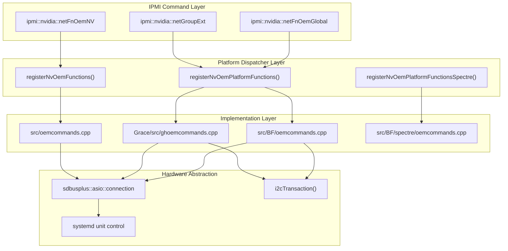
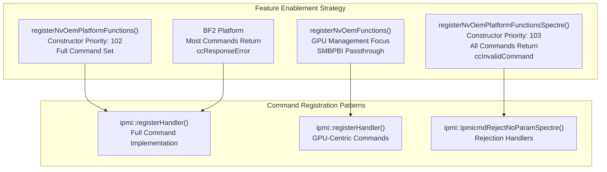
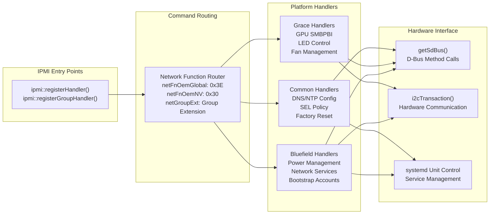
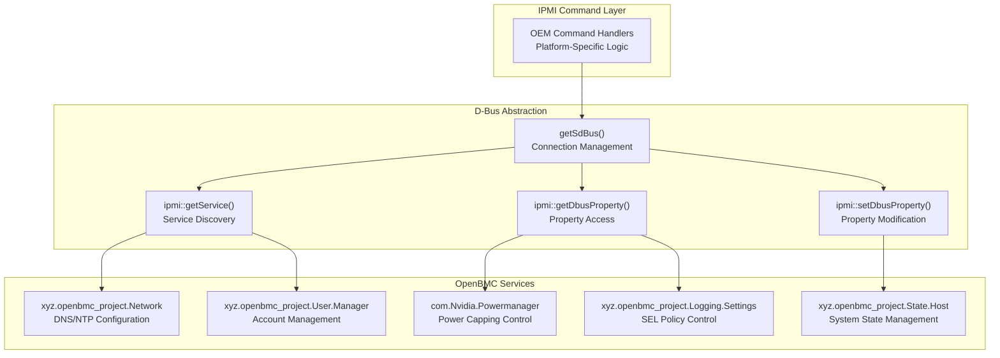
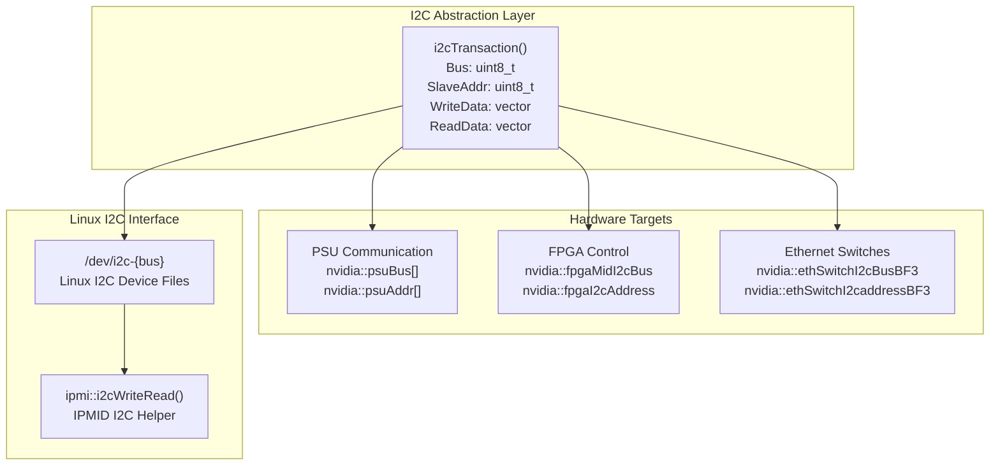
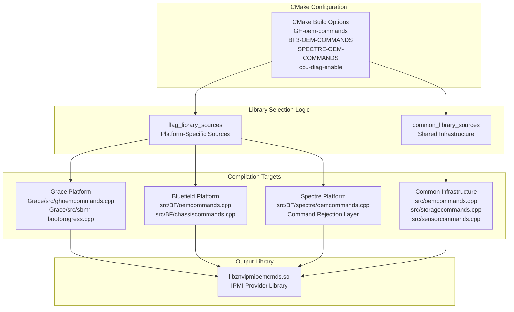

<!-- source: DeepWiki mcp.deepwiki.com · repo NVIDIA/nvidia-ipmi-oem · page 2 System Architecture · fetched 2026-10-26 -->

# System Architecture

Relevant source files

The following files were used as context for generating this wiki page:

- [CMakeLists.txt](CMakeLists.txt)
- [Grace/src/ghoemcommands.cpp](Grace/src/ghoemcommands.cpp)
- [src/BF/chassiscommands.cpp](src/BF/chassiscommands.cpp)
- [src/BF/oemcommands.cpp](src/BF/oemcommands.cpp)
- [src/BF/spectre/oemcommands.cpp](src/BF/spectre/oemcommands.cpp)
- [src/oemcommands.cpp](src/oemcommands.cpp)

This document describes the high-level system architecture of the NVIDIA IPMI OEM Commands library (`znvipmioemcmds`). It covers the platform differentiation strategy, command processing pipeline, hardware abstraction mechanisms, and build system organization that enable unified IPMI management across different NVIDIA hardware platforms.

For platform-specific implementation details, see [Bluefield Platform](#3.1), [Grace Platform](#3.2), and [Platform Variants](#3.3). For hardware integration specifics, see [Hardware Integration](#5).

## Architectural Overview

The NVIDIA IPMI OEM Commands library implements a platform-centric architecture that provides unified IPMI management interfaces while supporting graduated feature sets across different NVIDIA hardware platforms. The system is built around three core architectural principles: platform abstraction, shared infrastructure, and conditional compilation.

**Sources:** [src/BF/oemcommands.cpp:229](), [Grace/src/ghoemcommands.cpp:132](), [src/oemcommands.cpp:201](), [src/BF/spectre/oemcommands.cpp:52]()

## Platform Differentiation Strategy

The system implements a graduated feature support model where different NVIDIA platforms expose different subsets of OEM commands based on their hardware capabilities and intended use cases.

### Platform Support Matrix

| Platform | Implementation File | Feature Level | Constructor Priority |
|----------|-------------------|---------------|---------------------|
| Bluefield | `src/BF/oemcommands.cpp` | Full Featured | 102 |
| Grace | `Grace/src/ghoemcommands.cpp` | GPU Focused | Default |
| BF2 | `src/BF/BF2/oemcommands.cpp` | Limited | N/A |
| Spectre | `src/BF/spectre/oemcommands.cpp` | Disabled | 103 |

**Sources:** [src/BF/oemcommands.cpp:229](), [Grace/src/ghoemcommands.cpp:132](), [src/BF/spectre/oemcommands.cpp:112](), [CMakeLists.txt:185-189]()

## Command Processing Pipeline

The IPMI command processing follows a structured pipeline that routes commands through platform-specific handlers while maintaining common infrastructure for shared functionality.

**Sources:** [src/BF/oemcommands.cpp:2150-2250](), [Grace/src/ghoemcommands.cpp:1850-1950](), [src/oemcommands.cpp:3400-3500]()

## Hardware Abstraction Layer

The system provides a unified hardware abstraction layer that enables platform-agnostic access to various hardware subsystems through standardized interfaces.

### D-Bus Service Integration

**Sources:** [src/oemcommands.cpp:52-55](), [src/BF/oemcommands.cpp:68-89](), [Grace/src/ghoemcommands.cpp:89-93]()

### I2C Hardware Communication

The system provides direct hardware access through a standardized I2C transaction interface that abstracts low-level hardware communication details.

**Sources:** [src/oemcommands.cpp:340-361](), [src/BF/oemcommands.cpp:372-393](), [Grace/src/ghoemcommands.cpp:328-349]()

## Build System Architecture

The build system implements a flexible configuration mechanism that enables conditional compilation of platform-specific features and commands through CMake options and preprocessor definitions.

### Conditional Compilation Strategy

**Sources:** [CMakeLists.txt:120-150](), [CMakeLists.txt:185-189](), [CMakeLists.txt:195-197]()

### Feature Enablement Matrix

| CMake Option | Preprocessor Define | Affected Files | Purpose |
|--------------|-------------------|----------------|---------|
| `GH-oem-commands` | N/A | `Grace/src/ghoemcommands.cpp` | Enable Grace platform support |
| `BF3-OEM-COMMANDS` | `BF3_OEM_COMMANDS` | `src/BF/oemcommands.cpp` | Enable BF3 platform features |
| `SPECTRE-OEM-COMMANDS` | N/A | `src/BF/spectre/oemcommands.cpp` | Enable Spectre rejection handlers |
| `cpu-diag-enable` | `CPU_DIAG_ENABLE` | `Grace/src/ghoemcommands.cpp` | Enable CPU diagnostic commands |
| `gb200nvl-oem-commands` | `GB200NVL_OEM_COMMANDS` | Multiple files | Enable GB200NVL specific features |

**Sources:** [CMakeLists.txt:22-24](), [CMakeLists.txt:126-148](), [CMakeLists.txt:178-183]()

---

