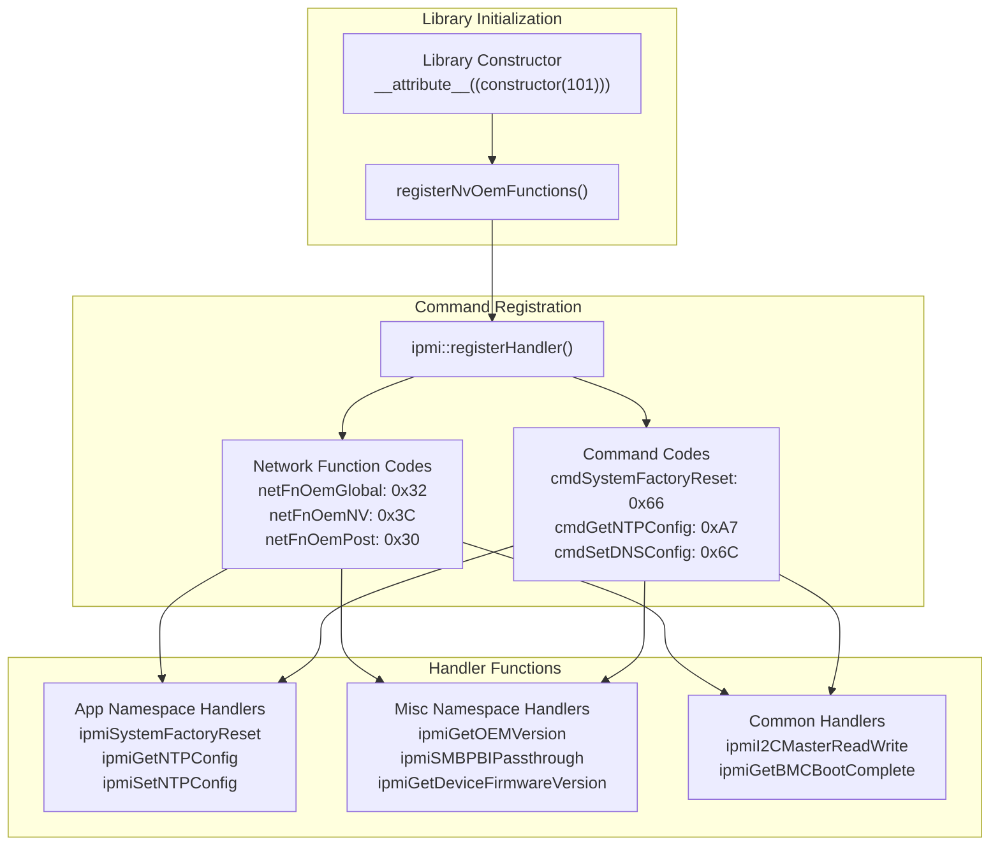
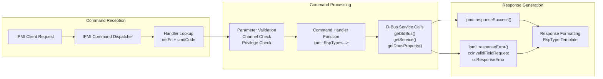
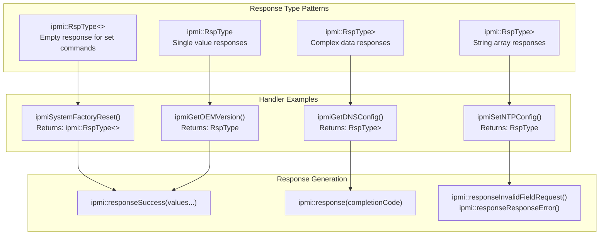
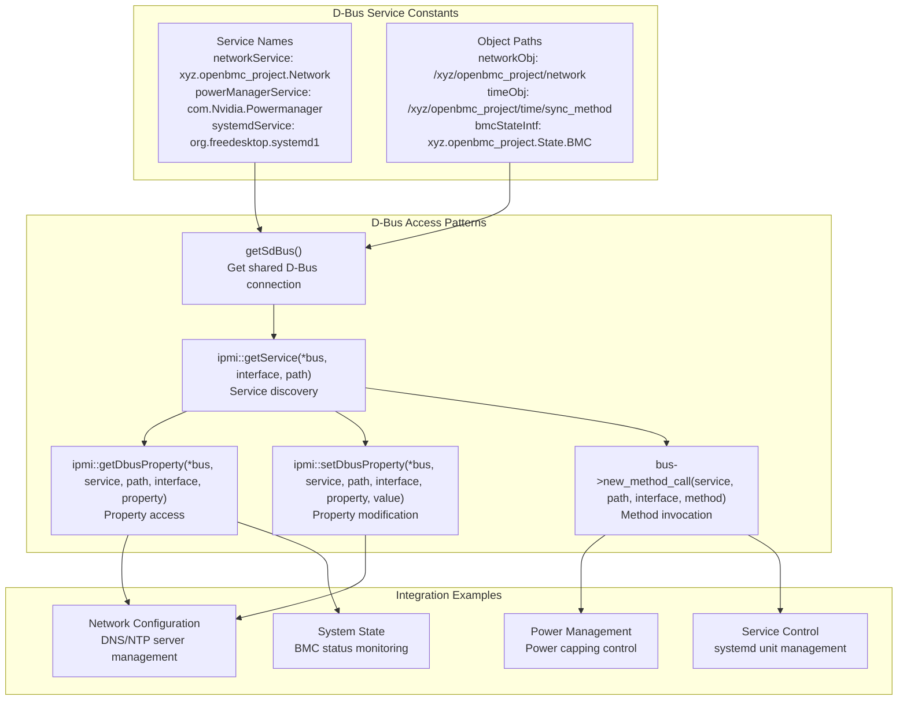
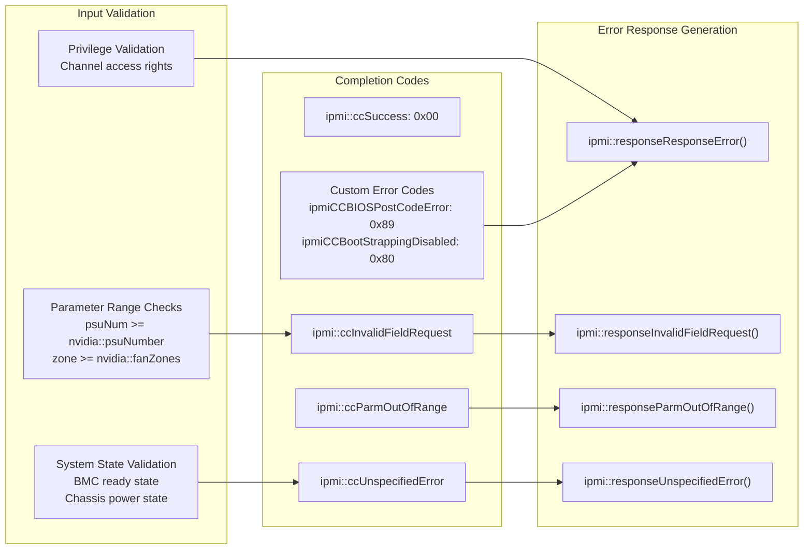
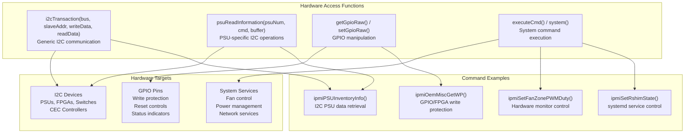

<!-- source: DeepWiki mcp.deepwiki.com · repo NVIDIA/nvidia-ipmi-oem · page 2.1 IPMI Command Processing · fetched 2026-10-26 -->

# IPMI Command Processing

Relevant source files

The following files were used as context for generating this wiki page:

- [include/oemcommands.hpp](include/oemcommands.hpp)
- [src/oemcommands.cpp](src/oemcommands.cpp)

This document explains how IPMI commands are registered, dispatched, and processed within the NVIDIA IPMI OEM Commands library. It covers the common infrastructure used across all platform implementations for handling IPMI protocol interactions, command validation, and response generation.

For platform-specific command implementations, see [Bluefield Platform](#3.1), [Grace Platform](#3.2), and [Platform Variants](#3.3). For details on D-Bus service integration patterns, see [D-Bus Service Integration](#2.2).

## Command Registration Architecture

The IPMI command processing system uses a registration-based architecture where command handlers are automatically registered during library initialization. The registration process maps network function and command code combinations to specific handler functions.

Sources: [src/oemcommands.cpp:201](), [include/oemcommands.hpp:26-30](), [include/oemcommands.hpp:32-57](), [include/oemcommands.hpp:59-163]()

## Command Processing Flow

When an IPMI command is received, it follows a standardized processing pattern that includes validation, execution, and response formatting. The system uses template-based response types to ensure type safety and consistent formatting.

Sources: [src/oemcommands.cpp:275-330](), [src/oemcommands.cpp:428-474](), [src/oemcommands.cpp:517-610]()

## Handler Implementation Patterns

IPMI command handlers follow consistent implementation patterns using templated response types and standardized error handling. The system provides a rich set of response types and completion codes for different scenarios.

### Response Type Templates

The command handlers use `ipmi::RspType` templates to define strongly-typed return values:

Sources: [src/oemcommands.cpp:275](), [src/oemcommands.cpp:1116-1122](), [src/oemcommands.cpp:428](), [src/oemcommands.cpp:612]()

## D-Bus Integration Patterns

Command handlers integrate with OpenBMC D-Bus services using standardized patterns for service discovery, property access, and method calls. The system maintains service name and object path constants for consistency.

Sources: [src/oemcommands.cpp:52-108](), [src/oemcommands.cpp:238-273](), [src/oemcommands.cpp:534-556](), [src/oemcommands.cpp:1056-1070]()

## Error Handling and Validation

The system implements comprehensive error handling with standardized completion codes and validation patterns. Commands validate parameters, check system state, and handle D-Bus communication failures gracefully.

### Validation Patterns

Sources: [src/oemcommands.cpp:366-384](), [src/oemcommands.cpp:1433-1436](), [src/oemcommands.cpp:215-221](), [src/oemcommands.cpp:1771-1781]()

## Hardware Abstraction Layer

Command handlers access hardware through abstraction layers that provide consistent interfaces for I2C communication, GPIO control, and system service interaction. This abstraction enables platform portability while maintaining hardware-specific optimization.

Sources: [src/oemcommands.cpp:340-384](), [src/oemcommands.cpp:1427-1517](), [src/oemcommands.cpp:2405-2427](), [src/oemcommands.cpp:1024-1072]()

---

