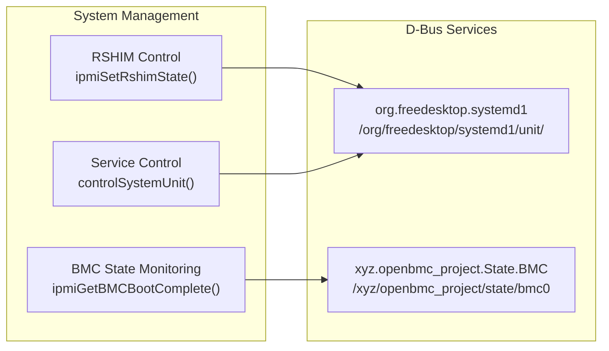
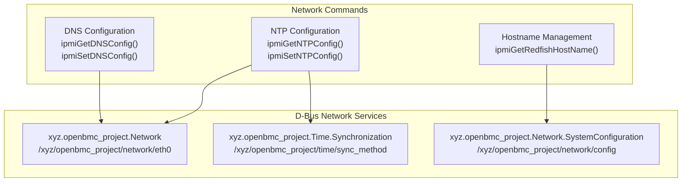
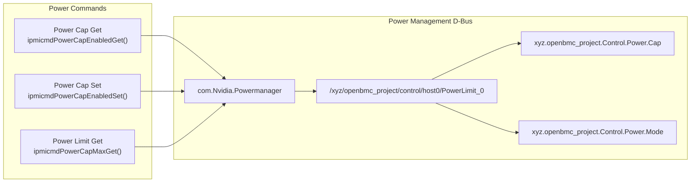
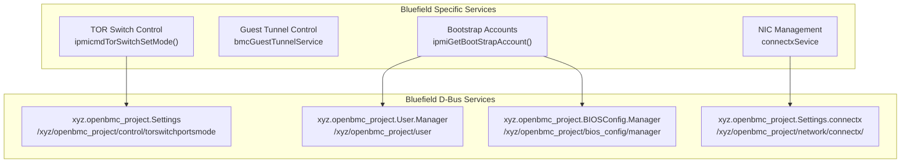
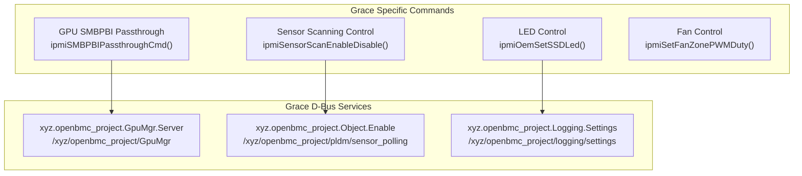
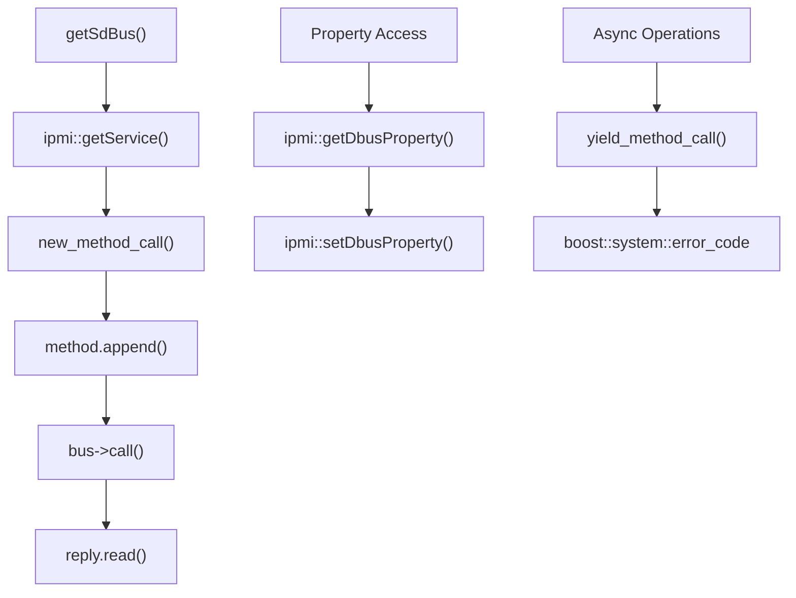
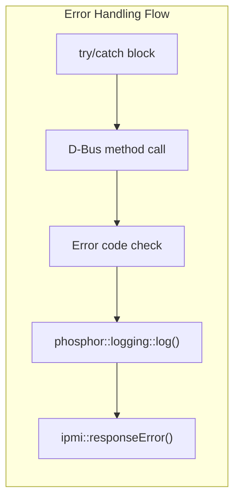

<!-- source: DeepWiki mcp.deepwiki.com · repo NVIDIA/nvidia-ipmi-oem · page 2.2 D-Bus Service Integration · fetched 2026-10-26 -->

# D-Bus Service Integration

Relevant source files

The following files were used as context for generating this wiki page:

- [Grace/src/ghoemcommands.cpp](Grace/src/ghoemcommands.cpp)
- [src/BF/oemcommands.cpp](src/BF/oemcommands.cpp)
- [src/BF/spectre/oemcommands.cpp](src/BF/spectre/oemcommands.cpp)
- [src/oemcommands.cpp](src/oemcommands.cpp)

## Purpose and Scope

This document describes how the NVIDIA IPMI OEM Commands library integrates with OpenBMC D-Bus services to provide system management functionality. The library acts as a bridge between IPMI protocol commands and the underlying OpenBMC D-Bus ecosystem, enabling remote management of NVIDIA hardware platforms through standardized IPMI interfaces.

For information about the overall system architecture, see [System Architecture](#2). For platform-specific implementations, see [Platform Implementations](#3).

## D-Bus Integration Architecture

The NVIDIA IPMI OEM Commands library implements a layered approach to D-Bus service integration, where IPMI command handlers communicate with various OpenBMC services through the D-Bus message bus.

### Overall D-Bus Service Integration Flow

```mermaid
graph TB
    subgraph "IPMI Command Layer"
        BF_Handlers["Bluefield Handlers<br/>src/BF/oemcommands.cpp"]
        Grace_Handlers["Grace Handlers<br/>Grace/src/ghoemcommands.cpp"]
        Common_Handlers["Common Handlers<br/>src/oemcommands.cpp"]
    end
    
    subgraph "D-Bus Service Categories"
        SystemMgmt["System Management<br/>systemd, BMC state"]
        NetworkSvc["Network Services<br/>DNS, NTP, Network Config"]
        PowerMgmt["Power Management<br/>Power capping, Control"]
        UserMgmt["User Management<br/>Accounts, Authentication"]
        HardwareCtrl["Hardware Control<br/>GPU, Sensors, I2C"]
        StorageMgmt["Storage Management<br/>Software updates, FRU"]
    end
    
    subgraph "OpenBMC D-Bus Services"
        Systemd["org.freedesktop.systemd1"]
        NetworkService["xyz.openbmc_project.Network"]
        PowerService["com.Nvidia.Powermanager"]
        UserService["xyz.openbmc_project.User.Manager"]
        GpuService["xyz.openbmc_project.GpuMgr.Server"]
        LoggingService["xyz.openbmc_project.Logging"]
        TimeService["xyz.openbmc_project.Time.Synchronization"]
        BiosService["xyz.openbmc_project.BIOSConfig.Manager"]
    end
    
    BF_Handlers --> SystemMgmt
    BF_Handlers --> NetworkSvc
    BF_Handlers --> PowerMgmt
    Grace_Handlers --> HardwareCtrl
    Grace_Handlers --> UserMgmt
    Common_Handlers --> StorageMgmt
    Common_Handlers --> NetworkSvc
    
    SystemMgmt --> Systemd
    NetworkSvc --> NetworkService
    NetworkSvc --> TimeService
    PowerMgmt --> PowerService
    UserMgmt --> UserService
    UserMgmt --> BiosService
    HardwareCtrl --> GpuService
    StorageMgmt --> LoggingService
```

Sources: [src/BF/oemcommands.cpp:68-148](), [src/oemcommands.cpp:52-200](), [Grace/src/ghoemcommands.cpp:64-125]()

## Core D-Bus Service Categories

### System Management Services

The library integrates with systemd and BMC state management services to control system-level operations.

Key service objects and interfaces:
- **systemdService**: `"org.freedesktop.systemd1"`
- **systemdUnitIntf**: `"org.freedesktop.systemd1.Unit"`
- **rshimSystemdObj**: `"/org/freedesktop/systemd1/unit/rshim_2eservice"`
- **bmcStateIntf**: `"xyz.openbmc_project.State.BMC"`

Sources: [src/oemcommands.cpp:74-82](), [src/BF/oemcommands.cpp:68-72](), [Grace/src/ghoemcommands.cpp:650-668]()

### Network Configuration Services

Network services handle DNS, NTP, and general network configuration management.

Key properties managed:
- **StaticNameServers**: DNS server configuration
- **StaticNTPServers**: NTP server configuration  
- **TimeSyncMethod**: NTP enable/disable control
- **HostName**: System hostname

Sources: [src/oemcommands.cpp:428-749](), [Grace/src/ghoemcommands.cpp:1014-1035]()

### Power Management Services

Power management integration provides control over power capping and monitoring.

Sources: [src/BF/oemcommands.cpp:82-88](), [src/oemcommands.cpp:93-109]()

## Platform-Specific D-Bus Integration

### Bluefield Platform Integration

Bluefield platforms implement extensive D-Bus integration for DPU-specific functionality.

Key Bluefield-specific D-Bus objects:
- **ctlBMCtorSwitchModeService**: `"xyz.openbmc_project.Settings"`
- **ctlBMCtorSwitchModeBMCObj**: `"/xyz/openbmc_project/control/torswitchportsmode"`
- **connectxSevice**: `"xyz.openbmc_project.Settings.connectx"`

Sources: [src/BF/oemcommands.cpp:74-148](), [src/BF/oemcommands.cpp:924-1053](), [src/BF/oemcommands.cpp:1062-1117]()

### Grace Platform Integration  

Grace platforms focus on GPU management and sensor control through D-Bus services.

Key Grace-specific interfaces:
- **gpuSMBPBIIntf**: `"xyz.openbmc_project.GpuMgr.Server"`
- **pldmPollingIntf**: `"xyz.openbmc_project.Object.Enable"`

Sources: [Grace/src/ghoemcommands.cpp:167-275](), [Grace/src/ghoemcommands.cpp:677-712](), [Grace/src/ghoemcommands.cpp:746-834]()

## D-Bus Interaction Patterns

### Service Discovery Pattern

The library uses a consistent pattern for D-Bus service discovery and interaction.

### Error Handling Pattern

D-Bus operations implement consistent error handling across all platform implementations.

Common error handling patterns:
- Try-catch blocks around D-Bus calls
- Boost error code checking for async operations
- Phosphor logging for error reporting
- IPMI completion code mapping

Sources: [src/oemcommands.cpp:275-330](), [src/BF/oemcommands.cpp:355-370](), [Grace/src/ghoemcommands.cpp:896-923]()

## Property Management

### Property Access Methods

The library implements standardized methods for D-Bus property access across all platforms.

| Function | Purpose | Usage Pattern |
|----------|---------|---------------|
| `ipmi::getDbusProperty()` | Read D-Bus properties | Service discovery + property read |
| `ipmi::setDbusProperty()` | Write D-Bus properties | Service discovery + property write |
| `dbusctlSetGetProperty()` | Custom property access | String-based property operations |

### Common Property Types

| Property Type | D-Bus Type | Usage |
|---------------|------------|-------|
| Boolean flags | `bool` | Enable/disable settings |
| String values | `std::string` | Hostnames, service names |
| String arrays | `std::vector<std::string>` | DNS/NTP server lists |
| Numeric values | `uint64_t`, `uint32_t` | Timestamps, power values |

Sources: [src/oemcommands.cpp:230-273](), [src/BF/oemcommands.cpp:1064-1081](), [Grace/src/ghoemcommands.cpp:1360-1377]()

# D-Bus Service Integration

This document provides a comprehensive overview of how the NVIDIA IPMI OEM Commands library integrates with the OpenBMC D-Bus ecosystem to provide platform management capabilities across different NVIDIA hardware platforms.

---

