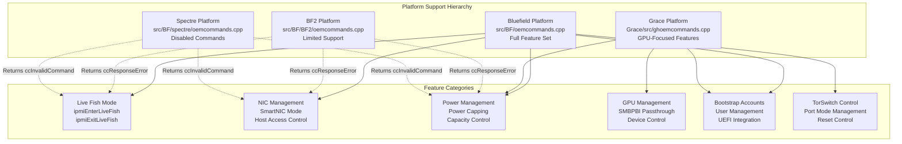
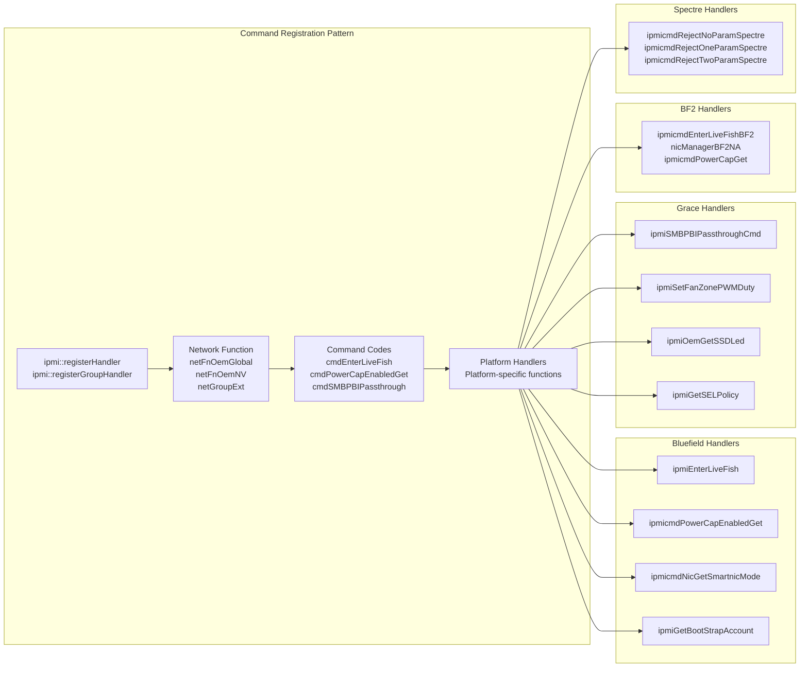
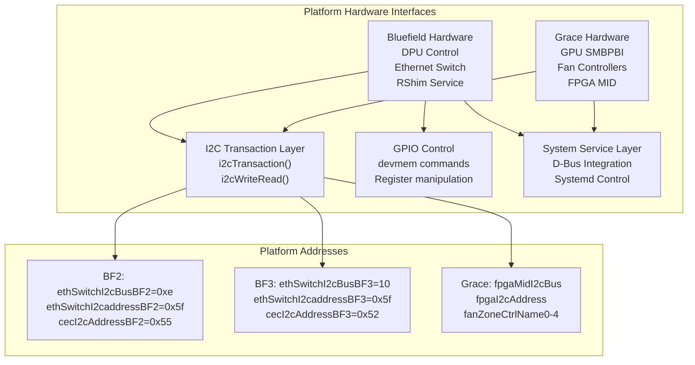

<!-- source: DeepWiki mcp.deepwiki.com · repo NVIDIA/nvidia-ipmi-oem · page 3 Platform Implementations · fetched 2026-10-26 -->

# Platform Implementations

<details>
<summary>Relevant source files</summary>

The following files were used as context for generating this wiki page:

- [Grace/src/ghoemcommands.cpp](Grace/src/ghoemcommands.cpp)
- [include/oemcommandsBF.hpp](include/oemcommandsBF.hpp)
- [src/BF/BF2/oemcommands.cpp](src/BF/BF2/oemcommands.cpp)
- [src/BF/oemcommands.cpp](src/BF/oemcommands.cpp)
- [src/BF/spectre/oemcommands.cpp](src/BF/spectre/oemcommands.cpp)

</details>


This document covers the platform-specific implementations within the NVIDIA IPMI OEM Commands library, detailing how different NVIDIA hardware platforms are supported through a graduated feature model. For information about the overall system architecture and command processing flow, see [System Architecture](#2). For details about common infrastructure shared across platforms, see [Common Infrastructure](#4).

## Platform Differentiation Strategy

The codebase implements a platform-centric design that provides different levels of OEM command support based on the target hardware platform. This graduated support model allows the same codebase to serve multiple NVIDIA platforms while optimizing functionality for each platform's specific capabilities and requirements.

## Platform Support Levels



**Sources:** [src/BF/oemcommands.cpp:1-100](), [Grace/src/ghoemcommands.cpp:1-100](), [src/BF/BF2/oemcommands.cpp:66-110](), [src/BF/spectre/oemcommands.cpp:58-110]()

## Platform Command Implementation Matrix



**Sources:** [src/BF/oemcommands.cpp:2800-3000](), [Grace/src/ghoemcommands.cpp:1800-2000](), [src/BF/BF2/oemcommands.cpp:111-206](), [src/BF/spectre/oemcommands.cpp:112-298]()

## Platform-Specific Feature Sets

### Bluefield Platform

The Bluefield platform provides the most comprehensive OEM command support, implementing full DPU (Data Processing Unit) management capabilities.

**Key Features:**
- **Live Fish Mode**: `ipmiEnterLiveFish` and `ipmiExitLiveFish` functions for firmware recovery
- **NIC Management**: SmartNIC mode control, host access privileges, external host privileges
- **Power Capping**: Complete power management with min/max capacity and percentage controls  
- **Bootstrap Accounts**: UEFI boot account management with `NvBluefieldUefi0` and `NvBluefieldUefi1` accounts
- **TorSwitch Control**: Ethernet switch port mode management
- **DPU Reset Control**: Multiple reset options including SOC hard reset and ARM soft reset
- **Network Reprovisioning**: Golden image update capabilities

**Sources:** [src/BF/oemcommands.cpp:323-570](), [src/BF/oemcommands.cpp:924-1050](), [src/BF/oemcommands.cpp:1400-1600]()

### Grace Platform  

The Grace platform focuses on GPU and system management with specialized hardware control capabilities.

**Key Features:**
- **GPU Management**: SMBPBI passthrough commands via `ipmiSMBPBIPassthroughCmd` and `ipmiSMBPBIPassthroughExtendedCmd`
- **Fan Control**: PWM duty cycle control through `ipmiSetFanZonePWMDuty` and zone management
- **LED Control**: SSD LED management with `ipmiOemGetSSDLed` and `ipmiOemSetSSDLed`
- **SEL Policy**: System Event Log policy management with linear/circular modes
- **BIOS Integration**: Redfish hostname retrieval and USB device description
- **I2C Communication**: Direct I2C master read/write operations via `ipmiI2CMasterReadWrite`

**Sources:** [Grace/src/ghoemcommands.cpp:167-275](), [Grace/src/ghoemcommands.cpp:463-605](), [Grace/src/ghoemcommands.cpp:714-834]()

### Platform Variants

#### BF2 Platform (Limited Support)

The BF2 platform provides minimal OEM command support, with most commands returning error responses.

**Command Rejection Pattern:**
```cpp
ipmi::RspType<uint8_t> ipmicmdEnterLiveFishBF2()
{
    phosphor::logging::log<phosphor::logging::level::ERR>(
        "Enter LiveFish command is unsupported in Bluefield 2");
    return ipmi::response(ipmi::ccResponseError);
}
```

**Sources:** [src/BF/BF2/oemcommands.cpp:66-100](), [src/BF/BF2/oemcommands.cpp:80-107]()

#### Spectre Platform (Disabled Commands)

The Spectre platform completely disables OEM command functionality, returning `ccInvalidCommand` for all requests.

**Universal Rejection Pattern:**
```cpp
ipmi::RspType<uint8_t> ipmicmdRejectNoParamSpectre()
{
    phosphor::logging::log<phosphor::logging::level::ERR>(
        "Command is unsupported on Spectre");
    return ipmi::response(ipmi::ccInvalidCommand);
}
```

**Sources:** [src/BF/spectre/oemcommands.cpp:58-110]()

## Constructor-Based Registration

Each platform uses constructor functions with different priorities to ensure proper initialization order:

| Platform | Constructor Function | Priority |
|----------|---------------------|----------|
| Common | `registerNvOemCommonFunctions()` | 101 |
| Bluefield | `registerNvOemPlatformFunctions()` | 102 |
| BF2 | `registerNvOemPlatformFunctionsBF2()` | 103 |
| Spectre | `registerNvOemPlatformFunctionsSpectre()` | 103 |
| Grace | `registerNvOemFunctions()` | default |

**Sources:** [src/BF/oemcommands.cpp:229](), [src/BF/BF2/oemcommands.cpp:52](), [src/BF/spectre/oemcommands.cpp:52](), [Grace/src/ghoemcommands.cpp:132]()

## Hardware Abstraction Layer



**Sources:** [include/oemcommandsBF.hpp:26-34](), [Grace/src/ghoemcommands.cpp:328-349](), [src/BF/oemcommands.cpp:372-393]()

---

