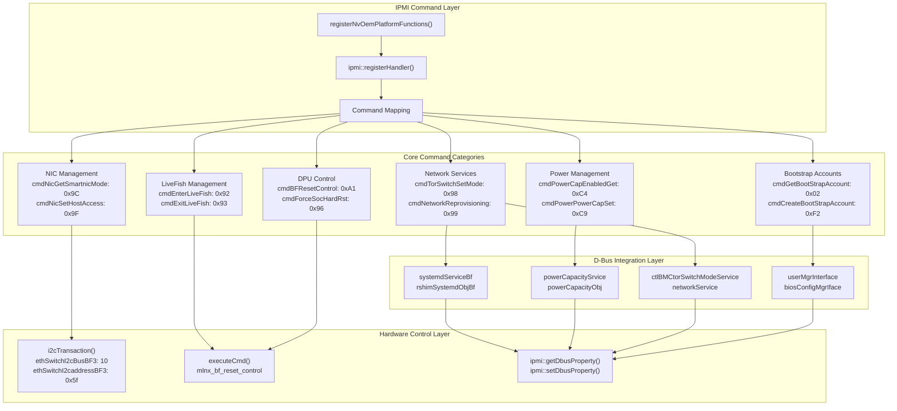
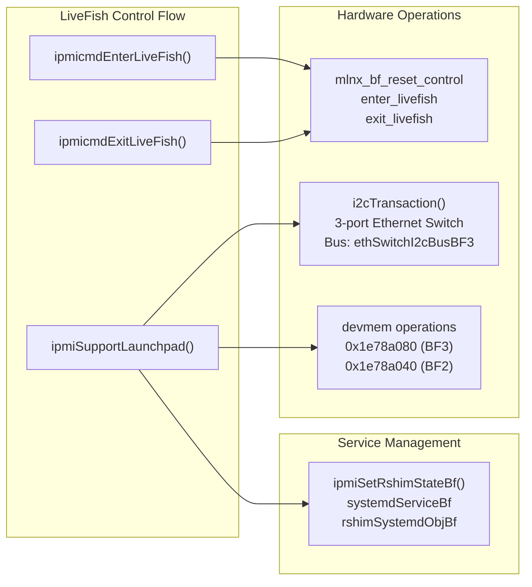
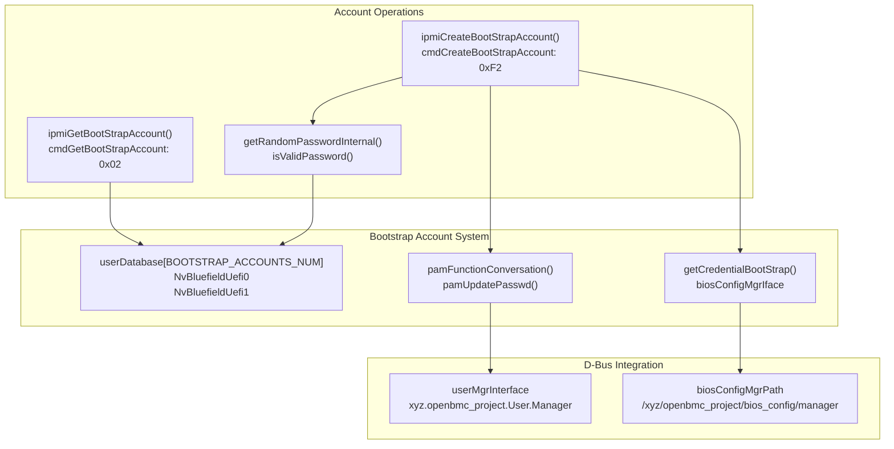
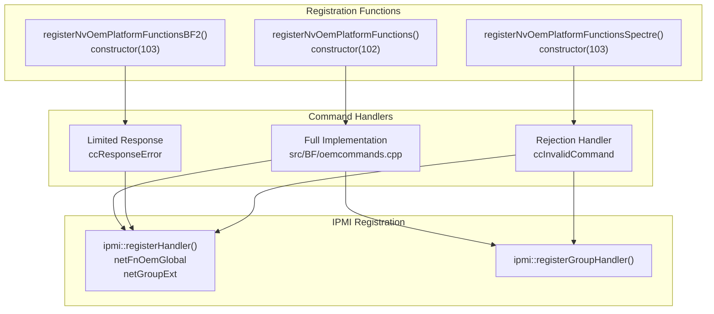

<!-- source: DeepWiki mcp.deepwiki.com · repo NVIDIA/nvidia-ipmi-oem · page 3.1 Bluefield Platform · fetched 2026-10-26 -->

# Bluefield Platform

Relevant source files

The following files were used as context for generating this wiki page:

- [include/oemcommandsBF.hpp](include/oemcommandsBF.hpp)
- [src/BF/BF2/oemcommands.cpp](src/BF/BF2/oemcommands.cpp)
- [src/BF/oemcommands.cpp](src/BF/oemcommands.cpp)
- [src/BF/spectre/oemcommands.cpp](src/BF/spectre/oemcommands.cpp)

## Purpose and Scope

The Bluefield Platform implementation provides comprehensive IPMI OEM command support for NVIDIA's Bluefield Data Processing Unit (DPU) systems. This platform offers the most feature-complete implementation within the NVIDIA IPMI OEM commands library, supporting advanced DPU management capabilities including LiveFish mode operations, network service control, power capping, and bootstrap account management.

For information about other platform implementations, see [Grace Platform](#3.2) and [Platform Variants](#3.3). For general OEM command infrastructure, see [Common Infrastructure](#4).

## Platform Architecture Overview

The Bluefield platform follows a layered architecture that integrates IPMI command processing with OpenBMC D-Bus services and direct hardware control mechanisms.

### Bluefield Platform Command Architecture

Sources: [src/BF/oemcommands.cpp:229](), [include/oemcommandsBF.hpp:47-82](), [src/BF/oemcommands.cpp:68-148]()

## Core Functionality Areas

### LiveFish Mode Management

LiveFish mode provides a special operational state for DPU debugging and maintenance. The Bluefield platform implements complete LiveFish lifecycle management through dedicated IPMI commands.

Sources: [src/BF/oemcommands.cpp:542-566](), [src/BF/oemcommands.cpp:395-483](), [src/BF/oemcommands.cpp:323-371]()

### Network Services Control

The platform manages multiple network services including RShim communication, TOR switch configuration, and guest tunnel services through integrated D-Bus and systemd interfaces.

**Key Network Service Constants:**
- `systemdServiceBf`: `"org.freedesktop.systemd1"`
- `ctlBMCtorSwitchModeService`: `"xyz.openbmc_project.Settings"`
- `bmcGuestTunnelService`: `"xyz.openbmc_project.Settings"`

Sources: [src/BF/oemcommands.cpp:68-107](), [src/BF/oemcommands.cpp:924-1053]()

### Power Capping Implementation

Power management capabilities include dynamic power cap configuration with minimum, maximum, and current power settings controlled through OpenBMC power management services.

**Power Service Integration:**
- Service: `com.Nvidia.Powermanager`
- Object Path: `/xyz/openbmc_project/control/host0/PowerLimit_0`
- Interfaces: `xyz.openbmc_project.Control.Power.Cap`, `xyz.openbmc_project.Control.Power.Mode`

Sources: [src/BF/oemcommands.cpp:82-89]()

### Bootstrap Account Management

The platform implements a sophisticated bootstrap account system with PAM integration for secure temporary account creation during system initialization.

Sources: [src/BF/oemcommands.cpp:256-274](), [src/BF/oemcommands.cpp:1062-1117](), [src/BF/oemcommands.cpp:1177-1281]()

## NIC Management and SmartNIC Features

The Bluefield platform provides comprehensive Network Interface Controller management including SmartNIC mode configuration, host access privileges, and OS state monitoring.

### NIC Attribute Management

The platform uses structured property mappings to manage NIC configurations through D-Bus services:

**Property Information Structures:**
- `nicAttributeInfo`: Binary enable/disable states
- `nicTristateAttributeInfo`: Default/enabled/disabled states  
- `smartNicOsStateInfo`: Comprehensive OS state tracking

**External Host Privileges:**
The system manages eight distinct host privilege categories through dedicated D-Bus object paths under `/xyz/openbmc_project/network/connectx/external_host_privileges/`.

Sources: [src/BF/oemcommands.cpp:131-139](), [src/BF/oemcommands.cpp:153-228]()

## Hardware Integration

### I2C Communication Layer

The platform implements direct I2C hardware communication for various subsystems including Ethernet switches and CEC controllers.

**I2C Bus Configuration:**
- **BF2**: Ethernet switch on bus `0xe`, address `0x5f`; CEC on bus `0x7`, address `0x55`
- **BF3**: Ethernet switch on bus `10`, address `0x5f`; CEC on bus `0xf`, address `0x52`

The `i2cTransaction()` function provides the core I2C communication interface with automatic resource management.

Sources: [src/BF/oemcommands.cpp:372-393](), [include/oemcommandsBF.hpp:26-34]()

## Platform Variants and Feature Support

### Bluefield Feature Matrix

| Platform | LiveFish | Power Capping | NIC Management | Bootstrap Accounts | TOR Switch |
|----------|----------|---------------|----------------|-------------------|------------|
| BF3 (Full) | ✓ | ✓ | ✓ | ✓ | ✓ |
| BF2 (Limited) | ✗ | ✗ | ✗ | ✓ | ✓ |
| Spectre | ✗ | ✗ | ✗ | ✗ | ✗ |

### Command Registration Architecture

Sources: [src/BF/oemcommands.cpp:229](), [src/BF/BF2/oemcommands.cpp:52-206](), [src/BF/spectre/oemcommands.cpp:52-298]()

The Bluefield platform demonstrates a comprehensive approach to DPU management, providing full-featured IPMI OEM command support with extensive hardware integration capabilities and robust service management through OpenBMC's D-Bus architecture.

---

