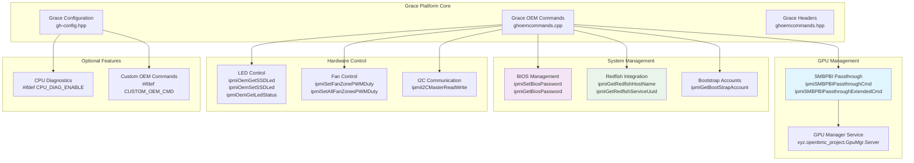
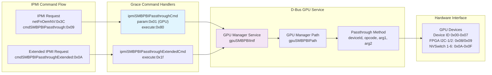
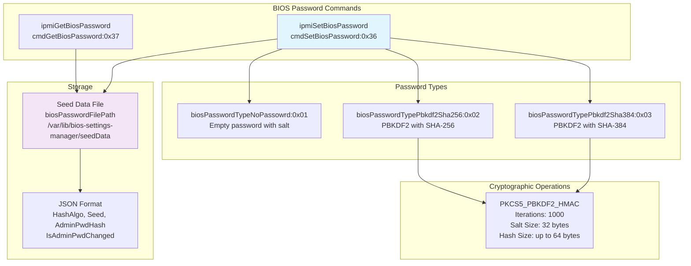
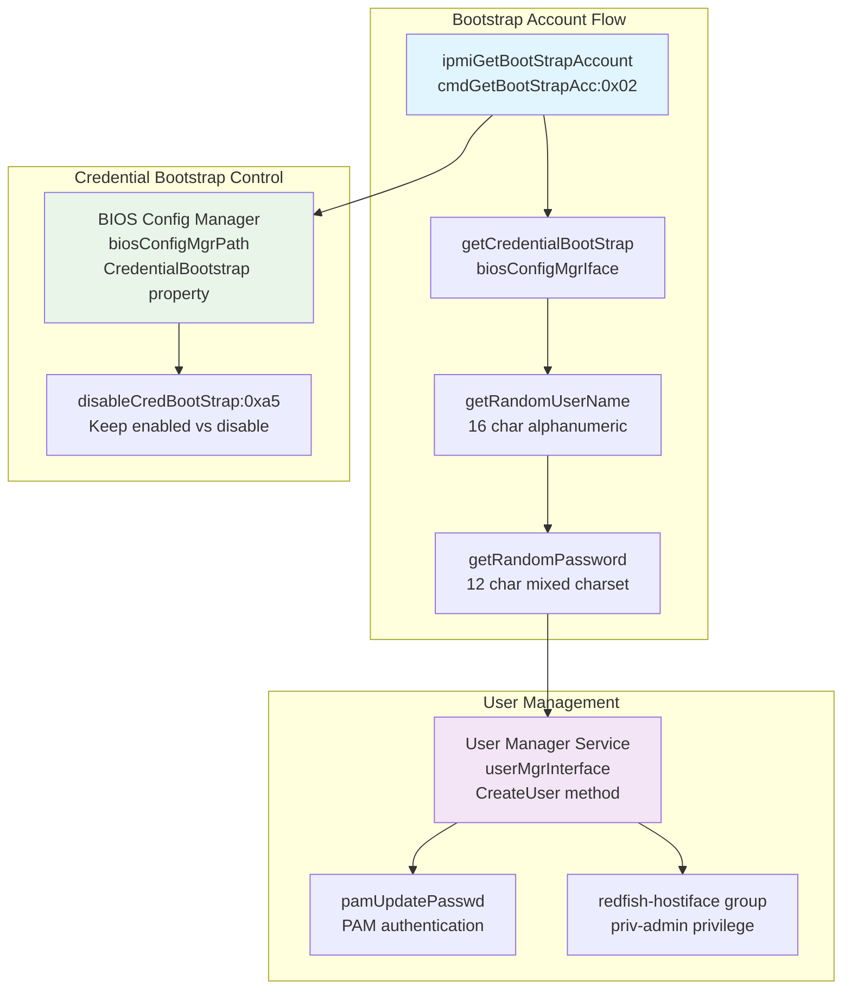
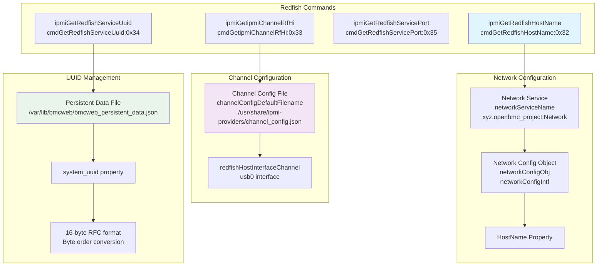
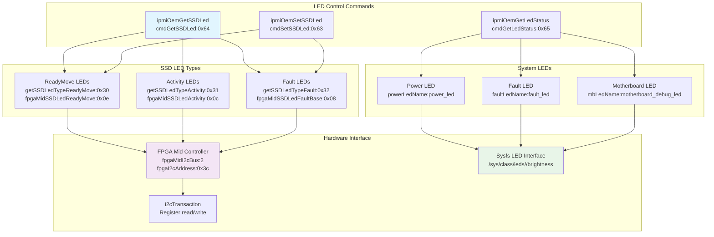
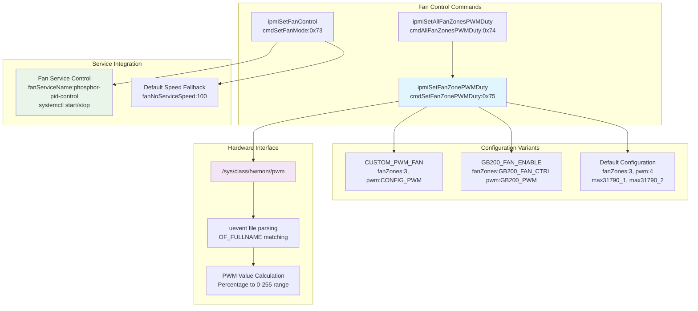
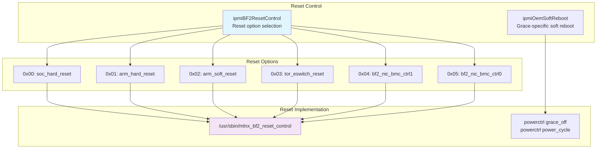
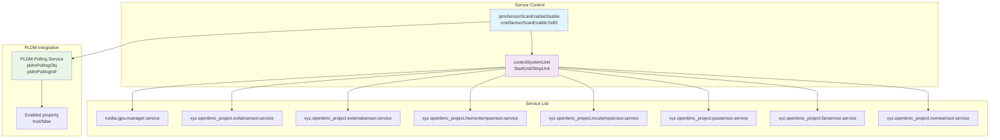
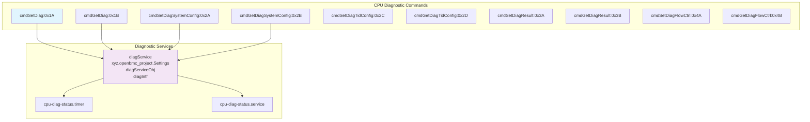

<!-- source: DeepWiki mcp.deepwiki.com · repo NVIDIA/nvidia-ipmi-oem · page 3.2 Grace Platform · fetched 2026-10-26 -->

# Grace Platform

Relevant source files

The following files were used as context for generating this wiki page:

- [Grace/include/gh-config.hpp](Grace/include/gh-config.hpp)
- [Grace/include/ghoemcommands.hpp](Grace/include/ghoemcommands.hpp)
- [Grace/src/ghoemcommands.cpp](Grace/src/ghoemcommands.cpp)

## Purpose and Scope

The Grace Platform implementation provides IPMI OEM command support specifically for NVIDIA Grace-based systems, focusing on GPU management, BIOS configuration, Redfish integration, and hardware control. This platform emphasizes GPU-centric operations through SMBPBI (System Management Bus Pass-through Bus Interface) passthrough capabilities, along with comprehensive system management features including LED control, fan management, and bootstrap account functionality.

For information about other platform implementations, see [Bluefield Platform](#3.1) and [Platform Variants](#3.3). For common infrastructure shared across platforms, see [Common Infrastructure](#4).

## Architecture Overview

The Grace Platform follows a modular architecture that integrates GPU management capabilities with standard BMC functionality through IPMI OEM commands.

### Grace Platform Command Architecture

Sources: [Grace/src/ghoemcommands.cpp:1-2000](), [Grace/include/gh-config.hpp:1-103](), [Grace/include/ghoemcommands.hpp:1-119]()

## GPU Management via SMBPBI

The Grace Platform's primary distinguishing feature is its GPU management capabilities through SMBPBI passthrough commands.

### SMBPBI Passthrough Implementation

Sources: [Grace/src/ghoemcommands.cpp:167-275](), [Grace/src/ghoemcommands.cpp:351-461](), [Grace/src/ghoemcommands.cpp:63-66]()

The SMBPBI implementation provides two command variants:

| Command | Execute Code | Device Support | Response Size |
|---------|-------------|----------------|---------------|
| `ipmiSMBPBIPassthroughCmd` | 0x80 | GPU only (param=0x01) | 9 bytes |
| `ipmiSMBPBIPassthroughExtendedCmd` | 0x1f | GPU, FPGA, NVSwitch | 13 bytes (includes extended data) |

## BIOS and Security Management

### BIOS Password Management

The Grace Platform includes comprehensive BIOS password management with support for multiple hashing algorithms.

Sources: [Grace/src/ghoemcommands.cpp:1232-1290](), [Grace/src/ghoemcommands.cpp:1292-1356](), [Grace/include/ghoemcommands.hpp:76-85]()

### Bootstrap Account Management

Sources: [Grace/src/ghoemcommands.cpp:1606-1723](), [Grace/src/ghoemcommands.cpp:1358-1404](), [Grace/src/ghoemcommands.cpp:1535-1554]()

## Redfish Integration

The Grace Platform provides comprehensive Redfish Host Interface support with multiple configuration endpoints.

### Redfish Service Information

| Command | Function | Return Data |
|---------|----------|-------------|
| `ipmiGetRedfishHostName` | Get system hostname | Variable length string |
| `ipmiGetRedfishServiceUuid` | Get service UUID | 16-byte UUID (RFC format) |
| `ipmiGetRedfishServicePort` | Get service port | 16-bit port (default: 443) |
| `ipmiGetipmiChannelRfHi` | Get IPMI channel for Redfish | Channel number for `usb0` |

Sources: [Grace/src/ghoemcommands.cpp:1014-1035](), [Grace/src/ghoemcommands.cpp:1037-1109](), [Grace/src/ghoemcommands.cpp:1146-1221](), [Grace/src/ghoemcommands.cpp:1223-1230]()

## Hardware Control Systems

### LED Control Implementation

The Grace Platform provides comprehensive LED control for both SSD activity indicators and system status LEDs.

Sources: [Grace/src/ghoemcommands.cpp:746-781](), [Grace/src/ghoemcommands.cpp:783-834](), [Grace/src/ghoemcommands.cpp:836-873](), [Grace/include/gh-config.hpp:72-83]()

### Fan Control System

The Grace Platform supports multiple fan control configurations through conditional compilation.

Sources: [Grace/src/ghoemcommands.cpp:463-574](), [Grace/src/ghoemcommands.cpp:576-605](), [Grace/src/ghoemcommands.cpp:607-638](), [Grace/include/gh-config.hpp:38-58]()

## System Management Features

### Reset Control and Power Management

Sources: [Grace/src/ghoemcommands.cpp:285-326](), [Grace/src/ghoemcommands.cpp:1799-1808]()

### Sensor and Service Management

Sources: [Grace/src/ghoemcommands.cpp:677-712](), [Grace/src/ghoemcommands.cpp:650-668](), [Grace/include/gh-config.hpp:60-70](), [Grace/src/ghoemcommands.cpp:78-80]()

## Platform Configuration

### Conditional Compilation Features

The Grace Platform uses extensive conditional compilation to support different hardware variants and optional features:

| Build Flag | Purpose | Impact |
|------------|---------|--------|
| `CUSTOM_PWM_FAN` | Custom PWM fan configuration | Configures fan zones and PWM counts |
| `GB200_FAN_ENABLE` | GB200-specific fan support | Enables 5-zone fan control |
| `CPU_DIAG_ENABLE` | CPU diagnostics support | Adds diagnostic commands and services |
| `CUSTOM_OEM_CMD` | Custom OEM command set | Modifies available sensor services |
| `GB200NVL_OEM_COMMANDS` | GB200 NVL variant | Disables certain sensor commands |

### I2C and Hardware Addressing

| Component | Bus | Address | Purpose |
|-----------|-----|---------|---------|
| FPGA Mid Controller | 2 | 0x3c | SSD LED control |
| GPIO Write Protect | gpiochip816 | 70 | Write protection control |

Sources: [Grace/include/gh-config.hpp:41-58](), [Grace/include/gh-config.hpp:78-86](), [Grace/include/gh-config.hpp:88-92]()

## Optional CPU Diagnostics

When `CPU_DIAG_ENABLE` is defined, the Grace Platform includes additional CPU diagnostic capabilities:

Sources: [Grace/include/ghoemcommands.hpp:98-109](), [Grace/include/gh-config.hpp:88-102]()

---

