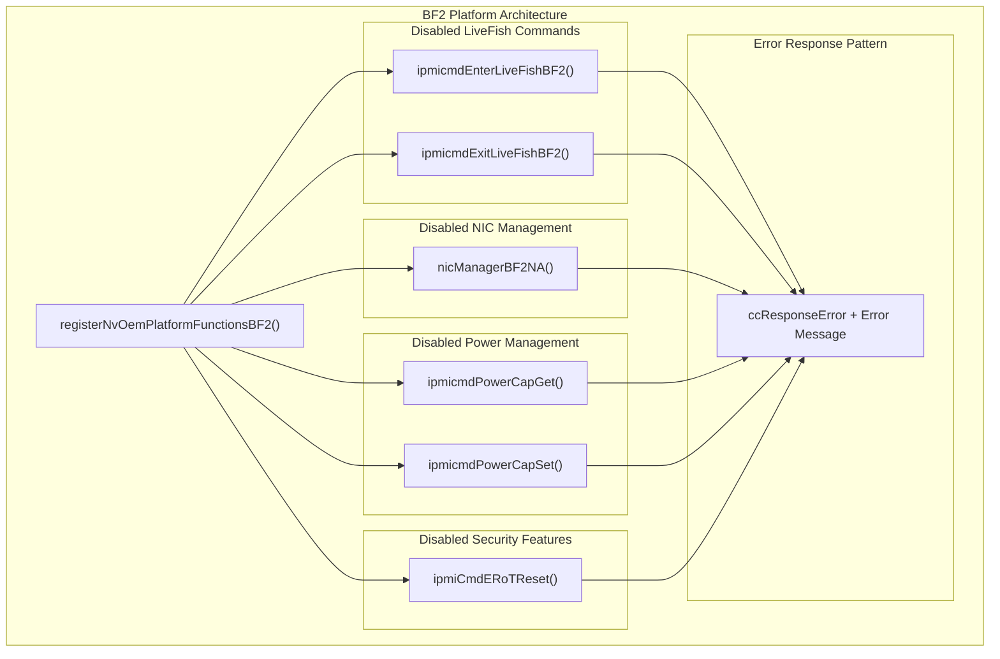
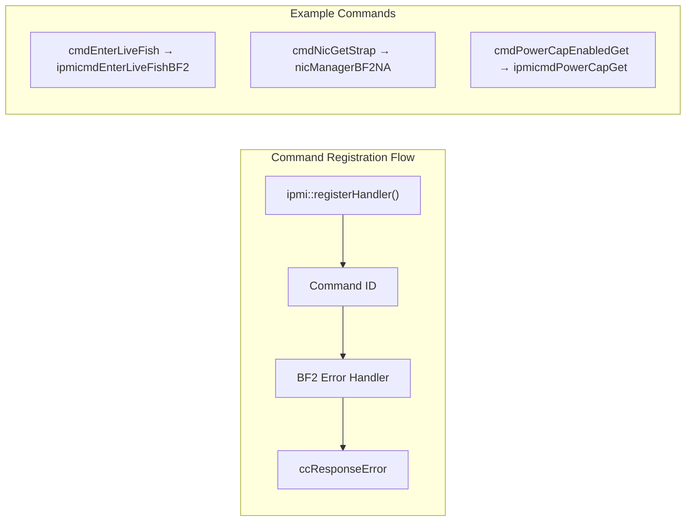
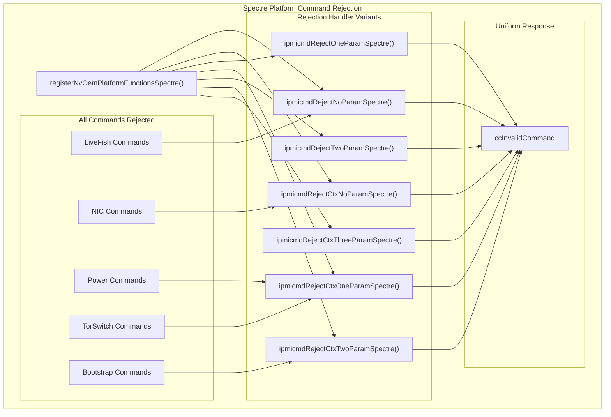
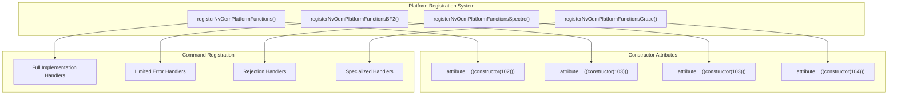
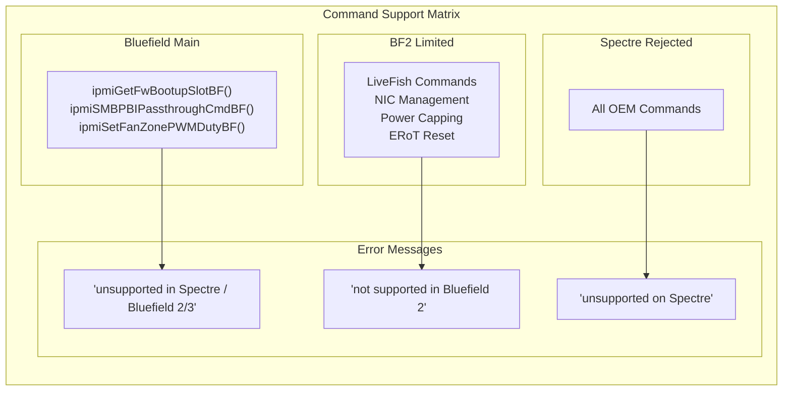

<!-- source: DeepWiki mcp.deepwiki.com · repo NVIDIA/nvidia-ipmi-oem · page 3.3 Platform Variants · fetched 2026-10-26 -->

# Platform Variants

Relevant source files

The following files were used as context for generating this wiki page:

- [include/oemcommandsBF.hpp](include/oemcommandsBF.hpp)
- [src/BF/BF2/oemcommands.cpp](src/BF/BF2/oemcommands.cpp)
- [src/BF/oemcommands.cpp](src/BF/oemcommands.cpp)
- [src/BF/spectre/oemcommands.cpp](src/BF/spectre/oemcommands.cpp)

This document covers the graduated feature support model implemented across different NVIDIA platform variants within the IPMI OEM commands library. It explains how BF2 provides limited command support and Spectre completely disables OEM commands, contrasting with the full-featured Bluefield and Grace platforms.

For information about the full-featured Bluefield platform implementation, see [Bluefield Platform](#3.1). For Grace platform specifics, see [Grace Platform](#3.2).

## Platform Support Matrix

The NVIDIA IPMI OEM commands library implements a tiered support model across different hardware platforms, with each variant providing different levels of functionality:

| Platform | Support Level | Error Response | Description |
|----------|---------------|----------------|-------------|
| Bluefield | Full Featured | N/A | Complete OEM command implementation |
| Grace | GPU Focused | N/A | Specialized GPU management commands |
| BF2 | Limited | `ccResponseError` | Basic functionality, most commands disabled |
| Spectre | Disabled | `ccInvalidCommand` | All OEM commands rejected |

## BF2 Platform Limited Support

The BF2 platform implements a subset of OEM commands with most advanced features disabled. Commands return `ipmi::ccResponseError` with descriptive error messages.

### BF2 Disabled Command Categories

**Sources:** [src/BF/BF2/oemcommands.cpp:111-206]()

### BF2 Command Registration Pattern

The BF2 platform registers command handlers that immediately return error responses:

**Sources:** [src/BF/BF2/oemcommands.cpp:117-203]()

### BF2 Specific Implementations

The BF2 platform provides specialized error handlers for different command categories:

- **LiveFish Mode Commands**: `ipmicmdEnterLiveFishBF2()` and `ipmicmdExitLiveFishBF2()` return "unsupported in Bluefield 2"
- **NIC Management**: `nicManagerBF2NA()` handles all NIC-related commands with "not supported in Bluefield 2"
- **Power Management**: `ipmicmdPowerCapGet()` and `ipmicmdPowerCapSet()` reject power capping functionality
- **Security Features**: `ipmiCmdERoTReset()` disables ERoT reset capabilities

**Sources:** [src/BF/BF2/oemcommands.cpp:66-107]()

## Spectre Platform Disabled Commands

The Spectre platform completely disables all OEM commands by returning `ipmi::ccInvalidCommand` for any OEM command request.

### Spectre Rejection Architecture

**Sources:** [src/BF/spectre/oemcommands.cpp:58-109](), [src/BF/spectre/oemcommands.cpp:112-298]()

### Spectre Command Registration

The Spectre platform uses a systematic approach to reject all OEM commands by providing multiple rejection handler variants to match different command signatures:

- **No Parameters**: `ipmicmdRejectNoParamSpectre()` for simple commands
- **Context Only**: `ipmicmdRejectCtxNoParamSpectre()` for context-aware commands  
- **Single Parameter**: `ipmicmdRejectOneParamSpectre()` and `ipmicmdRejectCtxOneParamSpectre()`
- **Multiple Parameters**: Up to three parameter variants with context support

All rejection handlers return the same response: `ipmi::response(ipmi::ccInvalidCommand)` with the message "Command is unsupported on Spectre".

**Sources:** [src/BF/spectre/oemcommands.cpp:58-109]()

## Cross-Platform Implementation Architecture

### Platform-Specific Constructor Pattern

**Sources:** [src/BF/oemcommands.cpp:229](), [src/BF/BF2/oemcommands.cpp:52](), [src/BF/spectre/oemcommands.cpp:52]()

### Error Response Differentiation

The platform variants use different IPMI completion codes to signal their support level:

| Platform | Completion Code | Meaning |
|----------|-----------------|---------|
| BF2 | `ccResponseError` | Command recognized but not supported |
| Spectre | `ccInvalidCommand` | Command not recognized/completely disabled |

This differentiation allows clients to understand whether a command might be supported on different hardware or is fundamentally unavailable.

**Sources:** [src/BF/BF2/oemcommands.cpp:70](), [src/BF/spectre/oemcommands.cpp:62]()

### Command Overlap Analysis

Some commands show cross-platform restrictions even in full-featured implementations:

**Sources:** [src/BF/oemcommands.cpp:665-892](), [src/BF/BF2/oemcommands.cpp:68-106](), [src/BF/spectre/oemcommands.cpp:60-108]()

---

