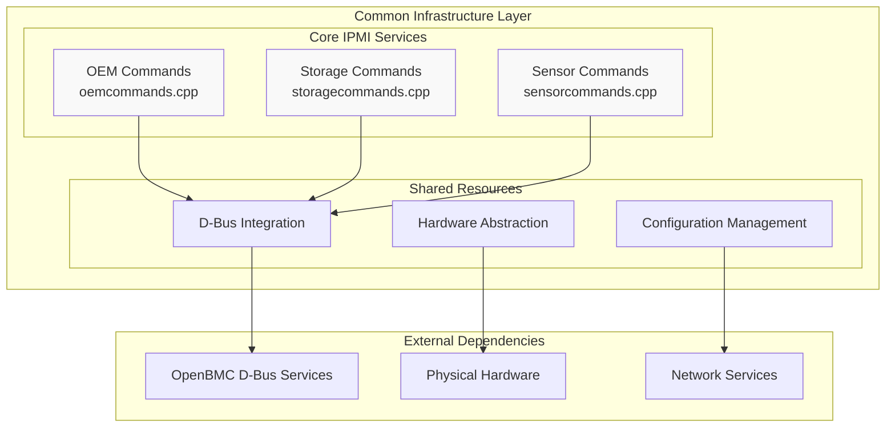
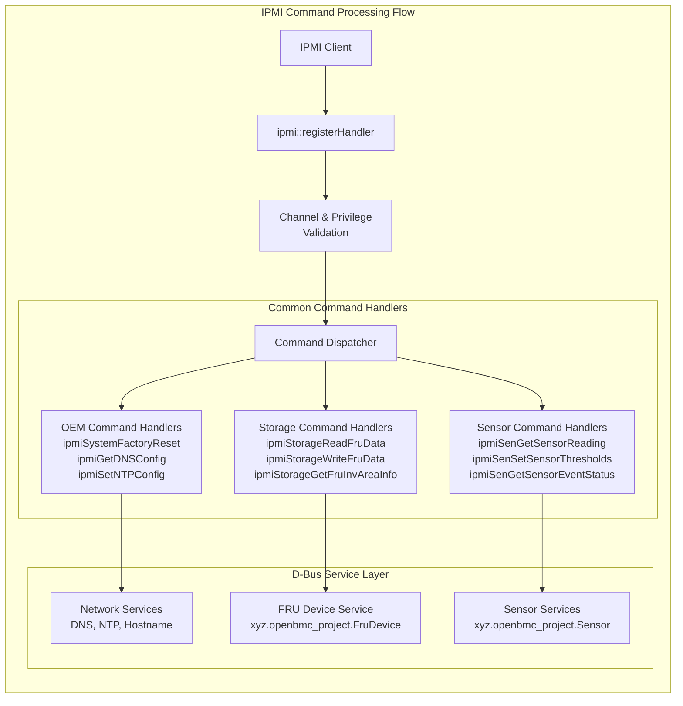
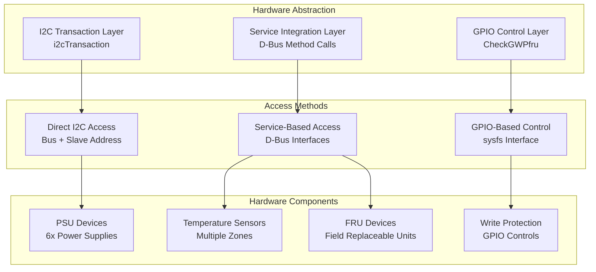
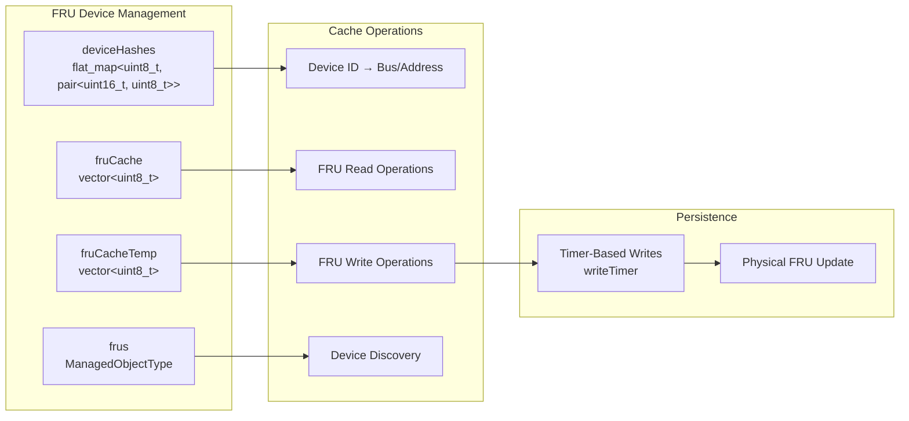
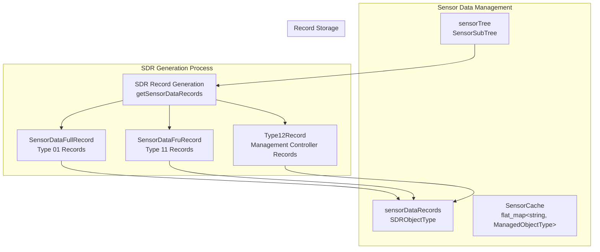

<!-- source: DeepWiki mcp.deepwiki.com · repo NVIDIA/nvidia-ipmi-oem · page 4 Common Infrastructure · fetched 2026-10-26 -->

# Common Infrastructure

Relevant source files

The following files were used as context for generating this wiki page:

- [.clang-format](.clang-format)
- [src/oemcommands.cpp](src/oemcommands.cpp)
- [src/sensorcommands.cpp](src/sensorcommands.cpp)
- [src/storagecommands.cpp](src/storagecommands.cpp)

This document covers the shared components and services that provide foundational functionality across all NVIDIA platform implementations. The common infrastructure layer abstracts core IPMI operations, storage management, and sensor handling to ensure consistent behavior regardless of the specific platform (Bluefield, Grace, etc.).

For platform-specific implementations that build upon this infrastructure, see [Platform Implementations](#3). For low-level hardware integration details, see [Hardware Integration](#5).

## Overview

The common infrastructure consists of three primary subsystems that work together to provide a unified IPMI management interface:

Sources: [src/oemcommands.cpp:1-1500](), [src/storagecommands.cpp:1-1000](), [src/sensorcommands.cpp:1-1700]()

## Core Service Architecture

The common infrastructure implements a layered service architecture where IPMI commands are processed through standardized interfaces:

Sources: [src/oemcommands.cpp:201-330](), [src/storagecommands.cpp:979-997](), [src/sensorcommands.cpp:104-105]()

## Configuration Management

The common infrastructure provides centralized configuration management through D-Bus property manipulation and persistent storage:

| Configuration Area | Service | Key Properties | Implementation |
|-------------------|---------|----------------|----------------|
| Network Settings | `xyz.openbmc_project.Network` | `StaticNameServers`, `StaticNTPServers` | [src/oemcommands.cpp:428-748]() |
| System Event Logging | `xyz.openbmc_project.Logging.Settings` | `SelPolicy` | [src/oemcommands.cpp:751-841]() |
| Time Synchronization | `xyz.openbmc_project.Time.Synchronization` | `TimeSyncMethod` | [src/oemcommands.cpp:517-748]() |
| Vendor Field Mode | `xyz.openbmc_project.Software.BMC.VendorFieldModeService` | `VendorFieldModeStatus` | [src/oemcommands.cpp:843-931]() |
| Serial Redirect | `xyz.openbmc_project.Common.SerialRedirectMode` | `SerialRedirectModeStatus` | [src/oemcommands.cpp:933-1022]() |

Sources: [src/oemcommands.cpp:52-200]()

## Hardware Abstraction Layer

The common infrastructure provides standardized hardware access patterns through I2C transactions and GPIO control:

Sources: [src/oemcommands.cpp:340-384](), [src/storagecommands.cpp:289-566]()

## Data Structure Management

The common infrastructure maintains several key data structures for efficient operation:

### FRU Management Data Structures

Sources: [src/storagecommands.cpp:95-217]()

### Sensor Data Repository

Sources: [src/sensorcommands.cpp:63-84](), [src/sensorcommands.cpp:1136-1432]()

## Service Registration

The common infrastructure uses constructor-based registration to ensure all IPMI command handlers are properly registered during module initialization:

| Registration Function | Purpose | Command Handlers |
|----------------------|---------|------------------|
| `registerNvOemFunctions()` | OEM command registration | Factory reset, DNS/NTP config, SEL policy, vendor modes |
| `registerStorageFunctions()` | Storage command registration | FRU read/write, inventory info |
| `registerSensorFunctions()` | Sensor command registration | Sensor readings, thresholds, event status |

Sources: [src/oemcommands.cpp:201](), [src/storagecommands.cpp:113](), [src/sensorcommands.cpp:104]()

---

