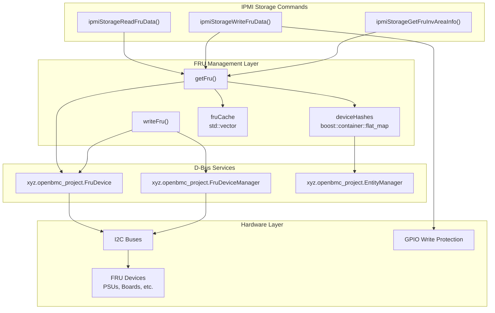
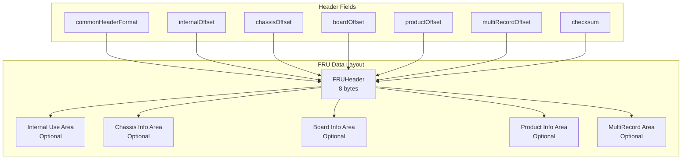
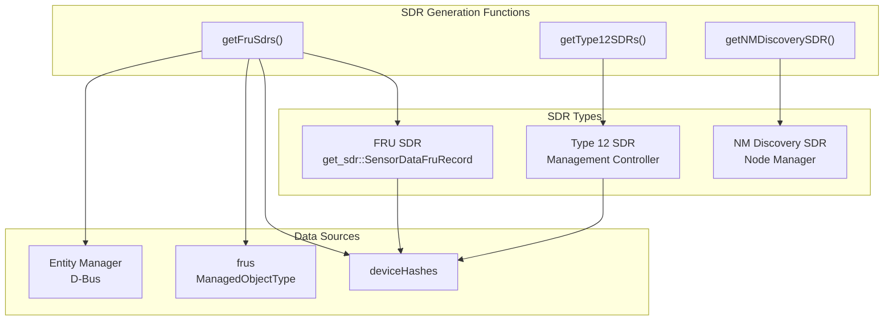
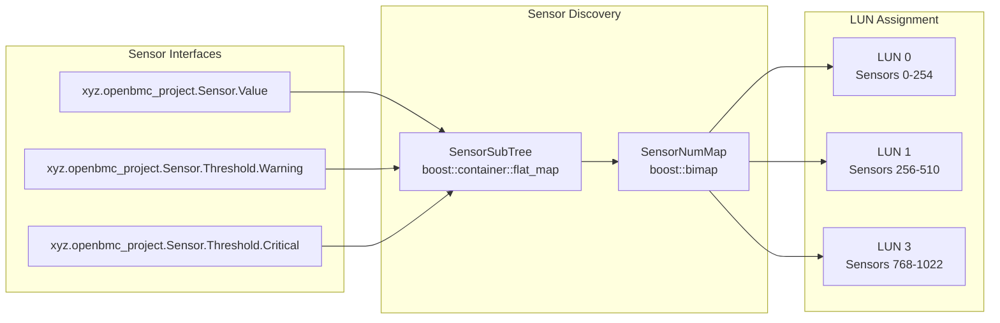

<!-- source: DeepWiki mcp.deepwiki.com · repo NVIDIA/nvidia-ipmi-oem · page 4.1 Storage and FRU Management · fetched 2026-10-26 -->

# Storage and FRU Management

Relevant source files

The following files were used as context for generating this wiki page:

- [include/sdrutils.hpp](include/sdrutils.hpp)
- [include/storagecommands.hpp](include/storagecommands.hpp)
- [src/storagecommands.cpp](src/storagecommands.cpp)

This document covers the storage and Field Replaceable Unit (FRU) management functionality within the NVIDIA IPMI OEM commands library. This includes FRU data handling, Sensor Data Record (SDR) management, and IPMI storage commands for hardware inventory management. For sensor data collection and threshold management, see [Sensor Management](#4.2). For platform-specific storage implementations, see the respective platform documentation ([Bluefield Platform](#3.1), [Grace Platform](#3.2)).

## System Overview

The storage management system provides IPMI-compliant access to FRU data and sensor metadata through standardized storage commands. It integrates with OpenBMC's D-Bus infrastructure to provide hardware inventory management and supports both read and write operations on FRU devices connected via I2C buses.

## FRU Management Architecture

**Sources:** [src/storagecommands.cpp:434-482](), [src/storagecommands.cpp:115-143](), [src/storagecommands.cpp:240-277]()

The FRU management system maintains a device hash map that associates 8-bit device IDs with 16-bit bus addresses and 8-bit device addresses. The `recalculateHashes()` function generates unique device IDs by hashing object paths, handling collisions by incrementing the hash value.

## IPMI Storage Command Implementation

| Command | Function | Purpose | Privilege Level |
|---------|----------|---------|-----------------|
| Read FRU Data | `ipmiStorageReadFruData()` | Read FRU inventory data | User |
| Write FRU Data | `ipmiStorageWriteFruData()` | Write FRU inventory data | Operator |
| Get FRU Inventory Area Info | `ipmiStorageGetFruInvAreaInfo()` | Get FRU size and access type | User |

**Sources:** [src/storagecommands.cpp:984-997](), [include/storagecommands.hpp:95-101]()

### FRU Data Structure

The FRU data follows the IPMI FRU Data Format Specification with a standardized header structure:

**Sources:** [include/storagecommands.hpp:104-115](), [src/storagecommands.cpp:593-639]()

## Write Protection Mechanisms

The system implements multiple write protection mechanisms:

1. **GPIO-based Protection**: Configurable via `WP_GPIO` and `WP_GPIO_CHIP` build options
2. **Software Protection**: Via `CHASSIS_WRITE_PROTECT` D-Bus property
3. **Device-level Protection**: Enforced by FRU device drivers

**Sources:** [src/storagecommands.cpp:510-566](), [src/storagecommands.cpp:289-343]()

## SDR Management System

**Sources:** [src/storagecommands.cpp:694-886](), [src/storagecommands.cpp:888-977](), [include/storagecommands.hpp:118-150]()

### SDR Record Types

The system generates three types of SDR records:

1. **FRU SDR Records**: Map FRU devices to device IDs with entity information
2. **Type 12 Records**: Management Controller Device Records for BMC and ME
3. **NM Discovery Records**: Node Manager discovery information

**Sources:** [include/storagecommands.hpp:118-150]()

## Sensor Number Management

**Sources:** [include/sdrutils.hpp:138-184](), [include/sdrutils.hpp:68-73]()

The sensor numbering system assigns sensors across three LUNs (Logical Unit Numbers), skipping LUN 2 per IPMI specification. The system supports up to 1023 total sensors with automatic LUN assignment based on sensor discovery order.

## D-Bus Integration

The storage system integrates with multiple OpenBMC D-Bus services:

| Service | Interface | Purpose |
|---------|-----------|---------|
| `xyz.openbmc_project.FruDevice` | FRU device management | Hardware FRU access |
| `xyz.openbmc_project.EntityManager` | Entity configuration | Hardware metadata |
| `xyz.openbmc_project.ObjectMapper` | Object discovery | Service location |

**Sources:** [src/storagecommands.cpp:78-87](), [include/sdrutils.hpp:112-135]()

## Caching and Performance

The system implements several caching mechanisms:

1. **FRU Cache**: `fruCache` stores recently accessed FRU data
2. **Device Hash Cache**: `deviceHashes` maps device IDs to bus/address pairs  
3. **Sensor Tree Cache**: Static sensor hierarchy with invalidation on changes
4. **Write Buffering**: `fruCacheTemp` buffers partial writes with timer-based commits

**Sources:** [src/storagecommands.cpp:95-104](), [src/storagecommands.cpp:145-153](), [include/sdrutils.hpp:77-136]()

## Error Handling and Validation

The storage commands implement comprehensive error handling:

- **Invalid Device ID**: Returns `IPMI_CC_SENSOR_INVALID` for unknown devices
- **Access Violations**: Returns `ipmi::responseCommandDisabled()` for write-protected devices  
- **Range Validation**: Checks offset and length parameters against FRU size
- **D-Bus Failures**: Graceful degradation with appropriate IPMI completion codes

**Sources:** [src/storagecommands.cpp:247-252](), [src/storagecommands.cpp:469-472](), [src/storagecommands.cpp:538-544]()

---

