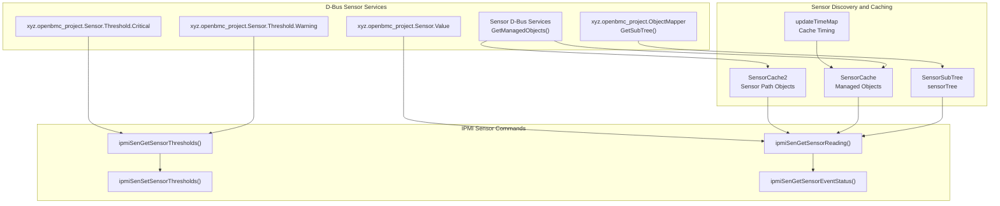
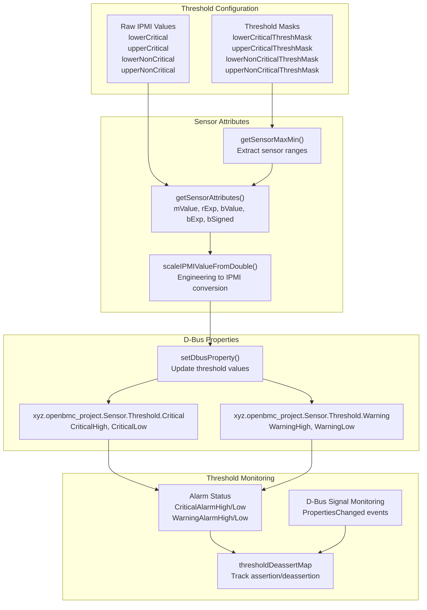
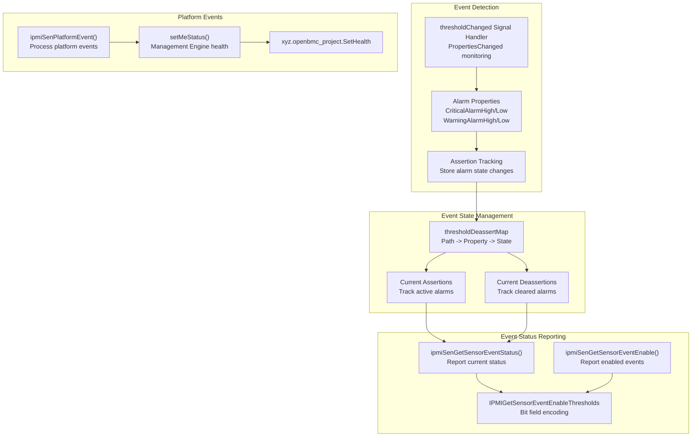
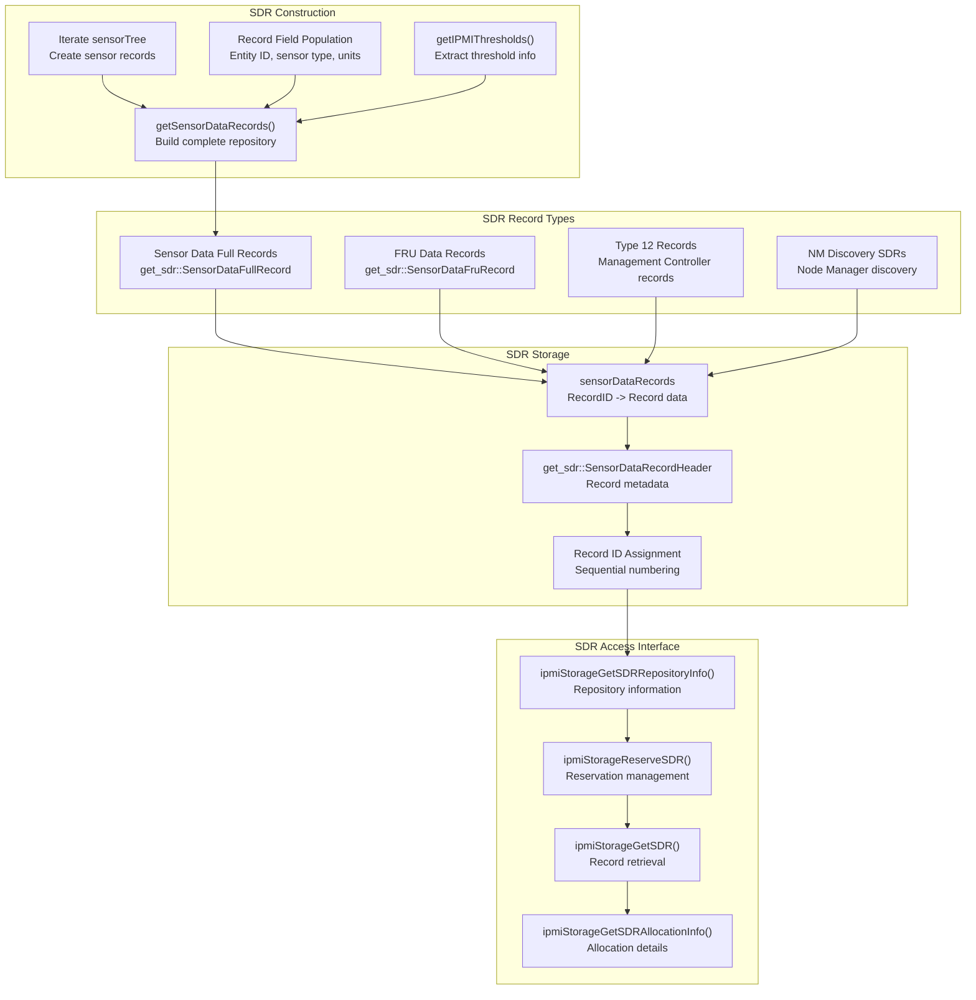
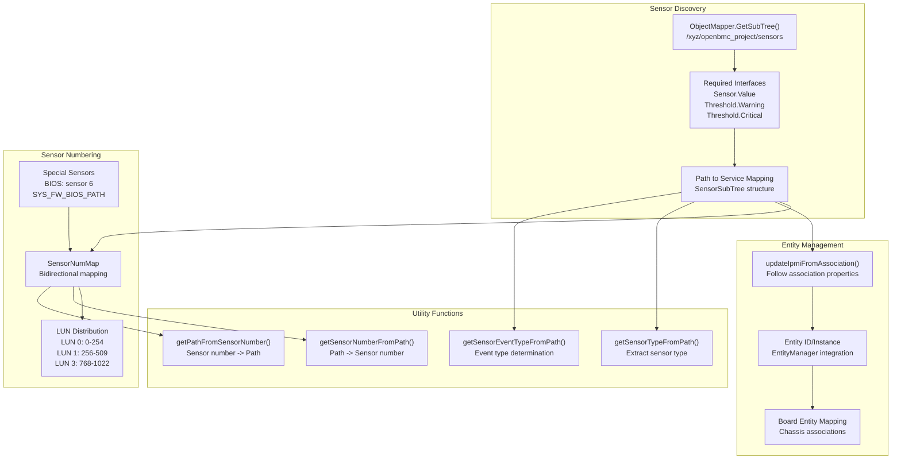

<!-- source: DeepWiki mcp.deepwiki.com · repo NVIDIA/nvidia-ipmi-oem · page 4.2 Sensor Management · fetched 2026-10-26 -->

# Sensor Management

Relevant source files

The following files were used as context for generating this wiki page:

- [.clang-format](.clang-format)
- [include/sdrutils.hpp](include/sdrutils.hpp)
- [src/sensorcommands.cpp](src/sensorcommands.cpp)

This document covers the sensor management subsystem within the NVIDIA IPMI OEM Commands repository, which provides IPMI sensor reading, threshold management, event handling, and Sensor Data Record (SDR) repository services. The sensor management system serves as a bridge between IPMI clients and the underlying OpenBMC sensor infrastructure via D-Bus services.

For information about platform-specific sensor implementations, see [Platform Implementations](#3). For storage and FRU management capabilities, see [Storage and FRU Management](#4.1).

## Sensor Data Collection and Caching

The sensor management system implements a comprehensive caching mechanism to efficiently access sensor data from multiple D-Bus services. The core sensor reading functionality centers around the `getSensorMap()` function which maintains cached sensor properties with periodic updates.

The system maintains two levels of caching: a sensor tree discovery cache updated through D-Bus signals, and individual sensor property caches with configurable update periods. The `sensorMapUpdatePeriod` constant controls cache refresh timing to balance performance with data freshness.

**Sources:** [src/sensorcommands.cpp:257-334](), [src/sensorcommands.cpp:83-87](), [src/sensorcommands.cpp:106-128]()

## Threshold Management and Monitoring

Threshold management provides both reading and writing capabilities for sensor warning and critical thresholds. The system supports upper and lower thresholds for both warning (non-critical) and critical levels, with automatic scaling between raw IPMI values and engineering units.

The threshold system implements linear scaling using the IPMI sensor formula: `Reading = (Raw * M + B * 10^(bExp)) * 10^(rExp)` where M, B, and exponents are derived from sensor min/max ranges. This ensures proper conversion between IPMI raw values and actual engineering units.

**Sources:** [src/sensorcommands.cpp:598-734](), [src/sensorcommands.cpp:736-816](), [src/sensorcommands.cpp:178-255]()

## Sensor Event Processing

The sensor event system monitors threshold crossings and manages event assertions and deassertions. It tracks sensor alarm states through D-Bus property changes and maintains historical event information for status reporting.

The event system distinguishes between assertions (threshold crossings) and deassertions (threshold clears), requiring an assertion to occur before a deassertion can be reported. This prevents spurious deassertion reports and maintains accurate event state tracking.

**Sources:** [src/sensorcommands.cpp:130-176](), [src/sensorcommands.cpp:901-987](), [src/sensorcommands.cpp:997-1134](), [src/sensorcommands.cpp:403-450]()

## SDR Repository Management

The Sensor Data Record (SDR) repository provides a comprehensive catalog of all available sensors, their properties, and capabilities. The system builds SDR records dynamically from sensor discovery and integrates with FRU and type 12 management records.

Each sensor record contains complete sensor metadata including entity information derived from association chains, threshold configurations, supported event types, and sensor-specific attributes like units and scaling factors. The repository supports partial record reads with reservation-based access control.

**Sources:** [src/sensorcommands.cpp:1136-1432](), [src/sensorcommands.cpp:1553-1581](), [src/sensorcommands.cpp:1616-1698]()

## Sensor Numbering and Path Management

The system implements a sophisticated sensor numbering scheme that maps sensor D-Bus paths to IPMI sensor numbers across multiple Logical Unit Numbers (LUNs). This provides a stable addressing mechanism for IPMI clients while accommodating dynamic sensor discovery.

The numbering system supports up to 1023 sensors distributed across three LUNs, with LUN 2 reserved. Special handling exists for system firmware progress sensors and other platform-specific sensor types. Entity ID and instance information is derived from Entity Manager associations when available.

**Sources:** [include/sdrutils.hpp:138-184](), [include/sdrutils.hpp:268-320](), [include/sdrutils.hpp:417-545](), [src/sensorcommands.cpp:1207-1215]()

## Integration with OpenBMC Services

The sensor management system integrates deeply with the OpenBMC D-Bus architecture, providing a translation layer between IPMI sensor commands and the underlying sensor services. This integration supports dynamic sensor discovery, real-time event monitoring, and seamless property updates.

The system registers D-Bus signal handlers for sensor addition, removal, and property changes, ensuring that the sensor repository remains synchronized with the actual system state. Cache invalidation occurs automatically when sensors are added or removed, and threshold monitoring provides immediate response to alarm condition changes.

**Sources:** [src/sensorcommands.cpp:106-128](), [src/sensorcommands.cpp:136-176](), [include/sdrutils.hpp:77-136]()

---

