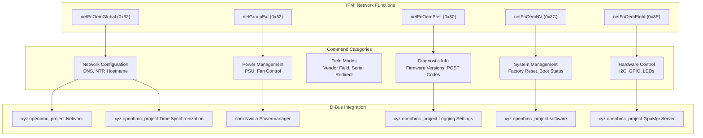
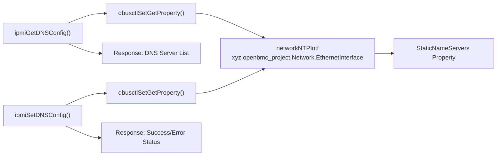
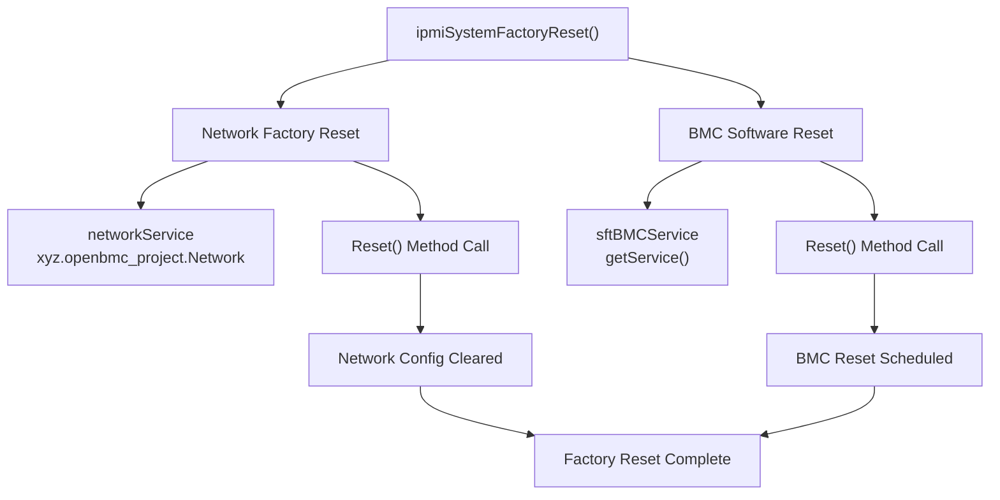
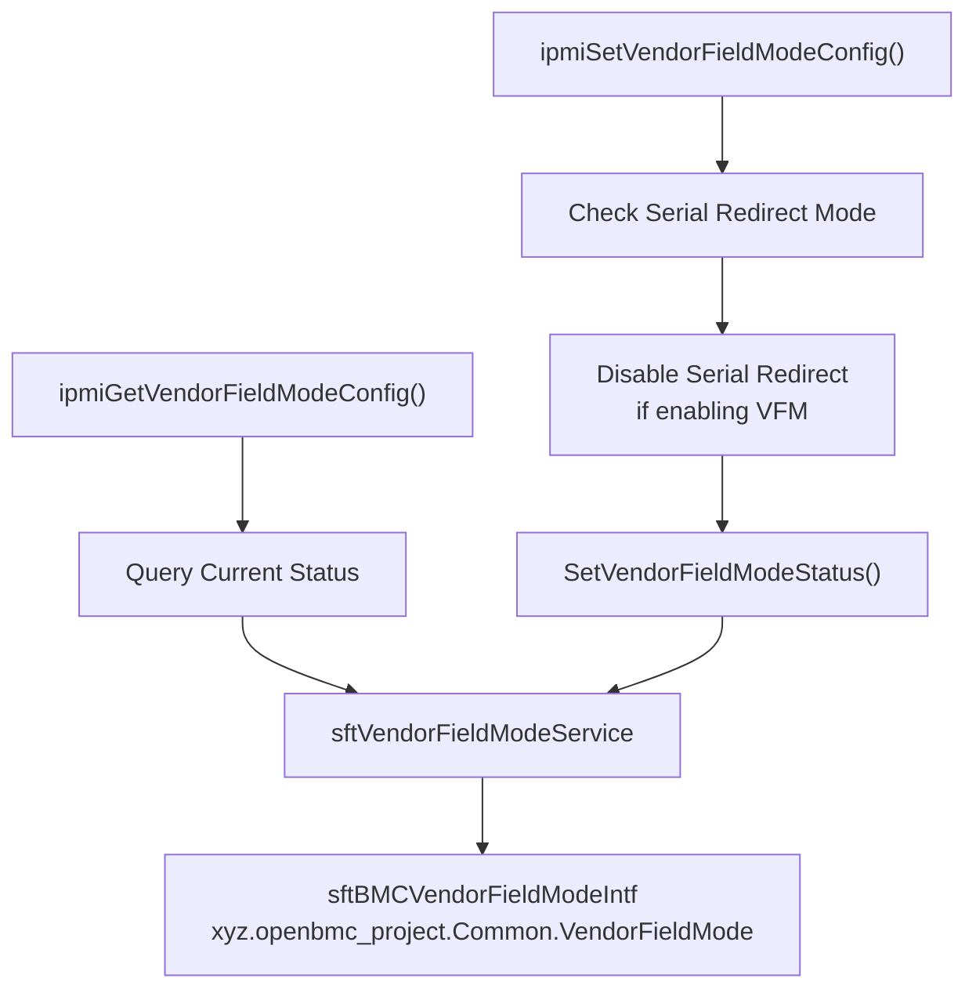
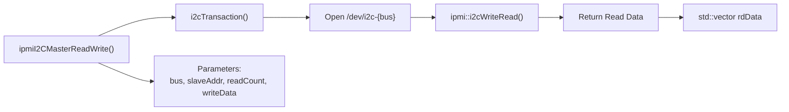
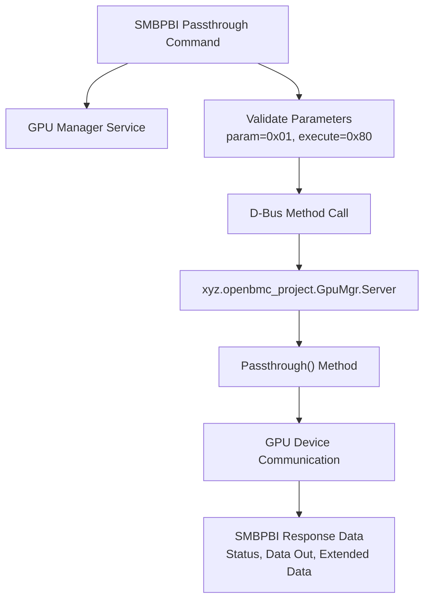
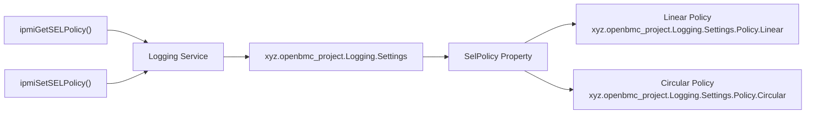
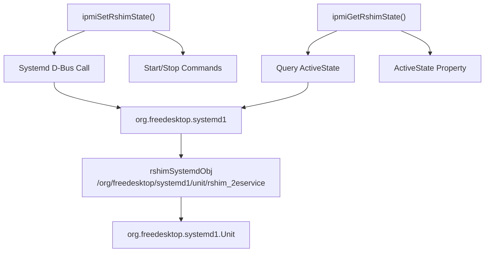
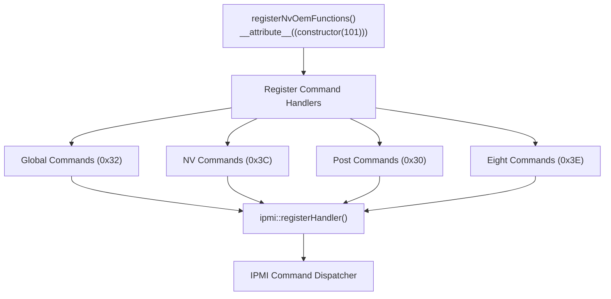

<!-- source: DeepWiki mcp.deepwiki.com · repo NVIDIA/nvidia-ipmi-oem · page 4.3 General OEM Commands · fetched 2026-10-26 -->

# General OEM Commands

Relevant source files

The following files were used as context for generating this wiki page:

- [include/oemcommands.hpp](include/oemcommands.hpp)
- [src/oemcommands.cpp](src/oemcommands.cpp)

This document covers the platform-agnostic OEM commands that provide common functionality across all NVIDIA platforms, including DNS/NTP configuration, factory reset, user management, and system monitoring capabilities. These commands form the foundation of system management operations available through IPMI.

For platform-specific OEM commands, see [Bluefield Platform](#3.1) and [Grace Platform](#3.2). For hardware-specific control commands, see [Hardware Integration](#5).

## Overview

The general OEM commands are implemented in the common infrastructure layer and provide essential system management functions that work consistently across all supported NVIDIA platforms. These commands handle network configuration, system maintenance, hardware monitoring, and low-level system control through standardized IPMI interfaces.

Sources: [src/oemcommands.cpp:52-168](), [include/oemcommands.hpp:26-31]()

## Network Configuration Commands

### DNS Configuration

The DNS configuration commands provide get/set functionality for DNS server settings through the OpenBMC network service. These commands interface with the `StaticNameServers` property of the network interface.

| Command | Function | Description |
|---------|----------|-------------|
| `cmdGetDNSConfig (0x6B)` | `ipmiGetDNSConfig()` | Retrieves current DNS server configuration |
| `cmdSetDNSConfig (0x6C)` | `ipmiSetDNSConfig()` | Updates DNS server configuration |

Sources: [src/oemcommands.cpp:428-515](), [include/oemcommands.hpp:45-46]()

### NTP Configuration

NTP configuration commands manage both the time synchronization method and NTP server settings. The system supports Manual, NTP, and failure states.

| Command | Function | Description |
|---------|----------|-------------|
| `cmdGetNTPConfig (0xA7)` | `ipmiGetNTPConfig()` | Gets NTP status and server list |
| `cmdSetNTPConfig (0xA8)` | `ipmiSetNTPConfig()` | Configures NTP enable/disable and servers |

The NTP configuration supports three operational modes:
- **Manual (0x00)**: Time synchronization disabled
- **NTP (0x01)**: Network time synchronization enabled  
- **Failure (0x02)**: Time synchronization in error state

Sources: [src/oemcommands.cpp:520-749](), [include/oemcommands.hpp:43-44]()

## System Management Commands

### Factory Reset

The `ipmiSystemFactoryReset()` command performs a comprehensive BMC factory reset operation in two phases:

1. **Network Factory Reset**: Restores all network interfaces to DHCP configuration
2. **BMC Software Factory Reset**: Clears persistence files and volumes (applied on next reboot)

Sources: [src/oemcommands.cpp:275-330](), [include/oemcommands.hpp:35]()

### Boot Status Monitoring

The system provides comprehensive boot status monitoring through multiple commands:

| Command | Function | Purpose |
|---------|----------|---------|
| `cmdGetBMCBootComplete (0x05)` | `ipmiGetBMCBootComplete()` | Check if BMC initialization is complete |
| `cmdGetBiosPostStatus (0x25)` | `ipmiGetBiosPostStatus()` | Monitor BIOS POST progress |
| `cmdGetBiosPostCode (0xE9)` | `ipmiGetBiosPostCode()` | Retrieve BIOS POST codes |

Sources: [src/oemcommands.cpp:1168-1833](), [include/oemcommands.hpp:50-53]()

## Field Mode Operations

### Vendor Field Mode

Vendor Field Mode is a special boot configuration that enables field service operations. The mode is mutually exclusive with Serial Redirect Mode.

| Command | Function | Description |
|---------|----------|-------------|
| `cmdSetVendorFieldModeConfig (0x67)` | `ipmiSetVendorFieldModeConfig()` | Enable/disable vendor field mode |
| `cmdGetVendorFieldModeConfig (0x68)` | `ipmiGetVendorFieldModeConfig()` | Query vendor field mode status |

Sources: [src/oemcommands.cpp:843-931](), [include/oemcommands.hpp:36-37]()

### Serial Redirect Mode

Serial Redirect Mode enables console redirection capabilities and is mutually exclusive with Vendor Field Mode.

| Command | Function | Description |
|---------|----------|-------------|
| `cmdSetSerialRedirectModeConfig (0x6D)` | `ipmiSetSerialRedirectModeConfig()` | Enable/disable serial redirect |
| `cmdGetSerialRedirectModeConfig (0x6E)` | `ipmiGetSerialRedirectModeConfig()` | Query serial redirect status |

Sources: [src/oemcommands.cpp:933-1022](), [include/oemcommands.hpp:54-55]()

## Hardware Control Commands

### I2C Master Operations

The `ipmiI2CMasterReadWrite()` command provides direct I2C bus access for hardware communication. It supports combined write-then-read transactions commonly used for register access.

Sources: [src/oemcommands.cpp:1101-1114](), [src/oemcommands.cpp:340-384](), [include/oemcommands.hpp:52]()

### SMBPBI GPU Passthrough

The SMBPBI (SMBus Packet-Based Interface) commands provide direct communication with GPU devices through the GPU manager service.

| Command | Function | Description |
|---------|----------|-------------|
| `cmdSMBPBIPassthrough (0x09)` | `ipmiSMBPBIPassthroughCmd()` | Standard GPU SMBPBI communication |
| `cmdSMBPBIPassthroughExtended (0x0A)` | `ipmiSMBPBIPassthroughExtendedCmd()` | Extended GPU SMBPBI with more data |

Sources: [src/oemcommands.cpp:1207-1425](), [include/oemcommands.hpp:65-66]()

## System Event Log Management

### SEL Policy Configuration

The SEL (System Event Log) policy commands control how system events are logged and stored, supporting both Linear and Circular logging policies.

| Command | Function | Policy Types |
|---------|----------|-------------|
| `cmdGetSELPolicy (0x7E)` | `ipmiGetSELPolicy()` | Linear (0x00), Circular (0x01) |
| `cmdSetSELPolicy (0x7F)` | `ipmiSetSELPolicy()` | Linear (0x00), Circular (0x01) |

Sources: [src/oemcommands.cpp:751-841](), [include/oemcommands.hpp:41-42]()

## Remote Access Control

### Rshim Service Management

Rshim (Remote Shared Memory) provides out-of-band access to the system. The commands control the systemd service state.

| Command | Function | States |
|---------|----------|--------|
| `cmdSetRshimState (0x6A)` | `ipmiSetRshimState()` | Stop (0x00), Start (0x01) |
| `cmdGetRshimState (0x69)` | `ipmiGetRshimState()` | Active (0x01), Inactive (0x00) |

Sources: [src/oemcommands.cpp:1024-1098](), [include/oemcommands.hpp:38-39]()

## Command Registration

All general OEM commands are registered through the `registerNvOemFunctions()` constructor function, which maps IPMI command codes to their corresponding handler functions using the `ipmi::registerHandler()` interface.

Sources: [src/oemcommands.cpp:201](), [src/oemcommands.cpp:2848-3000]()

---

