<!-- source: DeepWiki mcp.deepwiki.com · repo NVIDIA/nvidia-ipmi-oem · page 5 Hardware Integration · fetched 2026-10-26 -->

# Hardware Integration

Relevant source files

The following files were used as context for generating this wiki page:

- [Grace/src/ghoemcommands.cpp](Grace/src/ghoemcommands.cpp)
- [include/dgx-a100-config.hpp](include/dgx-a100-config.hpp)
- [src/BF/oemcommands.cpp](src/BF/oemcommands.cpp)
- [src/BF/spectre/oemcommands.cpp](src/BF/spectre/oemcommands.cpp)

This document describes how the NVIDIA IPMI OEM commands system interfaces with physical hardware components through various communication protocols and abstraction layers. It covers the hardware communication mechanisms, component management strategies, and platform-specific integration patterns used across different NVIDIA platforms.

For information about the platform-specific command implementations that utilize this hardware integration, see [Platform Implementations](#3). For details about the D-Bus services that mediate hardware control, see [D-Bus Service Integration](#2.2).

## Hardware Communication Protocols

The system primarily uses I2C and GPIO protocols for direct hardware communication, with additional abstraction through D-Bus services for system-level hardware management.

### I2C Communication Layer

The core I2C communication is implemented through the `i2cTransaction()` function which provides a standardized interface for hardware access across all platforms.

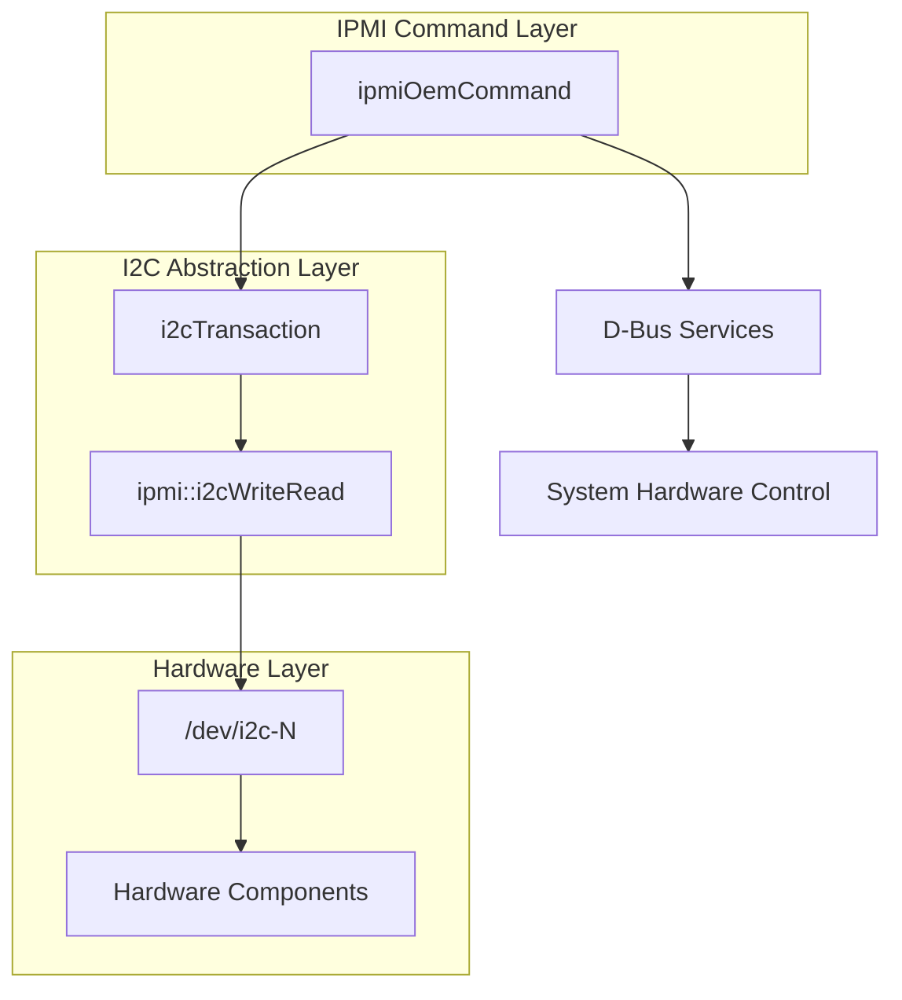

The I2C transaction function handles device file operations, error handling, and provides a consistent interface for all hardware communication:

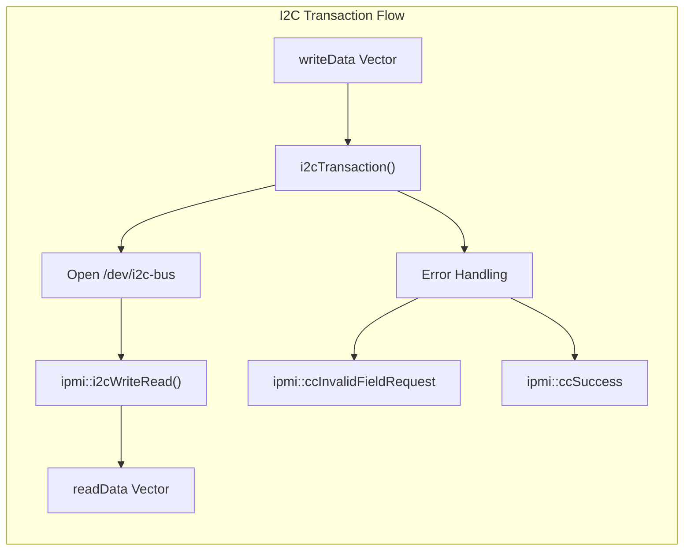

Sources: [src/BF/oemcommands.cpp:372-393](), [Grace/src/ghoemcommands.cpp:328-349]()

### GPIO Control Interface

GPIO control is used for direct hardware manipulation, particularly for write protection and LED control. The system uses Linux GPIO interfaces with specific chip and pin mappings.

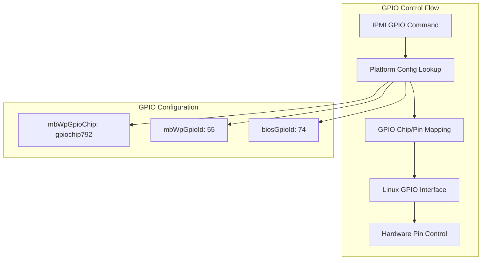

Sources: [include/dgx-a100-config.hpp:82-84](), [include/dgx-a100-config.hpp:103-104]()

## Hardware Component Management

The system manages various hardware components through standardized addressing schemes and communication protocols.

### Power Supply Unit (PSU) Management

PSU management involves monitoring and control of multiple power supply units through I2C communication with predefined addresses and registers.

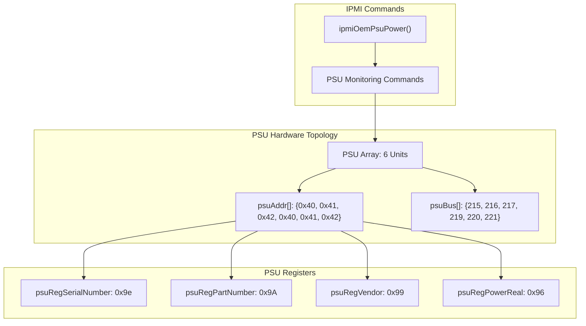

Sources: [include/dgx-a100-config.hpp:28-44]()

### FPGA and Control Hardware

The system manages multiple FPGAs for various control functions including write protection, LED control, and system monitoring.

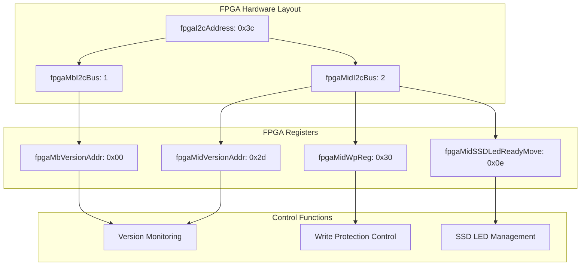

Sources: [include/dgx-a100-config.hpp:45-62]()

### Switch and Network Hardware

The system manages PEX switches and Ethernet switches through I2C communication for network topology control.

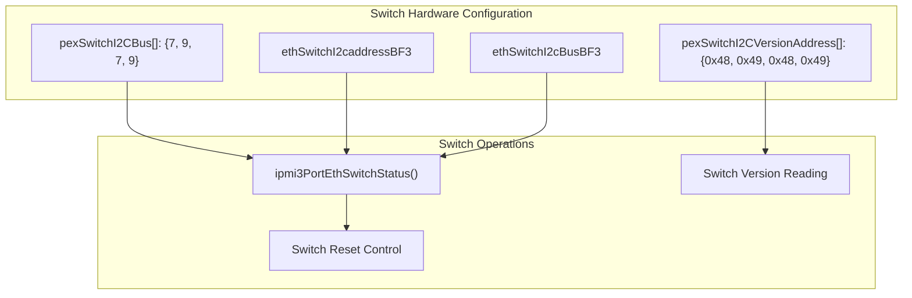

Sources: [include/dgx-a100-config.hpp:70-73](), [src/BF/oemcommands.cpp:485-513]()

## Platform-Specific Hardware Integration

Different NVIDIA platforms implement varying levels of hardware integration based on their capabilities and intended use cases.

### Bluefield Platform Hardware Support

The Bluefield platform provides comprehensive hardware integration with full support for all hardware components.

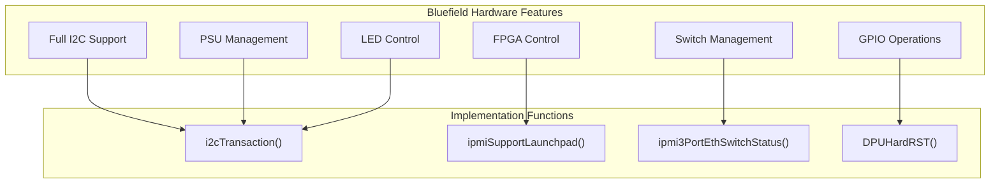

Sources: [src/BF/oemcommands.cpp:372-393](), [src/BF/oemcommands.cpp:395-483]()

### Grace Platform Hardware Support

The Grace platform focuses on GPU management and system control with specialized SMBPBI passthrough capabilities.

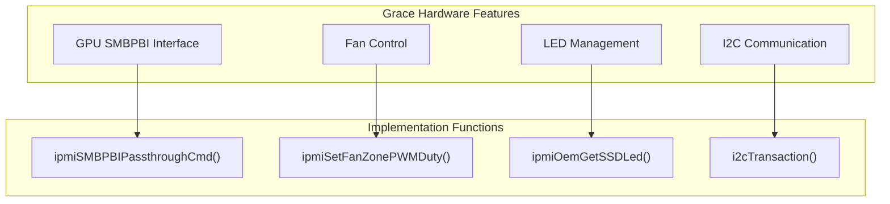

Sources: [Grace/src/ghoemcommands.cpp:167-275](), [Grace/src/ghoemcommands.cpp:463-574]()

### Platform Hardware Differentiation

The system implements graduated hardware support across platforms, with some platforms disabling hardware commands entirely.

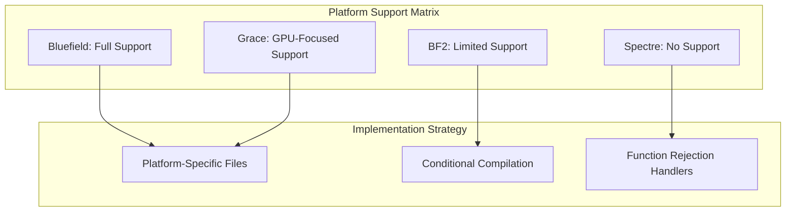

Sources: [src/BF/spectre/oemcommands.cpp:58-110]()

## Hardware Control Flow

The hardware control flow demonstrates how IPMI commands are translated into actual hardware operations through multiple abstraction layers.

### Command Processing to Hardware Execution

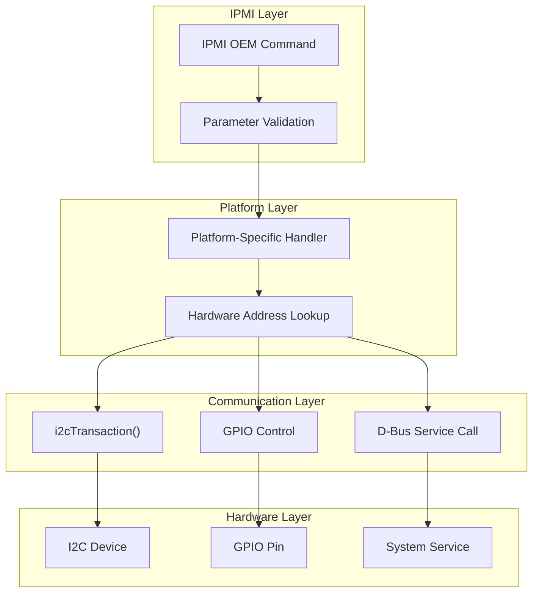

Sources: [src/BF/oemcommands.cpp:372-393](), [Grace/src/ghoemcommands.cpp:328-349]()

### Fan Control Hardware Integration

Fan control demonstrates the integration between IPMI commands, system services, and hardware PWM control.

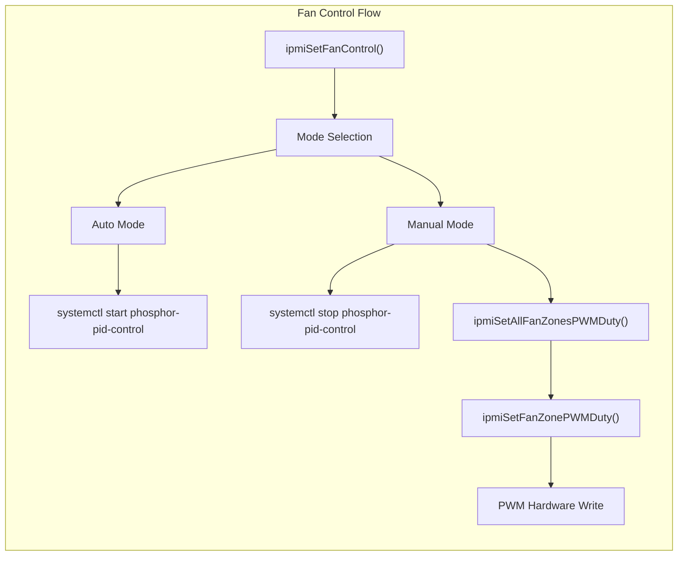

Sources: [Grace/src/ghoemcommands.cpp:607-638](), [Grace/src/ghoemcommands.cpp:463-574]()

## Hardware Configuration and Addressing

The system uses comprehensive configuration constants to define hardware addressing schemes and communication parameters.

### I2C Bus and Address Mapping

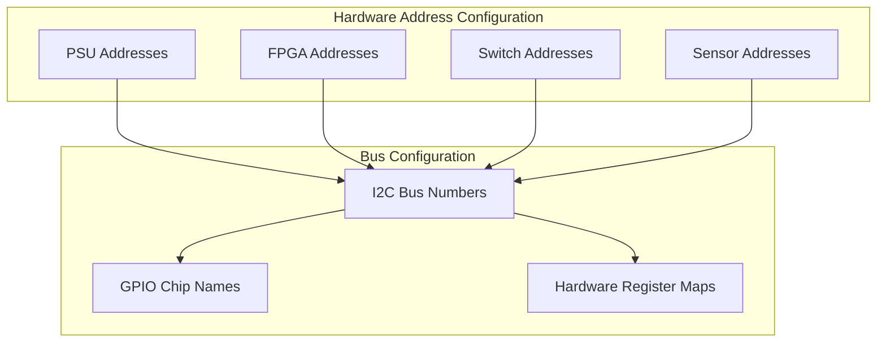

The hardware configuration provides compile-time constants for all hardware addressing:

| Component | Bus/Address | Register | Purpose |
|-----------|-------------|----------|---------|
| PSU Array | Buses 215-221 | Addresses 0x40-0x42 | Power monitoring |
| MB FPGA | Bus 1 | Address 0x3c | Motherboard control |
| MID FPGA | Bus 2 | Address 0x3c | System control |
| PEX Switches | Buses 7,9 | Addresses 0x48,0x49 | Network topology |

Sources: [include/dgx-a100-config.hpp:28-107]()

### Hardware Register Organization

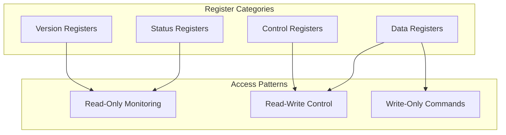

Sources: [include/dgx-a100-config.hpp:33-68]()

---

