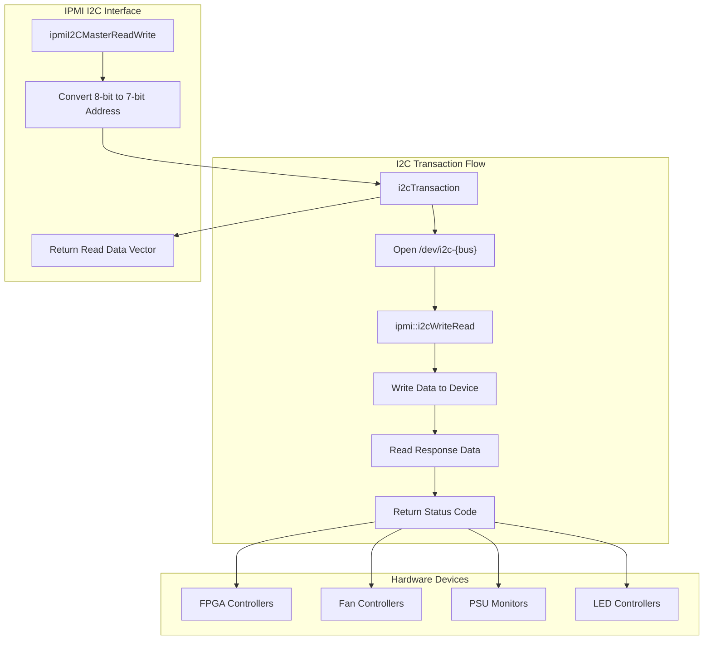
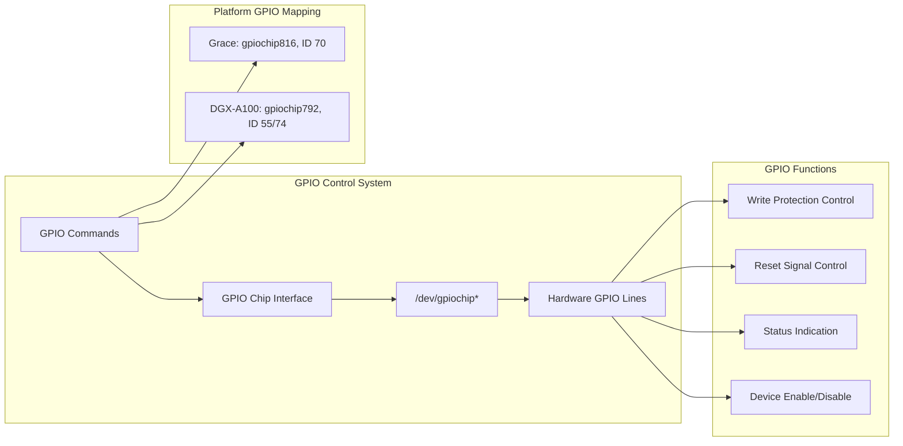
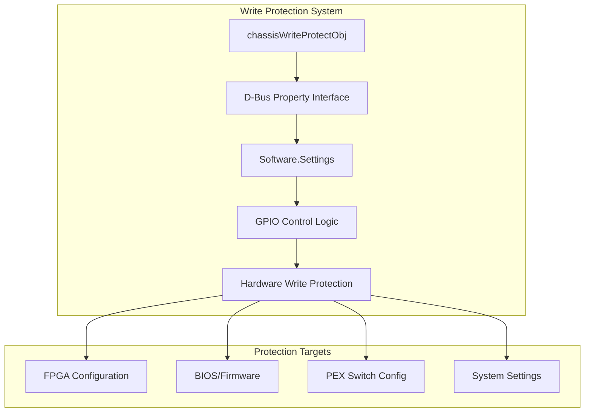
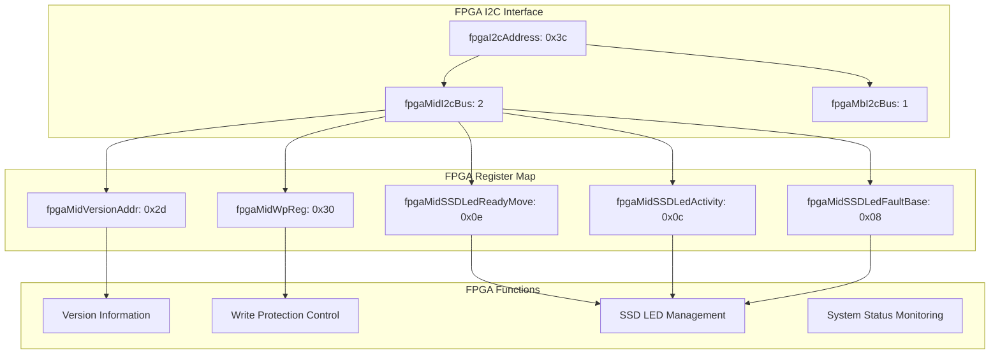
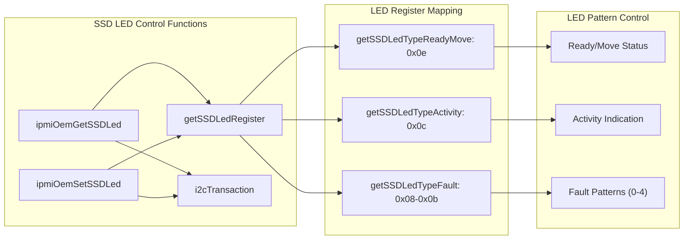
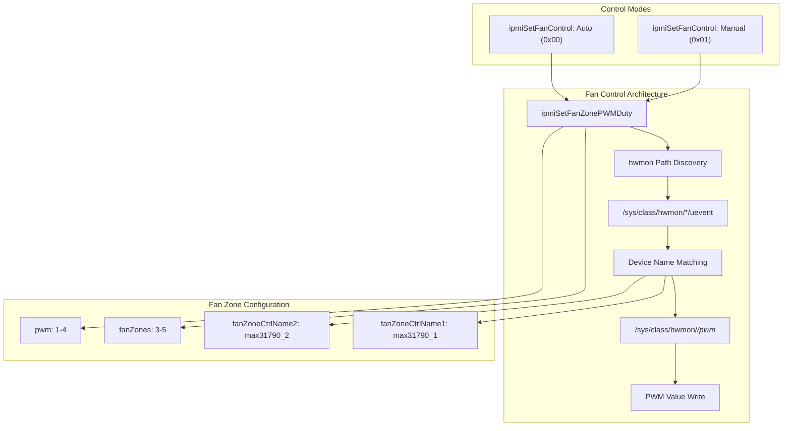

<!-- source: DeepWiki mcp.deepwiki.com · repo NVIDIA/nvidia-ipmi-oem · page 5.1 I2C and GPIO Control · fetched 2026-10-26 -->

# I2C and GPIO Control

Relevant source files

The following files were used as context for generating this wiki page:

- [Grace/include/gh-config.hpp](Grace/include/gh-config.hpp)
- [Grace/src/ghoemcommands.cpp](Grace/src/ghoemcommands.cpp)
- [include/dgx-a100-config.hpp](include/dgx-a100-config.hpp)

This document covers the low-level hardware communication interfaces used by the NVIDIA IPMI OEM commands library to interact with physical hardware components. The I2C and GPIO control systems provide direct access to devices such as FPGAs, fan controllers, PSUs, and status indicators across different NVIDIA platform implementations.

For broader hardware integration topics including power management and thermal control, see [Power and Thermal Management](#5.2). For status indication systems, see [Status and LED Control](#5.3).

## I2C Communication Framework

The I2C communication system provides a standardized interface for reading and writing data to hardware devices across multiple I2C buses. The framework supports both synchronous transactions and IPMI-exposed I2C master operations.

### Core I2C Transaction Function

The foundation of I2C communication is the `i2cTransaction` function, which handles low-level I2C read/write operations:

**Sources:** [Grace/src/ghoemcommands.cpp:328-349](), [Grace/src/ghoemcommands.cpp:875-888]()

### Platform I2C Bus Configuration

Different NVIDIA platforms utilize distinct I2C bus layouts and device addresses:

| Platform | FPGA Bus | FPGA Address | PSU Buses | Fan Controller Buses |
|----------|----------|--------------|-----------|---------------------|
| Grace | 2 (MID), 1 (MB) | 0x3c | Various | hwmon interface |
| DGX-A100 | 1 (MB), 2 (MID) | 0x3c | 215-221 | 20, 2c |

**Sources:** [Grace/include/gh-config.hpp:78-79](), [include/dgx-a100-config.hpp:45-47](), [include/dgx-a100-config.hpp:31]()

## GPIO Control Interface

GPIO control provides direct hardware line manipulation for write protection, reset signals, and device control. The system uses Linux GPIO character device interface through specific GPIO chip identifiers.

### GPIO Control Architecture

**Sources:** [Grace/include/gh-config.hpp:85-86](), [include/dgx-a100-config.hpp:82-84](), [include/dgx-a100-config.hpp:103-104]()

### Write Protection Control

Write protection functionality uses GPIO signals to control hardware write access:

**Sources:** [Grace/src/ghoemcommands.cpp:83-86]()

## Hardware Component Integration

The I2C and GPIO systems integrate with various hardware components to provide monitoring, control, and status functions.

### FPGA Communication Interface

FPGA devices serve as central control hubs, accessible via I2C for configuration and status monitoring:

**Sources:** [Grace/include/gh-config.hpp:72-79](), [include/dgx-a100-config.hpp:45-62]()

### SSD LED Control System

SSD LED control demonstrates the integration between I2C communication and hardware status indication:

**Sources:** [Grace/src/ghoemcommands.cpp:714-834](), [Grace/include/gh-config.hpp:72-77]()

### Fan Zone PWM Control

Fan control integrates I2C communication with the Linux hwmon subsystem for thermal management:

**Sources:** [Grace/src/ghoemcommands.cpp:463-638](), [Grace/include/gh-config.hpp:38-58]()

## Platform-Specific Hardware Mapping

### Grace Platform I2C/GPIO Configuration

The Grace platform utilizes specific hardware addresses and GPIO assignments for its component layout:

| Component | Interface | Address/ID | Bus/Chip |
|-----------|-----------|------------|----------|
| FPGA MID | I2C | 0x3c | Bus 2 |
| FPGA MB | I2C | 0x3c | Bus 1 |
| Write Protection | GPIO | 70 | gpiochip816 |
| Fan Control | hwmon | Variable | /sys/class/hwmon |

### DGX-A100 Platform Configuration

DGX-A100 platforms use a more complex I2C topology with multiple PSU and PEX switch devices:

| Component | Interface | Address | Bus |
|-----------|-----------|---------|-----|
| PSU 1-3 | I2C | 0x40-0x42 | 215-217 |
| PSU 4-6 | I2C | 0x40-0x42 | 219-221 |
| PEX Switch 1-4 | I2C | 0x48-0x49 | 7, 9 |
| CEC Controller | I2C | 0x55 | 1 |
| MB Write Protection | GPIO | 55 | gpiochip792 |
| BIOS Control | GPIO | 74 | gpiochip792 |

**Sources:** [include/dgx-a100-config.hpp:28-104](), [Grace/include/gh-config.hpp:85-86]()

---

