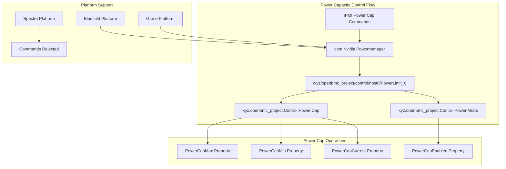
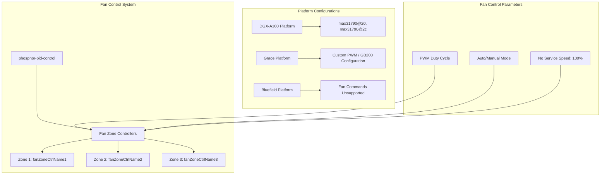
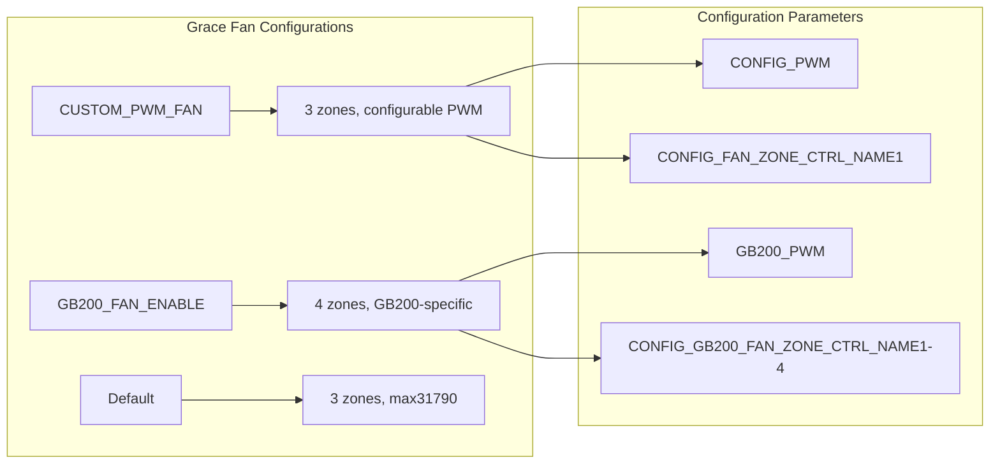
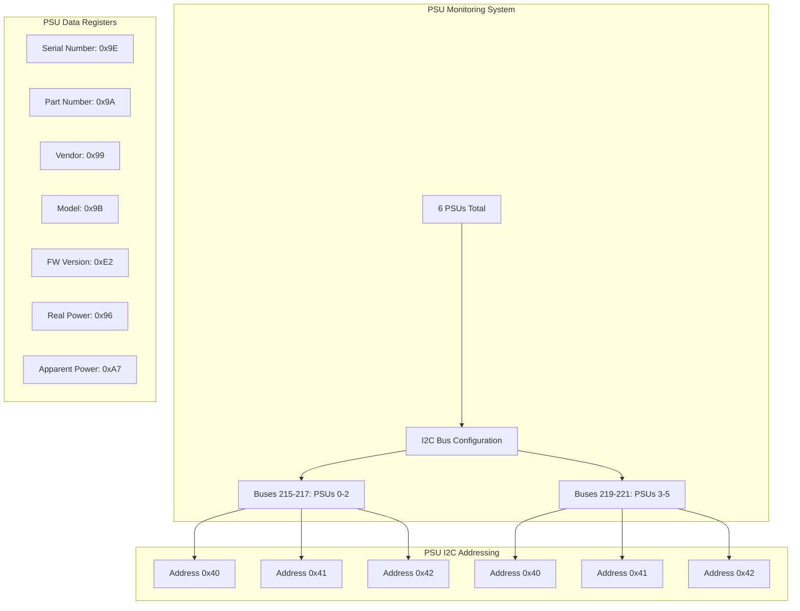
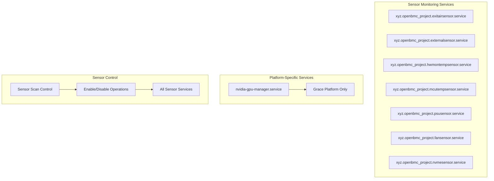

<!-- source: DeepWiki mcp.deepwiki.com · repo NVIDIA/nvidia-ipmi-oem · page 5.2 Power and Thermal Management · fetched 2026-10-26 -->

# Power and Thermal Management

Relevant source files

The following files were used as context for generating this wiki page:

- [Grace/include/gh-config.hpp](Grace/include/gh-config.hpp)
- [include/dgx-a100-config.hpp](include/dgx-a100-config.hpp)
- [src/BF/oemcommands.cpp](src/BF/oemcommands.cpp)
- [src/BF/spectre/oemcommands.cpp](src/BF/spectre/oemcommands.cpp)

This document covers the power and thermal management capabilities of the NVIDIA IPMI OEM Commands library, including power capping, fan control, PSU monitoring, and thermal management across different NVIDIA platforms. The system provides comprehensive power and thermal control through D-Bus service integration and direct hardware communication.

For information about hardware control interfaces, see [I2C and GPIO Control](#5.1). For status monitoring and LED control systems, see [Status and LED Control](#5.3).

## Power Capping System

The power management subsystem provides dynamic power capping capabilities through D-Bus service integration. Power capping allows systems to limit power consumption within specified bounds while maintaining operational stability.

### Power Capacity Management

The power capping system operates through several D-Bus interfaces defined in the codebase:

- **Power Capacity Service**: `com.Nvidia.Powermanager` manages power limit enforcement
- **Power Limit Object**: `/xyz/openbmc_project/control/host0/PowerLimit_0` provides the control interface
- **Power Cap Interface**: `xyz.openbmc_project.Control.Power.Cap` handles capacity settings
- **Power Mode Interface**: `xyz.openbmc_project.Control.Power.Mode` controls enable/disable state

**Sources**: [src/BF/oemcommands.cpp:82-89](), [src/BF/spectre/oemcommands.cpp:227-285]()

### Power Cap Command Support

| Platform | Power Cap Support | Implementation |
|----------|------------------|----------------|
| Bluefield | Full Support | D-Bus service integration |
| Grace | Full Support | D-Bus service integration |
| BF2 | Limited Support | Returns `ccResponseError` |
| Spectre | Not Supported | Returns `ccInvalidCommand` |

The Spectre platform explicitly rejects all power capping commands, while BF2 provides limited functionality. Only Bluefield and Grace platforms offer full power management capabilities.

**Sources**: [src/BF/spectre/oemcommands.cpp:227-285]()

## Thermal Management

The thermal management system controls cooling through fan speed regulation and temperature monitoring. Fan control operates through the phosphor-pid-control service with platform-specific configurations.

### Fan Control Architecture

### Platform-Specific Fan Configurations

The system supports different fan configurations based on the target platform:

#### DGX-A100 Configuration
- **Fan Zones**: 3 zones total
- **Controllers**: `max31790@20` and `max31790@2c`
- **Service**: `phosphor-pid-control`
- **No Service Speed**: 100% when service unavailable

#### Grace Platform Configuration
The Grace platform supports multiple fan control configurations through compile-time flags:

#### Bluefield Platform Limitations
Bluefield platforms do not support fan control commands. All fan-related IPMI commands return `ccResponseError`, indicating these platforms rely on alternative cooling management.

**Sources**: [Grace/include/gh-config.hpp:38-58](), [include/dgx-a100-config.hpp:85-90](), [src/BF/oemcommands.cpp:695-714]()

## PSU Monitoring

The PSU monitoring system provides comprehensive power supply unit health and status information through I2C communication. The system supports monitoring of multiple PSUs with detailed telemetry data.

### PSU Configuration

### PSU Register Map

| Register | Address | Length | Description |
|----------|---------|--------|-------------|
| Serial Number | 0x9E | 0x0D | PSU serial number identification |
| Part Number | 0x9A | 0x0C | PSU part number |
| Vendor | 0x99 | 0x06 | PSU vendor information |
| Model | 0x9B | 0x06 | PSU model identifier |
| FW Version | 0xE2 | Variable | PSU firmware version |
| Real Power | 0x96 | Variable | Actual power output |
| Apparent Power | 0xA7 | Variable | Apparent power measurement |

The PSU monitoring system uses a distributed I2C architecture where PSUs are accessed across multiple I2C buses (215-217 and 219-221) with identical addressing schemes on each bus group.

**Sources**: [include/dgx-a100-config.hpp:28-43]()

## Sensor Monitoring Integration

The thermal management system integrates with comprehensive sensor monitoring services to provide complete environmental awareness.

### Sensor Service Architecture

The sensor monitoring system provides environmental data that feeds into the thermal management algorithms. The `nvidia-gpu-manager.service` is conditionally included only on Grace platforms that don't use `CUSTOM_OEM_CMD` compilation flag.

**Sources**: [Grace/include/gh-config.hpp:60-70](), [include/dgx-a100-config.hpp:92-98]()

## Platform Implementation Differences

The power and thermal management capabilities vary significantly across NVIDIA platforms, reflecting different hardware architectures and use cases.

### Feature Support Matrix

| Feature | Bluefield | Grace | BF2 | Spectre |
|---------|-----------|-------|-----|---------|
| Power Capping | ✅ Full | ✅ Full | ⚠️ Limited | ❌ Disabled |
| Fan Control | ❌ Unsupported | ✅ Full | ❌ Unsupported | ❌ Disabled |
| PSU Monitoring | ✅ Supported | ✅ Supported | ⚠️ Limited | ❌ Disabled |
| Sensor Integration | ✅ Basic | ✅ Full | ⚠️ Limited | ❌ Disabled |

### Platform-Specific Implementations

#### Bluefield Platform
- Power capping through D-Bus integration
- No fan control support (commands return errors)
- PSU monitoring via I2C
- Basic sensor integration

#### Grace Platform  
- Full power and thermal management
- Configurable fan control (3-4 zones)
- Complete sensor monitoring including GPU management
- Support for custom PWM and GB200 configurations

#### BF2 Platform
- Limited functionality across all subsystems
- Most commands return `ccResponseError`
- Reduced feature set compared to full Bluefield

#### Spectre Platform
- All power and thermal commands disabled
- Returns `ccInvalidCommand` for all operations
- No thermal or power management capabilities

**Sources**: [src/BF/oemcommands.cpp:695-714](), [src/BF/spectre/oemcommands.cpp:227-285]()

---

