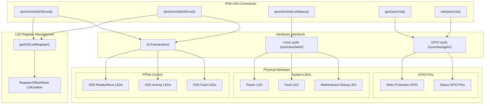
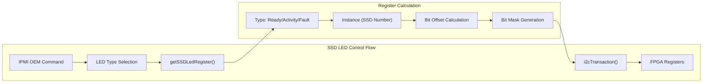
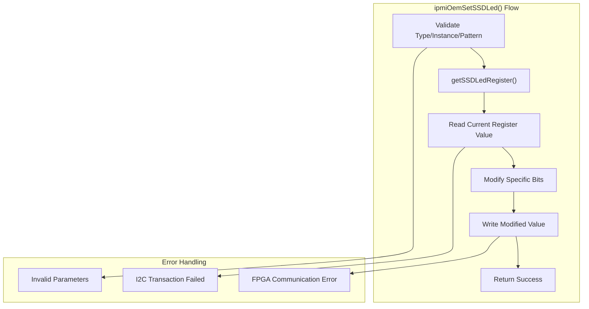
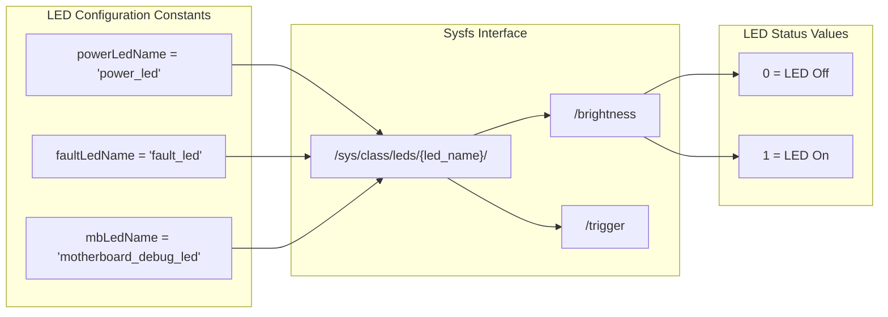
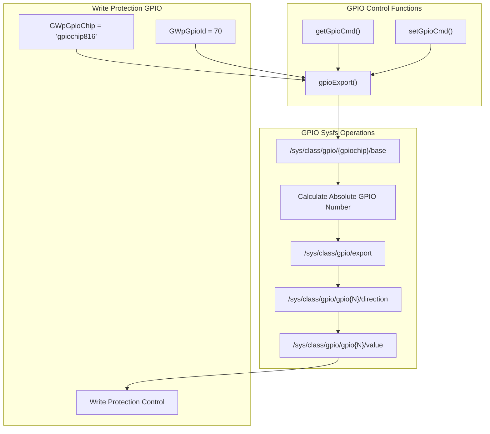

<!-- source: DeepWiki mcp.deepwiki.com · repo NVIDIA/nvidia-ipmi-oem · page 5.3 Status and LED Control · fetched 2026-10-26 -->

# Status and LED Control

Relevant source files

The following files were used as context for generating this wiki page:

- [Grace/include/gh-config.hpp](Grace/include/gh-config.hpp)
- [Grace/src/ghoemcommands.cpp](Grace/src/ghoemcommands.cpp)
- [src/oemcommands.cpp](src/oemcommands.cpp)

This document covers the visual status indication and LED control systems within the NVIDIA IPMI OEM Commands library. The system provides comprehensive LED management for SSDs and system status indicators, along with GPIO control functionality for hardware state management.

For power and thermal management of fans and PSUs, see [Power and Thermal Management](#5.2). For general hardware communication protocols, see [I2C and GPIO Control](#5.1).

## Overview

The LED control system provides two primary categories of visual status indication:

1. **SSD Activity LEDs** - Storage device status indicators controlled via FPGA I2C interface
2. **System Status LEDs** - Power, fault, and debug indicators managed through Linux sysfs interface
3. **GPIO Control** - Direct hardware pin control for write protection and system state management

The LED control functionality is primarily implemented in the Grace platform, with hardware-specific configurations defined for different system variants.

## LED Control Architecture

Sources: [Grace/src/ghoemcommands.cpp:714-873](), [Grace/include/gh-config.hpp:72-86]()

## SSD LED Management

The system provides comprehensive SSD LED control through FPGA I2C communication. Each SSD has multiple LED types for different status indications.

### SSD LED Types and Register Mapping

| LED Type | Register Base | Description | Pattern Values |
|----------|---------------|-------------|----------------|
| Ready/Move | `fpgaMidSSDLedReadyMove` (0x0e) | Indicates SSD ready or data movement | 0-1 |
| Activity | `fpgaMidSSDLedActivity` (0x0c) | Shows SSD I/O activity | 0-1 |
| Fault | `fpgaMidSSDLedFaultBase` (0x08) | Error/fault indication | 0-4 |

The `getSSDLedRegister()` function implements complex bit-field mapping for fault LEDs, where each register contains multiple LED states using 3-bit fields arranged in reverse order.

Sources: [Grace/src/ghoemcommands.cpp:714-744](), [Grace/src/ghoemcommands.cpp:746-834](), [Grace/include/gh-config.hpp:72-79]()

### SSD LED Command Implementation

The SSD LED control uses I2C communication to the FPGA at address `fpgaI2cAddress` (0x3c) on bus `fpgaMidI2cBus` (2):

Sources: [Grace/src/ghoemcommands.cpp:783-834]()

## System LED Management

System LEDs (power, fault, motherboard debug) are controlled through the Linux LED subsystem via sysfs interface.

### System LED Types

The system defines three primary LED types in the configuration:

The `ipmiOemGetLedStatus()` function reads LED brightness values to determine on/off state, returning 1 for any non-zero brightness value and 0 for off.

Sources: [Grace/src/ghoemcommands.cpp:836-873](), [Grace/include/gh-config.hpp:81-83]()

## GPIO Control Interface

The system provides GPIO control functionality for hardware state management, particularly for write protection and status pins.

### GPIO Export and Control Flow

The GPIO control system automatically exports GPIO pins if they don't exist in sysfs, providing persistent access to hardware control pins.

Sources: [Grace/src/ghoemcommands.cpp:1852-1964](), [Grace/include/gh-config.hpp:85-86]()

## Hardware Interface Details

### I2C Communication Protocol

SSD LED control uses the standardized I2C transaction flow:

| Parameter | Value | Description |
|-----------|--------|-------------|
| Bus | `fpgaMidI2cBus` (2) | I2C bus for FPGA communication |
| Slave Address | `fpgaI2cAddress` (0x3c) | FPGA I2C device address |
| Register Access | Single byte write/read | Register address followed by data |

### LED Register Organization

The FPGA LED registers use different bit layouts for different LED types:

- **Ready/Move and Activity LEDs**: 1 bit per LED instance
- **Fault LEDs**: 3 bits per LED instance, packed in reverse order
- **Register Width**: Fault LEDs use `fpgaMidSSDLedFaultWidth` (3) bits per instance

### Error Handling and Validation

The LED control system implements comprehensive error checking:

1. **Parameter Validation**: LED type, instance number, and pattern value ranges
2. **Hardware Communication**: I2C transaction error detection
3. **Resource Management**: Automatic cleanup of I2C file descriptors
4. **GPIO Export**: Automatic GPIO pin setup and error recovery

Sources: [Grace/src/ghoemcommands.cpp:328-349](), [Grace/src/ghoemcommands.cpp:714-873](), [Grace/include/gh-config.hpp:72-86]()

---

