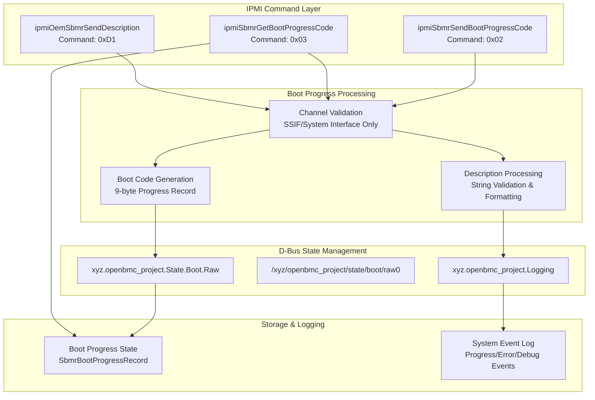
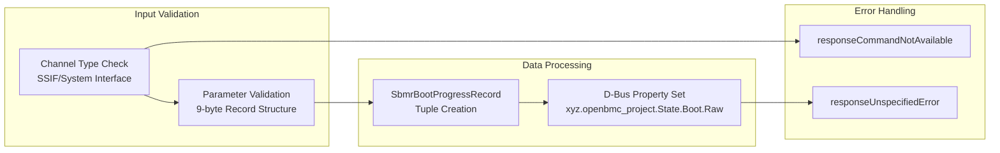
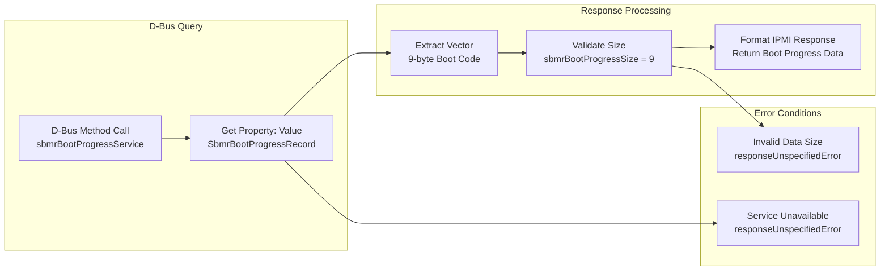
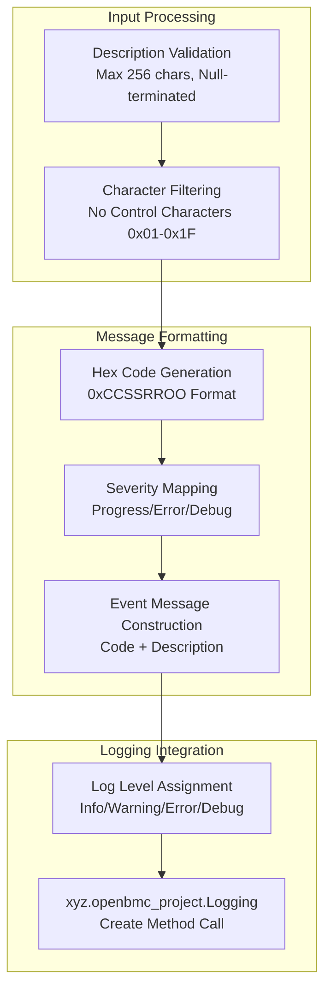
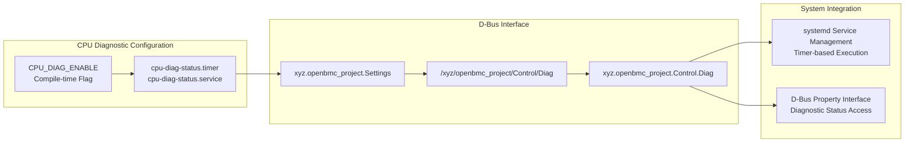
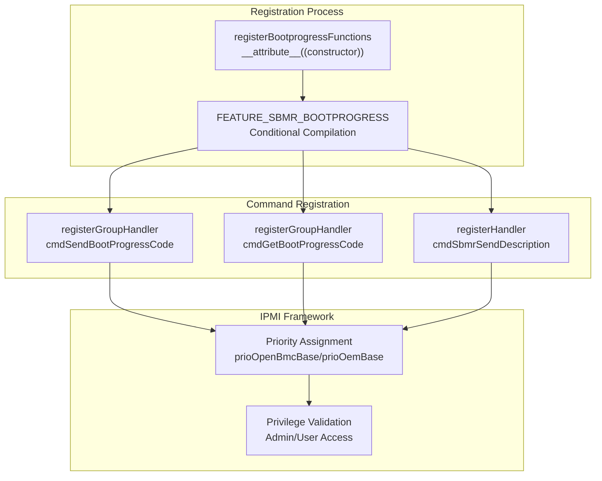

<!-- source: DeepWiki mcp.deepwiki.com · repo NVIDIA/nvidia-ipmi-oem · page 6 Boot Progress and Diagnostics · fetched 2026-10-26 -->

# Boot Progress and Diagnostics

<details>
<summary>Relevant source files</summary>

The following files were used as context for generating this wiki page:

- [Grace/include/gh-config.hpp](Grace/include/gh-config.hpp)
- [Grace/include/sbmr-bootprogress.hpp](Grace/include/sbmr-bootprogress.hpp)
- [Grace/src/sbmr-bootprogress.cpp](Grace/src/sbmr-bootprogress.cpp)
- [include/sbmr-bootprogress.hpp](include/sbmr-bootprogress.hpp)
- [src/sbmr-bootprogress.cpp](src/sbmr-bootprogress.cpp)

</details>


## Purpose and Scope

This page documents the boot progress monitoring and diagnostic capabilities provided by the NVIDIA IPMI OEM Commands library. The system implements Server Base Management Requirements (SBMR) boot progress codes and provides platform-specific diagnostic features to monitor system health during boot and runtime operations.

The boot progress system enables remote monitoring of system initialization stages, error reporting, and debug information collection through IPMI commands. For general system monitoring and sensor management, see [Sensor Management](#4.2). For platform-specific hardware control, see [Hardware Integration](#5).

## SBMR Boot Progress System

The boot progress system implements SBMR-compliant boot monitoring through a set of IPMI commands that allow external management systems to track system boot status and receive detailed error information.

### Boot Progress Architecture



Sources: [include/sbmr-bootprogress.hpp:20-54](), [src/sbmr-bootprogress.cpp:30-82](), [Grace/src/sbmr-bootprogress.cpp:30-83]()

### Boot Progress Code Structure

The system uses a 9-byte boot progress record structure to encode comprehensive boot status information:

| Field | Purpose | Values |
|-------|---------|--------|
| Status Code | Progress/Error/Debug indicator | `0x01` (Progress), `0x02` (Error), `0x03` (Debug) |
| Reserved Fields | Future use | 2 bytes reserved |
| Severity | Error severity level | `0x40` (Minor), `0x80` (Major), `0x90` (Unrecovered), `0xA0` (Uncontained) |
| Operation | Boot operation identifier | 2 bytes for operation classification |
| Sub-Class | Operation sub-category | 1 byte |
| Code Class | Error/progress classification | 1 byte |
| Instance | Instance identifier | 1 byte |

Sources: [include/sbmr-bootprogress.hpp:45-53](), [src/sbmr-bootprogress.cpp:61-66]()

## Boot Progress Code Management

### Sending Boot Progress Codes

The `ipmiSbmrSendBootProgressCode` function processes incoming boot progress information and stores it in the OpenBMC state management system:



Sources: [src/sbmr-bootprogress.cpp:30-81](), [Grace/src/sbmr-bootprogress.cpp:30-82]()

### Retrieving Boot Progress Codes

The `ipmiSbmrGetBootProgressCode` function retrieves the current boot progress state from the D-Bus service:



Sources: [src/sbmr-bootprogress.cpp:83-122](), [Grace/src/sbmr-bootprogress.cpp:85-127]()

## Boot Progress Description System

### Enhanced Error Reporting

The `ipmiOemSbmrSendDescription` command provides detailed textual descriptions for boot events, creating comprehensive log entries in the OpenBMC logging system:



Sources: [src/sbmr-bootprogress.cpp:123-244](), [Grace/src/sbmr-bootprogress.cpp:128-262]()

### Event Message Format

Boot progress descriptions are formatted as structured log entries:

| Status Code | Message Format | Log Level |
|-------------|----------------|-----------|
| `0x01` (Progress) | `"Progress Code 0xCCSSRROO: description"` | Informational |
| `0x02` (Error) | `"Error Code [Severity] 0xCCSSRROO: description"` | Warning/Error |
| `0x03` (Debug) | `"Debug Code 0xCCSSRROO: description"` | Debug |

Where `CC` = Code Class, `SS` = Sub-Class, `RR` = Operation 2nd, `OO` = Operation 1st.

Sources: [src/sbmr-bootprogress.cpp:187-243]()

## CPU Diagnostics (Grace Platform)

The Grace platform includes optional CPU diagnostic capabilities for enhanced system health monitoring:

### Diagnostic Service Integration



Sources: [Grace/include/gh-config.hpp:88-102]()

### Platform-Specific Configuration

The Grace platform provides conditional compilation support for CPU diagnostics:

```cpp
#ifdef CPU_DIAG_ENABLE
constexpr auto diagServiceList = "cpu-diag-status.timer "
                                 "cpu-diag-status.service";
#endif
```

The diagnostic system integrates with systemd for service lifecycle management and uses standardized OpenBMC D-Bus interfaces for status reporting.

Sources: [Grace/include/gh-config.hpp:88-91](), [Grace/include/gh-config.hpp:97-102]()

## Command Registration and Interface

### IPMI Command Mapping

The boot progress system registers three main IPMI commands with specific privilege requirements:

| Command | Group/NetFn | Code | Privilege | Function |
|---------|-------------|------|-----------|----------|
| Send Boot Progress | `0xAE` (Group Ext) | `0x02` | Admin | `ipmiSbmrSendBootProgressCode` |
| Get Boot Progress | `0xAE` (Group Ext) | `0x03` | User | `ipmiSbmrGetBootProgressCode` |
| Send Description | `0x3C` (OEM) | `0xD1` | Admin | `ipmiOemSbmrSendDescription` |



Sources: [src/sbmr-bootprogress.cpp:246-271](), [Grace/src/sbmr-bootprogress.cpp:264-289]()

The system uses conditional compilation with the `FEATURE_SBMR_BOOTPROGRESS` flag to enable boot progress functionality, allowing platforms to selectively include this feature based on their requirements.

Sources: [src/sbmr-bootprogress.cpp:248](), [Grace/src/sbmr-bootprogress.cpp:266]()

---

