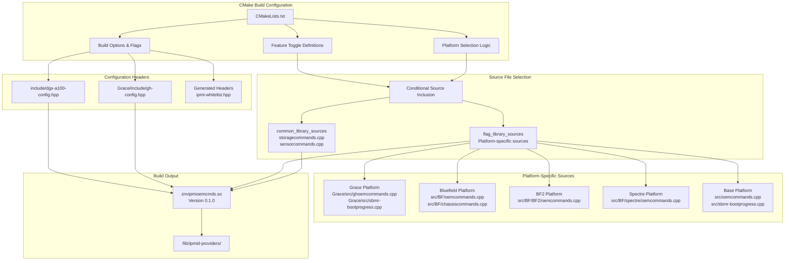
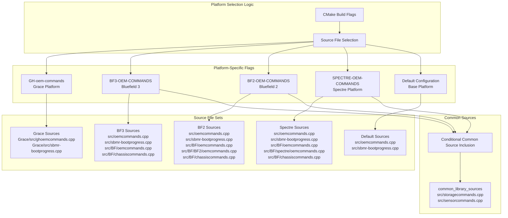
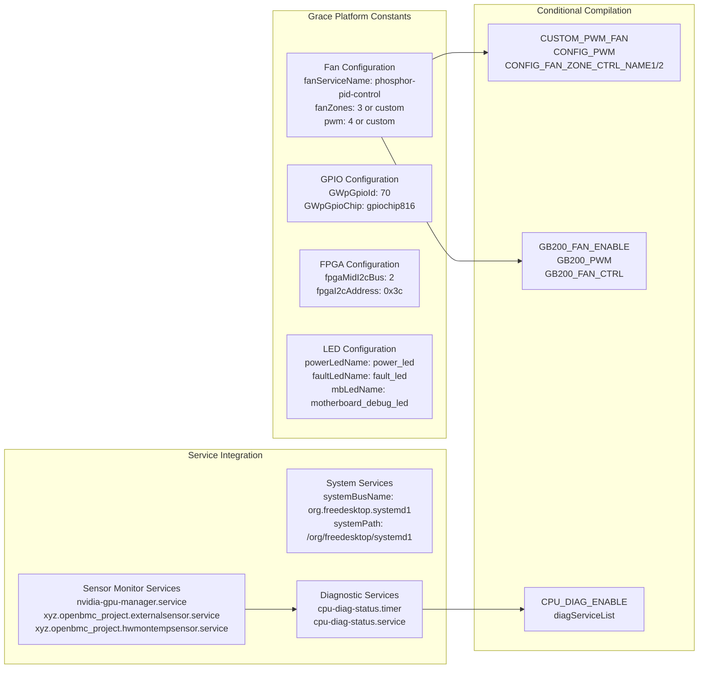
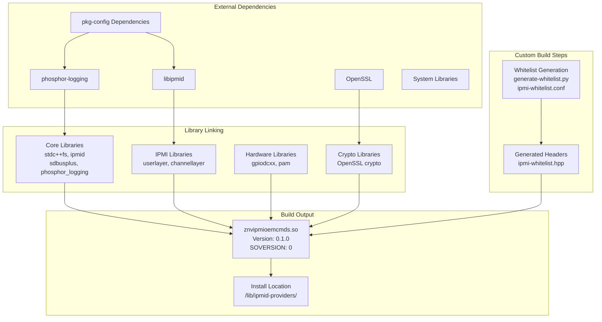

<!-- source: DeepWiki mcp.deepwiki.com · repo NVIDIA/nvidia-ipmi-oem · page 7 Configuration and Build · fetched 2026-10-26 -->

# Configuration and Build

Relevant source files

The following files were used as context for generating this wiki page:

- [CMakeLists.txt](CMakeLists.txt)
- [Grace/include/gh-config.hpp](Grace/include/gh-config.hpp)
- [include/dgx-a100-config.hpp](include/dgx-a100-config.hpp)
- [src/BF/chassiscommands.cpp](src/BF/chassiscommands.cpp)

This document covers the build system configuration, platform selection mechanisms, and compile-time feature toggles that control the functionality and hardware support of the NVIDIA IPMI OEM Commands library. The build system uses CMake with extensive conditional compilation to support multiple NVIDIA platforms and hardware configurations.

For information about platform-specific implementations and their runtime behavior, see [Platform Implementations](#3). For details about the resulting command structures and runtime architecture, see [System Architecture](#2).

## Build System Overview

The NVIDIA IPMI OEM Commands library uses a CMake-based build system that generates the `znvipmioemcmds` shared library. The build process is highly configurable, allowing the same codebase to support multiple NVIDIA platforms with different feature sets and hardware configurations.

Sources: [CMakeLists.txt:1-236]()

## Platform Selection and Source Configuration

The build system implements a hierarchical platform selection mechanism that determines which source files to include based on compile-time flags. This allows the same codebase to support different NVIDIA platforms with varying levels of functionality.

Sources: [CMakeLists.txt:120-150](), [CMakeLists.txt:185-189]()

## Feature Toggles and Conditional Compilation

The build system provides extensive feature toggles that control specific functionality within each platform. These toggles use CMake options and compile-time definitions to enable or disable features.

| Feature Toggle | CMake Option | Compile Definition | Purpose |
|----------------|--------------|-------------------|---------|
| Entity Manager Decorators | `USING_ENTITY_MANAGER_DECORATORS` | `USING_ENTITY_MANAGER_DECORATORS` | Enable FRU to entity ID mapping |
| Network Device Selection | `USE_ETH1_NETWORK_DEVICE` | `USE_ETH1_NETWORK_DEVICE` | Use eth1 instead of eth0 for network settings |
| Boot Progress Support | `sbmr-boot-progress` | `FEATURE_SBMR_BOOTPROGRESS` | Enable ARM system boot progress codes |
| SMBPBI Passthrough | `disable-smbpbi-passthru` | `ENABLE_SMBPBI_PASSTHRU=0/1` | Control GPU SMBPBI command passthrough |
| Custom PWM/Fan | `custom-pwm-fan` | `CUSTOM_PWM_FAN` | Enable custom fan/PWM configurations |
| GB200 Fan Support | `gb200-fan-enable` | `GB200_FAN_ENABLE` | Enable GB200-specific fan configurations |
| CPU Diagnostics | `cpu-diag-enable` | `CPU_DIAG_ENABLE` | Enable CPU diagnostic commands |
| GB200NVL Commands | `gb200nvl-oem-commands` | `GB200NVL_OEM_COMMANDS` | Enable GB200NVL-specific OEM commands |
| BF3 Chassis Commands | `bf3-chassis-commands` | `BF3_CHASSIS_COMMAND` | Enable BF3 chassis control commands |
| Write Protection | `chassis-write-protect` | `CHASSIS_WRITE_PROTECT` | Enable chassis write protection |

Sources: [CMakeLists.txt:10-70](), [CMakeLists.txt:152-197](), [CMakeLists.txt:213-235]()

## Hardware Configuration Constants

Platform-specific configuration is managed through dedicated header files that define hardware addresses, service names, and operational parameters. These configurations are selected at compile time based on platform flags.

### Grace Platform Configuration

The Grace platform configuration defines GPU-focused hardware settings and service integration parameters.

Sources: [Grace/include/gh-config.hpp:28-102]()

### DGX-A100 Platform Configuration

The DGX-A100 configuration focuses on multi-PSU systems and complex hardware component addressing.

| Component | Configuration | Values |
|-----------|---------------|---------|
| PSU Configuration | `psuNumber` | 6 units |
| PSU I2C Addresses | `psuAddr[]` | {0x40, 0x41, 0x42, 0x40, 0x41, 0x42} |
| PSU I2C Buses | `psuBus[]` | {215, 216, 217, 219, 220, 221} |
| FPGA MB Bus | `fpgaMbI2cBus` | 1 |
| FPGA MID Bus | `fpgaMidI2cBus` | 2 |
| FPGA I2C Address | `fpgaI2cAddress` | 0x3c |
| CEC I2C Configuration | `cecI2cAddress`, `cecI2cBus` | 0x55, 1 |
| PEX Switch Buses | `pexSwitchI2CBus[]` | {7, 9, 7, 9} |
| Write Protection GPIO | `mbWpGpioId`, `mbWpGpioChip` | 55, "gpiochip792" |

Sources: [include/dgx-a100-config.hpp:28-105]()

## Build Dependencies and Library Generation

The build system integrates with the OpenBMC ecosystem through multiple external dependencies and generates a shared library for IPMI command providers.

Sources: [CMakeLists.txt:91-211]()

## Compilation Flags and Standards

The build system enforces strict compilation standards and includes comprehensive error checking to ensure code quality across all supported platforms.

| Configuration | Setting | Purpose |
|---------------|---------|---------|
| C++ Standard | C++20 | Modern C++ features and type safety |
| CMake Minimum | 3.5 | Build system compatibility |
| Error Handling | `-Werror` | Treat warnings as errors |
| Type Safety | `-Wtype-limits`, `-Wnull-dereference` | Prevent common programming errors |
| Boost Configuration | `BOOST_ERROR_CODE_HEADER_ONLY` | Header-only Boost usage |
| ASIO Configuration | `BOOST_ASIO_DISABLE_THREADS` | Single-threaded ASIO operation |

The build system also supports GPIO-based write protection through conditional compilation, allowing hardware-specific write protection mechanisms to be enabled based on GPIO chip and pin configurations.

Sources: [CMakeLists.txt:1-89](), [CMakeLists.txt:35-46]()

---

