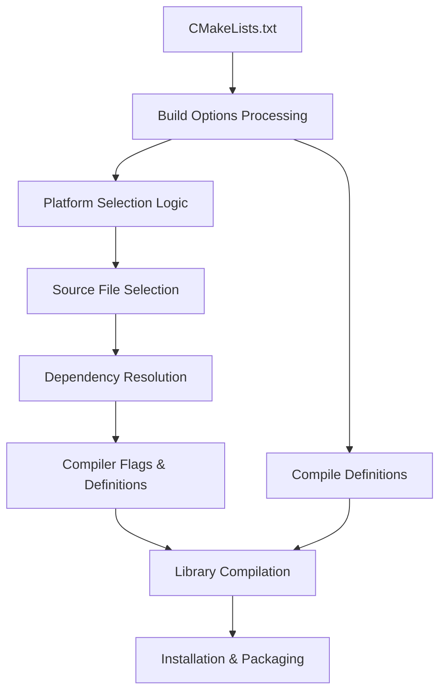
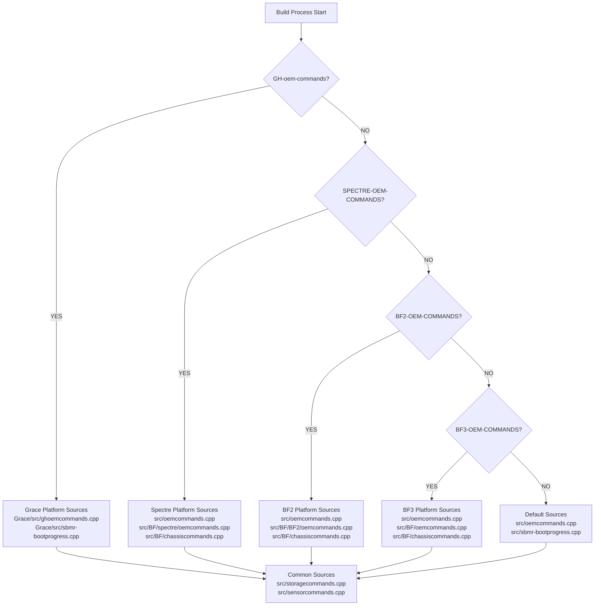
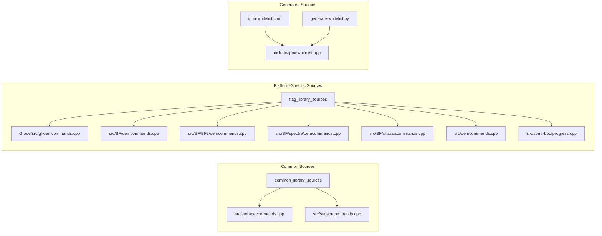
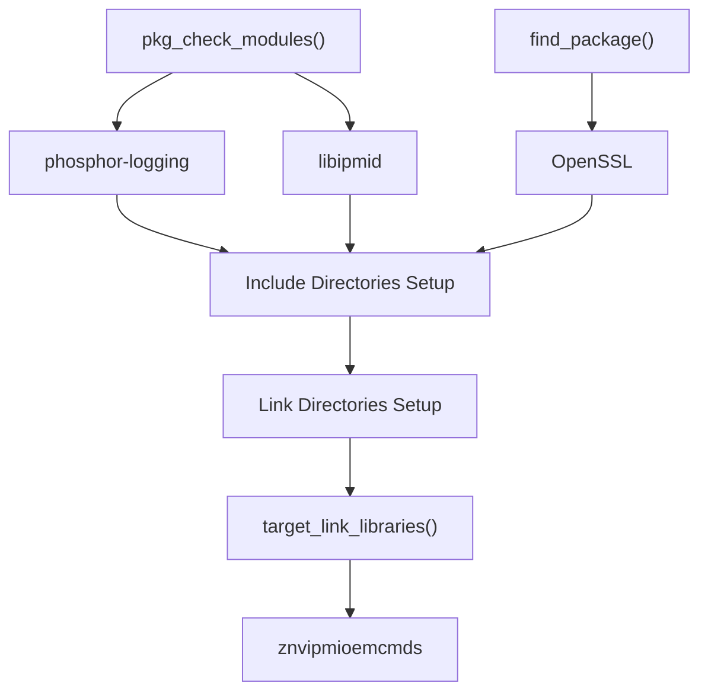
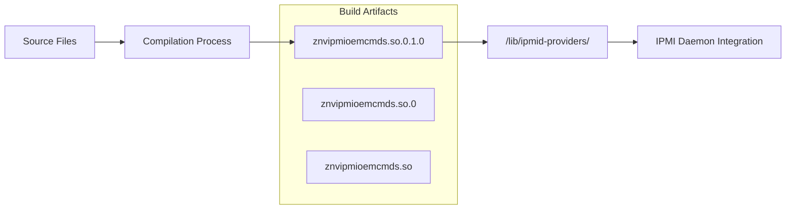

<!-- source: DeepWiki mcp.deepwiki.com · repo NVIDIA/nvidia-ipmi-oem · page 7.1 Build System · fetched 2026-10-26 -->

# Build System

Relevant source files

The following files were used as context for generating this wiki page:

- [.gitignore](.gitignore)
- [CMakeLists.txt](CMakeLists.txt)
- [src/BF/chassiscommands.cpp](src/BF/chassiscommands.cpp)

This document covers the CMake-based build system for the NVIDIA IPMI OEM Commands library. The build system manages platform-specific compilation, conditional feature inclusion, and library generation for the `znvipmioemcmds` shared library.

For information about platform-specific configurations and hardware addresses, see [Platform Configuration](#7.2). For details about command definitions and constants used in the build process, see [Command Definitions and Constants](#7.3).

## CMake Configuration Structure

The build system is implemented using CMake 3.5+ and follows a modular approach with extensive use of conditional compilation. The main configuration is defined in `CMakeLists.txt` which sets up C++20 compilation standards, manages dependencies, and controls platform-specific feature inclusion.

### Build Configuration Flow

**Sources**: [CMakeLists.txt:1-236]()

## Platform Selection and Feature Flags

The build system uses CMake options to control which platform-specific code and features are included in the final library. These options determine both source file inclusion and compile-time definitions.

### Platform Options

| Option | Purpose | Default |
|--------|---------|---------|
| `GH-oem-commands` | Enable Grace platform specific commands | OFF |
| `BF2-OEM-COMMANDS` | Enable BF2 platform variant | OFF |
| `BF3-OEM-COMMANDS` | Enable BF3 platform variant | OFF |
| `SPECTRE-OEM-COMMANDS` | Enable Spectre platform (disabled commands) | OFF |

### Feature Control Options

| Option | Purpose | Default |
|--------|---------|---------|
| `USING_ENTITY_MANAGER_DECORATORS` | Enable EM decorators for FRU mapping | ON |
| `USE_ETH1_NETWORK_DEVICE` | Use eth1 instead of eth0 for network settings | OFF |
| `disable-smbpbi-passthru` | Disable SMBPBI passthrough commands | OFF |
| `custom-pwm-fan` | Enable custom PWM/fan configurations | OFF |
| `gb200-fan-enable` | Enable GB200 specific fan configurations | OFF |
| `cpu-diag-enable` | Enable CPU diagnostic commands | OFF |

### Platform Selection Logic

**Sources**: [CMakeLists.txt:120-151](), [CMakeLists.txt:185-189]()

## Source File Organization

The build system organizes source files into categories based on functionality and platform requirements. Source selection is driven by CMake conditional logic that determines which files to include in the final library.

### Source File Categories

**Sources**: [CMakeLists.txt:115-117](), [CMakeLists.txt:122-150](), [CMakeLists.txt:106-111]()

### Conditional Source Inclusion

The build system uses cascading conditional logic to select appropriate source files:

1. **Grace Platform**: Uses Grace-specific sources and excludes Bluefield components
2. **Spectre Platform**: Includes disabled command implementations in `src/BF/spectre/oemcommands.cpp`
3. **BF2 Platform**: Includes limited command implementations in `src/BF/BF2/oemcommands.cpp`
4. **BF3 Platform**: Uses standard Bluefield sources with BF3-specific chassis commands
5. **Default**: Basic OEM commands without platform-specific extensions

**Sources**: [CMakeLists.txt:120-151]()

## Dependency Management

The build system manages external dependencies through PkgConfig and CMake's find_package mechanism. All dependencies are linked to the final `znvipmioemcmds` shared library.

### Required Dependencies

| Dependency | Purpose | Link Method |
|------------|---------|-------------|
| `phosphor-logging` | OpenBMC logging framework | PkgConfig |
| `libipmid` | IPMI daemon library | PkgConfig |
| `OpenSSL` | Cryptographic functions | find_package |
| `sdbusplus` | D-Bus C++ bindings | Direct linking |
| `gpiodcxx` | GPIO control library | Direct linking |
| `pam` | PAM authentication | Direct linking |

### Dependency Resolution Process

**Sources**: [CMakeLists.txt:91-104](), [CMakeLists.txt:201-209]()

## Compiler Configuration

The build system applies strict compiler flags and preprocessor definitions to ensure code quality and platform-specific behavior.

### Compiler Flags

The following warning and error flags are enforced:

- `-Werror`: Treat warnings as errors
- `-Wtype-limits`: Warn about type limit comparisons  
- `-Wnull-dereference`: Warn about null pointer dereferences
- `-Wno-psabi`: Suppress ABI warnings

### Preprocessor Definitions

Key compile-time definitions control library behavior:

| Definition | Purpose |
|------------|---------|
| `BOOST_ERROR_CODE_HEADER_ONLY` | Use header-only Boost error codes |
| `BOOST_ASIO_DISABLE_THREADS` | Disable threading in Boost ASIO |
| `ENABLE_SMBPBI_PASSTHRU` | Control SMBPBI passthrough availability |
| `USING_ENTITY_MANAGER_DECORATORS` | Enable Entity Manager integration |
| `FEATURE_SBMR_BOOTPROGRESS` | Enable boot progress reporting |

**Sources**: [CMakeLists.txt:72-89](), [CMakeLists.txt:152-156](), [CMakeLists.txt:213-235]()

## Library Generation and Installation

The build process culminates in generating the `znvipmioemcmds` shared library, which is installed as an IPMI provider plugin.

### Library Properties

- **Name**: `znvipmioemcmds`
- **Type**: Shared library (.so)
- **Version**: 0.1.0
- **SOVERSION**: 0
- **Installation Path**: `/lib/ipmid-providers/`

### Build Artifacts

**Sources**: [CMakeLists.txt:185-211](), [CMakeLists.txt:199-211]()

The library is automatically loaded by the OpenBMC IPMI daemon (`ipmid`) at runtime, providing the NVIDIA-specific OEM command implementations to the IPMI framework.

---

