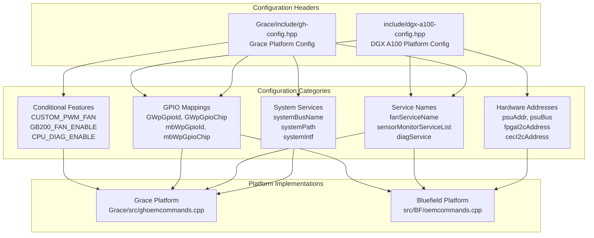
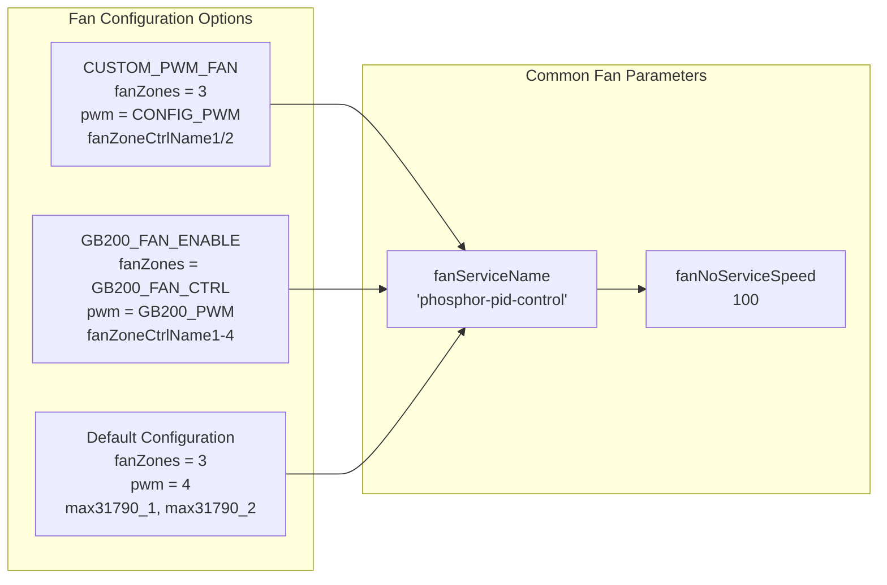
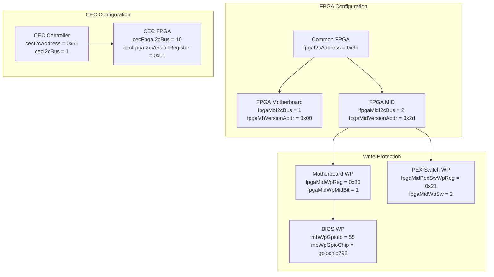
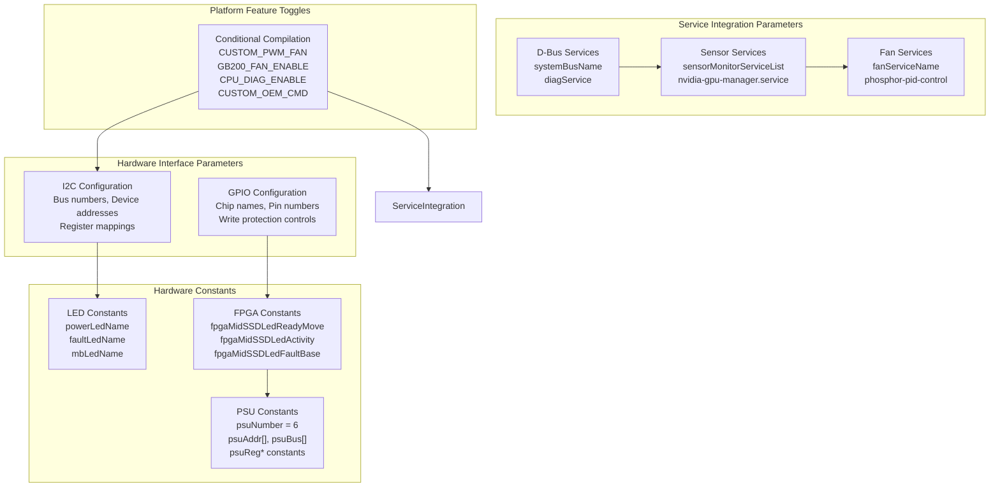

<!-- source: DeepWiki mcp.deepwiki.com · repo NVIDIA/nvidia-ipmi-oem · page 7.2 Platform Configuration · fetched 2026-10-26 -->

# Platform Configuration

<details>
<summary>Relevant source files</summary>

The following files were used as context for generating this wiki page:

- [Grace/include/gh-config.hpp](Grace/include/gh-config.hpp)
- [include/dgx-a100-config.hpp](include/dgx-a100-config.hpp)

</details>


This document covers platform-specific configuration parameters, hardware addresses, service names, and feature toggles used throughout the NVIDIA IPMI OEM commands library. These configurations define hardware-specific constants, D-Bus service names, GPIO mappings, and conditional compilation settings that enable different functionality across NVIDIA platforms.

For information about the build system that processes these configurations, see [Build System](#7.1). For the actual command definitions and constants, see [Command Definitions and Constants](#7.3).

## Configuration Architecture Overview

The platform configuration system uses header files to define platform-specific parameters that are compiled into the appropriate platform implementations. Each platform has its own configuration header that defines hardware addresses, service names, and feature flags.



Sources: [Grace/include/gh-config.hpp:1-103](), [include/dgx-a100-config.hpp:1-108]()

## Grace Platform Configuration

The Grace platform configuration defines parameters for GPU-focused systems, including fan control, sensor monitoring, LED management, and optional CPU diagnostics.

### System D-Bus Configuration

| Constant | Value | Purpose |
|----------|-------|---------|
| `systemBusName` | `"org.freedesktop.systemd1"` | SystemD D-Bus service name |
| `systemPath` | `"/org/freedesktop/systemd1"` | SystemD D-Bus object path |
| `systemIntf` | `"org.freedesktop.systemd1.Manager"` | SystemD Manager interface |

### Fan Control Configuration

The Grace platform supports multiple fan control configurations through conditional compilation:



### Sensor Monitoring Services

The Grace platform defines a comprehensive list of sensor monitoring services:

| Service Name | Purpose |
|-------------|---------|
| `nvidia-gpu-manager.service` | GPU sensor management (disabled with `CUSTOM_OEM_CMD`) |
| `xyz.openbmc_project.exitairsensor.service` | Exit air temperature monitoring |
| `xyz.openbmc_project.externalsensor.service` | External sensor management |
| `xyz.openbmc_project.hwmontempsensor.service` | Hardware monitor temperature sensors |
| `xyz.openbmc_project.mcutempsensor.service` | MCU temperature sensors |
| `xyz.openbmc_project.psusensor.service` | Power supply unit sensors |
| `xyz.openbmc_project.fansensor.service` | Fan sensor monitoring |
| `xyz.openbmc_project.nvmesensor.service` | NVMe storage sensors |

### LED and FPGA Configuration

The Grace platform defines several LED and FPGA control parameters:

| Parameter | Value | Purpose |
|-----------|-------|---------|
| `fpgaMidSSDLedReadyMove` | `0x0e` | SSD ready/move LED register |
| `fpgaMidSSDLedActivity` | `0x0c` | SSD activity LED register |
| `fpgaMidSSDLedFaultBase` | `0x08` | SSD fault LED base register |
| `fpgaMidI2cBus` | `2` | FPGA MID I2C bus number |
| `fpgaI2cAddress` | `0x3c` | FPGA I2C device address |
| `powerLedName` | `"power_led"` | Power LED identifier |
| `faultLedName` | `"fault_led"` | Fault LED identifier |
| `mbLedName` | `"motherboard_debug_led"` | Motherboard debug LED |

Sources: [Grace/include/gh-config.hpp:38-84](), [Grace/include/gh-config.hpp:60-70]()

## DGX A100 Platform Configuration

The DGX A100 platform configuration focuses on high-density GPU systems with extensive PSU arrays, FPGA controllers, and PEX switch management.

### Power Supply Unit Configuration

The DGX A100 supports 6 PSUs with specific I2C addressing:

| PSU Index | I2C Address | I2C Bus | Purpose |
|-----------|-------------|---------|---------|
| 0 | `0x40` | `215` | PSU group 1, unit 1 |
| 1 | `0x41` | `216` | PSU group 1, unit 2 |
| 2 | `0x42` | `217` | PSU group 1, unit 3 |
| 3 | `0x40` | `219` | PSU group 2, unit 1 |
| 4 | `0x41` | `220` | PSU group 2, unit 2 |
| 5 | `0x42` | `221` | PSU group 2, unit 3 |

### PSU Register Mapping

| Register Constant | Address | Length | Purpose |
|------------------|---------|--------|---------|
| `psuRegSerialNumber` | `0x9e` | `0x0D` | PSU serial number |
| `psuRegPartNumber` | `0x9A` | `0x0C` | PSU part number |
| `psuRegVendor` | `0x99` | `0x06` | PSU vendor information |
| `psuRegModel` | `0x9B` | `0x06` | PSU model number |
| `psuRegFWVersion` | `0xE2` | - | Firmware version |
| `psuRegPowerReal` | `0x96` | - | Real power consumption |

### FPGA and CEC Configuration



### PEX Switch Configuration

The DGX A100 includes 4 PEX switches with specific I2C configuration:

| Switch Index | I2C Bus | I2C Address | Version Write Command |
|-------------|---------|-------------|----------------------|
| 0 | `7` | `0x48` | `0x04` |
| 1 | `9` | `0x49` | `0x00` |
| 2 | `7` | `0x48` | `0x3C` |
| 3 | `9` | `0x49` | `0x84` |

Sources: [include/dgx-a100-config.hpp:28-44](), [include/dgx-a100-config.hpp:45-82](), [include/dgx-a100-config.hpp:70-73]()

## Configuration Parameter Categories

The platform configurations can be categorized into several functional groups:



## Conditional Compilation Features

Both platforms support conditional compilation to enable/disable specific features:

### Grace Platform Features

| Feature Flag | Purpose | Default Behavior |
|-------------|---------|------------------|
| `CUSTOM_PWM_FAN` | Custom PWM fan configuration | Uses `CONFIG_PWM` and `CONFIG_FAN_ZONE_CTRL_NAME*` |
| `GB200_FAN_ENABLE` | GB200-specific fan configuration | Uses `GB200_FAN_CTRL` and `GB200_PWM` |
| `CPU_DIAG_ENABLE` | CPU diagnostics functionality | Enables `diagServiceList` and D-Bus interfaces |
| `CUSTOM_OEM_CMD` | Custom OEM command set | Disables `nvidia-gpu-manager.service` |

### Fan Zone Configuration Example

The fan control system adapts based on compilation flags:

```cpp
// From gh-config.hpp lines 41-58
#ifdef CUSTOM_PWM_FAN
constexpr auto fanZones = 3;
constexpr auto pwm = int(CONFIG_PWM);
constexpr auto fanZoneCtrlName1 = STR(CONFIG_FAN_ZONE_CTRL_NAME1);
constexpr auto fanZoneCtrlName2 = STR(CONFIG_FAN_ZONE_CTRL_NAME2);
#elif GB200_FAN_ENABLE
constexpr auto fanZones = int(GB200_FAN_CTRL);
constexpr auto pwm = int(GB200_PWM);
// Additional zone names for GB200
#else
constexpr auto fanZones = 3;
constexpr auto pwm = 4;
constexpr auto fanZoneCtrlName1 = "max31790_1";
constexpr auto fanZoneCtrlName2 = "max31790_2";
#endif
```

Sources: [Grace/include/gh-config.hpp:41-58](), [Grace/include/gh-config.hpp:88-102](), [include/dgx-a100-config.hpp:85-105]()

---

