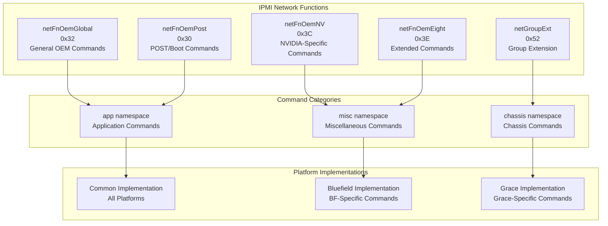
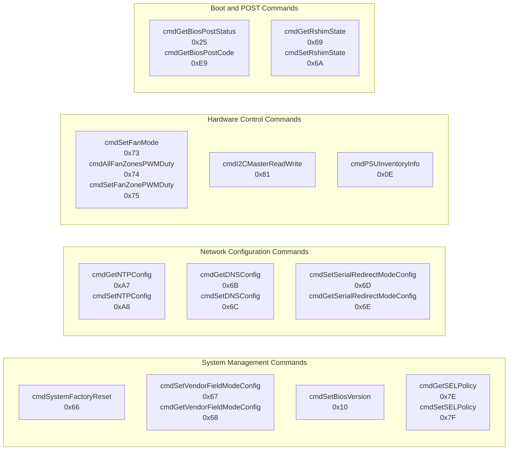
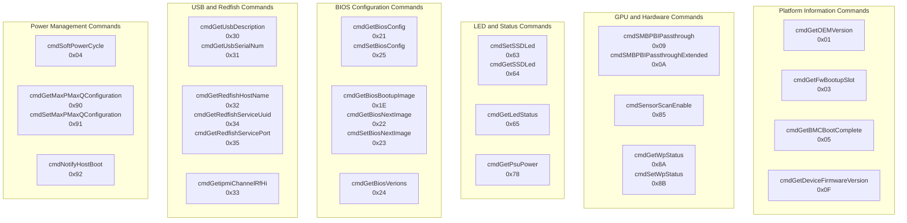
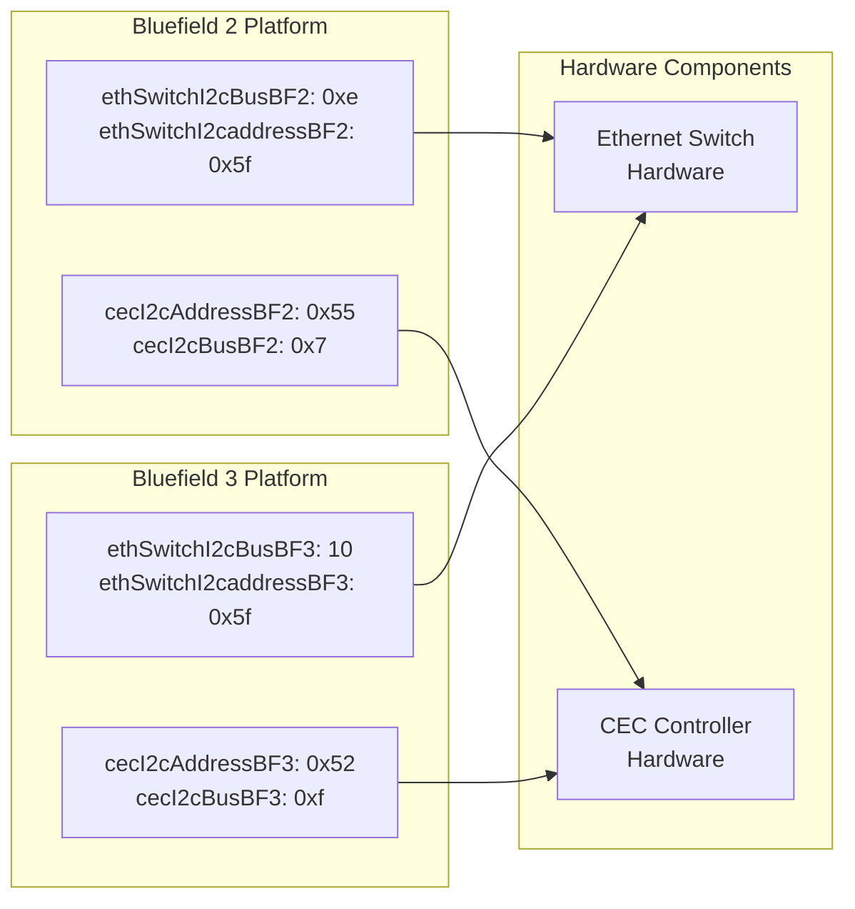
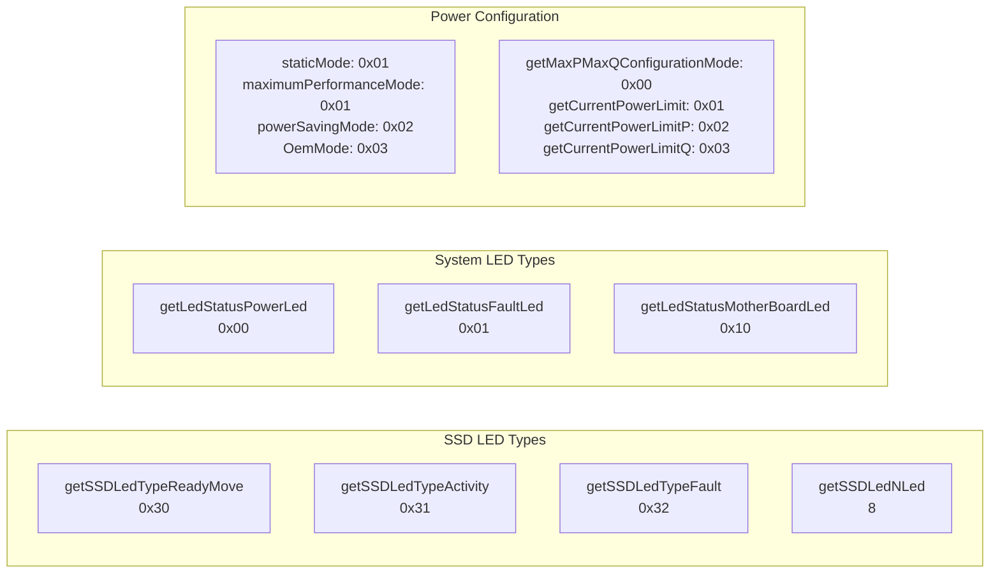
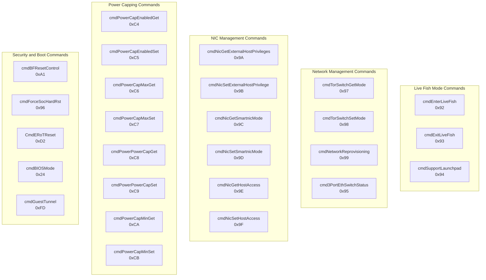
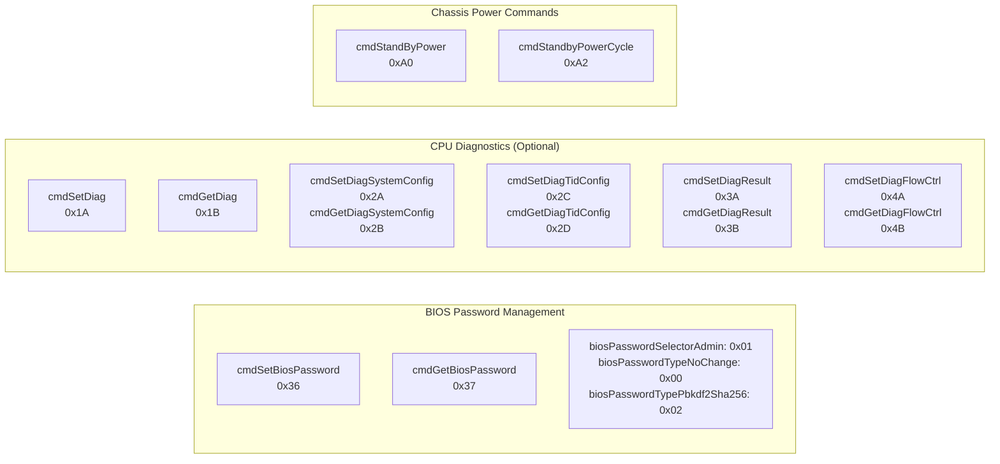
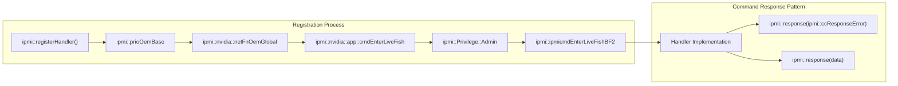

<!-- source: DeepWiki mcp.deepwiki.com · repo NVIDIA/nvidia-ipmi-oem · page 7.3 Command Definitions and Constants · fetched 2026-10-26 -->

# Command Definitions and Constants

<details>
<summary>Relevant source files</summary>

The following files were used as context for generating this wiki page:

- [Grace/include/ghoemcommands.hpp](Grace/include/ghoemcommands.hpp)
- [include/oemcommands.hpp](include/oemcommands.hpp)
- [include/oemcommandsBF.hpp](include/oemcommandsBF.hpp)
- [src/BF/BF2/oemcommands.cpp](src/BF/BF2/oemcommands.cpp)

</details>


This document describes the IPMI command codes, network function definitions, device addresses, and protocol constants used throughout the NVIDIA IPMI OEM commands system. These constants define the interface between IPMI clients and the BMC, establishing the command structure and addressing scheme for hardware management operations.

For information about how these commands are implemented and registered, see [IPMI Command Processing](#2.1). For platform-specific command implementations, see [Platform Implementations](#3).

## Network Function Organization

The system organizes IPMI commands using standardized network function codes that categorize different types of operations. These network functions serve as the top-level routing mechanism for IPMI command processing.

### Core Network Functions



Sources: [include/oemcommands.hpp:26-30](), [include/oemcommandsBF.hpp:26-30](), [Grace/include/ghoemcommands.hpp:27-30]()

## Command Code Structure by Namespace

The system organizes command codes within three primary namespaces, each serving distinct functional categories. This hierarchical organization enables systematic command routing and platform-specific implementations.

### Application Commands (app namespace)



Sources: [include/oemcommands.hpp:34-56](), [Grace/include/ghoemcommands.hpp:34-40]()

### Miscellaneous Commands (misc namespace)



Sources: [include/oemcommands.hpp:61-93](), [Grace/include/ghoemcommands.hpp:44-75]()

## Device and Hardware Address Constants

The system defines specific device identifiers and I2C addresses for hardware component access across different platforms.

### Device Firmware Version Constants

| Device Type | Constant | Value | Description |
|-------------|----------|-------|-------------|
| Main Board FPGA | `getFirmwareVersionDeviceMBFPGA` | 0x00 | Motherboard FPGA |
| GPU Board FPGA | `getFirmwareVersionDeviceGBFPGA` | 0x01 | GPU Board FPGA |
| PSU Units | `getFirmwareVersionDevicePSU0-5` | 0x02-0x07 | Power Supply Units 0-5 |
| MID FPGA | `getFirmwareVersionDeviceMIDFPGA` | 0x08 | MID Controller FPGA |
| CEC Controllers | `getFirmwareVersionDeviceCEC` | 0x09 | Consumer Electronics Control |
| FPGA CEC | `getFirmwareVersionDeviceFPGACEC` | 0x0A | FPGA CEC Controller |
| PEX Switches | `getFirmwareVersionDevicePEXSwitch0-3` | 0x10-0x13 | PCIe Switches 0-3 |
| BMC Images | `getFirmwareVersionDeviceBMCActive/Inactive` | 0x20-0x21 | BMC Active/Inactive Images |

Sources: [include/oemcommands.hpp:94-111]()

### Platform-Specific I2C Addressing



Sources: [include/oemcommandsBF.hpp:26-34]()

## Configuration and Status Constants

### Write Protection Types and IDs

The system defines hierarchical write protection constants for different hardware components:

```mermaid
graph TB
    subgraph "Write Protection Types"
        WPTypePEX["getWPTypePEX<br/>0x00<br/>PEX Switch Protection"]
        WPTypeFRU["getWPTypeFRU<br/>0x01<br/>FRU Protection"]
    end
    
    subgraph "PEX Switch IDs"
        PEXSwitch0["getWPIdPexSW0: 0x00"]
        PEXSwitch1["getWPIdPexSW1: 0x01"]
        PEXSwitch2["getWPIdPexSW2: 0x02"]
        PEXSwitch3["getWPIdPexSW3: 0x03"]
    end
    
    subgraph "FRU Component IDs"
        WPIDMB["getWPIdMB: 0x00<br/>Main Board"]
        WPIDMid["getWPIdMid: 0x01<br/>MID Board"]
        WPIDIOEL["getWPIdIOEL: 0x02<br/>IO Left"]
        WPIDIOER["getWpIdIOER: 0x03<br/>IO Right"]
        WPIDPDB["getWpIdPDB: 0x04<br/>Power Distribution"]
        WPIDGB["getWpIdGB: 0x05<br/>GPU Board"]
        WPIDM2["getWPIdM2: 0x06<br/>M.2 Storage"]
        WPIDSwitch["getWpIdSW: 0x07<br/>Switch"]
    end
    
    WPTypePEX --> PEXSwitch0
    WPTypePEX --> PEXSwitch1
    WPTypePEX --> PEXSwitch2
    WPTypePEX --> PEXSwitch3
    
    WPTypeFRU --> WPIDMB
    WPTypeFRU --> WPIDMid
    WPTypeFRU --> WPIDIOEL
    WPTypeFRU --> WPIDIOER
    WPTypeFRU --> WPIDPDB
    WPTypeFRU --> WPIDGB
    WPTypeFRU --> WPIDM2
    WPTypeFRU --> WPIDSwitch
```



Sources: [include/oemcommands.hpp:112-128]()

### LED and Power Management Constants



Sources: [include/oemcommands.hpp:129-157](), [Grace/include/ghoemcommands.hpp:54-62]()

## Platform-Specific Command Variations

### Bluefield Platform Commands

The Bluefield platform extends the common command set with DPU-specific functionality:



Sources: [include/oemcommandsBF.hpp:50-81]()

### Grace Platform Commands

The Grace platform includes GPU-specific management and BIOS password functionality:



Sources: [Grace/include/ghoemcommands.hpp:70-116]()

## Command Registration Pattern

The system uses a consistent pattern for registering IPMI command handlers, demonstrated in the BF2 implementation:



Sources: [src/BF/BF2/oemcommands.cpp:111-130]()

### Utility Functions

The system includes utility functions for data manipulation:

```cpp
constexpr uint8_t getMaskdata(int data, int position)
{
    return (data >> position * 8) & 0xff;
}
```

This function extracts byte-level data from multi-byte values, commonly used in IPMI data processing.

Sources: [include/oemcommands.hpp:158-161]()

---

