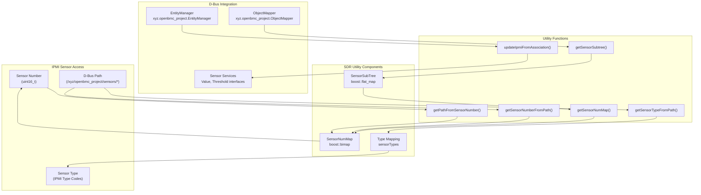
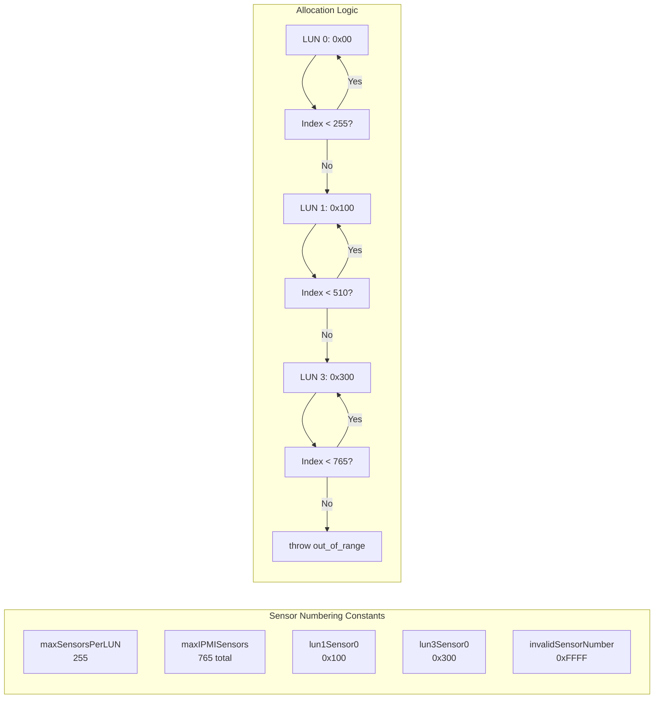
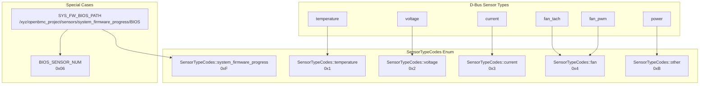
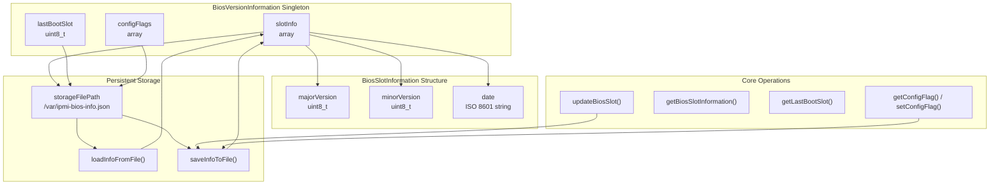
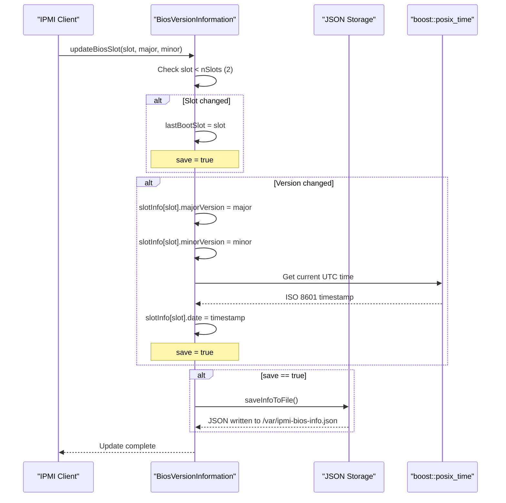
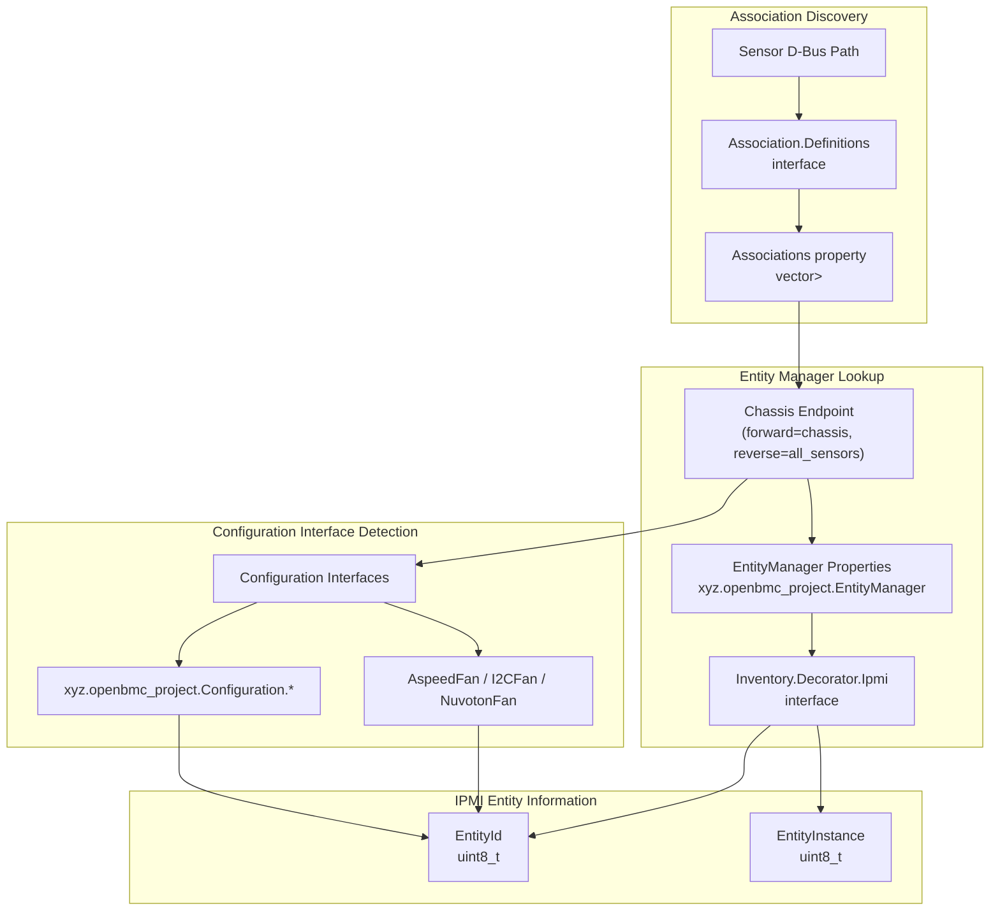

<!-- source: DeepWiki mcp.deepwiki.com · repo NVIDIA/nvidia-ipmi-oem · page 8 Utility Components · fetched 2026-10-26 -->

# Utility Components

Relevant source files

The following files were used as context for generating this wiki page:

- [include/biosversionutils.hpp](include/biosversionutils.hpp)
- [include/sdrutils.hpp](include/sdrutils.hpp)

This page documents the supporting utility components that provide essential data management, sensor integration, and version tracking capabilities for the NVIDIA IPMI OEM commands library. These utilities serve as the foundational layer for sensor data record (SDR) management and BIOS version tracking across all platform implementations.

For information about platform-specific command implementations, see [Platform Implementations](#3). For details about sensor command processing, see [Sensor Management](#4.2).

## SDR Utilities

The SDR utilities provide a comprehensive framework for managing sensor data records, sensor numbering, and integration with the OpenBMC sensor infrastructure. These utilities bridge the gap between D-Bus sensor services and IPMI sensor access patterns.

### Sensor Data Management Architecture

Sources: [include/sdrutils.hpp:61-184](), [include/sdrutils.hpp:322-547]()

### Sensor Number Allocation Strategy

The system implements a sophisticated sensor numbering scheme that maps IPMI sensor numbers to D-Bus sensor paths using LUN-based allocation:

| LUN | Range | Purpose |
|-----|-------|---------|
| 0 | 0x00-0xFE | Primary sensors (255 max) |
| 1 | 0x100-0x1FE | Extended sensors (255 max) |
| 2 | - | Reserved (skipped) |
| 3 | 0x300-0x3FE | Additional sensors (255 max) |

Sources: [include/sdrutils.hpp:68-73](), [include/sdrutils.hpp:158-180]()

### Sensor Type Classification

The utilities provide mapping between D-Bus sensor types and IPMI sensor type codes:

Sources: [include/sdrutils.hpp:208-230](), [include/sdrutils.hpp:251-266](), [include/sdrutils.hpp:219-222]()

## BIOS Version Management Utilities

The BIOS version management utilities provide persistent storage and tracking of BIOS slot information, supporting dual-slot BIOS configurations common in enterprise systems.

### BIOS Version Information Architecture

Sources: [include/biosversionutils.hpp:46-171]()

### BIOS Slot Update Workflow

The system tracks BIOS version changes and boot slot usage with automatic persistence:

Sources: [include/biosversionutils.hpp:105-131](), [include/biosversionutils.hpp:74-83]()

## Entity Manager Integration

The SDR utilities provide sophisticated integration with OpenBMC's Entity Manager for sensor configuration and IPMI entity association:

Sources: [include/sdrutils.hpp:417-545](), [include/sdrutils.hpp:380-413](), [include/sdrutils.hpp:353-378]()

## Data Structure Relationships

The utility components use several key data structures that provide efficient access patterns for sensor management:

| Data Structure | Type | Purpose | Key Features |
|----------------|------|---------|--------------|
| `SensorSubTree` | `boost::container::flat_map` | Sensor hierarchy mapping | Version-aware string comparison |
| `SensorNumMap` | `boost::bimap<int, std::string>` | Bidirectional sensor number mapping | O(log n) lookups both directions |
| `BiosSlotInformation` | Struct with JSON serialization | BIOS version tracking | nlohmann::json integration |
| `BiosVersionInformation` | Singleton pattern | Persistent BIOS state | Automatic file I/O |

Sources: [include/sdrutils.hpp:53-66](), [include/biosversionutils.hpp:35-43](), [include/biosversionutils.hpp:46-171]()