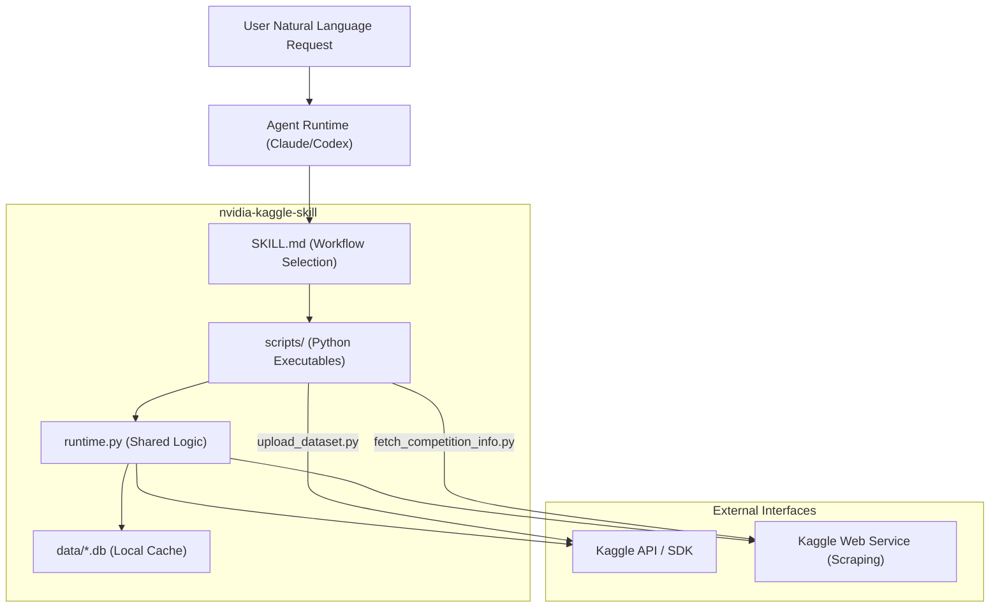
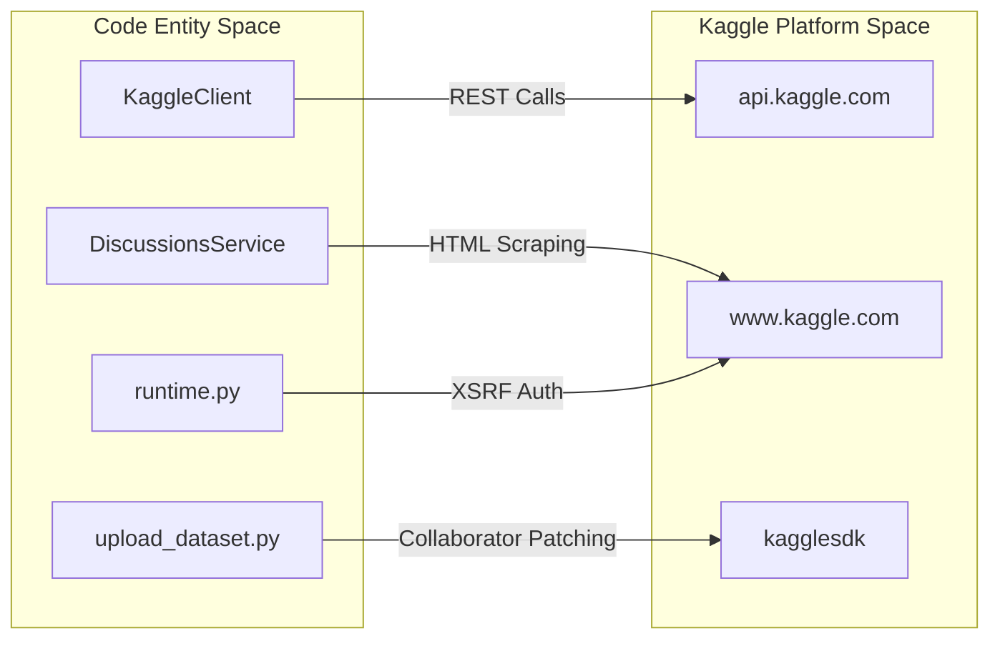

<!-- source: DeepWiki mcp.deepwiki.com · repo NVIDIA/nvidia-kaggle · page 1 Overview · fetched 2026-10-26 -->

# Overview

Relevant source files

The following files were used as context for generating this wiki page:

- [README.md](README.md)
- [demo/demo.gif](demo/demo.gif)
- [pyproject.toml](pyproject.toml)
- [skills/nvidia-kaggle-skill/SKILL.md](skills/nvidia-kaggle-skill/SKILL.md)
- [skills/nvidia-kaggle-skill/research-brief.md](skills/nvidia-kaggle-skill/research-brief.md)
- [skills/nvidia-kaggle-skill/scripts/upload_dataset.py](skills/nvidia-kaggle-skill/scripts/upload_dataset.py)

The **nvidia-kaggle** plugin is a technical skill designed for AI agents (such as Claude Code and Codex) to perform end-to-end Kaggle competition workflows. It bridges the gap between natural language requests and the complex Kaggle ecosystem by providing a unified interface for context gathering, research, local reproduction, and competition management.

## Purpose and Scope

The plugin provides the `nvidia-kaggle-skill` to handle all aspects of a Kaggle competition lifecycle [README.md:1-13](). It is specifically scoped for Kaggle-related tasks and is not intended for generic machine learning or data analysis unrelated to the platform [skills/nvidia-kaggle-skill/SKILL.md:23-27]().

### Key Capabilities
*   **Context Gathering:** Automated fetching of competition rules, timelines, evaluation metrics, and dataset descriptions [README.md:70-76]().
*   **Community Research:** Indexing and querying public discussions and kernels to extract winning strategies and modeling patterns [README.md:103-109]().
*   **Writeup Analysis:** Scraping and summarizing top-tier solution writeups from the leaderboard [README.md:35-41]().
*   **Local Reproduction:** Setting up a local workspace with notebooks and their required input data/models [README.md:134-140]().
*   **Asset Management:** Submitting kernels to competitions and managing Kaggle datasets [README.md:24-25]().

## System Architecture

The plugin is built on a modular architecture that separates agent-facing workflows from low-level Kaggle API interactions.

### High-Level Interaction Flow
The following diagram illustrates how an agent request flows through the skill to the underlying Kaggle infrastructure.

**Diagram: Request Resolution and Execution**

**Sources:** [skills/nvidia-kaggle-skill/SKILL.md:65-149](), [README.md:9-11]()

## Key Code Entities

The plugin maps natural language intents to specific Python scripts and library modules.

| Intent | Script / Entity | Role |
| :--- | :--- | :--- |
| **Competition Info** | `scripts/fetch_competition_info.py` | Fetches rules and overview via `runtime.py` [skills/nvidia-kaggle-skill/SKILL.md:71-80]() |
| **Research Brief** | `research-brief.md` | Orchestrates multiple scripts to create a strategy document [skills/nvidia-kaggle-skill/SKILL.md:89-98]() |
| **Discussion Sync** | `scripts/discussion_ingest.py` | Ingests threads into `data/discussions.db` [skills/nvidia-kaggle-skill/SKILL.md:104-113]() |
| **Dataset Upload** | `scripts/upload_dataset.py` | Manages `dataset-metadata.json` and calls Kaggle CLI [skills/nvidia-kaggle-skill/scripts/upload_dataset.py:1-8]() |
| **Kernel Research** | `kernels/` library | Provides logic for querying and reading notebooks [skills/nvidia-kaggle-skill/SKILL.md:123-125]() |

### Code-to-System Mapping
This diagram maps internal code components to the external Kaggle entities they manage.

**Diagram: Entity Mapping**

**Sources:** [skills/nvidia-kaggle-skill/scripts/upload_dataset.py:152-199](), [skills/nvidia-kaggle-skill/SKILL.md:49-57]()

## Wiki Navigation

To understand the plugin in depth, follow these child pages:

*   **[Getting Started & Installation](#1.1)**: Explains the prerequisites like `KAGGLE_API_TOKEN` and how to install the plugin using `uv` [README.md:27-31]().
*   **[Skill Specification (SKILL.md)](#1.2)**: Details the formal contract used by agents to discover capabilities, manage permissions, and execute workflows [skills/nvidia-kaggle-skill/SKILL.md:1-19]().

For implementation details, refer to the **Core Architecture** section, which covers the `runtime.py` shared module and the SQLite-backed data models for discussions and kernels.

---

