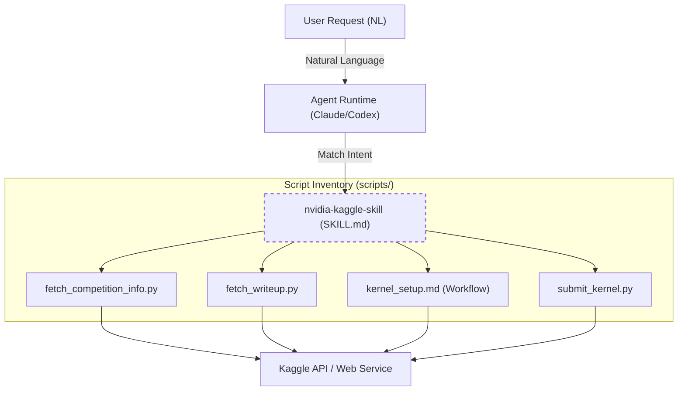
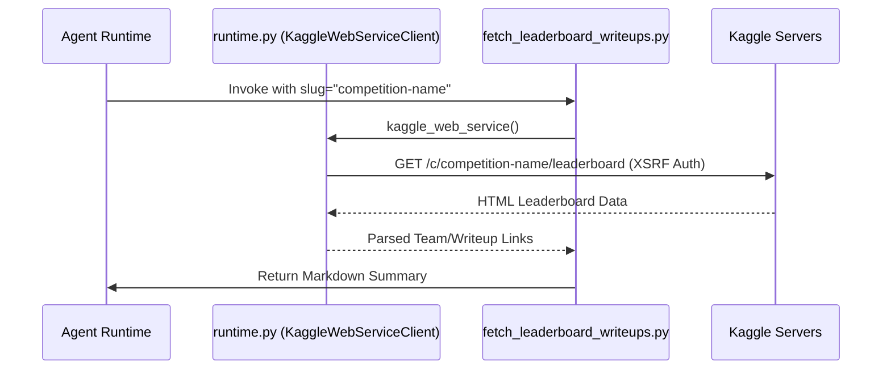

<!-- source: DeepWiki mcp.deepwiki.com · repo NVIDIA/nvidia-kaggle · page 1.1 Getting Started & Installation · fetched 2026-10-26 -->

# Getting Started & Installation

<details>
<summary>Relevant source files</summary>

The following files were used as context for generating this wiki page:

- [.agents/plugins/marketplace.json](.agents/plugins/marketplace.json)
- [.claude-plugin/marketplace.json](.claude-plugin/marketplace.json)
- [.claude-plugin/plugin.json](.claude-plugin/plugin.json)
- [.codex-plugin/plugin.json](.codex-plugin/plugin.json)
- [README.md](README.md)
- [demo/demo.gif](demo/demo.gif)

</details>


The NVIDIA Kaggle Plugin provides a unified skill for agent runtimes to interact with the Kaggle platform. It enables workflows ranging from competition context gathering and discussion indexing to local kernel reproduction and submission management. This page covers the installation process, environment configuration, and initial execution for supported runtimes.

## Prerequisites

Before installation, ensure the following requirements are met:
*   **Python 3.10+**: The core logic and scripts require a modern Python environment [README.md:29-29]().
*   **uv**: Recommended for fast, reproducible dependency management and synchronization.
*   **Kaggle Account**: An active account on [kaggle.com](https://www.kaggle.com).
*   **Kaggle API Token**: A `kaggle.json` file containing your `username` and `key`.

### Setting up KAGGLE_API_TOKEN
The plugin relies on the official Kaggle API and internal web services. You must export your credentials as environment variables or ensure they are present in `~/.kaggle/kaggle.json` [README.md:31-31]().

```bash
export KAGGLE_USERNAME="your_username"
export KAGGLE_KEY="your_api_key"
```

---

## Installation by Runtime

The plugin supports multiple agent environments, each with specific installation patterns.

### 1. Claude Code
Claude Code uses the `.claude-plugin/` directory to discover skills. The `plugin.json` manifest points to the skill implementation [ .claude-plugin/plugin.json:1-8]().

**Steps:**
1.  Clone the repository into your project or a global plugin directory.
2.  Run `uv sync` to install dependencies defined in `pyproject.toml`.
3.  Add the plugin to Claude Code:
    ```bash
    claude plugin add /path/to/nvidia-kaggle
    ```
4.  Verify the skill `nvidia-kaggle-skill` is available in the `claude` interface.

### 2. Codex
Codex utilizes the `.codex-plugin/` and `.agents/` directories for marketplace registration and interface metadata [ .codex-plugin/plugin.json:1-13]().

**Steps:**
1.  Ensure the repository is accessible to the Codex agent runtime.
2.  The runtime detects the `marketplace.json` which defines the installation policy as `AVAILABLE` and authentication as `ON_INSTALL` [ .agents/plugins/marketplace.json:14-17]().
3.  Install via the Codex UI or CLI:
    ```bash
    codex install nvidia-kaggle
    ```

### 3. Generic Agent Runtimes
For custom harnesses, the plugin follows the [Agent Skills Specification](https://agentskills.io) [README.md:6-6]().
1.  **Sync Dependencies**: Run `uv sync` to ensure all Python requirements (e.g., `kagglesdk`, `pydantic`, `httpx`) are installed.
2.  **Environment**: Ensure the Python interpreter used by the agent has access to the `scripts/` directory.

---

## System Integration & Data Flow

The following diagram illustrates how natural language requests from the user are routed through the agent runtime to the specific Python scripts within the plugin.

### Natural Language to Code Mapping
"This diagram bridges User Intent to the internal Script Inventory."


**Sources:** [README.md:15-25](), [SKILL.md]() (referenced in [README.md:6-6]()).

---

## Implementation Detail: First Invocation

When a command like `/nvidia-kaggle:nvidia-kaggle-skill Get the top 3 solution writeups...` is executed [README.md:39-41](), the system performs the following data flow:

### Initialization Flow
1.  **Credential Loading**: The `KaggleWebServiceClient` (in `runtime.py`) initializes using environment variables or `kaggle.json`.
2.  **Route Selection**: The agent parses `SKILL.md` to identify that a "writeup" request maps to `fetch_leaderboard_writeups.py`.
3.  **Execution**: The script is invoked with the competition slug.


**Sources:** [README.md:35-41](), `runtime.py` (referenced in [Core Architecture 2.1]()).

---

## Verification & Troubleshooting

After installation, verify the setup by running a basic context fetch:

| Command | Expected Outcome |
| :--- | :--- |
| `uv run scripts/fetch_competition_info.py --slug titanic` | Prints Titanic competition metadata in JSON/Markdown. |
| `claude code "List my Kaggle datasets"` | Agent uses `nvidia-kaggle-skill` to query Kaggle API. |

**Common Issues:**
*   **403 Forbidden**: Ensure your `KAGGLE_API_TOKEN` has accepted the specific competition's rules on the Kaggle website [README.md:31-31]().
*   **ModuleNotFoundError**: Run `uv sync` to ensure the virtual environment is populated with dependencies from `pyproject.toml`.

**Sources:**
- [README.md:27-32]()
- [.claude-plugin/plugin.json:1-8]()
- [.agents/plugins/marketplace.json:1-21]()
- [.codex-plugin/plugin.json:1-13]()

---

