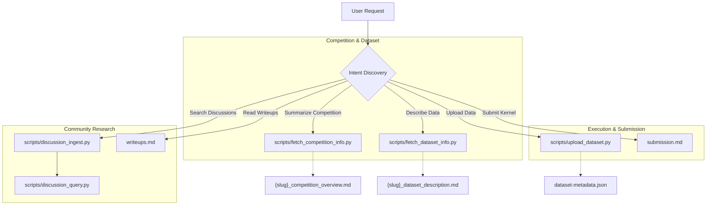
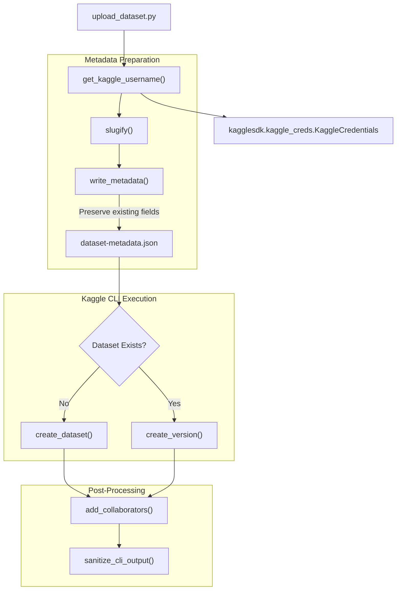

<!-- source: DeepWiki mcp.deepwiki.com · repo NVIDIA/nvidia-kaggle · page 1.2 Skill Specification (SKILL.md) · fetched 2026-10-26 -->

# Skill Specification (SKILL.md)

Relevant source files

The following files were used as context for generating this wiki page:

- [skills/nvidia-kaggle-skill/SKILL.md](skills/nvidia-kaggle-skill/SKILL.md)
- [skills/nvidia-kaggle-skill/research-brief.md](skills/nvidia-kaggle-skill/research-brief.md)
- [skills/nvidia-kaggle-skill/scripts/constants.py](skills/nvidia-kaggle-skill/scripts/constants.py)
- [skills/nvidia-kaggle-skill/scripts/upload_dataset.py](skills/nvidia-kaggle-skill/scripts/upload_dataset.py)

This page defines the technical contract and operational requirements for the `nvidia-kaggle-skill`. It serves as the primary reference for how the skill declares its capabilities, manages dependencies, and structures its workflows for agent runtimes like Claude Code and Codex.

## Purpose and Scope

The `SKILL.md` file acts as a manifest and instruction set for AI agents. It defines the boundaries of the skill, ensuring it is used specifically for Kaggle competition tasks—such as context gathering, kernel research, and submissions—rather than general-purpose machine learning or data analysis [skills/nvidia-kaggle-skill/SKILL.md:23-27]().

## Skill Manifest (Frontmatter)

The skill uses a YAML frontmatter block to declare its identity and required system permissions to the host runtime.

| Field | Description |
| :--- | :--- |
| `name` | Unique identifier: `nvidia-kaggle-skill` [skills/nvidia-kaggle-skill/SKILL.md:2](). |
| `permissions` | Declares needs for `shell` (scripts/CLI), `network` (Kaggle APIs/PyPI), `env` (KAGLE_API_TOKEN), and `file_read/write` [skills/nvidia-kaggle-skill/SKILL.md:5-10](). |
| `metadata` | Short descriptions and tags for marketplace discovery [skills/nvidia-kaggle-skill/SKILL.md:11-18](). |

## Runtime Dependency Policy

To maintain a lean footprint, the skill follows a "progressive disclosure" and "just-in-time" installation policy. Agents are instructed to install only the packages required for the specific requested workflow [skills/nvidia-kaggle-skill/SKILL.md:40-47]().

### Core Dependency Stack
The following packages are identified as the standard runtime stack for Kaggle operations:
- `httpx`: Network requests to Kaggle Web Services.
- `kaggle`: Official Kaggle CLI.
- `kagglesdk`: Advanced Kaggle API interactions.
- `nbformat`: Processing Jupyter Notebook structures.
- `pydantic`: Data validation for local storage models.
- `python-dotenv`: Environment management.
- `rich`: Terminal formatting and tables.

Sources: [skills/nvidia-kaggle-skill/SKILL.md:49-57]()

## Workflow Architecture

The skill organizes its capabilities into functional groups. Each group either provides a direct CLI command or points to a specialized markdown file for complex, multi-step procedures.

### Information Flow: Natural Language to Script Execution

The diagram below illustrates how a user request is mapped to specific code entities defined in the `SKILL.md` contract.

**Figure 1: Capability Mapping**

Sources: [skills/nvidia-kaggle-skill/SKILL.md:71-150]()

## Security & Credential Contract

The skill enforces strict rules regarding the `KAGGLE_API_TOKEN` (KGAT):
1.  **Verification**: Scripts must verify the token exists before calling Kaggle [skills/nvidia-kaggle-skill/SKILL.md:62-63]().
2.  **Redaction**: The token is treated as a secret; it must never be printed, logged, or echoed in the agent's output [skills/nvidia-kaggle-skill/SKILL.md:43]().
3.  **User Confirmation**: Sensitive actions (submissions, public dataset uploads) require explicit user approval before execution [skills/nvidia-kaggle-skill/SKILL.md:43]().

## Implementation Detail: Dataset Uploads

The `upload_dataset.py` script demonstrates the integration between the `SKILL.md` contract and the underlying Python implementation. It handles credential resolution, slug validation, and metadata preservation.

### Data Flow: Local to Kaggle Cloud
The following diagram shows the data flow and the specific functions involved in the upload process.

**Figure 2: Dataset Upload Logic**

Sources: [skills/nvidia-kaggle-skill/scripts/upload_dataset.py:25-53](), [skills/nvidia-kaggle-skill/scripts/upload_dataset.py:56-61](), [skills/nvidia-kaggle-skill/scripts/upload_dataset.py:64-92](), [skills/nvidia-kaggle-skill/scripts/upload_dataset.py:124-135](), [skills/nvidia-kaggle-skill/scripts/upload_dataset.py:152-200]()

### Validation Rules
- **Slug Length**: Minimum 6, Maximum 50 characters [skills/nvidia-kaggle-skill/scripts/constants.py:19-20]().
- **Privacy**: Defaults to private unless `--public` is explicitly passed [skills/nvidia-kaggle-skill/SKILL.md:145]().
- **Sanitization**: All CLI output is passed through `sanitize_cli_output()` to strip ANSI/control sequences, preventing terminal manipulation by untrusted remote text [skills/nvidia-kaggle-skill/scripts/upload_dataset.py:115-135]().

## Research Brief Strategy

The `research-brief.md` workflow is a high-level orchestration instruction. It directs the agent to chain multiple scripts to produce a "Strategy Brief."

**Key Principles for the Agent:**
- **Quantified Score Ladder**: Collect scores into a baseline-to-top ladder [skills/nvidia-kaggle-skill/research-brief.md:37-38]().
- **Honesty Rules**: Distinguish between author claims (titles) and verified leaderboard scores [skills/nvidia-kaggle-skill/research-brief.md:44-47]().
- **Visual Integrity**: Every plotted number in the brief must trace to a gathered source; fabrication is strictly prohibited [skills/nvidia-kaggle-skill/research-brief.md:57-58]().

Sources: [skills/nvidia-kaggle-skill/research-brief.md:1-73]()

---

