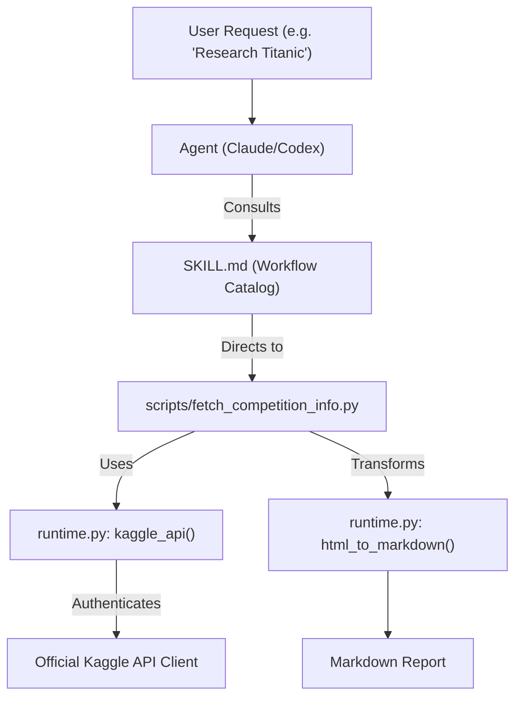
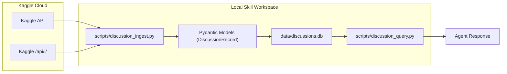

<!-- source: DeepWiki mcp.deepwiki.com · repo NVIDIA/nvidia-kaggle · page 2 Core Architecture · fetched 2026-10-26 -->

# Core Architecture

Relevant source files

The following files were used as context for generating this wiki page:

- [skills/nvidia-kaggle-skill/SKILL.md](skills/nvidia-kaggle-skill/SKILL.md)
- [skills/nvidia-kaggle-skill/research-brief.md](skills/nvidia-kaggle-skill/research-brief.md)
- [skills/nvidia-kaggle-skill/scripts/runtime.py](skills/nvidia-kaggle-skill/scripts/runtime.py)
- [skills/nvidia-kaggle-skill/scripts/upload_dataset.py](skills/nvidia-kaggle-skill/scripts/upload_dataset.py)

The `nvidia-kaggle-skill` is structured as a collection of modular Python scripts that delegate complex logic to a shared runtime and domain-specific libraries. This architecture allows an AI agent to perform high-level workflows—such as "researching a competition"—by chaining together granular script executions that interact with Kaggle's public API and internal web services.

## System Overview

The skill operates by bridging the gap between the agent's natural language space and Kaggle's data structures. The architecture is defined by four primary layers:

1.  **Workflow Layer**: High-level Markdown files (`SKILL.md`, `research-brief.md`, `kernels.md`) that instruct the agent on how to combine scripts to achieve complex goals [skills/nvidia-kaggle-skill/SKILL.md:65-135]().
2.  **Script Entry Points**: A `scripts/` directory containing standalone Python tools (e.g., `fetch_competition_info.py`, `discussion_ingest.py`) that the agent invokes directly [skills/nvidia-kaggle-skill/SKILL.md:69-70]().
3.  **Shared Runtime**: The `runtime.py` module, which handles authentication (OAuth and XSRF), HTML-to-Markdown conversion, and Kaggle API client instantiation [skills/nvidia-kaggle-skill/scripts/runtime.py:1-4]().
4.  **Local Data Stores**: SQLite databases located in `data/` that cache discussion threads and kernel metadata to enable fast, offline querying and filtering [skills/nvidia-kaggle-skill/SKILL.md:115-120]().

### Natural Language to Code Mapping

The following diagram illustrates how user requests are mapped to specific code entities within the architecture.

**Diagram: Request Dispatch Flow**

Sources: [skills/nvidia-kaggle-skill/SKILL.md:65-88](), [skills/nvidia-kaggle-skill/scripts/runtime.py:34-47](), [skills/nvidia-kaggle-skill/scripts/runtime.py:176-184]()

---

## Shared Runtime & API Clients

The core of the skill's connectivity is `runtime.py`. It provides two distinct ways to interact with Kaggle:

*   **Official API (`kaggle_api`)**: Used for standard operations like listing competition files or submitting kernels [skills/nvidia-kaggle-skill/scripts/runtime.py:34-47]().
*   **Internal Web Service (`KaggleWebServiceClient`)**: A custom client that handles XSRF-authenticated POST requests to `/api/i/` endpoints. This is required for data not exposed in the public API, such as leaderboard writeup links and full forum topic content [skills/nvidia-kaggle-skill/scripts/runtime.py:52-77]().

For details, see [Runtime Module & Kaggle API Clients](#2.1).

---

## Data Management & Local Storage

To provide a responsive experience and allow the agent to perform complex filtering (e.g., "find discussions with >10 votes by author X"), the skill implements a local caching strategy using SQLite and Pydantic models.

**Diagram: Data Persistence Architecture**

Sources: [skills/nvidia-kaggle-skill/SKILL.md:108-121](), [skills/nvidia-kaggle-skill/scripts/runtime.py:52-59]()

The skill maintains two primary databases:
*   `data/discussions.db`: Stores competition threads, comments, and metadata [skills/nvidia-kaggle-skill/SKILL.md:119]().
*   `data/kernels.db`: Stores kernel metadata, scores, and lineage information [skills/nvidia-kaggle-skill/SKILL.md:125]().

For details, see [Data Models & Local Storage](#2.2).

---

## Workflow Delegation

Individual workflows are defined in Markdown files that serve as "runbooks" for the AI. Instead of the agent guessing how to use the scripts, these files provide explicit instructions on sequencing and logic:

| Workflow | Primary Script / Logic | Purpose |
| :--- | :--- | :--- |
| **Research Brief** | `research-brief.md` | Chaining info, discussions, and kernels into a strategy document [skills/nvidia-kaggle-skill/research-brief.md:1-9](). |
| **Kernel Setup** | `kernel-setup.md` | Creating a local reproduction environment with symlinks and data [skills/nvidia-kaggle-skill/SKILL.md:128-129](). |
| **Dataset Upload** | `upload_dataset.py` | Handling metadata lifecycle and collaborator patching via SDK [skills/nvidia-kaggle-skill/scripts/upload_dataset.py:152-164](). |
| **Submissions** | `submission.md` | Managing the push-and-poll lifecycle for competition entries [skills/nvidia-kaggle-skill/SKILL.md:131-133](). |

Sources: [skills/nvidia-kaggle-skill/SKILL.md:89-149](), [skills/nvidia-kaggle-skill/research-brief.md:1-9](), [skills/nvidia-kaggle-skill/scripts/upload_dataset.py:152-164]()

---

