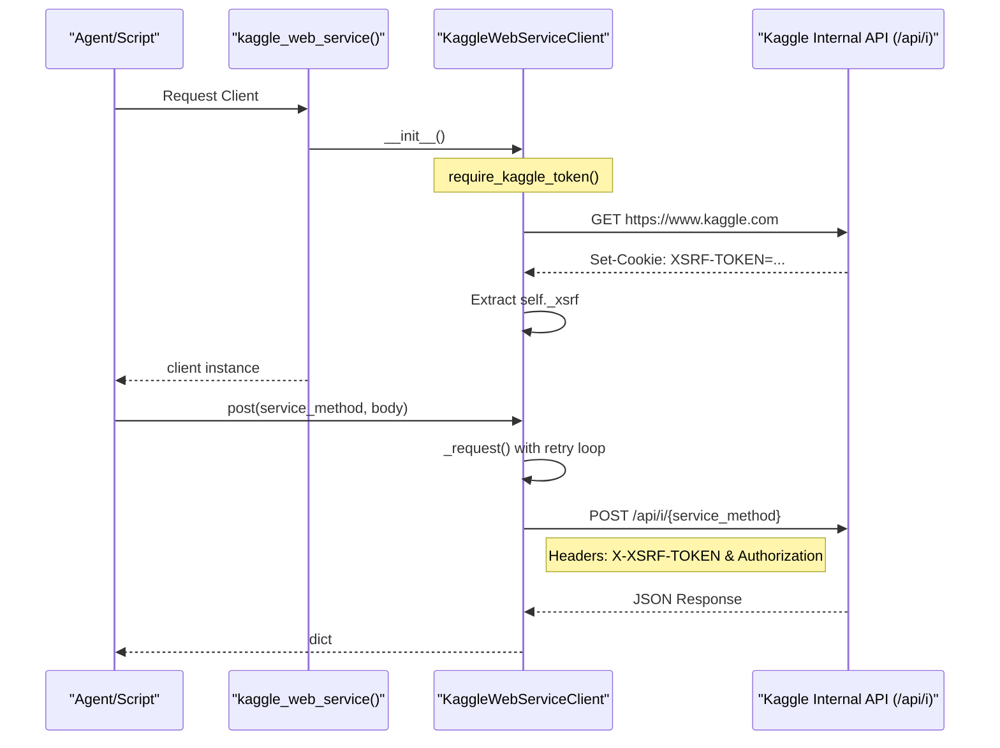
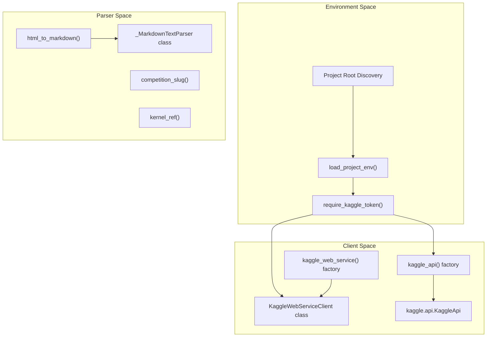

<!-- source: DeepWiki mcp.deepwiki.com · repo NVIDIA/nvidia-kaggle · page 2.1 Runtime Module & Kaggle API Clients · fetched 2026-10-26 -->

# Runtime Module & Kaggle API Clients

Relevant source files

The following files were used as context for generating this wiki page:

- [skills/nvidia-kaggle-skill/scripts/runtime.py](skills/nvidia-kaggle-skill/scripts/runtime.py)

The `runtime.py` module serves as the foundational utility layer for the `nvidia-kaggle` skill. It provides unified authentication, specialized API clients for both public and internal Kaggle services, and shared logic for parsing identifiers and content.

## Overview of Runtime Utilities

The runtime module manages the lifecycle of Kaggle connections, ensuring that all scripts in the skill have access to a consistent environment. It handles three primary concerns:
1.  **Environment & Auth**: Discovering the project root, loading `.env` files, and verifying `KAGGLE_API_TOKEN`.
2.  **Client Factories**: Providing authenticated instances of the official Kaggle SDK and a custom internal web service client.
3.  **Data Transformation**: Converting Kaggle's HTML-heavy competition content into clean Markdown and parsing URLs into canonical slugs.

### Project Discovery & Environment
The module includes logic to locate the project root by searching for marker files (like `pyproject.toml` or `SKILL.md`) and automatically loading environment variables via `dotenv`.

Sources: [skills/nvidia-kaggle-skill/scripts/runtime.py:40-41](), [skills/nvidia-kaggle-skill/scripts/runtime.py:127-127]()

---

## Kaggle API Clients

The codebase utilizes two distinct clients to interact with Kaggle, depending on whether the data is exposed via the public REST API or Kaggle's internal frontend service.

### 1. Official Kaggle API (`kaggle_api`)
The `kaggle_api()` factory returns an authenticated instance of the official `KaggleApi`. This is used for standard operations like listing competition files or fetching competition pages.

Sources: [skills/nvidia-kaggle-skill/scripts/runtime.py:34-46](), [skills/nvidia-kaggle-skill/scripts/runtime.py:194-195]()

### 2. Kaggle Web Service Client (`KaggleWebServiceClient`)
Certain critical data—such as leaderboard writeup links, forum topic content, and specific notebook versions—is only accessible via Kaggle's internal JSON web service (prefixed with `/api/i`). The `KaggleWebServiceClient` implements a session-based approach to access these endpoints without a full browser.

#### XSRF Authentication Flow
Kaggle's internal API requires an `XSRF-TOKEN` cookie and a corresponding `X-XSRF-TOKEN` header. The client automates this handshake:
1.  **Session Initialization**: Creates an `httpx.Client` with the `KAGGLE_API_TOKEN` in the Bearer header.
2.  **Seeding**: Performs a GET request to `https://www.kaggle.com` to populate the session cookies.
3.  **Token Extraction**: Extracts the `XSRF-TOKEN` from the cookie jar.
4.  **Request Execution**: Includes both the Bearer token and the XSRF token in subsequent POST requests.

Sources: [skills/nvidia-kaggle-skill/scripts/runtime.py:52-77](), [skills/nvidia-kaggle-skill/scripts/runtime.py:83-87]()

#### Retry Logic & Exponential Backoff
To handle transient network issues or rate limiting, the `_request` method implements a retry loop. It uses an exponential backoff strategy where the delay increases with each attempt.

| Parameter | Default Value | Description |
| :--- | :--- | :--- |
| `max_retries` | 3 | Maximum number of attempts for a failed request. |
| `retry_delay` | 2.0s | Base delay multiplier for backoff. |
| `timeout` | 30.0s | Network timeout for the HTTP session. |

Sources: [skills/nvidia-kaggle-skill/scripts/runtime.py:61-71](), [skills/nvidia-kaggle-skill/scripts/runtime.py:89-101]()

---

## Data Flow: Web Service Authentication

The following diagram illustrates the transition from the "Natural Language Space" (user/agent intent) to the "Code Entity Space" (authentication and request handling).

**Kaggle Web Service Authentication Sequence**

Sources: [skills/nvidia-kaggle-skill/scripts/runtime.py:52-128]()

---

## Content Parsing & Transformation

### Competition Pages & HTML to Markdown
Kaggle provides competition metadata (Rules, Evaluation, Description) as HTML. The `_MarkdownTextParser` (an `HTMLParser` subclass) converts this into clean Markdown for the LLM.

- **Tag Mapping**:
    - `h1`-`h6` $\rightarrow$ `#` headers.
    - `li` $\rightarrow$ `- ` bullet points.
    - `a` $\rightarrow$ `[text](href)` links.
    - `tr`, `p`, `div` $\rightarrow$ Double newlines for spacing.
- **Sanitization**: The parser drops unknown tags but preserves their text content and uses regex to collapse excessive whitespace.

Sources: [skills/nvidia-kaggle-skill/scripts/runtime.py:131-174](), [skills/nvidia-kaggle-skill/scripts/runtime.py:176-184]()

### Slug and Reference Helpers
The runtime provides regex-based helpers to extract identifiers from URLs or strings, ensuring scripts can handle both raw IDs and copy-pasted URLs.

| Function | Input Example | Output |
| :--- | :--- | :--- |
| `competition_slug` | `https://www.kaggle.com/competitions/titanic` | `titanic` |
| `kernel_ref` | `https://www.kaggle.com/code/user/notebook-slug` | `user/notebook-slug` |

Sources: [skills/nvidia-kaggle-skill/scripts/runtime.py:12-23]()

---

## Entity Relationship: Runtime Components

This diagram maps the logical components of the `runtime.py` module to their implementation entities.

**Runtime Module Architecture**

Sources: [skills/nvidia-kaggle-skill/scripts/runtime.py:1-201]()

---

