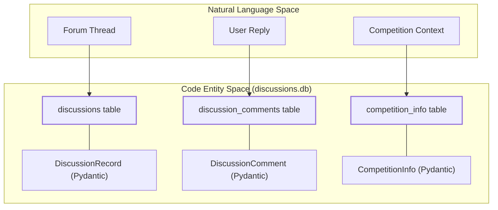
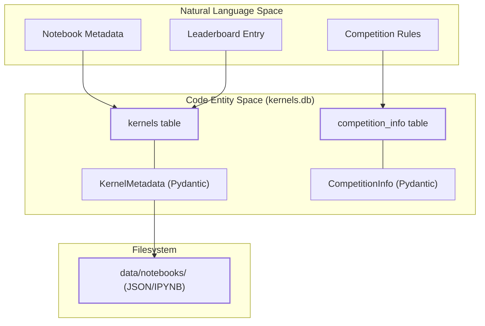

<!-- source: DeepWiki mcp.deepwiki.com · repo NVIDIA/nvidia-kaggle · page 2.2 Data Models & Local Storage · fetched 2026-10-26 -->

# Data Models & Local Storage

Relevant source files

The following files were used as context for generating this wiki page:

- [skills/nvidia-kaggle-skill/scripts/constants.py](skills/nvidia-kaggle-skill/scripts/constants.py)
- [skills/nvidia-kaggle-skill/scripts/discussions/database.py](skills/nvidia-kaggle-skill/scripts/discussions/database.py)
- [skills/nvidia-kaggle-skill/scripts/discussions/models.py](skills/nvidia-kaggle-skill/scripts/discussions/models.py)
- [skills/nvidia-kaggle-skill/scripts/discussions/paths.py](skills/nvidia-kaggle-skill/scripts/discussions/paths.py)
- [skills/nvidia-kaggle-skill/scripts/kernels/database.py](skills/nvidia-kaggle-skill/scripts/kernels/database.py)
- [skills/nvidia-kaggle-skill/scripts/kernels/models.py](skills/nvidia-kaggle-skill/scripts/kernels/models.py)
- [skills/nvidia-kaggle-skill/scripts/kernels/paths.py](skills/nvidia-kaggle-skill/scripts/kernels/paths.py)

This section describes the structured domain models and persistent storage mechanisms used by the `nvidia-kaggle` skill. The system utilizes Pydantic for data validation and SQLite for local caching of Kaggle entities, enabling fast querying and cross-referencing without constant API overhead.

## Domain Models

The codebase defines domain models using Pydantic `BaseModel` to ensure type safety and structured serialization across the discussion and kernel subsystems.

### Discussion Models
Discussion models capture the hierarchical nature of Kaggle forums, from top-level threads to individual comments.

| Class | Description | Key Fields |
| :--- | :--- | :--- |
| `DiscussionRecord` | Represents a main thread/topic. | `discussion_id`, `title`, `author`, `votes`, `body_markdown`, `tags` |
| `DiscussionComment` | A single reply within a thread. | `id`, `discussion_id`, `author`, `body_markdown`, `votes` |
| `CompetitionInfo` | Cached metadata for a competition. | `competition_id`, `title`, `evaluation_metric`, `deadline` |
| `CompetitionSummary` | Aggregated stats for local cache. | `discussion_count`, `top_authors`, `vote_stats` |

**Sources:**
- `DiscussionRecord`, `DiscussionComment`, `CompetitionInfo`: [skills/nvidia-kaggle-skill/scripts/discussions/models.py:9-64]()

### Kernel & Notebook Models
Kernel models handle both the metadata found in search results and the internal structure of Jupyter notebooks.

| Class | Description | Key Fields |
| :--- | :--- | :--- |
| `KernelMetadata` | Search-level info for a notebook. | `ref` (user/slug), `title`, `author`, `total_votes`, `last_run_time` |
| `NotebookCell` | A single unit of content. | `cell_type` ("code", "markdown"), `source`, `execution_count` |
| `NotebookContent` | A complete parsed notebook. | `kernel_ref`, `cells` (List of `NotebookCell`), `metadata` |

The `NotebookContent` class includes a `render_readable()` method that converts the structured cell data into a single Markdown document with Python code blocks, suitable for consumption by an LLM [skills/nvidia-kaggle-skill/scripts/kernels/models.py:53-64]().

**Sources:**
- `KernelMetadata`, `NotebookCell`, `NotebookContent`: [skills/nvidia-kaggle-skill/scripts/kernels/models.py:21-76]()

## Local Storage & SQLite Schema

The skill maintains two primary SQLite databases within the `data/` directory to facilitate offline search and analysis.

### Database Layout
- **`data/discussions.db`**: Stores competition forum threads and their full comment trees [skills/nvidia-kaggle-skill/scripts/discussions/paths.py:8-9]().
- **`data/kernels.db`**: Stores metadata for kernels, including vote counts and last run times [skills/nvidia-kaggle-skill/scripts/kernels/paths.py:8-9]().

### Discussion Schema Implementation
The `DiscussionDatabase` class manages three main tables: `discussions`, `discussion_comments`, and `competition_info`. It uses `ON CONFLICT` clauses to handle upserts during ingestion [skills/nvidia-kaggle-skill/scripts/discussions/database.py:113-141]().

**Discussion Database Entity Mapping**

**Sources:**
- Schema definitions: [skills/nvidia-kaggle-skill/scripts/discussions/database.py:15-69]()
- `DiscussionDatabase` class: [skills/nvidia-kaggle-skill/scripts/discussions/database.py:72-192]()

### Kernel Schema Implementation
The `KernelDatabase` mirrors the competition info structure but focuses on the `kernels` table for discovery [skills/nvidia-kaggle-skill/scripts/kernels/database.py:13-42]().

**Kernel Database Entity Mapping**

**Sources:**
- Schema definitions: [skills/nvidia-kaggle-skill/scripts/kernels/database.py:13-42]()
- `KernelDatabase` class: [skills/nvidia-kaggle-skill/scripts/kernels/database.py:45-164]()

## Filesystem Conventions

Beyond SQLite, the skill uses specific directory structures for raw content and artifacts.

### Data Directory
The `data/` directory is the root for all persistent local state:
- `data/discussions.db`: SQLite database for forum content.
- `data/kernels.db`: SQLite database for kernel metadata.
- `data/notebooks/`: Directory containing cached notebook source files (usually in `.ipynb` or `.json` format) [skills/nvidia-kaggle-skill/scripts/kernels/paths.py:12-13]().

### Constants & Limits
The system enforces several constraints defined in `constants.py` to ensure manageable data sizes:
- `DEFAULT_QUERY_LIMIT`: 50 records for search results [skills/nvidia-kaggle-skill/scripts/constants.py:9]().
- `MAX_DATASET_SLUG_LENGTH`: 50 characters [skills/nvidia-kaggle-skill/scripts/constants.py:20]().
- `DEFAULT_DISCUSSION_MAX_PAGES`: 5 pages during ingestion [skills/nvidia-kaggle-skill/scripts/constants.py:5]().

**Sources:**
- Path helpers: [skills/nvidia-kaggle-skill/scripts/discussions/paths.py:1-10](), [skills/nvidia-kaggle-skill/scripts/kernels/paths.py:1-14]()
- Numeric constants: [skills/nvidia-kaggle-skill/scripts/constants.py:1-21]()

---

