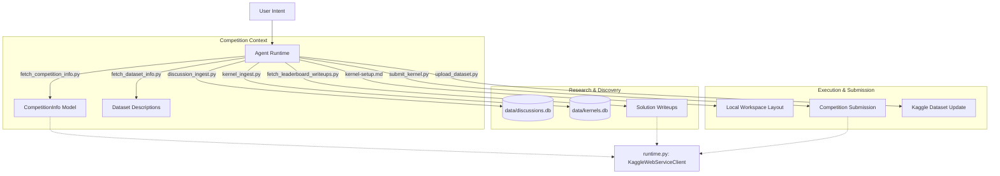
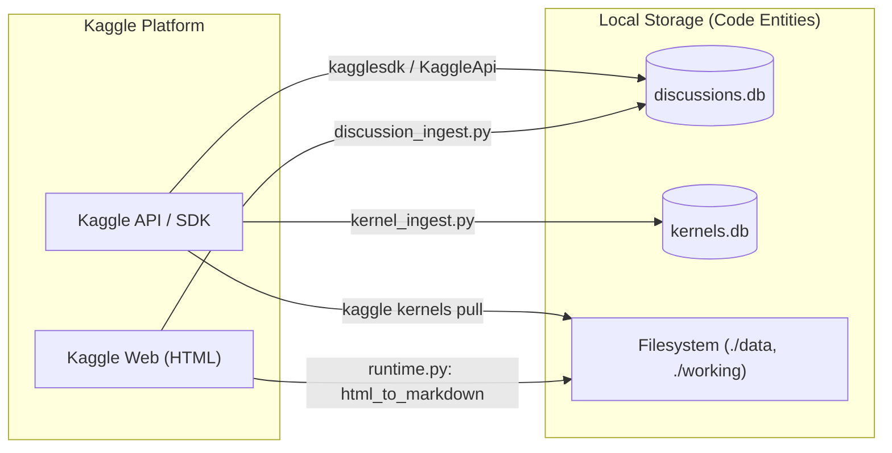

<!-- source: DeepWiki mcp.deepwiki.com · repo NVIDIA/nvidia-kaggle · page 3 Workflows & Capabilities · fetched 2026-10-26 -->

# Workflows & Capabilities

Relevant source files

The following files were used as context for generating this wiki page:

- [README.md](README.md)
- [demo/demo.gif](demo/demo.gif)
- [skills/nvidia-kaggle-skill/SKILL.md](skills/nvidia-kaggle-skill/SKILL.md)
- [skills/nvidia-kaggle-skill/research-brief.md](skills/nvidia-kaggle-skill/research-brief.md)
- [skills/nvidia-kaggle-skill/scripts/upload_dataset.py](skills/nvidia-kaggle-skill/scripts/upload_dataset.py)

The NVIDIA Kaggle Plugin provides a comprehensive suite of workflows designed to assist human and autonomous agents in navigating the Kaggle competition lifecycle. These capabilities range from initial context gathering and historical solution research to local environment setup, model submission, and dataset management.

This page serves as a high-level map of the functional areas exposed by the skill. For detailed implementation details, command-line arguments, and internal logic, refer to the specific child pages linked in each section.

## Functional Overview

The skill is organized into several major workflow groups that bridge the gap between natural language requests and specific Kaggle API or web service actions.

### System Architecture Bridge
The following diagram illustrates how natural language intents are mapped to specific code entities and scripts within the `nvidia-kaggle-skill`.

**Diagram: Workflow Mapping**

**Sources:** [README.md:15-25](), [skills/nvidia-kaggle-skill/SKILL.md:65-155]()

---

## 1. Competition & Dataset Information
This workflow provides the "Day 1" context needed for any competition. It retrieves the rules, evaluation metrics, timelines, and detailed dataset descriptions. It primarily utilizes the `competition_pages()` function to scrape and convert Kaggle's web interface into clean, agent-readable Markdown.

*   **Key Scripts:** `fetch_competition_info.py`, `fetch_dataset_info.py`
*   **Details:** See [Competition & Dataset Information](#3.1)

**Sources:** [skills/nvidia-kaggle-skill/SKILL.md:71-88]()

## 2. Discussion Workflows
The discussion pipeline allows agents to index thousands of forum posts into a local SQLite database (`data/discussions.db`) for fast, offline querying. This is used to find community tips, common bugs, and early insights.

*   **Key Scripts:** `discussion_ingest.py`, `discussion_query.py`, `discussion_read.py`
*   **Details:** See [Discussion Workflows](#3.2)

**Sources:** [skills/nvidia-kaggle-skill/SKILL.md:104-122]()

## 3. Kernel Research Workflows
This capability group handles the discovery and analysis of public Kaggle Notebooks (kernels). It supports indexing kernels by competition, filtering by score or votes, and resolving "best versions" based on competition metrics.

*   **Key Scripts:** `kernel_ingest.py`, `kernel_query.py`, `kernel_archive.py`
*   **Details:** See [Kernel Research Workflows](#3.3)

**Sources:** [skills/nvidia-kaggle-skill/SKILL.md:123-126]()

## 4. Writeup Workflows
Focused on "post-mortem" analysis, these workflows scrape leaderboards to find links to solution writeups. They correlate team rankings with discussion posts and extract clean Markdown content for strategy analysis.

*   **Key Scripts:** `fetch_leaderboard_writeups.py`, `fetch_writeup.py`
*   **Details:** See [Writeup Workflows](#3.4)

**Sources:** [skills/nvidia-kaggle-skill/SKILL.md:100-102](), [README.md:35-68]()

## 5. Kernel Setup (Local Reproduction)
This workflow automates the creation of a local reproduction environment. It downloads a kernel's source code, its associated competition data, and any external dataset or model dependencies, arranging them in a standardized `input/`, `working/`, and `scripts/` directory structure.

*   **Key Workflow:** `kernel-setup.md`
*   **Details:** See [Kernel Setup (Local Reproduction)](#3.5)

**Sources:** [skills/nvidia-kaggle-skill/SKILL.md:127-130](), [README.md:134-158]()

## 6. Submission Workflow
Provides a robust interface for submitting code to competitions. It supports pushing new kernel versions or submitting existing versions, and includes a polling loop that monitors the submission's lifecycle from `Pending` to `Complete`.

*   **Key Script:** `submit_kernel.py`
*   **Details:** See [Submission Workflow](#3.6)

**Sources:** [skills/nvidia-kaggle-skill/SKILL.md:131-134]()

## 7. Dataset Upload Workflow
Enables the creation and updating of Kaggle Datasets from local directories. It handles metadata preservation, slug generation, and collaborator management using the `kagglesdk`.

*   **Key Script:** `upload_dataset.py`
*   **Details:** See [Dataset Upload Workflow](#3.7)

**Sources:** [skills/nvidia-kaggle-skill/scripts/upload_dataset.py:1-8](), [skills/nvidia-kaggle-skill/SKILL.md:135-149]()

## 8. Research Brief Workflow
An orchestrator workflow that chains context gathering, discussion indexing, and kernel research into a single comprehensive `brief.md` artifact. It follows strict principles for "grounding" claims in evidence and maintaining visual integrity in plots.

*   **Key Workflow:** `research-brief.md`
*   **Details:** See [Research Brief Workflow](#3.8)

**Sources:** [skills/nvidia-kaggle-skill/research-brief.md:1-9](), [skills/nvidia-kaggle-skill/SKILL.md:89-99]()

---

### Data Lineage & Entities
The following diagram shows how data flows from the Kaggle Platform into the local storage entities managed by the skill.

**Diagram: Data Entity Flow**

**Sources:** [skills/nvidia-kaggle-skill/SKILL.md:115-120](), [skills/nvidia-kaggle-skill/scripts/upload_dataset.py:165-199]()

---

