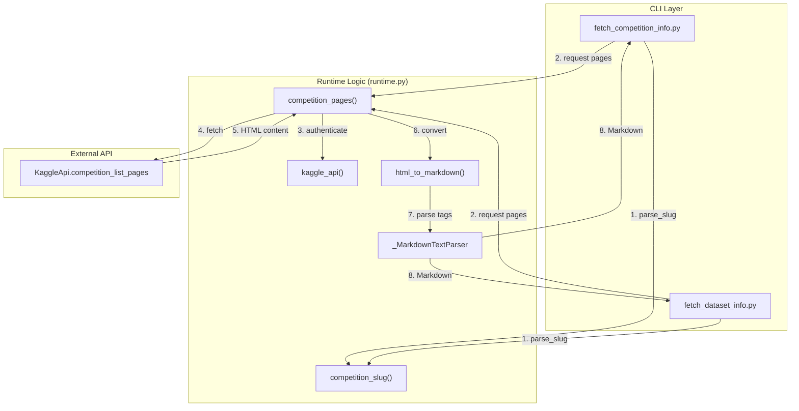
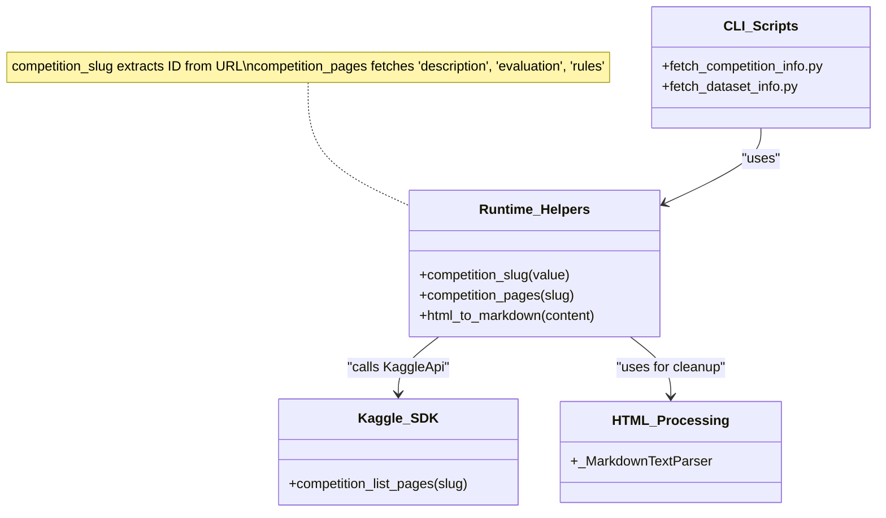

<!-- source: DeepWiki mcp.deepwiki.com · repo NVIDIA/nvidia-kaggle · page 3.1 Competition & Dataset Information · fetched 2026-10-26 -->

# Competition & Dataset Information

Relevant source files

The following files were used as context for generating this wiki page:

- [skills/nvidia-kaggle-skill/scripts/fetch_competition_info.py](skills/nvidia-kaggle-skill/scripts/fetch_competition_info.py)
- [skills/nvidia-kaggle-skill/scripts/fetch_dataset_info.py](skills/nvidia-kaggle-skill/scripts/fetch_dataset_info.py)
- [skills/nvidia-kaggle-skill/scripts/runtime.py](skills/nvidia-kaggle-skill/scripts/runtime.py)

This section covers the scripts responsible for retrieving structured and unstructured information about Kaggle competitions, including their rules, evaluation metrics, timelines, and dataset specifications. These scripts leverage the shared `runtime.py` module to interact with the Kaggle API and convert platform-specific HTML content into clean Markdown for agent consumption.

## Overview

The primary goal of these workflows is to provide the agent with the "ground truth" of a competition. Instead of scraping the public web pages, which is brittle and requires a browser, the skill uses the official Kaggle API's `competition_list_pages` method to retrieve content sections.

Key components:
- **`fetch_competition_info.py`**: Aggregates the 'Description' and 'Evaluation' pages into a single overview.
- **`fetch_dataset_info.py`**: Extracts the 'Data Description' page which contains details about file formats, column definitions, and sample submissions.
- **`runtime.py` (`competition_pages`)**: The underlying utility that fetches and caches the raw page content from the API.

## Data Flow & Implementation

The following diagram illustrates how a request for competition information moves from a slug or URL input through the runtime logic to the Kaggle API.

### Logic Flow: Competition Information Retrieval

**Sources:** [skills/nvidia-kaggle-skill/scripts/fetch_competition_info.py:9-33](), [skills/nvidia-kaggle-skill/scripts/fetch_dataset_info.py:9-21](), [skills/nvidia-kaggle-skill/scripts/runtime.py:187-202]()

### Competition Overview (`fetch_competition_info.py`)

This script identifies the core objective of the competition. It specifically targets two sections returned by the API:
1.  **Description**: The general problem statement and background [skills/nvidia-kaggle-skill/scripts/fetch_competition_info.py:22-24]().
2.  **Evaluation**: The mathematical metrics used to rank submissions (e.g., LogLoss, MAE) and the expected format of the submission file [skills/nvidia-kaggle-skill/scripts/fetch_competition_info.py:26-28]().

The script combines these sections, prepending a `## Evaluation` header to the latter to maintain document structure [skills/nvidia-kaggle-skill/scripts/fetch_competition_info.py:28]().

### Dataset Description (`fetch_dataset_info.py`)

This script focuses on the `data-description` page [skills/nvidia-kaggle-skill/scripts/fetch_dataset_info.py:17](). This page typically contains:
- Descriptions of `train.csv`, `test.csv`, and other supplementary files.
- Data dictionaries (column names and types).
- Information on data splits (Public vs. Private leaderboard).

### Shared Runtime Utilities

Both scripts rely on `runtime.py` for three critical functions:

1.  **Slug Parsing**: `competition_slug()` uses regex `kaggle\.com/competitions/([^/?#]+)` to extract the unique identifier from a full URL or validate a provided slug [skills/nvidia-kaggle-skill/scripts/runtime.py:12-15]().
2.  **Page Retrieval**: `competition_pages()` calls `api.competition_list_pages(slug)`. It iterates through the returned objects, converting them to a dictionary where keys are lowercased page names (e.g., "description", "rules") [skills/nvidia-kaggle-skill/scripts/runtime.py:187-202]().
3.  **HTML to Markdown**: Since Kaggle stores page content as HTML, `html_to_markdown()` utilizes a custom `_MarkdownTextParser` (inheriting from `HTMLParser`) to convert tags like `<h1>` to `#`, `<li>` to `-`, and preserve `<a>` hrefs as Markdown links [skills/nvidia-kaggle-skill/scripts/runtime.py:131-184]().

## Code Entity Map

The following diagram maps the Natural Language concepts (like "Rules" or "Slug") to the specific Python entities and API methods used in the codebase.

### System Entity Mapping

**Sources:** [skills/nvidia-kaggle-skill/scripts/runtime.py:12-15](), [skills/nvidia-kaggle-skill/scripts/runtime.py:131-140](), [skills/nvidia-kaggle-skill/scripts/runtime.py:187-195]()

## Usage Summary

| Script | Primary Input | Key Output Sections |
| :--- | :--- | :--- |
| `fetch_competition_info.py` | Slug or URL | `description`, `evaluation` |
| `fetch_dataset_info.py` | Slug or URL | `data-description` |

**Sources:** [skills/nvidia-kaggle-skill/scripts/fetch_competition_info.py:35-38](), [skills/nvidia-kaggle-skill/scripts/fetch_dataset_info.py:23-26]()

---

