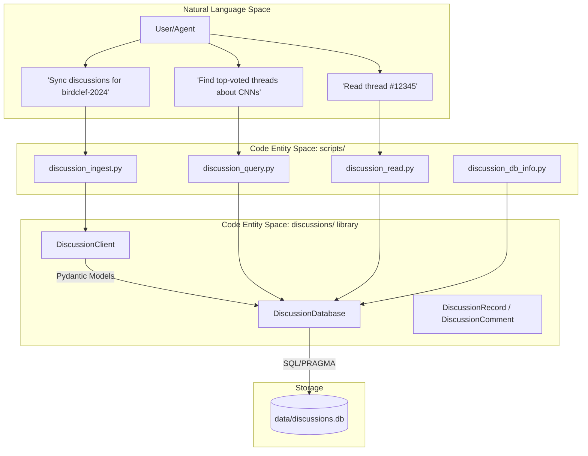
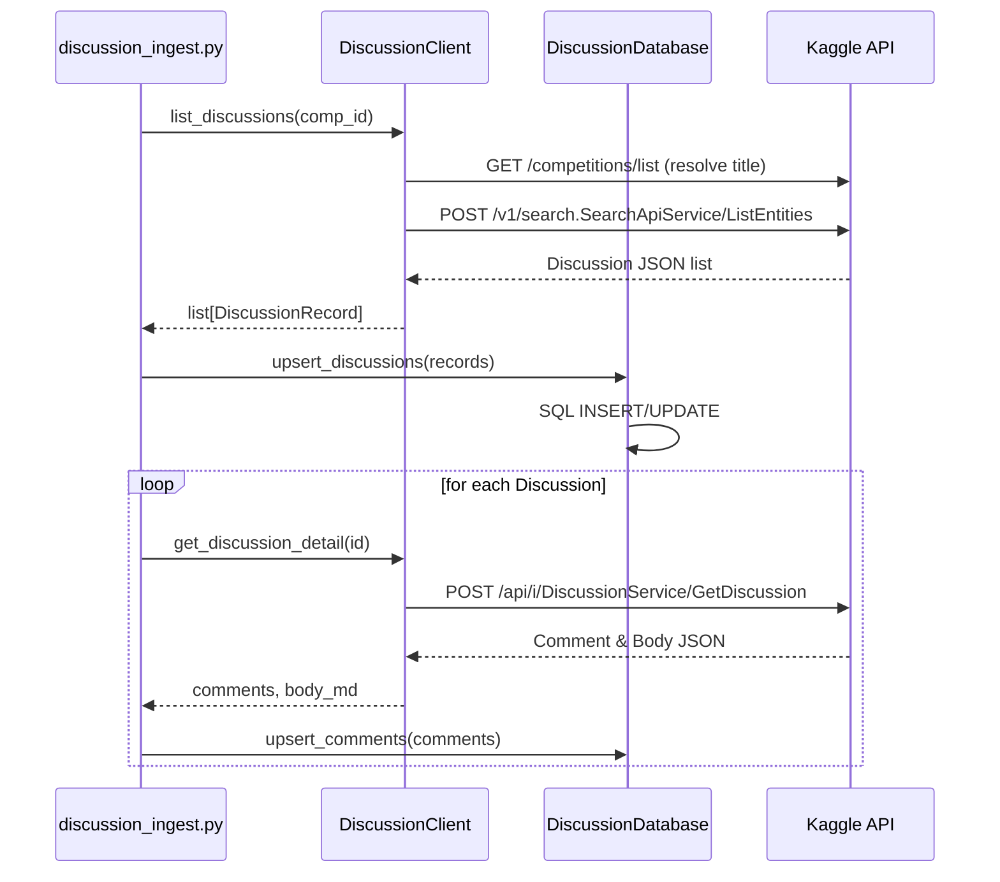

<!-- source: DeepWiki mcp.deepwiki.com · repo NVIDIA/nvidia-kaggle · page 3.2 Discussion Workflows · fetched 2026-10-26 -->

# Discussion Workflows

Relevant source files

The following files were used as context for generating this wiki page:

- [skills/nvidia-kaggle-skill/scripts/discussion_db_info.py](skills/nvidia-kaggle-skill/scripts/discussion_db_info.py)
- [skills/nvidia-kaggle-skill/scripts/discussion_ingest.py](skills/nvidia-kaggle-skill/scripts/discussion_ingest.py)
- [skills/nvidia-kaggle-skill/scripts/discussion_query.py](skills/nvidia-kaggle-skill/scripts/discussion_query.py)
- [skills/nvidia-kaggle-skill/scripts/discussion_read.py](skills/nvidia-kaggle-skill/scripts/discussion_read.py)
- [skills/nvidia-kaggle-skill/scripts/discussions/__init__.py](skills/nvidia-kaggle-skill/scripts/discussions/__init__.py)
- [skills/nvidia-kaggle-skill/scripts/discussions/database.py](skills/nvidia-kaggle-skill/scripts/discussions/database.py)
- [skills/nvidia-kaggle-skill/scripts/discussions/discussion_client.py](skills/nvidia-kaggle-skill/scripts/discussions/discussion_client.py)
- [skills/nvidia-kaggle-skill/scripts/discussions/models.py](skills/nvidia-kaggle-skill/scripts/discussions/models.py)
- [skills/nvidia-kaggle-skill/scripts/discussions/paths.py](skills/nvidia-kaggle-skill/scripts/discussions/paths.py)

The Discussion Workflows provide a comprehensive pipeline for synchronizing, searching, and reading Kaggle competition discussions. Because Kaggle's API separates high-level search from detailed thread content, this system implements a two-stage ingestion process and a local SQLite cache to enable fast, offline-capable analysis of community insights.

## Pipeline Overview

The discussion system follows a structured data flow from the Kaggle API to a local persistent store, which is then queried by downstream research scripts.

### Data Flow Diagram

The following diagram bridges the **Natural Language Space** (User/Agent actions) to the **Code Entity Space** (scripts and library classes).

**Sources:** [skills/nvidia-kaggle-skill/scripts/discussion_ingest.py:10-14](), [skills/nvidia-kaggle-skill/scripts/discussions/database.py:72-81](), [skills/nvidia-kaggle-skill/scripts/discussions/paths.py:8-9]()

## Core Components

### DiscussionClient
The `DiscussionClient` handles the complexity of Kaggle's dual-API architecture. It uses `api.kaggle.com` for listing entities and the internal `www.kaggle.com/api/i` web service for fetching full thread details and comments.

*   **Authentication:** Requires a Kaggle API token via `require_kaggle_token()` [skills/nvidia-kaggle-skill/scripts/discussions/discussion_client.py:27]().
*   **XSRF Management:** The `_ensure_session()` method handles the acquisition of an `XSRF-TOKEN` from a live Kaggle session, which is mandatory for POSTing to the discussion service [skills/nvidia-kaggle-skill/scripts/discussions/discussion_client.py:76-91]().
*   **Slug Resolution:** The `_resolve_competition_title()` method converts competition slugs (e.g., `birdclef-2024`) into human-readable titles, as the Search API primarily matches on titles [skills/nvidia-kaggle-skill/scripts/discussions/discussion_client.py:128-144]().

**Sources:** [skills/nvidia-kaggle-skill/scripts/discussions/discussion_client.py:1-21](), [skills/nvidia-kaggle-skill/scripts/discussions/discussion_client.py:93-116]()

### DiscussionDatabase (SQLite)
The database serves as a local cache to avoid redundant API calls and enable complex filtering. It utilizes three primary tables: `discussions`, `discussion_comments`, and `competition_info` [skills/nvidia-kaggle-skill/scripts/discussions/database.py:15-63]().

| Table | Purpose | Key Fields |
| :--- | :--- | :--- |
| `discussions` | Thread metadata | `discussion_id`, `votes`, `body_markdown`, `tags` |
| `discussion_comments` | Individual replies | `discussion_id`, `author`, `body_markdown` |
| `competition_info` | Competition context | `evaluation_metric`, `deadline`, `description` |

**Sources:** [skills/nvidia-kaggle-skill/scripts/discussions/database.py:72-97](), [skills/nvidia-kaggle-skill/scripts/discussions/models.py:9-53]()

## Execution Workflows

### 1. Ingestion (`discussion_ingest.py`)
This script populates the local database. It first fetches a list of threads based on a sort metric (e.g., `hotness`, `votes`) and then iterates through each thread to fetch the full markdown body and all comments.

*   **Key Function:** `ingest()` [skills/nvidia-kaggle-skill/scripts/discussion_ingest.py:69-126]().
*   **Comment Fetching:** Uses `_fetch_and_store_comments()` to perform deep-dives into each thread [skills/nvidia-kaggle-skill/scripts/discussion_ingest.py:44-67]().
*   **Upsert Logic:** Uses `INSERT ... ON CONFLICT DO UPDATE` to ensure local data stays fresh without duplicates [skills/nvidia-kaggle-skill/scripts/discussions/database.py:101-148]().

**Sources:** [skills/nvidia-kaggle-skill/scripts/discussion_ingest.py:1-43]()

### 2. Filtering & Search (`discussion_query.py`)
Provides a CLI interface to search the cached discussions. It supports free-text search across titles and bodies, minimum vote thresholds, and author filtering.

*   **Implementation:** The `query()` function delegates to `DiscussionDatabase.query_discussions()` [skills/nvidia-kaggle-skill/scripts/discussion_query.py:22-44]().
*   **Search Scope:** The SQL query uses `LIKE` operators across `title`, `author`, and `body_markdown` [skills/nvidia-kaggle-skill/scripts/discussions/database.py:165-168]().

**Sources:** [skills/nvidia-kaggle-skill/scripts/discussion_query.py:70-90]()

### 3. Thread Reading (`discussion_read.py`)
Renders a specific discussion thread and its comments in the terminal using `rich.markdown`.

*   **Logic:** Retrieves the `DiscussionRecord` and associated `DiscussionComment` list via the database [skills/nvidia-kaggle-skill/scripts/discussion_read.py:17-38]().
*   **Rendering:** Uses `rich.Panel` for the header and `rich.Markdown` for the content to preserve formatting [skills/nvidia-kaggle-skill/scripts/discussion_read.py:44-63]().

**Sources:** [skills/nvidia-kaggle-skill/scripts/discussion_read.py:1-15]()

### 4. Database Statistics (`discussion_db_info.py`)
Displays an overview of what is currently stored in `data/discussions.db`.

*   **Overview:** Lists all competition IDs, total discussion counts, and ingestion timestamps [skills/nvidia-kaggle-skill/scripts/discussion_db_info.py:18-40]().
*   **Detail Mode:** If a `competition_id` is provided, it shows top authors and vote statistics [skills/nvidia-kaggle-skill/scripts/discussion_db_info.py:51-59]().

**Sources:** [skills/nvidia-kaggle-skill/scripts/discussion_db_info.py:1-16]()

## Internal Data Flow Detail

The following sequence diagram illustrates the interaction between the script, the client, and the database during a typical ingestion run.

**Sources:** [skills/nvidia-kaggle-skill/scripts/discussion_ingest.py:82-113](), [skills/nvidia-kaggle-skill/scripts/discussions/discussion_client.py:148-185](), [skills/nvidia-kaggle-skill/scripts/discussions/database.py:101-148]()

---

