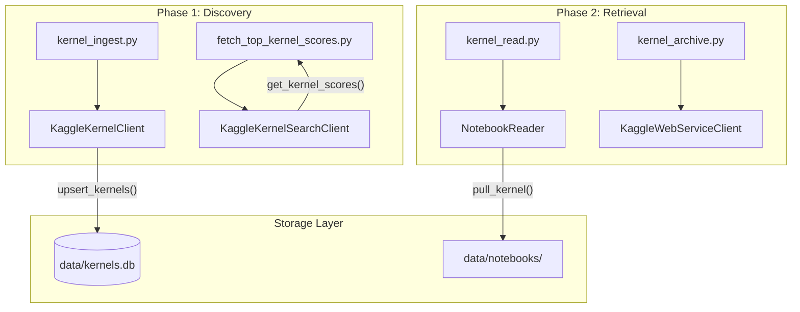

<!-- source: DeepWiki mcp.deepwiki.com · repo NVIDIA/nvidia-kaggle · page 3.3 Kernel Research Workflows · fetched 2026-10-26 -->

# Kernel Research Workflows

Relevant source files

The following files were used as context for generating this wiki page:

- [skills/nvidia-kaggle-skill/kernels.md](skills/nvidia-kaggle-skill/kernels.md)
- [skills/nvidia-kaggle-skill/scripts/fetch_kernel_score.py](skills/nvidia-kaggle-skill/scripts/fetch_kernel_score.py)
- [skills/nvidia-kaggle-skill/scripts/fetch_top_kernel_scores.py](skills/nvidia-kaggle-skill/scripts/fetch_top_kernel_scores.py)
- [skills/nvidia-kaggle-skill/scripts/kernel_db_info.py](skills/nvidia-kaggle-skill/scripts/kernel_db_info.py)
- [skills/nvidia-kaggle-skill/scripts/kernel_ingest.py](skills/nvidia-kaggle-skill/scripts/kernel_ingest.py)
- [skills/nvidia-kaggle-skill/scripts/kernel_query.py](skills/nvidia-kaggle-skill/scripts/kernel_query.py)
- [skills/nvidia-kaggle-skill/scripts/kernel_read.py](skills/nvidia-kaggle-skill/scripts/kernel_read.py)
- [skills/nvidia-kaggle-skill/scripts/kernels/__init__.py](skills/nvidia-kaggle-skill/scripts/kernels/__init__.py)
- [skills/nvidia-kaggle-skill/scripts/kernels/database.py](skills/nvidia-kaggle-skill/scripts/kernels/database.py)
- [skills/nvidia-kaggle-skill/scripts/kernels/kaggle_client.py](skills/nvidia-kaggle-skill/scripts/kernels/kaggle_client.py)
- [skills/nvidia-kaggle-skill/scripts/kernels/kaggle_search.py](skills/nvidia-kaggle-skill/scripts/kernels/kaggle_search.py)
- [skills/nvidia-kaggle-skill/scripts/kernels/notebook_reader.py](skills/nvidia-kaggle-skill/scripts/kernels/notebook_reader.py)
- [skills/nvidia-kaggle-skill/scripts/kernels/paths.py](skills/nvidia-kaggle-skill/scripts/kernels/paths.py)

The Kernel Research Workflow provides tools to fetch, browse, and analyze Kaggle competition notebooks (kernels). It enables technical analysis of public solutions, leaderboard score verification, and the discovery of lineage—how notebooks build upon or fork one another.

## Research Lifecycle

Kernel research follows a four-phase model designed to move from broad competition context to specific code-level insights [skills/nvidia-kaggle-skill/kernels.md:30-37]().

1.  **Phase 1: Collection**: Enumerate competition kernels and leaderboard snapshots.
2.  **Phase 2: Extraction**: Pull metadata and source code for high-performing or high-vote kernels.
3.  **Phase 3: Lineage Mapping**: Build a dependency graph using `kernel-metadata.json` (sources) and code references (URLs, `/kaggle/input/` paths) [skills/nvidia-kaggle-skill/kernels.md:59-61]().
4.  **Phase 4: Synthesis**: Generate a `top_kernels_research.md` report summarizing observed techniques and verified scores.

### System Architecture & Code Entities

The following diagram maps the logical research phases to the specific Python classes and scripts that implement them.

**Kernel Research Entity Map**

**Sources:** [skills/nvidia-kaggle-skill/scripts/kernel_ingest.py:28-43](), [skills/nvidia-kaggle-skill/scripts/kernels/kaggle_search.py:70-75](), [skills/nvidia-kaggle-skill/scripts/kernels/notebook_reader.py:18-27]()

---

## Core Capabilities

### 1. Ingestion and Local Querying
The workflow begins by syncing kernel metadata to a local SQLite database (`data/kernels.db`). This allows for fast filtering by votes, author, or "hotness" without repeated API calls.

*   **`kernel_ingest.py`**: Fetches paginated kernel lists for a competition [skills/nvidia-kaggle-skill/scripts/kernel_ingest.py:28-34]().
*   **`kernel_query.py`**: Filters the local database by search terms, vote thresholds, or authors [skills/nvidia-kaggle-skill/scripts/kernel_query.py:36-44]().
*   **`kernel_db_info.py`**: Provides statistics on the local cache, showing which competitions have been indexed [skills/nvidia-kaggle-skill/scripts/kernel_db_info.py:18-40]().

**Sources:** [skills/nvidia-kaggle-skill/scripts/kernel_ingest.py:1-61](), [skills/nvidia-kaggle-skill/scripts/kernel_query.py:1-88](), [skills/nvidia-kaggle-skill/scripts/kernel_db_info.py:1-70]()

### 2. Score Verification
Public scores in Kaggle search results can sometimes be stale or missing. The skill provides dedicated scripts to verify scores via the Kaggle SDK.

*   **`fetch_top_kernel_scores.py`**: Enumerates competition kernels via the REST API and enriches them with SDK-verified public leaderboard scores [skills/nvidia-kaggle-skill/scripts/fetch_top_kernel_scores.py:22-46]().
*   **`fetch_kernel_score.py`**: Retrieves the score for a single specific kernel reference [skills/nvidia-kaggle-skill/scripts/fetch_kernel_score.py:11-21]().

**Sources:** [skills/nvidia-kaggle-skill/scripts/fetch_top_kernel_scores.py:1-91](), [skills/nvidia-kaggle-skill/scripts/fetch_kernel_score.py:1-31]()

### 3. Notebook Reading & Analysis
Once a kernel of interest is identified, its content must be parsed for analysis.

*   **`kernel_read.py`**: Downloads the notebook and renders it as readable Markdown in the terminal [skills/nvidia-kaggle-skill/scripts/kernel_read.py:26-46]().
*   **`NotebookReader`**: The underlying class that handles `.ipynb` parsing via `nbformat` and manages the local file cache in `data/notebooks/` [skills/nvidia-kaggle-skill/scripts/kernels/notebook_reader.py:18-91]().

**Sources:** [skills/nvidia-kaggle-skill/scripts/kernel_read.py:1-71](), [skills/nvidia-kaggle-skill/scripts/kernels/notebook_reader.py:1-109]()

---

## Data Lineage & Storage Layout

The system maintains a structured filesystem to support research evidence and reproducibility.

| Path | Purpose | Code Reference |
| :--- | :--- | :--- |
| `data/kernels.db` | SQLite store for `KernelMetadata` and `CompetitionInfo`. | [kernels/database.py:48-54]() |
| `data/notebooks/<comp>/<ref>/` | Cache for `.ipynb` files and `kernel-metadata.json`. | [kernels/notebook_reader.py:35-36]() |
| `data/kernel_research/<comp>/` | Temporary directory for manual `kaggle kernels pull` evidence. | [kernels.md:90]() |
| `top_kernels_research.md` | Final research report artifact. | [kernels.md:61]() |

**Sources:** [skills/nvidia-kaggle-skill/kernels.md:84-91](), [skills/nvidia-kaggle-skill/scripts/kernels/database.py:13-42]()

---

## Best-Version Archiving

Kaggle's standard API and CLI (`kaggle kernels pull`) typically only return the *latest* version of a notebook. However, the best-scoring version is often a historical one.

*   **`kernel_archive.py`**: A specialized tool that uses Kaggle's internal web service to inspect every historical version of a kernel, identify the best public leaderboard score, and download that specific version [skills/nvidia-kaggle-skill/kernels.md:65-80]().

For details, see [Kernel Archiving & Best-Version Selection](#3.3.1).

**Sources:** [skills/nvidia-kaggle-skill/kernels.md:65-80]()

---

