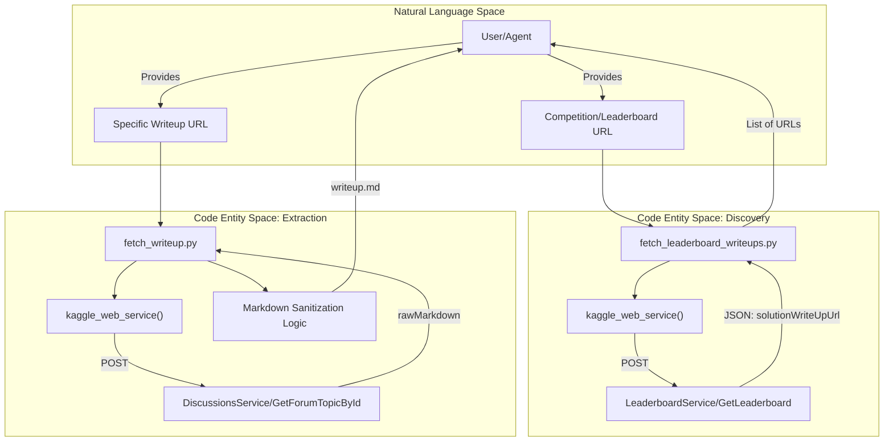
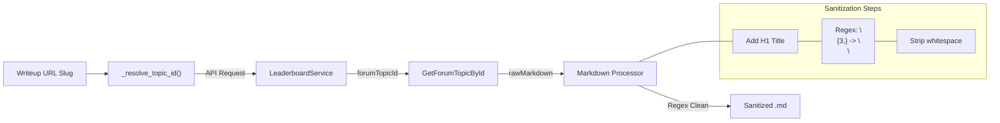

<!-- source: DeepWiki mcp.deepwiki.com · repo NVIDIA/nvidia-kaggle · page 3.4 Writeup Workflows · fetched 2026-10-26 -->

# Writeup Workflows

<details>
<summary>Relevant source files</summary>

The following files were used as context for generating this wiki page:

- [skills/nvidia-kaggle-skill/scripts/fetch_leaderboard_writeups.py](skills/nvidia-kaggle-skill/scripts/fetch_leaderboard_writeups.py)
- [skills/nvidia-kaggle-skill/scripts/fetch_writeup.py](skills/nvidia-kaggle-skill/scripts/fetch_writeup.py)
- [skills/nvidia-kaggle-skill/writeups.md](skills/nvidia-kaggle-skill/writeups.md)

</details>


The Writeup Workflows provide automated mechanisms for discovering and extracting competition solution writeups from Kaggle. Unlike legacy approaches that relied on headless browsers, these workflows utilize Kaggle's internal web services to retrieve structured data and raw markdown content directly.

## Overview

The system supports two primary modes of operation:
1.  **Discovery Mode**: Identifying which top-ranking teams have published formal solution writeups.
2.  **Extraction Mode**: Fetching the raw markdown content of a specific writeup and sanitizing it for research use.

The logic is encapsulated in two primary scripts: `fetch_leaderboard_writeups.py` for discovery and `fetch_writeup.py` for content extraction.

### Data Flow Diagram: Writeup Discovery and Extraction

This diagram illustrates how the system transitions from a competition URL to a set of localized markdown files.

"Writeup Workflow Data Flow"

Sources: [skills/nvidia-kaggle-skill/scripts/fetch_leaderboard_writeups.py:17-75](), [skills/nvidia-kaggle-skill/scripts/fetch_writeup.py:51-80](), [skills/nvidia-kaggle-skill/writeups.md:1-53]()

---

## Leaderboard Discovery

The script `fetch_leaderboard_writeups.py` identifies teams that have linked a solution writeup to their leaderboard entry.

### Implementation Details
The script performs a correlation between the team list and the leaderboard rankings:
1.  **Competition Resolution**: Resolves the competition slug to a numeric `competitionId` via `competitions.CompetitionService/GetCompetition` [skills/nvidia-kaggle-skill/scripts/fetch_leaderboard_writeups.py:28-32]().
2.  **Leaderboard Retrieval**: Fetches the leaderboard data via `competitions.LeaderboardService/GetLeaderboard` [skills/nvidia-kaggle-skill/scripts/fetch_leaderboard_writeups.py:36-39]().
3.  **Rank Correlation**: 
    *   It attempts to map `teamId` to rank using the `privateLeaderboard` [skills/nvidia-kaggle-skill/scripts/fetch_leaderboard_writeups.py:48-51]().
    *   If the private board is empty (e.g., live competitions), it falls back to the `publicLeaderboard` [skills/nvidia-kaggle-skill/scripts/fetch_leaderboard_writeups.py:52-56]().
4.  **Writeup Extraction**: Iterates through the `teams` list, extracting the `solutionWriteUpUrl` for any team that has provided one [skills/nvidia-kaggle-skill/scripts/fetch_leaderboard_writeups.py:59-71]().

### Output Format
The script outputs a JSON list of records sorted by rank:
```json
[
  {
    "rank": "1",
    "team": "Winning Team Name",
    "writeup_url": "https://www.kaggle.com/competitions/slug/writeups/12345"
  }
]
```
Sources: [skills/nvidia-kaggle-skill/scripts/fetch_leaderboard_writeups.py:58-89]()

---

## Writeup Extraction

The `fetch_writeup.py` script converts a Kaggle writeup URL into a sanitized markdown file.

### Topic ID Resolution
Kaggle writeup URLs use slugs (e.g., `/writeups/solution-slug`), but the API requires a numeric `forumTopicId`. The function `_resolve_topic_id` performs this mapping by:
1.  Fetching the competition leaderboard [skills/nvidia-kaggle-skill/scripts/fetch_writeup.py:36-39]().
2.  Matching the URL slug against the `solutionWriteUpUrl` in the team list to find the corresponding `writeUpForumTopicId` [skills/nvidia-kaggle-skill/scripts/fetch_writeup.py:40-44]().

### Content Retrieval and Sanitization
Once the `topic_id` is resolved, the script:
1.  Calls `discussions.DiscussionsService/GetForumTopicById` with `includeComments: False` [skills/nvidia-kaggle-skill/scripts/fetch_writeup.py:63-66]().
2.  Extracts content from `writeUp.message.rawMarkdown` [skills/nvidia-kaggle-skill/scripts/fetch_writeup.py:68-70]().
3.  **Sanitization**:
    *   Prepends the title as an H1 header if not already present [skills/nvidia-kaggle-skill/scripts/fetch_writeup.py:76-77]().
    *   Collapses excessive newlines (3 or more) into double newlines [skills/nvidia-kaggle-skill/scripts/fetch_writeup.py:79]().

"Writeup Resolution and Sanitization Logic"

Sources: [skills/nvidia-kaggle-skill/scripts/fetch_writeup.py:24-49](), [skills/nvidia-kaggle-skill/scripts/fetch_writeup.py:63-79]()

---

## Workflow Specifications

The `writeups.md` file defines the high-level orchestration logic for agents using these scripts.

### Single Writeup Mode
When a specific URL is provided, the agent is instructed to:
*   Run `fetch_writeup.py`.
*   Append a standard footer: `Fetched using the nvidia-kaggle-skill writeups workflow. Original write-up link: <link>` [skills/nvidia-kaggle-skill/writeups.md:24]().
*   Save the file using the writeup slug as the filename.

### Top-k Writeups Mode
When a competition URL or slug is provided, the agent performs a batch operation:
1.  **Discovery**: Runs `fetch_leaderboard_writeups.py` [skills/nvidia-kaggle-skill/writeups.md:32]().
2.  **Selection**: Selects the top `k` writeups (defaulting to 3) [skills/nvidia-kaggle-skill/writeups.md:11]().
3.  **Extraction**: Iteratively runs `fetch_writeup.py` for each URL [skills/nvidia-kaggle-skill/writeups.md:38]().
4.  **Summarization**: Generates a `summary.md` containing a table of ranks, teams, and brief approach summaries [skills/nvidia-kaggle-skill/writeups.md:41-46]().

### File Naming Convention
*   **Individual files**: `<rank>th_place_writeup.md` [skills/nvidia-kaggle-skill/writeups.md:41]().
*   **Aggregate index**: `summary.md` [skills/nvidia-kaggle-skill/writeups.md:41]().

Sources: [skills/nvidia-kaggle-skill/writeups.md:14-52]()

---

