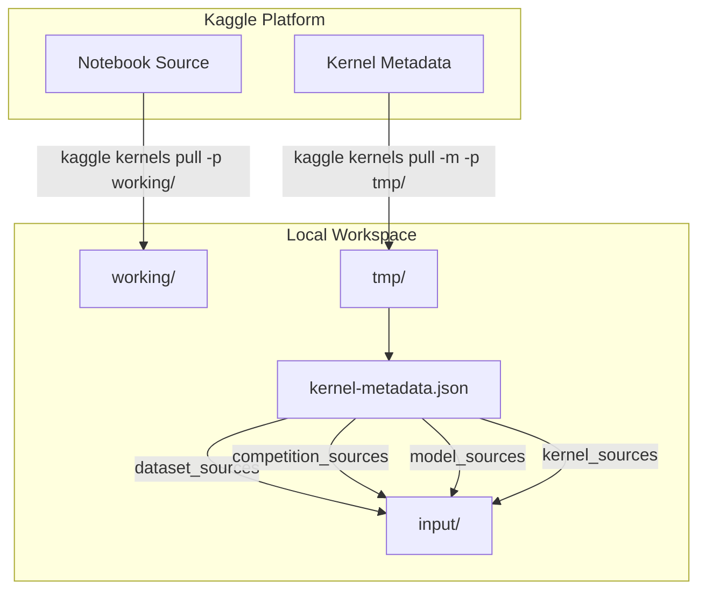
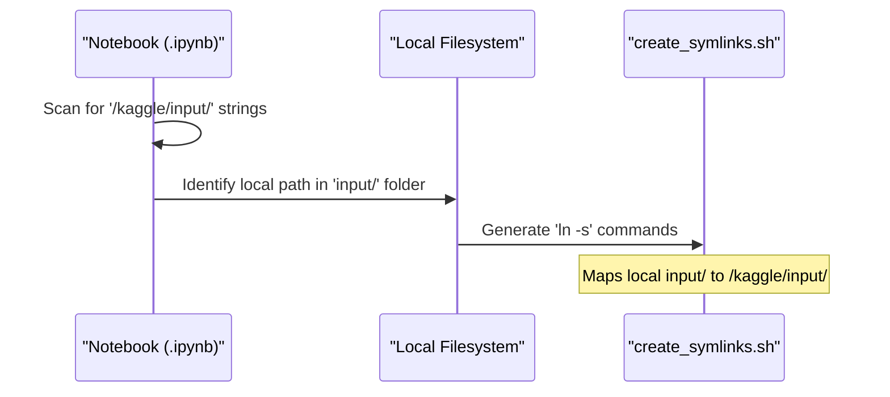

<!-- source: DeepWiki mcp.deepwiki.com · repo NVIDIA/nvidia-kaggle · page 3.5 Kernel Setup (Local Reproduction) · fetched 2026-10-26 -->

# Kernel Setup (Local Reproduction)

Relevant source files

The following files were used as context for generating this wiki page:

- [CLA.md](CLA.md)
- [LICENSE](LICENSE)
- [skills/nvidia-kaggle-skill/SKILL.md](skills/nvidia-kaggle-skill/SKILL.md)
- [skills/nvidia-kaggle-skill/kernel-setup.md](skills/nvidia-kaggle-skill/kernel-setup.md)
- [skills/nvidia-kaggle-skill/research-brief.md](skills/nvidia-kaggle-skill/research-brief.md)
- [skills/nvidia-kaggle-skill/scripts/upload_dataset.py](skills/nvidia-kaggle-skill/scripts/upload_dataset.py)

The **Kernel Setup** workflow provides a structured process for reproducing Kaggle notebooks in a local environment. It automates the retrieval of notebook code, metadata, and all associated input sources (competitions, datasets, models, and other kernel outputs), while organizing them into a standard workspace layout that mimics the Kaggle environment.

## Workflow Overview

The reproduction process follows a sequence of pulling metadata, downloading dependencies, and post-processing the filesystem to ensure paths in the notebook (e.g., `/kaggle/input/...`) can be resolved locally.

### Workspace Directory Layout
The workflow mandates a specific directory structure to separate raw inputs from working code and temporary artifacts [skills/nvidia-kaggle-skill/kernel-setup.md:14-25]():

| Directory | Purpose |
| :--- | :--- |
| `input/` | Raw data from competitions, datasets, and models. |
| `working/` | The primary notebook file and execution environment. |
| `tmp/` | Temporary storage for metadata and intermediate archives. |
| `scripts/` | Utility scripts and helper modules extracted from the kernel. |

### Data Flow: Metadata to Workspace
The following diagram illustrates how the `kernel-metadata.json` acts as the source of truth for orchestrating the setup.

**Entity Association: Metadata-Driven Setup**

Sources: [skills/nvidia-kaggle-skill/kernel-setup.md:27-41]()

## Implementation Details

### 1. Source Acquisition
The workflow uses the Kaggle CLI to fetch data based on the arrays defined in `kernel-metadata.json`.

*   **Competitions:** Downloaded via `kaggle competitions download -c {competition}`. Archives are extracted and zips are removed to save space [skills/nvidia-kaggle-skill/kernel-setup.md:46-52]().
*   **Datasets:** Downloaded using the `--unzip` flag to `{folder}/input/{dataset}` [skills/nvidia-kaggle-skill/kernel-setup.md:54-58]().
*   **Models:** Downloaded using the `--untar` flag via `kaggle models instances versions download` [skills/nvidia-kaggle-skill/kernel-setup.md:60-64]().
*   **Kernel Outputs:** Fetched via `kaggle kernels output` to provide lineage dependencies [skills/nvidia-kaggle-skill/kernel-setup.md:66-72]().

### 2. Path Mapping & Symlinking
Kaggle notebooks typically reference data using absolute paths like `/kaggle/input/competition-name/train.csv`. To support local execution without modifying the notebook code, the agent generates a `create_symlinks.sh` script [skills/nvidia-kaggle-skill/kernel-setup.md:78-79]().

**Entity Association: Path Resolution Logic**

Sources: [skills/nvidia-kaggle-skill/kernel-setup.md:78-79]()

### 3. Dependency Handling
*   **Requirements:** If an `input_requirements.txt` is found within the kernel's metadata folders, it is converted to a standard `requirements.txt` in the root folder [skills/nvidia-kaggle-skill/kernel-setup.md:75-76]().
*   **Utility Scripts:** Dependency scripts (often found in Kaggle as "Utility Scripts") are moved to the `scripts/` directory and renamed to valid Python identifiers to support local imports [skills/nvidia-kaggle-skill/kernel-setup.md:77-77]().

## Documentation Generation
A `README.md` is generated in the root of the reproduction folder to guide the user through the final steps. It includes:
*   **Source Summary:** A table listing every dataset/competition, its local path, and its status [skills/nvidia-kaggle-skill/kernel-setup.md:85-85]().
*   **Execution Instructions:** Commands for running the symlink script and installing dependencies [skills/nvidia-kaggle-skill/kernel-setup.md:86-88]().
*   **Hardware Metadata:** Information on whether the kernel requires GPU, TPU, or Internet access [skills/nvidia-kaggle-skill/kernel-setup.md:89-91]().

## Troubleshooting
| Symptom | Cause | Action |
| :--- | :--- | :--- |
| `403 Forbidden` on Competition | Rules not accepted | Direct user to `kaggle.com/competitions/{slug}/rules` [skills/nvidia-kaggle-skill/kernel-setup.md:99-99](). |
| `403 Forbidden` on Dataset | Incorrect Owner | Use `kaggle datasets list -s` to verify the correct slug [skills/nvidia-kaggle-skill/kernel-setup.md:100-100](). |
| Unresolved Paths | Non-standard notebook paths | Log uncertainty in the generated README for manual fix [skills/nvidia-kaggle-skill/kernel-setup.md:101-101](). |

Sources: [skills/nvidia-kaggle-skill/kernel-setup.md:93-102]()

---

