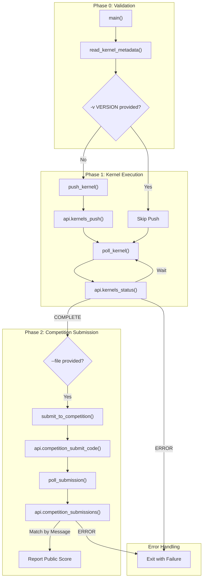
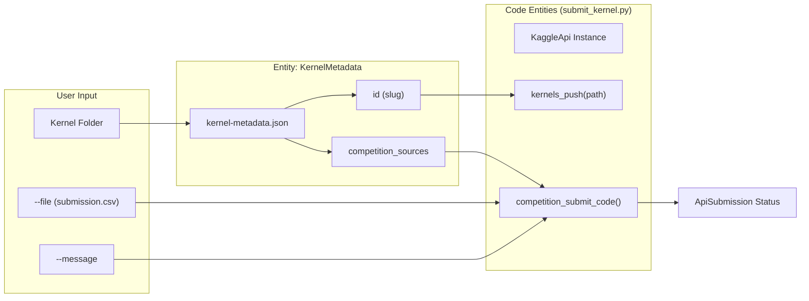

<!-- source: DeepWiki mcp.deepwiki.com · repo NVIDIA/nvidia-kaggle · page 3.6 Submission Workflow · fetched 2026-10-26 -->

# Submission Workflow

<details>
<summary>Relevant source files</summary>

The following files were used as context for generating this wiki page:

- [skills/nvidia-kaggle-skill/scripts/db_info.py](skills/nvidia-kaggle-skill/scripts/db_info.py)
- [skills/nvidia-kaggle-skill/scripts/submission_quota.py](skills/nvidia-kaggle-skill/scripts/submission_quota.py)
- [skills/nvidia-kaggle-skill/scripts/submit_kernel.py](skills/nvidia-kaggle-skill/scripts/submit_kernel.py)
- [skills/nvidia-kaggle-skill/submission.md](skills/nvidia-kaggle-skill/submission.md)

</details>


The submission workflow manages the end-to-end lifecycle of a Kaggle competition entry. This process involves pushing code to Kaggle's notebook servers, monitoring the execution of that notebook, and finally submitting the generated output file to a competition for scoring. The workflow is primarily implemented in `submit_kernel.py` and `submission_quota.py`.

## Overview of Submission Lifecycle

The workflow follows a two-phase polling architecture:
1.  **Kernel Execution Phase**: The code is pushed as a Kaggle Kernel. The system polls the Kaggle API until the kernel reaches a terminal state (`COMPLETE`, `ERROR`, or `CANCEL_ACKNOWLEDGED`).
2.  **Competition Evaluation Phase**: If a competition output file (e.g., `submission.csv`) is specified, the system triggers a competition submission using the successfully run kernel and polls the leaderboard evaluation service until a public score is assigned.

### Submission Quota Management

Kaggle enforces daily submission limits per competition (resetting at 00:00 UTC). The `submission_quota.py` script provides a proactive guard to check these limits before attempting a submission.

| Feature | Implementation | Description |
| :--- | :--- | :--- |
| **Daily Limit Retrieval** | `competition_daily_submission_limit` | Fetches `max_daily_submissions` via the Kaggle SDK. [scripts/submission_quota.py:27-46]() |
| **Usage Counting (CLI)** | `submissions_used_today` | Counts rows from `kaggle competitions submissions` since UTC midnight. [scripts/submission_quota.py:97-109]() |
| **Usage Counting (SDK)** | `submissions_by_user_today` | Uses `api.competition_submissions` to attribute usage to specific users. [scripts/submission_quota.py:144-157]() |
| **Exhausted State** | CLI Output | Reports `exhausted: true` if `used >= limit`. [skills/nvidia-kaggle-skill/submission.md:52-54]() |

**Sources:** [skills/nvidia-kaggle-skill/submission.md:44-59](), [scripts/submission_quota.py:1-12]()

---

## Technical Implementation: submit_kernel.py

The `submit_kernel.py` script is the primary driver for pushing and submitting code. It supports two modes:
*   **Push Mode**: Uploads local code and metadata to create a new kernel version.
*   **Existing-Version Mode**: Submits a specific, already-existing Kaggle kernel version to a competition using the `-v` flag. [skills/nvidia-kaggle-skill/submission.md:39-40]()

### Kernel Metadata Requirements
The workflow requires a `kernel-metadata.json` file in the target directory. This file must define:
*   `id`: The kernel slug (e.g., `username/kernel-name`).
*   `code_file`: Path to the script or notebook.
*   `competition_sources`: List of competitions the kernel is associated with.

**Sources:** [scripts/submit_kernel.py:52-75](), [skills/nvidia-kaggle-skill/submission.md:16-21]()

### Submission Flow Diagram

The following diagram bridges the natural language workflow to the specific functions in `submit_kernel.py`.

**Title: Kernel Submission Logic Flow**

**Sources:** [scripts/submit_kernel.py:78-179](), [skills/nvidia-kaggle-skill/submission.md:60-69]()

---

## Polling Mechanisms

### Kernel Status Polling
The `poll_kernel` function monitors the `api.kernels_status(slug)` endpoint. It tracks elapsed time against a timeout (default 1 hour) and recognizes terminal states.
*   **Terminal States**: `COMPLETE`, `ERROR`, `CANCEL_ACKNOWLEDGED`. [scripts/submit_kernel.py:95-95]()
*   **Backoff**: Uses `DEFAULT_POLL_INTERVAL_SECONDS` (default 60s) between checks. [scripts/submit_kernel.py:18-18]()

### Competition Submission Polling
Once a kernel is complete, `poll_submission` monitors the competition leaderboard.
*   **Matching Logic**: Since the API does not return a submission ID immediately, the script matches submissions using a unique timestamped message: `DEFAULT_SUBMISSION_MESSAGE`. [scripts/submit_kernel.py:26-26]()
*   **Result Extraction**: Upon completion, it extracts the `public_score` from the `ApiSubmission` object. [scripts/submit_kernel.py:168-170]()

**Sources:** [scripts/submit_kernel.py:91-119](), [scripts/submit_kernel.py:131-179]()

---

## Data Flow: CLI to SDK

This diagram illustrates how user inputs are transformed and passed through the Kaggle API entities.

**Title: Submission Data Flow and Entity Mapping**

**Sources:** [scripts/submit_kernel.py:33-38](), [scripts/submit_kernel.py:52-75](), [scripts/submit_kernel.py:120-128]()

## Usage Summary

### Execution Command
The script should be run with `PYTHONUNBUFFERED=1` to ensure real-time log visibility during long-running polling loops. [skills/nvidia-kaggle-skill/submission.md:33-40]()

```bash
# Standard push and submit
PYTHONUNBUFFERED=1 python ./scripts/submit_kernel.py ./my-solution --file submission.csv

# Submit existing version
PYTHONUNBUFFERED=1 python ./scripts/submit_kernel.py ./my-solution --file submission.csv -v 5
```

### Quota Check Command
```bash
python ./scripts/submission_quota.py <competition-slug> --as-json
```
The output includes `used`, `remaining`, and `exhausted` fields based on UTC midnight resets. [skills/nvidia-kaggle-skill/submission.md:52-52]()

**Sources:** [skills/nvidia-kaggle-skill/submission.md:31-59](), [scripts/submission_quota.py:1-11]()

---

