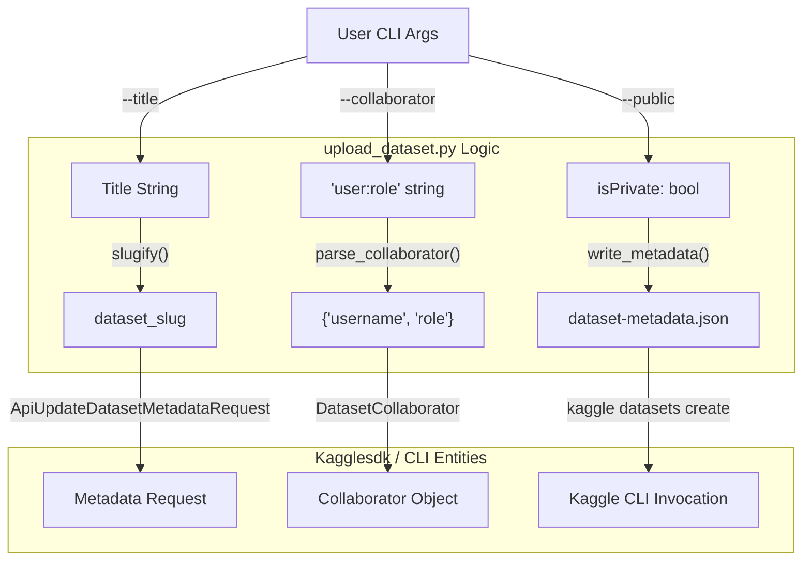
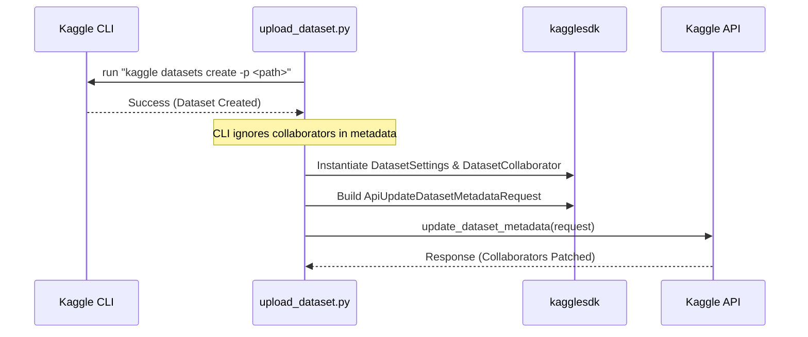

<!-- source: DeepWiki mcp.deepwiki.com · repo NVIDIA/nvidia-kaggle · page 3.7 Dataset Upload Workflow · fetched 2026-10-26 -->

# Dataset Upload Workflow

Relevant source files

The following files were used as context for generating this wiki page:

- [skills/nvidia-kaggle-skill/SKILL.md](skills/nvidia-kaggle-skill/SKILL.md)
- [skills/nvidia-kaggle-skill/research-brief.md](skills/nvidia-kaggle-skill/research-brief.md)
- [skills/nvidia-kaggle-skill/scripts/upload_dataset.py](skills/nvidia-kaggle-skill/scripts/upload_dataset.py)

The Dataset Upload Workflow provides a robust mechanism for creating or updating Kaggle datasets from local directories. It manages the entire lifecycle of dataset metadata, handles credential resolution, and ensures that sensitive terminal outputs are sanitized.

## Overview

The primary entry point for this workflow is `upload_dataset.py`. It automates the generation of `dataset-metadata.json`, handles slug constraints, and uses a combination of the Kaggle CLI and the `kagglesdk` to manage dataset creation, versioning, and collaborator permissions.

### Key Features
*   **Automatic Slug Generation**: Converts folder names into valid Kaggle slugs within length constraints [skills/nvidia-kaggle-skill/scripts/upload_dataset.py:56-61]().
*   **Metadata Lifecycle**: Creates new metadata files or patches existing ones to preserve descriptions and licenses [skills/nvidia-kaggle-skill/scripts/upload_dataset.py:64-92]().
*   **Collaborator Management**: Uses the `kagglesdk` to patch collaborator roles, as the standard CLI ignores these during initial creation [skills/nvidia-kaggle-skill/scripts/upload_dataset.py:152-164]().
*   **Output Sanitization**: Strips ANSI escape codes and control characters from CLI output to prevent terminal spoofing [skills/nvidia-kaggle-skill/scripts/upload_dataset.py:124-135]().

---

## Implementation Details

### Username & Credential Resolution
Before any upload occurs, the script resolves the Kaggle username using the `KAGGLE_API_TOKEN` (KGAT). It uses `KaggleCredentials` from the `kagglesdk` to introspect the token and retrieve the owner's handle.

| Entity | Role |
| --- | --- |
| `has_kaggle_credentials()` | Validates existence of `KAGGLE_API_TOKEN` [skills/nvidia-kaggle-skill/scripts/upload_dataset.py:20-22](). |
| `get_kaggle_username()` | Uses `KaggleCredentials.introspect()` to resolve the owner slug [skills/nvidia-kaggle-skill/scripts/upload_dataset.py:25-53](). |

### Slug and Metadata Generation
Kaggle requires dataset slugs to be between 6 and 50 characters, consisting only of alphanumeric characters and hyphens [skills/nvidia-kaggle-skill/scripts/constants.py:11-12]().

1.  **Slugification**: The `slugify()` function cleans the provided title or folder name [skills/nvidia-kaggle-skill/scripts/upload_dataset.py:56-61]().
2.  **Metadata Merging**: `write_metadata()` creates `dataset-metadata.json`. If a file already exists, it preserves fields like `subtitle`, `description`, `keywords`, and `licenses` while updating the `id` and `isPrivate` status [skills/nvidia-kaggle-skill/scripts/upload_dataset.py:78-87]().

### Data Flow: Natural Language to Code Entities

The following diagram illustrates how user-provided parameters are transformed into Kaggle API entities.

**Dataset Entity Mapping**

**Sources:** [skills/nvidia-kaggle-skill/scripts/upload_dataset.py:56-103](), [skills/nvidia-kaggle-skill/scripts/upload_dataset.py:138-149](), [skills/nvidia-kaggle-skill/scripts/upload_dataset.py:193-196]()

---

## Upload Execution & Collaborator Patching

The workflow differentiates between creating a new dataset and pushing a new version of an existing one.

### Creation vs. Update
The script executes `kaggle datasets create` for new datasets [skills/nvidia-kaggle-skill/scripts/upload_dataset.py:95-103](). If the dataset already exists, it requires `--version-notes` and executes `kaggle datasets version` [skills/nvidia-kaggle-skill/scripts/upload_dataset.py:106-112]().

### Collaborator Patching
Because the Kaggle CLI's `create` command does not process the `collaborators` field in the metadata file, `upload_dataset.py` performs a secondary "patch" operation using the `kagglesdk`.

1.  It maps roles (`reader`, `writer`) to `CollaboratorType` [skills/nvidia-kaggle-skill/scripts/upload_dataset.py:173-176]().
2.  It constructs a `DatasetSettings` object [skills/nvidia-kaggle-skill/scripts/upload_dataset.py:181-191]().
3.  It calls `update_dataset_metadata` via the `dataset_api_client` [skills/nvidia-kaggle-skill/scripts/upload_dataset.py:198-200]().

**Collaborator Patching Flow**

**Sources:** [skills/nvidia-kaggle-skill/scripts/upload_dataset.py:95-103](), [skills/nvidia-kaggle-skill/scripts/upload_dataset.py:152-202]()

---

## Output Sanitization

To ensure security when running in agentic environments, all CLI output is passed through `sanitize_cli_output()`.

*   **ANSI Stripping**: Removes escape sequences (e.g., `\x1b[...`) that could be used to manipulate terminal state or spoof logs [skills/nvidia-kaggle-skill/scripts/upload_dataset.py:119-131]().
*   **Control Char Removal**: Strips non-printable characters, excluding tabs and newlines [skills/nvidia-kaggle-skill/scripts/upload_dataset.py:120-132]().
*   **Truncation**: Limits output to 8,000 characters to prevent buffer overflows or excessive context window usage [skills/nvidia-kaggle-skill/scripts/upload_dataset.py:121-134]().

---

## Directory Modes

The `--dir-mode` option determines how the local directory is handled during upload [skills/nvidia-kaggle-skill/scripts/upload_dataset.py:140]():

| Mode | Description |
| --- | --- |
| `zip` | Compresses the directory into a .zip file before upload [skills/nvidia-kaggle-skill/scripts/upload_dataset.py:100-102](). |
| `tar` | Compresses the directory into a .tar file before upload [skills/nvidia-kaggle-skill/scripts/upload_dataset.py:100-102](). |
| `skip` | Uploads individual files within the directory without archiving them. |

**Sources:** [skills/nvidia-kaggle-skill/scripts/upload_dataset.py:6](), [skills/nvidia-kaggle-skill/scripts/upload_dataset.py:100-102](), [skills/nvidia-kaggle-skill/scripts/upload_dataset.py:140]()

---

