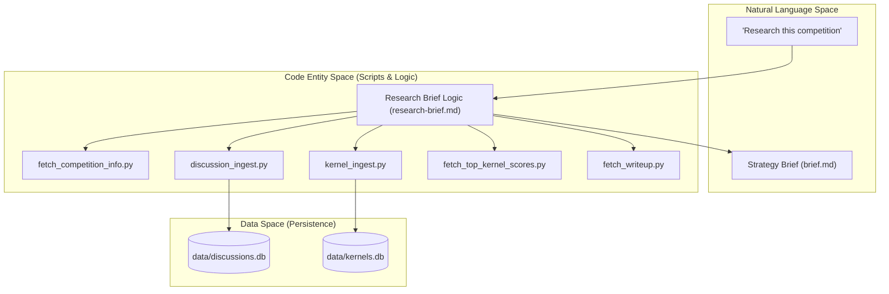
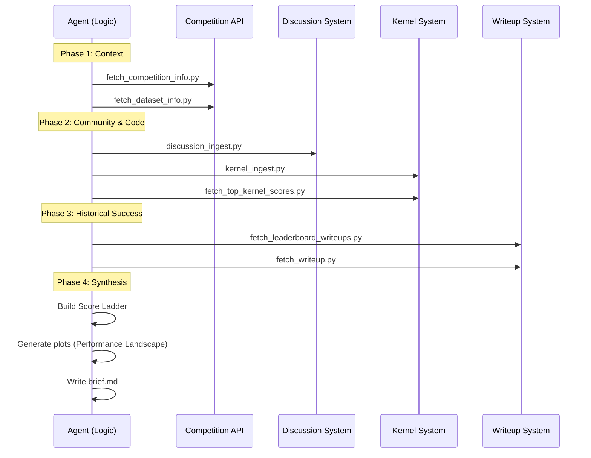

<!-- source: DeepWiki mcp.deepwiki.com · repo NVIDIA/nvidia-kaggle · page 3.8 Research Brief Workflow · fetched 2026-10-26 -->

# Research Brief Workflow

Relevant source files

The following files were used as context for generating this wiki page:

- [skills/nvidia-kaggle-skill/SKILL.md](skills/nvidia-kaggle-skill/SKILL.md)
- [skills/nvidia-kaggle-skill/kernels.md](skills/nvidia-kaggle-skill/kernels.md)
- [skills/nvidia-kaggle-skill/research-brief.md](skills/nvidia-kaggle-skill/research-brief.md)
- [skills/nvidia-kaggle-skill/scripts/upload_dataset.py](skills/nvidia-kaggle-skill/scripts/upload_dataset.py)

The Research Brief workflow is a high-level strategy pipeline that aggregates data from multiple specialized sub-systems (competition context, discussions, kernels, and writeups) to produce a comprehensive, grounded `brief.md` artifact. Unlike atomic scripts, this workflow is an agentic pattern where the system chains individual capabilities to synthesize an actionable strategy for a Kaggle competition [skills/nvidia-kaggle-skill/research-brief.md:3-9]().

## Workflow Overview

The Research Brief is designed to move from raw platform data to a structured strategy document. It emphasizes "grounding"—the principle that every claim, score, and technique must be traceable to a verified source gathered during the current session [skills/nvidia-kaggle-skill/research-brief.md:46-47]().

### Data Flow and Component Chaining

The workflow orchestrates the following sequence of script executions:

1.  **Context Discovery**: Retrieves competition mechanics (metrics, constraints, data shape) using `fetch_competition_info.py` and `fetch_dataset_info.py` [skills/nvidia-kaggle-skill/research-brief.md:13-14]().
2.  **Community Intelligence**: Ingests and queries threads via `discussion_ingest.py` and `discussion_query.py` to identify high-signal tips and community-vetted approaches [skills/nvidia-kaggle-skill/research-brief.md:14-15]().
3.  **Technical Research**: Enumerates kernels via `kernel_ingest.py` and verifies performance using `fetch_top_kernel_scores.py`. This phase identifies the "Score Ladder" [skills/nvidia-kaggle-skill/research-brief.md:15-16]().
4.  **Historical Analysis**: Pulls winning solutions via `fetch_leaderboard_writeups.py` and `fetch_writeup.py` to understand long-term successful strategies [skills/nvidia-kaggle-skill/research-brief.md:17-18]().

### System Entity Map

The following diagram illustrates how the natural language request for a "Research Brief" translates into specific code entities and data stores.

**Research Brief Entity Mapping**

Sources: [skills/nvidia-kaggle-skill/research-brief.md:1-18](), [skills/nvidia-kaggle-skill/SKILL.md:89-98]()

## Key Concepts

### The Score Ladder
A central component of the brief is the **Score Ladder**. This is a quantified progression of performance tiers (e.g., Baseline → Strong → Top-tier) where every rung is linked to a specific, verified source [skills/nvidia-kaggle-skill/research-brief.md:37-38]().
*   **Verification Rule**: Numbers found in notebook titles are treated as "claims." Only scores retrieved via `fetch_kernel_score.py` or `fetch_top_kernel_scores.py` are treated as "verified" [skills/nvidia-kaggle-skill/research-brief.md:39-40]().

### Visual Integrity Rules
The workflow mandates strict rules for any plots generated during the research process:
*   **Traceability**: Every plotted number must trace back to data actually gathered in the current run [skills/nvidia-kaggle-skill/research-brief.md:57-58]().
*   **Performance Over Popularity**: Plots should prioritize the score landscape (distribution of LB scores) over social metrics like vote counts [skills/nvidia-kaggle-skill/research-brief.md:54-56]().
*   **Legibility**: Entities must use human-readable titles or slugs rather than internal numeric IDs [skills/nvidia-kaggle-skill/research-brief.md:62-63]().

## Implementation Logic

The agent implementing this workflow follows a four-phase research model to build the final report.

**Research Execution Lifecycle**

Sources: [skills/nvidia-kaggle-skill/research-brief.md:11-18](), [skills/nvidia-kaggle-skill/kernels.md:30-37]()

## Output Structure

The resulting `brief.md` (or `top_kernels_research.md`) typically includes:

| Section | Content Source | Integrity Requirement |
| :--- | :--- | :--- |
| **Mechanics** | `fetch_competition_info.py` | Must specify metric and constraints [skills/nvidia-kaggle-skill/research-brief.md:33-34](). |
| **Winning Techniques** | `discussion_read.py`, `fetch_writeup.py` | Each technique must be tied to a source link [skills/nvidia-kaggle-skill/research-brief.md:35-36](). |
| **Score Ladder** | `fetch_top_kernel_scores.py` | Distinguish between claims and verified scores [skills/nvidia-kaggle-skill/research-brief.md:37-40](). |
| **Actionable Path** | Synthesis | Sequence of baseline to blending steps [skills/nvidia-kaggle-skill/research-brief.md:41-42](). |

Sources: [skills/nvidia-kaggle-skill/research-brief.md:28-43](), [skills/nvidia-kaggle-skill/kernels.md:61]()

---

