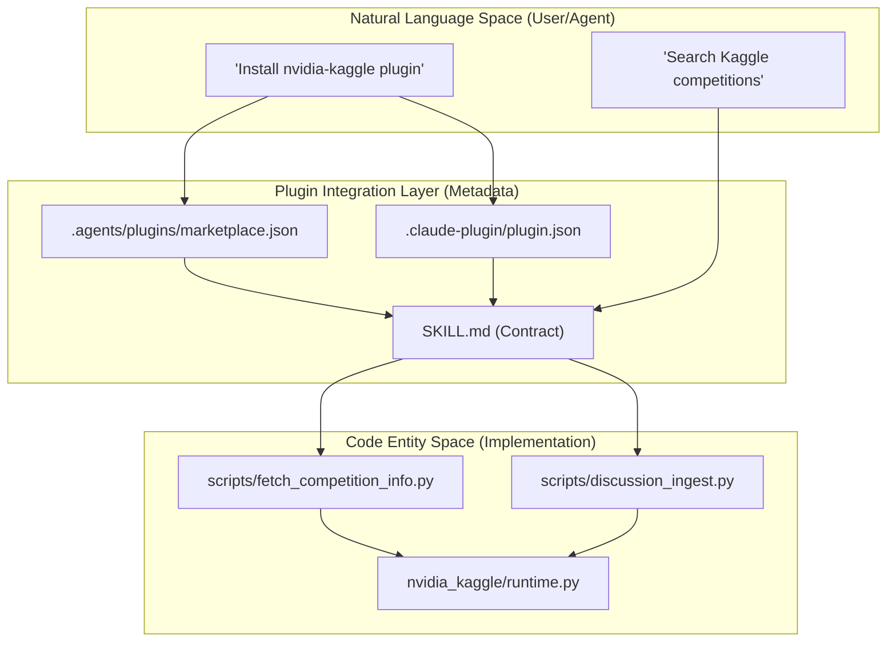
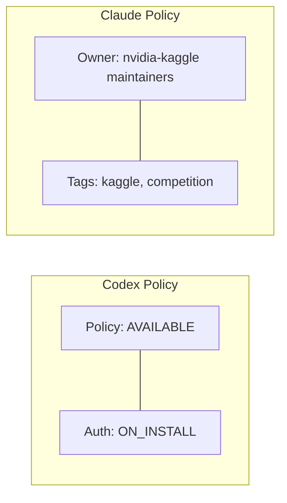

<!-- source: DeepWiki mcp.deepwiki.com · repo NVIDIA/nvidia-kaggle · page 4 Plugin Integration & Marketplace · fetched 2026-10-26 -->

# Plugin Integration & Marketplace

Relevant source files

The following files were used as context for generating this wiki page:

- [.agents/plugins/marketplace.json](.agents/plugins/marketplace.json)
- [.claude-plugin/marketplace.json](.claude-plugin/marketplace.json)

The `nvidia-kaggle` repository is designed as a multi-runtime skill that can be integrated into various AI agent environments. It achieves this through a dual-manifest strategy, providing the necessary metadata for both **Claude Code** and **Codex** marketplaces. While the core logic resides in the `scripts/` directory and the `nvidia_kaggle` Python package, these integration layers define how the agent discovers, installs, and authenticates the plugin.

### Integration Overview

The plugin is distributed primarily via its GitHub repository and is structured to be "installable" by agent runtimes that support the Claude or Codex plugin specifications. The integration defines the plugin's identity, source location, and installation policies.

#### Marketplace Discovery and Identity
The plugin identifies itself as `nvidia-kaggle` across all platforms. It utilizes a `marketplace.json` file in platform-specific hidden directories to register its presence and capabilities.

| Property | Claude Code (`.claude-plugin/`) | Codex (`.agents/`) |
| :--- | :--- | :--- |
| **Name** | `nvidia-kaggle` [.claude-plugin/marketplace.json:2]() | `nvidia-kaggle` [.agents/plugins/marketplace.json:2]() |
| **Category** | `data-science` [.claude-plugin/marketplace.json:19]() | `Productivity` [.agents/plugins/marketplace.json:18]() |
| **Source URL** | `https://github.com/NVIDIA/nvidia-kaggle.git` [.claude-plugin/marketplace.json:15]() | `https://github.com/NVIDIA/nvidia-kaggle.git` [.agents/plugins/marketplace.json:11]() |
| **Default Ref** | `main` [.claude-plugin/marketplace.json:16]() | `main` [.agents/plugins/marketplace.json:12]() |

**Sources:**
- [.claude-plugin/marketplace.json:1-24]()
- [.agents/plugins/marketplace.json:1-21]()

---

### Plugin Architecture & Runtime Mapping

The following diagram illustrates how the "Natural Language Space" (the user's intent within an agent) bridges to the "Code Entity Space" (the specific manifests and scripts) through the marketplace integration layer.

**Marketplace to Code Entity Bridge**

**Sources:**
- [.agents/plugins/marketplace.json:1-21]()
- [.claude-plugin/marketplace.json:1-24]()

---

### Distribution Runtimes

The `nvidia-kaggle` skill is currently optimized for two primary agentic ecosystems. Each runtime has its own lifecycle management for installing the Python dependencies (via `uv`) and configuring the `KAGGLE_API_TOKEN`.

#### Claude Code Plugin
The Claude Code integration is managed via the `.claude-plugin/` directory. It defines a `marketplace.json` that the Claude CLI uses to resolve the plugin's source and version. The integration relies on the `skills` array to point the agent toward the core `SKILL.md` definitions.

For details on manifest structure and the install/uninstall lifecycle, see **[Claude Code Plugin (#4.1)](#)**.

#### Codex Plugin
The Codex integration is managed via the `.agents/` and `.codex-plugin/` directories. It specifies an `installation` policy of `AVAILABLE` and an `authentication` policy of `ON_INSTALL`, ensuring the agent prompts for necessary credentials during the setup phase.

For details on the Codex agent runtime discovery and interface metadata, see **[Codex Plugin (#4.2)](#)**.

**Marketplace Policy Comparison**

**Sources:**
- [.agents/plugins/marketplace.json:14-17]()
- [.claude-plugin/marketplace.json:3-5]()
- [.claude-plugin/marketplace.json:20-20]()

---

### Key Marketplace Metadata

Both platforms share a common set of metadata that defines the plugin's purpose to the end-user.

| File Path | Entity | Description |
| :--- | :--- | :--- |
| [.claude-plugin/marketplace.json:7-7]() | `description` | "Claude Code marketplace for the NVIDIA Kaggle plugin." |
| [.claude-plugin/marketplace.json:8-8]() | `version` | `0.1.0` |
| [.agents/plugins/marketplace.json:4-4]() | `displayName` | "NVIDIA Kaggle" |

**Sources:**
- [.claude-plugin/marketplace.json:1-24]()
- [.agents/plugins/marketplace.json:1-21]()

---

