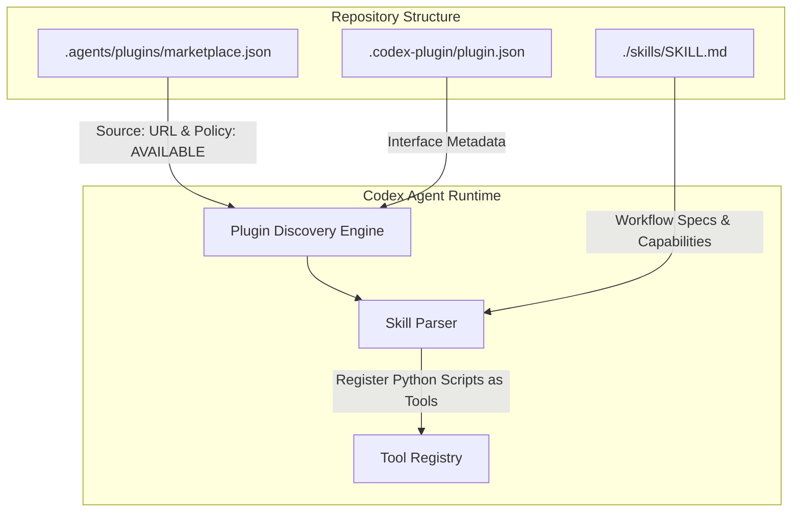
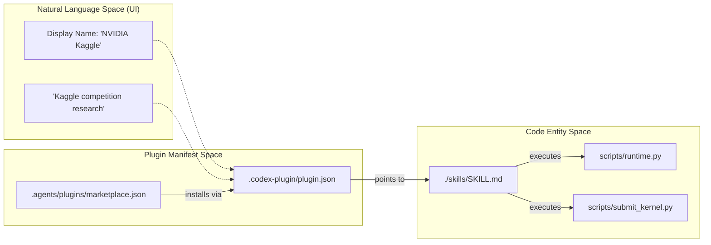

<!-- source: DeepWiki mcp.deepwiki.com · repo NVIDIA/nvidia-kaggle · page 4.2 Codex Plugin · fetched 2026-10-26 -->

# Codex Plugin

Relevant source files

The following files were used as context for generating this wiki page:

- [.agents/plugins/marketplace.json](.agents/plugins/marketplace.json)
- [.codex-plugin/plugin.json](.codex-plugin/plugin.json)

The Codex Plugin configuration defines how the `nvidia-kaggle` skill is discovered, installed, and represented within the Codex agent runtime. This integration relies on two primary directories: `.codex-plugin/`, which contains the plugin manifest and skill pointers, and `.agents/`, which manages marketplace registration and installation policies.

## Plugin Architecture and Manifests

The Codex agent runtime utilizes a manifest-driven approach to identify the capabilities of a plugin. The `nvidia-kaggle` plugin exposes a suite of Kaggle-specific workflows (research, submission, data management) by pointing the runtime to the `./skills/` directory.

### Plugin Definition (`.codex-plugin/plugin.json`)

The `plugin.json` file serves as the primary descriptor for the plugin's identity and its interface within the Codex ecosystem. It defines the versioning, licensing, and the entry point for the skill definitions.

| Field | Value | Description |
| :--- | :--- | :--- |
| `name` | `nvidia-kaggle` | Unique identifier for the plugin. |
| `skills` | `./skills/` | Path to the directory containing `SKILL.md` and associated scripts. |
| `interface.displayName` | `NVIDIA Kaggle` | The name shown to users in the Codex UI. |
| `interface.category` | `Data Science` | The classification used for filtering in the plugin library. |

**Sources:**
- [.codex-plugin/plugin.json:1-13]()

### Marketplace Registration (`.agents/plugins/marketplace.json`)

The `marketplace.json` file controls how the plugin is surfaced to the agent and the lifecycle of its installation. It explicitly links the plugin name to its source repository and defines security/authentication policies.

**Marketplace Policy Configuration:**
- **Installation Policy (`AVAILABLE`)**: The plugin is listed in the marketplace and can be explicitly selected or requested by the agent.
- **Authentication Policy (`ON_INSTALL`)**: Triggers the requirement for environment variables or credentials (such as `KAGGLE_API_TOKEN`) at the moment the plugin is added to the agent's environment.

**Sources:**
- [.agents/plugins/marketplace.json:1-21]()

---

## Data Flow: Discovery to Installation

The following diagram illustrates how the Codex Agent Runtime processes the plugin metadata to make the Kaggle skills available to the LLM.

### Codex Plugin Discovery Flow

**Sources:**
- [.agents/plugins/marketplace.json:9-17]()
- [.codex-plugin/plugin.json:6-12]()

---

## Technical Implementation Details

### Metadata and Categories
The plugin utilizes two distinct category labels depending on the manifest being read. In `.codex-plugin/plugin.json`, it is categorized as `"Data Science"` [[.codex-plugin/plugin.json:11]()] to align with technical task grouping. In `.agents/plugins/marketplace.json`, it is categorized as `"Productivity"` [[.agents/plugins/marketplace.json:18]()] to reflect its role in automating research and submission workflows.

### Skill Discovery
The `skills` field in the manifest points to `./skills/` [[.codex-plugin/plugin.json:6]()]. The Codex runtime expects this directory to contain a `SKILL.md` file that acts as a contract, mapping natural language descriptions to specific Python execution paths within the `scripts/` directory.

### Implementation Mapping: Natural Language to Code
This diagram shows how the metadata in the plugin manifests bridges the gap between the user's natural language intent and the underlying Python implementation.

### Code Entity Mapping

**Sources:**
- [.codex-plugin/plugin.json:1-13]()
- [.agents/plugins/marketplace.json:1-21]()

## Key Files Summary

| File Path | Role | Key Code Symbols |
| :--- | :--- | :--- |
| `.codex-plugin/plugin.json` | Plugin Manifest | `name`, `skills`, `interface` |
| `.agents/plugins/marketplace.json` | Marketplace Config | `source.url`, `policy.installation`, `policy.authentication` |

**Sources:**
- [.codex-plugin/plugin.json:1-13]()
- [.agents/plugins/marketplace.json:1-21]()

---

