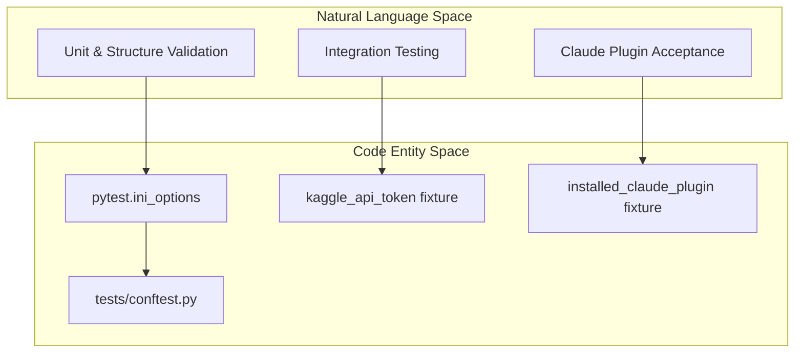

<!-- source: DeepWiki mcp.deepwiki.com · repo NVIDIA/nvidia-kaggle · page 5 Testing · fetched 2026-10-26 -->

# Testing

<details>
<summary>Relevant source files</summary>

The following files were used as context for generating this wiki page:

- [pyproject.toml](pyproject.toml)
- [tests/__init__.py](tests/__init__.py)
- [tests/conftest.py](tests/conftest.py)

</details>


The `nvidia-kaggle` repository utilizes a comprehensive test suite managed by `pytest` to ensure the integrity of its Kaggle competition workflows, plugin manifests, and runtime contracts. The test suite is divided into structural validation, unit tests, and live integration tests that interact with the Kaggle platform.

### Test Architecture Overview

The testing infrastructure is designed to handle both hermetic unit tests and environment-dependent integration tests. Configuration is centralized in `pyproject.toml` and `tests/conftest.py`.

**Testing Components Association**


**Sources:** [pyproject.toml:29-38](), [tests/conftest.py:1-43]()

---

### Test Categories

The suite distinguishes between fast, local tests and those requiring external network access or specific CLI tools.

| Category | Marker | Requirement | Description |
| :--- | :--- | :--- | :--- |
| **Structural** | N/A | None | Validates `SKILL.md` contracts and plugin manifests. |
| **Integration** | `integration` | `KAGGLE_API_TOKEN` | Hits real Kaggle API endpoints via `httpx` or `kagglesdk`. |
| **Claude Plugin** | `claude_plugin` | `claude` CLI | Tests marketplace installation/uninstallation in a temporary project. |

**Sources:** [pyproject.toml:31-31](), [tests/conftest.py:21-42]()

---

### Running Tests

Tests are executed using `pytest`. By default, integration and plugin-specific tests are skipped to ensure a fast, hermetic developer loop.

#### Standard Execution
To run unit and structural tests:
```bash
pytest
```

#### Running Integration Tests
Integration tests require the `--run-integration` flag and a valid `KAGGLE_API_TOKEN` in the environment. The `kaggle_api_token` fixture in `tests/conftest.py` will automatically skip tests if the token is missing.
```bash
export KAGGLE_API_TOKEN="your_token_here"
pytest --run-integration
```

#### Running Plugin Installation Tests
To verify the Claude Code plugin marketplace lifecycle, use the `--run-claude-plugin` flag. This utilizes the `installed_claude_plugin` fixture to simulate a project-scoped installation.
```bash
pytest --run-claude-plugin
```
**Sources:** [tests/conftest.py:21-34](), [tests/conftest.py:45-64](), [tests/conftest.py:67-72]()

---

### Test Suite Structure

The test suite is organized into two primary areas, detailed in the following child pages:

#### [Unit & Structure Tests](#5.1)
Focuses on the internal consistency of the skill.
*   **Manifest Validation:** Ensures `.claude-plugin/plugin.json` and `.codex-plugin/plugin.json` are correctly formatted.
*   **Contract Testing:** Validates that `SKILL.md` matches the available scripts and that the runtime parser correctly identifies capabilities.
*   **Wheel Payload:** Verifies that the build process includes necessary skill scripts and assets.

For details, see [Unit & Structure Tests](#5.1).

#### [Integration & Acceptance Tests](#5.2)
Focuses on end-to-end functionality and platform compatibility.
*   **API Integration:** Tests the `KaggleWebServiceClient` and `DiscussionsService` against live data.
*   **Marketplace Lifecycle:** Uses the `claude` CLI to add, install, and uninstall the plugin from a local path.
*   **Manual Acceptance:** References the `agent_acceptance_test.md` runbook for verifying agent behavior in complex workflows like "Research Brief" generation.

For details, see [Integration & Acceptance Tests](#5.2).

**Sources:** [tests/conftest.py:86-120](), [pyproject.toml:44-50]()

---

