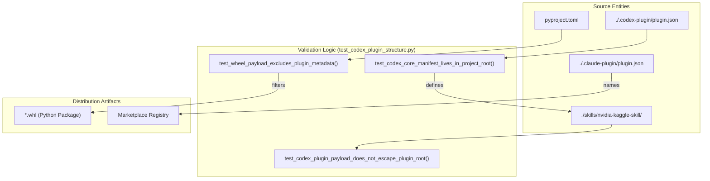
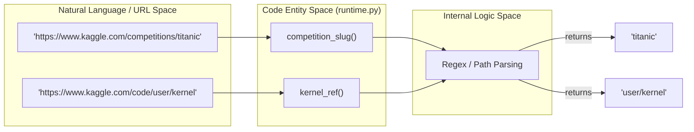

<!-- source: DeepWiki mcp.deepwiki.com · repo NVIDIA/nvidia-kaggle · page 5.1 Unit & Structure Tests · fetched 2026-10-26 -->

# Unit & Structure Tests

Relevant source files

The following files were used as context for generating this wiki page:

- [tests/conftest.py](tests/conftest.py)
- [tests/test_codex_plugin_structure.py](tests/test_codex_plugin_structure.py)
- [tests/test_day_one_skill_contracts.py](tests/test_day_one_skill_contracts.py)
- [tests/test_plugin_structure.py](tests/test_plugin_structure.py)

This section covers the structural and unit tests that ensure the `nvidia-kaggle` plugin adheres to the manifest requirements of various agent runtimes (Claude Code and Codex) and maintains its internal contract defined in `SKILL.md`. These tests are designed to run quickly without requiring external network access, focusing on file layout, metadata correctness, and core logic parsing.

## Overview of Structure Testing

The repository uses structural tests to validate that the plugin is correctly packaged for distribution and that its internal components (scripts, documentation, and shared runtime) are consistent. These tests ensure that changes to the directory structure or manifest files do not break the installation process for end-users.

### Key Test Categories
*   **Manifest Validation**: Verifies `plugin.json` and `marketplace.json` for both Claude and Codex platforms.
*   **Skill Contract Enforcement**: Ensures `SKILL.md` contains required sections and correctly references progressive-disclosure documents.
*   **Wheel Payload Verification**: Checks that build artifacts (Python wheels) exclude internal metadata while including necessary source files.
*   **Runtime Parser Correctness**: Validates utility functions in `runtime.py` for parsing Kaggle URLs and slugs.

Sources: [tests/test_plugin_structure.py:1-5]() | [tests/test_codex_plugin_structure.py:1-10]() | [tests/test_day_one_skill_contracts.py:1-12]()

## Claude Plugin Structure

The tests in `test_plugin_structure.py` validate the layout required by the Claude Code plugin system.

### Manifest and Marketplace Validation
The system checks that the `.claude-plugin/` directory contains a valid `plugin.json` naming the plugin `nvidia-kaggle` [tests/test_plugin_structure.py:13-20](). It also validates the `marketplace.json` structure, ensuring the source type (e.g., `github`, `url`, `git-subdir`) matches the expected schema for the Claude marketplace [tests/test_plugin_structure.py:22-54]().

### Skill Directory Integrity
The tests enforce that all skills are located in the `skills/` directory and that each contains a `SKILL.md` file [tests/test_plugin_structure.py:57-65](). Crucially, the list of skill directories on disk must exactly match the `skills` array defined in the plugin manifest [tests/test_plugin_structure.py:67-73]().

Sources: [tests/test_plugin_structure.py:13-73]()

## Codex Plugin & Wheel Payload

Codex-specific tests ensure compatibility with the OpenAI Codex agent runtime and verify the hygiene of the Python distribution package.

### Codex Manifests
Tests verify that `.agents/plugins/marketplace.json` correctly registers the "nvidia-kaggle" interface and sets the installation policy to `AVAILABLE` with `ON_INSTALL` authentication [tests/test_codex_plugin_structure.py:18-52](). The core manifest at `.codex-plugin/plugin.json` is checked for its license, name, and skill pathing [tests/test_codex_plugin_structure.py:54-64]().

### Build Payload Controls
To keep the distributed wheel clean, tests inspect the `pyproject.toml` configuration (specifically `hatch` build targets). They ensure that internal metadata directories like `.agents`, `.claude-plugin`, and `.codex-plugin` are excluded from the wheel payload [tests/test_codex_plugin_structure.py:66-74]().

### Data Flow: Plugin Registration to Payload
The following diagram illustrates how the codebase entities map to the physical distribution artifacts and runtime registration.

**Plugin Packaging and Registration Flow**

Sources: [tests/test_codex_plugin_structure.py:18-90]()

## Skill Contract & Runtime Logic

The `test_day_one_skill_contracts.py` suite ensures that the `SKILL.md` file serves as a reliable contract for agent runtimes.

### Contract Requirements
The tests verify the presence of mandatory sections in `SKILL.md`:
*   `## Inputs`
*   `## Runtime Dependencies`
*   `## Outputs`
*   `## Troubleshooting`
*   `## Runtime Compatibility` (must mention Codex, Claude Code, and Claude Agent SDK)

Sources: [tests/test_day_one_skill_contracts.py:20-26, 54-61]()

### Script Inventory and Self-Containment
The suite maintains an inventory of expected scripts in the `scripts/` directory, ensuring that core workflows (discussion, kernel, submission) are present [tests/test_day_one_skill_contracts.py:77-99](). A "self-contained" test copies the skill to a temporary directory and verifies that it can still execute and find its dependencies (like `runtime.py`) without relying on the original repository structure [tests/test_day_one_skill_contracts.py:112-130]().

### Parser Verification
The tests validate the `competition_slug` and `kernel_ref` parsers from `runtime.py`, ensuring they correctly handle both raw identifiers and full Kaggle URLs.

| Input Type | Input String | Expected Output |
| :--- | :--- | :--- |
| Competition Slug | `titanic` | `titanic` |
| Competition URL | `https://www.kaggle.com/competitions/titanic/data` | `titanic` |
| Kernel Ref | `alice/my-kernel` | `alice/my-kernel` |
| Kernel URL | `https://www.kaggle.com/code/alice/my-kernel?scriptVersionId=1` | `alice/my-kernel` |

Sources: [tests/test_day_one_skill_contracts.py:101-106]()

**Natural Language to Code Mapping: Runtime Parsers**

Sources: [tests/test_day_one_skill_contracts.py:101-106]()

## Shared Fixtures (`conftest.py`)

The `tests/conftest.py` file provides the foundation for the test suite, including CLI options and environment setup.

### Test Markers
The configuration defines two custom markers to segregate slow or environment-dependent tests:
*   `--run-integration`: Enables tests that hit the live Kaggle API (requires `KAGGLE_API_TOKEN`) [tests/conftest.py:21-27]().
*   `--run-claude-plugin`: Enables tests that perform a full installation via the `claude` CLI [tests/conftest.py:29-33]().

### The `installed_claude_plugin` Fixture
This fixture provides a high-level integration test for the Claude marketplace. It:
1.  Creates a temporary project directory [tests/conftest.py:96-97]().
2.  Uses the `claude` CLI to add the local repository as a marketplace [tests/conftest.py:101]().
3.  Installs the `nvidia-kaggle` plugin [tests/conftest.py:102]().
4.  Yields the project path for the test to use.
5.  Cleans up by uninstalling the plugin and removing the marketplace entry [tests/conftest.py:105-120]().

Sources: [tests/conftest.py:21-121]()

---

