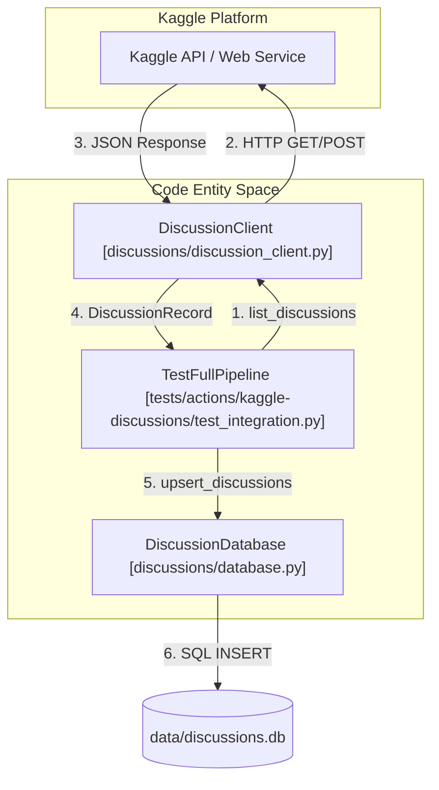
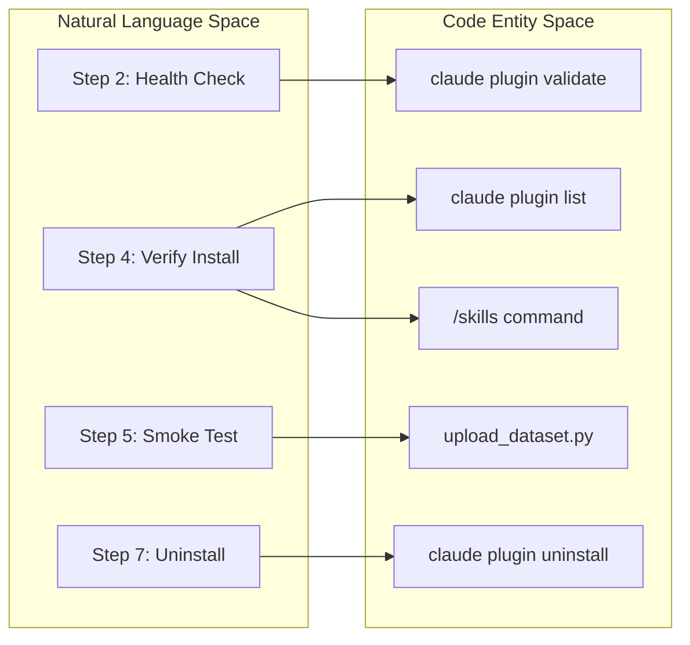

<!-- source: DeepWiki mcp.deepwiki.com · repo NVIDIA/nvidia-kaggle · page 5.2 Integration & Acceptance Tests · fetched 2026-10-26 -->

# Integration & Acceptance Tests

Relevant source files

The following files were used as context for generating this wiki page:

- [tests/actions/kaggle-discussions/test_discussion_client.py](tests/actions/kaggle-discussions/test_discussion_client.py)
- [tests/actions/kaggle-discussions/test_integration.py](tests/actions/kaggle-discussions/test_integration.py)
- [tests/agent_acceptance_test.md](tests/agent_acceptance_test.md)
- [tests/test_claude_plugin_install.py](tests/test_claude_plugin_install.py)

This page covers the integration and acceptance testing strategies for the `nvidia-kaggle` plugin. These tests ensure that the individual components work together correctly, the plugin interfaces properly with the live Kaggle API, and the end-to-end agent workflows are valid within their target runtimes (Claude Code and Codex).

## Overview of Test Categories

The testing suite is divided into three primary levels of integration:

1.  **Mocked Integration Tests**: Validate logic using the `DiscussionClient` and other service classes with mocked HTTP responses.
2.  **Live Integration Tests**: Targeted tests that hit the real Kaggle API, requiring a `KAGGLE_API_TOKEN`.
3.  **Agent Acceptance Tests**: A human-in-the-loop or agent-led runbook that validates the plugin's installation, marketplace registration, and full workflow execution in an isolated environment.

---

## Live Integration Tests

Integration tests that interact with the live Kaggle platform are gated behind the `--run-integration` flag and require a valid `KAGGLE_API_TOKEN` in the environment [tests/actions/kaggle-discussions/test_integration.py:25-27]().

### Discussion Client Integration
The `TestListDiscussions` and `TestCommentFetching` classes verify that the `DiscussionClient` can successfully authenticate, fetch records, and parse complex nested comment structures from real Kaggle competition threads [tests/actions/kaggle-discussions/test_integration.py:42-62]().

Key behaviors validated:
*   **Slug-to-Title Resolution**: Kaggle's discussion search often requires a competition title rather than a URL slug. The integration suite tests specific cases like `playground-series-s6e5` to ensure they resolve to the correct display title (e.g., "Predicting F1 Pit Stops") [tests/actions/kaggle-discussions/test_integration.py:17-20](), [tests/actions/kaggle-discussions/test_integration.py:65-77]().
*   **Database Roundtrip**: Ensures that data fetched from the API can be successfully ingested into the local SQLite `DiscussionDatabase`, queried back, and maintain referential integrity [tests/actions/kaggle-discussions/test_integration.py:91-104]().

### Data Flow: Integration Roundtrip
The following diagram illustrates the flow from the live API through the client and into the local storage during an integration test.

**Integration Test Data Flow**

Sources: [tests/actions/kaggle-discussions/test_integration.py:91-104](), [discussions/discussion_client.py:13-15](), [discussions/database.py:10-12]()

---

## Claude Plugin Installation Tests

The `test_claude_plugin_install.py` suite validates the marketplace and installation lifecycle. These tests are marked with `@pytest.mark.claude_plugin` and are skipped if the `claude` CLI is not present [tests/test_claude_plugin_install.py:16-19]().

### Key Functions
*   **`test_claude_plugin_validate_accepts_repo_manifest`**: Executes `claude plugin validate` against the repository root to ensure `plugin.json` and the `.claude-plugin/` structure meet the official schema requirements [tests/test_claude_plugin_install.py:17-28]().
*   **`test_marketplace_install_uses_plugin`**: Uses the `installed_claude_plugin` fixture to verify that the plugin can be registered in a temporary project's marketplace and listed via `claude plugin list` [tests/test_claude_plugin_install.py:31-44]().

---

## Agent Acceptance Runbook

The `agent_acceptance_test.md` file defines a rigorous manual/agent-led validation process. Unlike `pytest` suites, this is an "Acceptance Checklist" designed to be executed by an agent (like Claude Code) running in a clean, isolated directory [tests/agent_acceptance_test.md:1-5]().

### Isolation Rules
To prevent "contamination" from the development environment, the runbook enforces strict isolation:
*   Tests must run from a temporary `ACCEPTANCE_ROOT` outside the `REPO_ROOT` [tests/agent_acceptance_test.md:21-23]().
*   The agent must not use `--plugin-dir` (which bypasses marketplace logic) [tests/agent_acceptance_test.md:24]().
*   Plugins must be installed at the `project` scope, never `user` scope [tests/agent_acceptance_test.md:25]().

### Acceptance Workflow
The runbook follows a 9-step progression:
1.  **Health Checks**: Running `uv run pytest` and `claude plugin validate` on the source repo [tests/agent_acceptance_test.md:73-88]().
2.  **Plugin Verification**: Confirming the plugin is visible via `claude plugin list --json` and the `/skills` command [tests/agent_acceptance_test.md:133-157]().
3.  **Smoke Checks**: Executing core skills like `fetch_competition_info` and `upload_dataset` (using a tiny private test dataset) [tests/agent_acceptance_test.md:163-170]().
4.  **Cleanup**: Mandatory deletion of Kaggle datasets and uninstallation of the plugin to leave the system in a clean state [tests/agent_acceptance_test.md:33-35]().

### Acceptance Logic Mapping
This diagram maps the conceptual "Acceptance Steps" to the specific CLI commands and entities they validate.

**Acceptance Test Logic Mapping**

Sources: [tests/agent_acceptance_test.md:73-170](), [tests/test_claude_plugin_install.py:17-28]()

---

## Discussion Client Mocked Tests

For rapid iteration without API dependencies, `test_discussion_client.py` provides extensive unit coverage using `unittest.mock` to simulate Kaggle's internal web services.

### Core Validation Logic
*   **`TestParseDiscussionDoc`**: Validates the conversion of Kaggle's internal JSON "documents" into `DiscussionRecord` Pydantic models, including handling of missing IDs, non-numeric IDs, and malformed tags [tests/actions/kaggle-discussions/test_discussion_client.py:23-66]().
*   **`TestListDiscussions`**: Mocks the `_post_search` method to verify pagination logic, ensuring the client stops when `nextPageToken` is missing or `max_pages` is reached [tests/actions/kaggle-discussions/test_discussion_client.py:94-150]().
*   **`TestGetDiscussionDetail`**: Validates the recursive parsing of nested comments and replies, ensuring that author tiers and vote counts are correctly captured from the nested JSON structure [tests/actions/kaggle-discussions/test_discussion_client.py:155-180]().

Sources: [tests/actions/kaggle-discussions/test_discussion_client.py:1-180](), [tests/actions/kaggle-discussions/test_integration.py:1-104](), [tests/agent_acceptance_test.md:1-50](), [tests/test_claude_plugin_install.py:1-44]()

---

