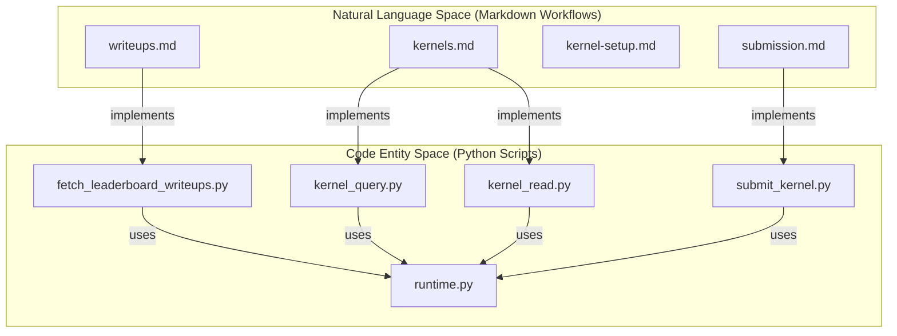
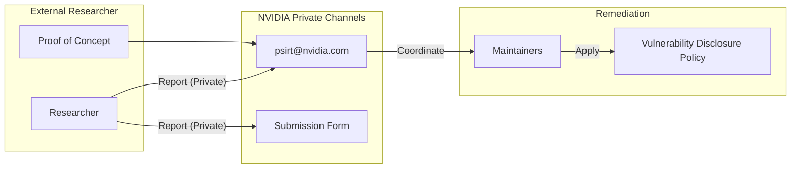

<!-- source: DeepWiki mcp.deepwiki.com · repo NVIDIA/nvidia-kaggle · page 6 Contributing & Legal · fetched 2026-10-26 -->

# Contributing & Legal

Relevant source files

The following files were used as context for generating this wiki page:

- [CLA.md](CLA.md)
- [CONTRIBUTING.md](CONTRIBUTING.md)
- [LICENSE](LICENSE)
- [SECURITY.md](SECURITY.md)
- [THIRD_PARTY_NOTICES.md](THIRD_PARTY_NOTICES.md)
- [skills/nvidia-kaggle-skill/kernel-setup.md](skills/nvidia-kaggle-skill/kernel-setup.md)

This page outlines the guidelines for contributing to the `nvidia-kaggle` project, the legal requirements for contributors, security reporting procedures, and third-party software licensing information.

## Contribution Guidelines

The `nvidia-kaggle` project follows a set of conventions to ensure that the skill remains self-contained and portable across different agent runtimes such as Claude Code and Codex.

### Development Environment
To begin contributing, clone the repository and initialize the environment using `uv` [CONTRIBUTING.md:5-9](). All workflows require a Kaggle API token, which should be provided via the `KAGGLE_API_TOKEN` environment variable [CONTRIBUTING.md:11-11]().

### Project Layout and Conventions
The skill is located in `skills/nvidia-kaggle-skill/` [CONTRIBUTING.md:15-15](). Contributors should adhere to the following rules:
*   **Self-Containment**: All logic required for the skill must reside within its directory to ensure it remains functional when copied into other runtimes [CONTRIBUTING.md:15-15]().
*   **Naming**: Use `nvidia-kaggle-skill` (hyphenated) for the public skill name, while Python modules and scripts must use `snake_case` [CONTRIBUTING.md:24-24]().
*   **Output Handling**: Use standard `print()` for primary data output intended for users or downstream commands. Use `rich`'s `console.print` for formatted tables and `logging` for internal diagnostics [CONTRIBUTING.md:27-27]().
*   **Credentials**: Never commit `.env`, `kaggle.json`, or private notebooks to the repository [CONTRIBUTING.md:31-31]().

### Testing Requirements
Before submitting changes, all tests must pass. The test suite is categorized by the level of access required:
*   **Unit Tests**: Run via `uv run pytest` [CONTRIBUTING.md:38-38]().
*   **Integration Tests**: These require network access and valid Kaggle credentials. Run via `uv run pytest --run-integration` [CONTRIBUTING.md:44-44]().
*   **Plugin Validation**: For Claude-specific changes, use `uv run pytest --run-claude-plugin tests/test_claude_plugin_install.py` and the `claude plugin validate .` command [CONTRIBUTING.md:50-56]().

### Workflow Implementation Flow
The following diagram illustrates the relationship between natural language workflow definitions and the Python implementation scripts.

**Workflow to Code Entity Mapping**

Sources: [CONTRIBUTING.md:15-15](), [skills/nvidia-kaggle-skill/kernel-setup.md:1-3]()

## Legal & Licensing

### License
The project is licensed under the **MIT License** [LICENSE:1-1](). This allows for broad use, modification, and distribution, provided that the copyright notice and permission notice are included in all copies or substantial portions of the software [LICENSE:5-13]().

### Contribution License Agreement (CLA)
All contributors must agree to the NVIDIA Contribution License Agreement [CLA.md:4-4](). 
*   **Originality**: You represent that your submissions are your original work [CLA.md:26-26]().
*   **Grant of Rights**: You grant NVIDIA a perpetual, worldwide, non-exclusive, royalty-free, irrevocable license to reproduce, distribute, and sublicense your contributions [CLA.md:43-44]().
*   **Employer Permission**: If the submission is made in the course of your employment, you must secure permission from your employer [CLA.md:34-35]().

### Third-Party Notices
The project relies on several third-party libraries. No third-party source code is vendored; all dependencies are resolved at runtime via standard Python package managers [THIRD_PARTY_NOTICES.md:5-5]().

| License | Dependencies |
| :--- | :--- |
| **Apache-2.0** | `kaggle`, `kagglesdk`, `Codex CLI/SDK`, `RAPIDS cuDF`, `RAPIDS cuML` |
| **MIT** | `claude-agent-sdk`, `pydantic`, `pytest`, `rich`, `hatchling`, `CuPy` |
| **BSD-3-Clause** | `httpx`, `nbformat`, `numpy`, `pandas`, `python-dotenv`, `scikit-learn` |

Sources: [THIRD_PARTY_NOTICES.md:11-84](), [LICENSE:1-21](), [CLA.md:1-110]()

## Security Policy

NVIDIA handles security vulnerabilities through private disclosure channels rather than public GitHub issues [SECURITY.md:5-5]().

### Reporting Vulnerabilities
If you identify a potential security issue, please report it via:
*   **Web**: [NVIDIA Security Vulnerability Submission Form](https://www.nvidia.com/object/submit-security-vulnerability.html) [SECURITY.md:10-10]()
*   **Email**: `psirt@nvidia.com` (PGP encryption encouraged) [SECURITY.md:11-12]()

### Required Information
When reporting, include:
1.  Product/Branch version [SECURITY.md:14-14]()
2.  Vulnerability type (e.g., code execution, buffer overflow) [SECURITY.md:15-15]()
3.  Reproduction instructions and Proof-of-Concept code [SECURITY.md:16-17]()
4.  Potential impact [SECURITY.md:18-18]()

**Security Response Data Flow**

Sources: [SECURITY.md:5-20]()

---

