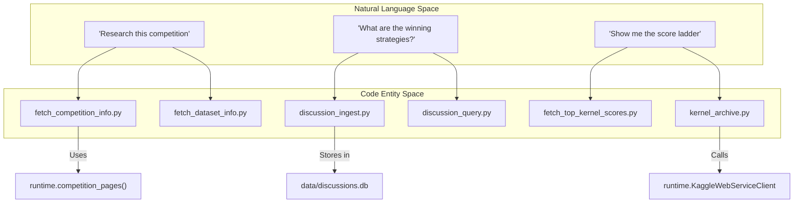
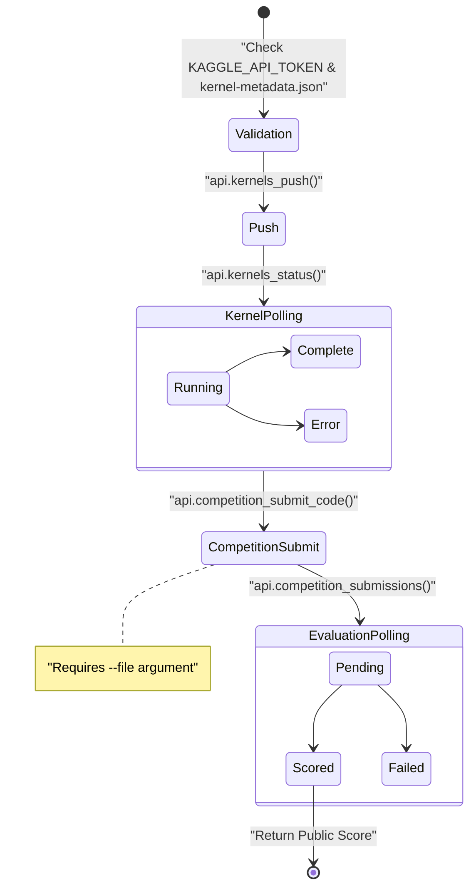

<!-- source: DeepWiki mcp.deepwiki.com · repo NVIDIA/nvidia-kaggle · page 7 Glossary · fetched 2026-10-26 -->

# Glossary

Relevant source files

The following files were used as context for generating this wiki page:

- [README.md](README.md)
- [demo/demo.gif](demo/demo.gif)
- [skills/nvidia-kaggle-skill/SKILL.md](skills/nvidia-kaggle-skill/SKILL.md)
- [skills/nvidia-kaggle-skill/kernels.md](skills/nvidia-kaggle-skill/kernels.md)
- [skills/nvidia-kaggle-skill/research-brief.md](skills/nvidia-kaggle-skill/research-brief.md)
- [skills/nvidia-kaggle-skill/scripts/constants.py](skills/nvidia-kaggle-skill/scripts/constants.py)
- [skills/nvidia-kaggle-skill/scripts/discussions/models.py](skills/nvidia-kaggle-skill/scripts/discussions/models.py)
- [skills/nvidia-kaggle-skill/scripts/kernels/archive.py](skills/nvidia-kaggle-skill/scripts/kernels/archive.py)
- [skills/nvidia-kaggle-skill/scripts/kernels/models.py](skills/nvidia-kaggle-skill/scripts/kernels/models.py)
- [skills/nvidia-kaggle-skill/scripts/runtime.py](skills/nvidia-kaggle-skill/scripts/runtime.py)
- [skills/nvidia-kaggle-skill/scripts/submission_quota.py](skills/nvidia-kaggle-skill/scripts/submission_quota.py)
- [skills/nvidia-kaggle-skill/scripts/upload_dataset.py](skills/nvidia-kaggle-skill/scripts/upload_dataset.py)
- [skills/nvidia-kaggle-skill/submission.md](skills/nvidia-kaggle-skill/submission.md)

This glossary defines codebase-specific terms, Kaggle platform concepts, and technical jargon used within the `nvidia-kaggle` plugin. It provides a bridge between natural language domain concepts and their specific implementations in the code.

## Core Concepts & Terms

### Competition Slug
A unique, URL-friendly identifier for a Kaggle competition (e.g., `titanic` or `home-credit-default-risk`).
*   **Implementation:** Extracted from URLs or raw strings using `competition_slug()` in [skills/nvidia-kaggle-skill/scripts/runtime.py:12-16]().
*   **Usage:** Used as a primary key for local SQLite caches and as a required parameter for most Kaggle API/CLI calls.

### Kernel Reference (kernel_ref)
A unique identifier for a Kaggle notebook, typically in the format `owner/slug` or a full Kaggle code URL.
*   **Implementation:** Parsed via `kernel_ref()` in [skills/nvidia-kaggle-skill/scripts/runtime.py:18-23]() and `parse_kernel_ref()` in [skills/nvidia-kaggle-skill/scripts/kernels/archive.py:38-57]().
*   **Data Structure:** Represented by the `KernelRef` dataclass [skills/nvidia-kaggle-skill/scripts/kernels/archive.py:32-36]().

### KGAT (Kaggle API Token)
The authentication credential required for the plugin to interact with Kaggle services.
*   **Implementation:** Loaded from the `KAGGLE_API_TOKEN` environment variable via `require_kaggle_token()` [skills/nvidia-kaggle-skill/scripts/runtime.py:26-32]().
*   **Security:** The system enforces that this token is never logged or echoed [skills/nvidia-kaggle-skill/SKILL.md:43-43]().

### Score Direction
The optimization goal of a competition metric, determining whether a lower score (e.g., MAE) or a higher score (e.g., Accuracy) is better.
*   **Implementation:** Managed in `select_best_public_lb_version()` with modes `auto`, `minimize`, or `maximize` [skills/nvidia-kaggle-skill/scripts/kernels/archive.py:180-187]().
*   **Inference Logic:** The `_infer_direction()` function attempts to determine the direction by comparing version scores against the `bestSubmissionScore` metadata [skills/nvidia-kaggle-skill/scripts/kernels/archive.py:160-178]().

---

## Technical Entities & Data Flow

### Kaggle Web Service (Internal API)
An internal JSON API (`/api/i/`) used by the Kaggle frontend, providing data not available in the public REST API (e.g., detailed version scores, writeup links).
*   **Implementation:** Handled by the `KaggleWebServiceClient` class [skills/nvidia-kaggle-skill/scripts/runtime.py:52-124]().
*   **Authentication:** Uses a dual-layer auth: the `KAGGLE_API_TOKEN` in the `Authorization` header and a session-seeded `X-XSRF-TOKEN` [skills/nvidia-kaggle-skill/scripts/runtime.py:83-87]().

### The "Research Brief" Pipeline
A high-level workflow that orchestrates multiple scripts to produce a strategic overview of a competition.

#### Natural Language to Code Entity Space: Research Brief
The following diagram maps the logical steps of a "Research Brief" request to the specific code entities that execute them.

**Sources:** [skills/nvidia-kaggle-skill/SKILL.md:89-98](), [skills/nvidia-kaggle-skill/research-brief.md:1-9](), [skills/nvidia-kaggle-skill/scripts/runtime.py:187-193]()

---

## Domain Models

The plugin uses Pydantic models to standardize data retrieved from various Kaggle sources before caching them in SQLite.

| Model | File | Description |
| :--- | :--- | :--- |
| `CompetitionInfo` | [discussions/models.py:9-19]() | Metadata including metric, deadline, and description. |
| `DiscussionRecord` | [discussions/models.py:21-39]() | A thread's metadata, author info, and body content. |
| `DiscussionComment` | [discussions/models.py:41-54]() | Individual replies within a thread. |
| `KernelMetadata` | [kernels/models.py]() | (Referenced) metadata for Kaggle notebooks. |

**Sources:** [skills/nvidia-kaggle-skill/scripts/discussions/models.py:1-64]()

---

## Submission Lifecycle

The submission process involves a two-phase polling mechanism to track both the notebook execution and the competition leaderboard evaluation.

#### Natural Language to Code Entity Space: Submission Flow
This diagram tracks the state transitions during a `submit_kernel.py` execution.

**Sources:** [skills/nvidia-kaggle-skill/submission.md:60-69](), [skills/nvidia-kaggle-skill/scripts/submit_kernel.py]()

---

## Abbreviations & Jargon

*   **LB (Leaderboard):** The ranking of participants. "Public LB" refers to the score on the visible test subset.
*   **Slug:** The URL-safe version of a title (e.g., `titanic` for the "Titanic - Machine Learning from Disaster" competition).
*   **Ingest:** The process of fetching remote Kaggle data (discussions or kernels) and saving it to the local SQLite `data/` directory.
*   **Quota Check:** A proactive check using `submission_quota.py` to see if the daily limit of competition submissions has been reached [skills/nvidia-kaggle-skill/scripts/submission_quota.py:2-11]().
*   **XSRF (Cross-Site Request Forgery):** A security token required by Kaggle's internal web service, obtained by the `KaggleWebServiceClient` during its initial session handshake [skills/nvidia-kaggle-skill/scripts/runtime.py:72-76]().
*   **Collaborator Patching:** The process of adding users to a dataset via the SDK because the CLI `create` command ignores the collaborator field in `dataset-metadata.json` [skills/nvidia-kaggle-skill/scripts/upload_dataset.py:159-164]().

**Sources:** [skills/nvidia-kaggle-skill/scripts/runtime.py:53-59](), [skills/nvidia-kaggle-skill/scripts/upload_dataset.py:159-164](), [skills/nvidia-kaggle-skill/scripts/submission_quota.py:2-11]()