# Page: Overview

# Overview

<details>
<summary>Relevant source files</summary>

The following files were used as context for generating this wiki page:

- [README.md](README.md)
- [demo/demo.gif](demo/demo.gif)
- [pyproject.toml](pyproject.toml)
- [skills/nvidia-kaggle-skill/SKILL.md](skills/nvidia-kaggle-skill/SKILL.md)
- [skills/nvidia-kaggle-skill/research-brief.md](skills/nvidia-kaggle-skill/research-brief.md)
- [skills/nvidia-kaggle-skill/scripts/upload_dataset.py](skills/nvidia-kaggle-skill/scripts/upload_dataset.py)

</details>


The **nvidia-kaggle** plugin is a technical skill designed for AI agents (such as Claude Code and Codex) to perform end-to-end Kaggle competition workflows. It bridges the gap between natural language requests and the complex Kaggle ecosystem by providing a unified interface for context gathering, research, local reproduction, and competition management.

## Purpose and Scope

The plugin provides the `nvidia-kaggle-skill` to handle all aspects of a Kaggle competition lifecycle [README.md:1-13](). It is specifically scoped for Kaggle-related tasks and is not intended for generic machine learning or data analysis unrelated to the platform [skills/nvidia-kaggle-skill/SKILL.md:23-27]().

### Key Capabilities
*   **Context Gathering:** Automated fetching of competition rules, timelines, evaluation metrics, and dataset descriptions [README.md:70-76]().
*   **Community Research:** Indexing and querying public discussions and kernels to extract winning strategies and modeling patterns [README.md:103-109]().
*   **Writeup Analysis:** Scraping and summarizing top-tier solution writeups from the leaderboard [README.md:35-41]().
*   **Local Reproduction:** Setting up a local workspace with notebooks and their required input data/models [README.md:134-140]().
*   **Asset Management:** Submitting kernels to competitions and managing Kaggle datasets [README.md:24-25]().

## System Architecture

The plugin is built on a modular architecture that separates agent-facing workflows from low-level Kaggle API interactions.

### High-Level Interaction Flow
The following diagram illustrates how an agent request flows through the skill to the underlying Kaggle infrastructure.

**Diagram: Request Resolution and Execution**
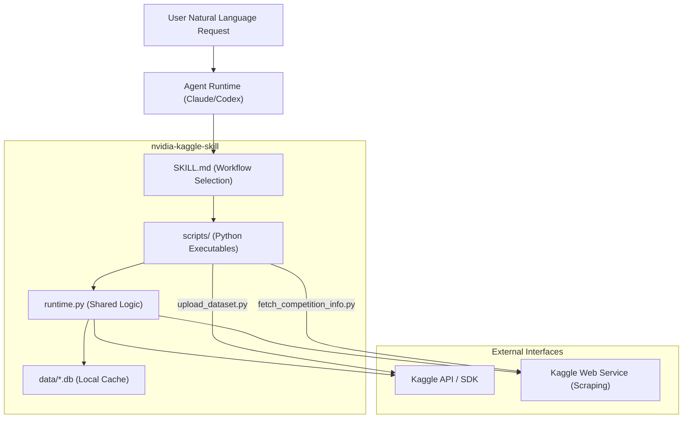
**Sources:** [skills/nvidia-kaggle-skill/SKILL.md:65-149](), [README.md:9-11]()

## Key Code Entities

The plugin maps natural language intents to specific Python scripts and library modules.

| Intent | Script / Entity | Role |
| :--- | :--- | :--- |
| **Competition Info** | `scripts/fetch_competition_info.py` | Fetches rules and overview via `runtime.py` [skills/nvidia-kaggle-skill/SKILL.md:71-80]() |
| **Research Brief** | `research-brief.md` | Orchestrates multiple scripts to create a strategy document [skills/nvidia-kaggle-skill/SKILL.md:89-98]() |
| **Discussion Sync** | `scripts/discussion_ingest.py` | Ingests threads into `data/discussions.db` [skills/nvidia-kaggle-skill/SKILL.md:104-113]() |
| **Dataset Upload** | `scripts/upload_dataset.py` | Manages `dataset-metadata.json` and calls Kaggle CLI [skills/nvidia-kaggle-skill/scripts/upload_dataset.py:1-8]() |
| **Kernel Research** | `kernels/` library | Provides logic for querying and reading notebooks [skills/nvidia-kaggle-skill/SKILL.md:123-125]() |

### Code-to-System Mapping
This diagram maps internal code components to the external Kaggle entities they manage.

**Diagram: Entity Mapping**
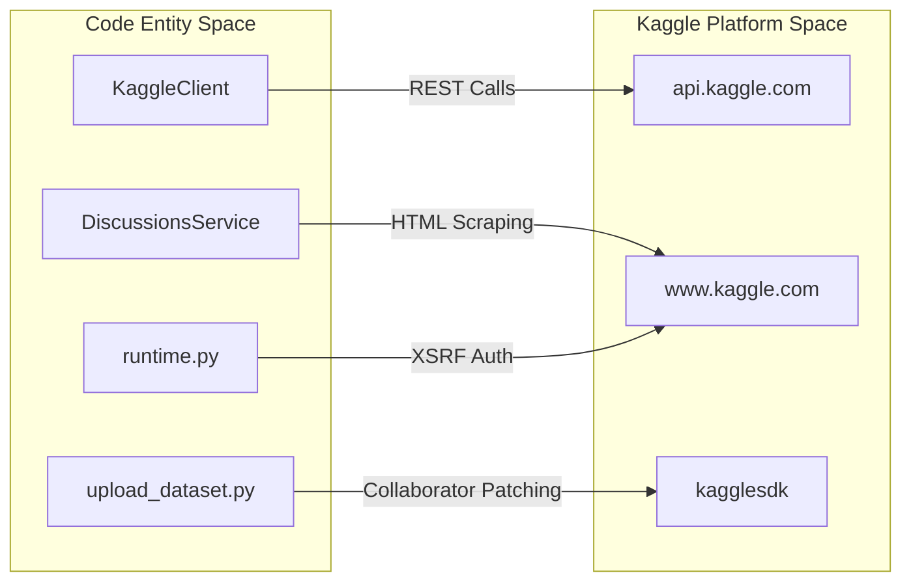
**Sources:** [skills/nvidia-kaggle-skill/scripts/upload_dataset.py:152-199](), [skills/nvidia-kaggle-skill/SKILL.md:49-57]()

## Wiki Navigation

To understand the plugin in depth, follow these child pages:

*   **[Getting Started & Installation](#1.1)**: Explains the prerequisites like `KAGGLE_API_TOKEN` and how to install the plugin using `uv` [README.md:27-31]().
*   **[Skill Specification (SKILL.md)](#1.2)**: Details the formal contract used by agents to discover capabilities, manage permissions, and execute workflows [skills/nvidia-kaggle-skill/SKILL.md:1-19]().

For implementation details, refer to the **Core Architecture** section, which covers the `runtime.py` shared module and the SQLite-backed data models for discussions and kernels.

---

# Page: Getting Started & Installation

# Getting Started & Installation

<details>
<summary>Relevant source files</summary>

The following files were used as context for generating this wiki page:

- [.agents/plugins/marketplace.json](.agents/plugins/marketplace.json)
- [.claude-plugin/marketplace.json](.claude-plugin/marketplace.json)
- [.claude-plugin/plugin.json](.claude-plugin/plugin.json)
- [.codex-plugin/plugin.json](.codex-plugin/plugin.json)
- [README.md](README.md)
- [demo/demo.gif](demo/demo.gif)

</details>


The NVIDIA Kaggle Plugin provides a unified skill for agent runtimes to interact with the Kaggle platform. It enables workflows ranging from competition context gathering and discussion indexing to local kernel reproduction and submission management. This page covers the installation process, environment configuration, and initial execution for supported runtimes.

## Prerequisites

Before installation, ensure the following requirements are met:
*   **Python 3.10+**: The core logic and scripts require a modern Python environment [README.md:29-29]().
*   **uv**: Recommended for fast, reproducible dependency management and synchronization.
*   **Kaggle Account**: An active account on [kaggle.com](https://www.kaggle.com).
*   **Kaggle API Token**: A `kaggle.json` file containing your `username` and `key`.

### Setting up KAGGLE_API_TOKEN
The plugin relies on the official Kaggle API and internal web services. You must export your credentials as environment variables or ensure they are present in `~/.kaggle/kaggle.json` [README.md:31-31]().

```bash
export KAGGLE_USERNAME="your_username"
export KAGGLE_KEY="your_api_key"
```

---

## Installation by Runtime

The plugin supports multiple agent environments, each with specific installation patterns.

### 1. Claude Code
Claude Code uses the `.claude-plugin/` directory to discover skills. The `plugin.json` manifest points to the skill implementation [ .claude-plugin/plugin.json:1-8]().

**Steps:**
1.  Clone the repository into your project or a global plugin directory.
2.  Run `uv sync` to install dependencies defined in `pyproject.toml`.
3.  Add the plugin to Claude Code:
    ```bash
    claude plugin add /path/to/nvidia-kaggle
    ```
4.  Verify the skill `nvidia-kaggle-skill` is available in the `claude` interface.

### 2. Codex
Codex utilizes the `.codex-plugin/` and `.agents/` directories for marketplace registration and interface metadata [ .codex-plugin/plugin.json:1-13]().

**Steps:**
1.  Ensure the repository is accessible to the Codex agent runtime.
2.  The runtime detects the `marketplace.json` which defines the installation policy as `AVAILABLE` and authentication as `ON_INSTALL` [ .agents/plugins/marketplace.json:14-17]().
3.  Install via the Codex UI or CLI:
    ```bash
    codex install nvidia-kaggle
    ```

### 3. Generic Agent Runtimes
For custom harnesses, the plugin follows the [Agent Skills Specification](https://agentskills.io) [README.md:6-6]().
1.  **Sync Dependencies**: Run `uv sync` to ensure all Python requirements (e.g., `kagglesdk`, `pydantic`, `httpx`) are installed.
2.  **Environment**: Ensure the Python interpreter used by the agent has access to the `scripts/` directory.

---

## System Integration & Data Flow

The following diagram illustrates how natural language requests from the user are routed through the agent runtime to the specific Python scripts within the plugin.

### Natural Language to Code Mapping
"This diagram bridges User Intent to the internal Script Inventory."

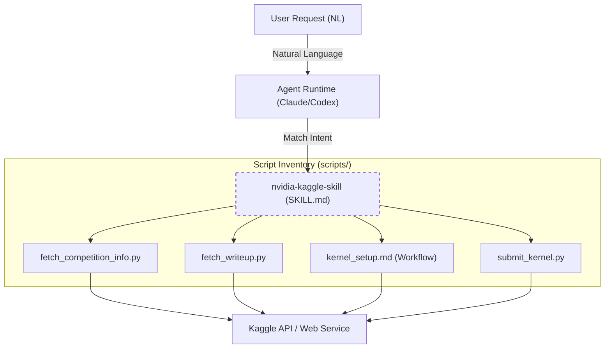
**Sources:** [README.md:15-25](), [SKILL.md]() (referenced in [README.md:6-6]()).

---

## Implementation Detail: First Invocation

When a command like `/nvidia-kaggle:nvidia-kaggle-skill Get the top 3 solution writeups...` is executed [README.md:39-41](), the system performs the following data flow:

### Initialization Flow
1.  **Credential Loading**: The `KaggleWebServiceClient` (in `runtime.py`) initializes using environment variables or `kaggle.json`.
2.  **Route Selection**: The agent parses `SKILL.md` to identify that a "writeup" request maps to `fetch_leaderboard_writeups.py`.
3.  **Execution**: The script is invoked with the competition slug.

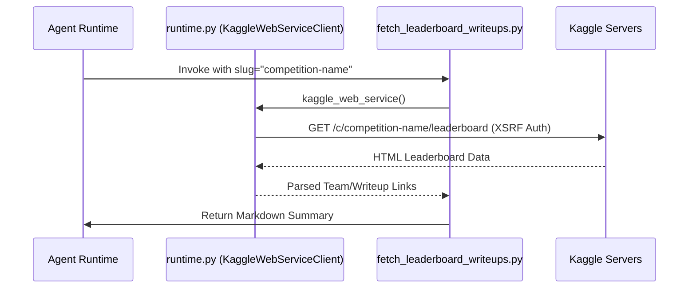
**Sources:** [README.md:35-41](), `runtime.py` (referenced in [Core Architecture 2.1]()).

---

## Verification & Troubleshooting

After installation, verify the setup by running a basic context fetch:

| Command | Expected Outcome |
| :--- | :--- |
| `uv run scripts/fetch_competition_info.py --slug titanic` | Prints Titanic competition metadata in JSON/Markdown. |
| `claude code "List my Kaggle datasets"` | Agent uses `nvidia-kaggle-skill` to query Kaggle API. |

**Common Issues:**
*   **403 Forbidden**: Ensure your `KAGGLE_API_TOKEN` has accepted the specific competition's rules on the Kaggle website [README.md:31-31]().
*   **ModuleNotFoundError**: Run `uv sync` to ensure the virtual environment is populated with dependencies from `pyproject.toml`.

**Sources:**
- [README.md:27-32]()
- [.claude-plugin/plugin.json:1-8]()
- [.agents/plugins/marketplace.json:1-21]()
- [.codex-plugin/plugin.json:1-13]()

---

# Page: Skill Specification (SKILL.md)

# Skill Specification (SKILL.md)

<details>
<summary>Relevant source files</summary>

The following files were used as context for generating this wiki page:

- [skills/nvidia-kaggle-skill/SKILL.md](skills/nvidia-kaggle-skill/SKILL.md)
- [skills/nvidia-kaggle-skill/research-brief.md](skills/nvidia-kaggle-skill/research-brief.md)
- [skills/nvidia-kaggle-skill/scripts/constants.py](skills/nvidia-kaggle-skill/scripts/constants.py)
- [skills/nvidia-kaggle-skill/scripts/upload_dataset.py](skills/nvidia-kaggle-skill/scripts/upload_dataset.py)

</details>


This page defines the technical contract and operational requirements for the `nvidia-kaggle-skill`. It serves as the primary reference for how the skill declares its capabilities, manages dependencies, and structures its workflows for agent runtimes like Claude Code and Codex.

## Purpose and Scope

The `SKILL.md` file acts as a manifest and instruction set for AI agents. It defines the boundaries of the skill, ensuring it is used specifically for Kaggle competition tasks—such as context gathering, kernel research, and submissions—rather than general-purpose machine learning or data analysis [skills/nvidia-kaggle-skill/SKILL.md:23-27]().

## Skill Manifest (Frontmatter)

The skill uses a YAML frontmatter block to declare its identity and required system permissions to the host runtime.

| Field | Description |
| :--- | :--- |
| `name` | Unique identifier: `nvidia-kaggle-skill` [skills/nvidia-kaggle-skill/SKILL.md:2](). |
| `permissions` | Declares needs for `shell` (scripts/CLI), `network` (Kaggle APIs/PyPI), `env` (KAGLE_API_TOKEN), and `file_read/write` [skills/nvidia-kaggle-skill/SKILL.md:5-10](). |
| `metadata` | Short descriptions and tags for marketplace discovery [skills/nvidia-kaggle-skill/SKILL.md:11-18](). |

## Runtime Dependency Policy

To maintain a lean footprint, the skill follows a "progressive disclosure" and "just-in-time" installation policy. Agents are instructed to install only the packages required for the specific requested workflow [skills/nvidia-kaggle-skill/SKILL.md:40-47]().

### Core Dependency Stack
The following packages are identified as the standard runtime stack for Kaggle operations:
- `httpx`: Network requests to Kaggle Web Services.
- `kaggle`: Official Kaggle CLI.
- `kagglesdk`: Advanced Kaggle API interactions.
- `nbformat`: Processing Jupyter Notebook structures.
- `pydantic`: Data validation for local storage models.
- `python-dotenv`: Environment management.
- `rich`: Terminal formatting and tables.

Sources: [skills/nvidia-kaggle-skill/SKILL.md:49-57]()

## Workflow Architecture

The skill organizes its capabilities into functional groups. Each group either provides a direct CLI command or points to a specialized markdown file for complex, multi-step procedures.

### Information Flow: Natural Language to Script Execution

The diagram below illustrates how a user request is mapped to specific code entities defined in the `SKILL.md` contract.

**Figure 1: Capability Mapping**
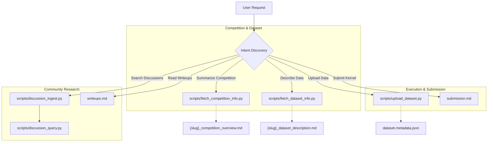
Sources: [skills/nvidia-kaggle-skill/SKILL.md:71-150]()

## Security & Credential Contract

The skill enforces strict rules regarding the `KAGGLE_API_TOKEN` (KGAT):
1.  **Verification**: Scripts must verify the token exists before calling Kaggle [skills/nvidia-kaggle-skill/SKILL.md:62-63]().
2.  **Redaction**: The token is treated as a secret; it must never be printed, logged, or echoed in the agent's output [skills/nvidia-kaggle-skill/SKILL.md:43]().
3.  **User Confirmation**: Sensitive actions (submissions, public dataset uploads) require explicit user approval before execution [skills/nvidia-kaggle-skill/SKILL.md:43]().

## Implementation Detail: Dataset Uploads

The `upload_dataset.py` script demonstrates the integration between the `SKILL.md` contract and the underlying Python implementation. It handles credential resolution, slug validation, and metadata preservation.

### Data Flow: Local to Kaggle Cloud
The following diagram shows the data flow and the specific functions involved in the upload process.

**Figure 2: Dataset Upload Logic**
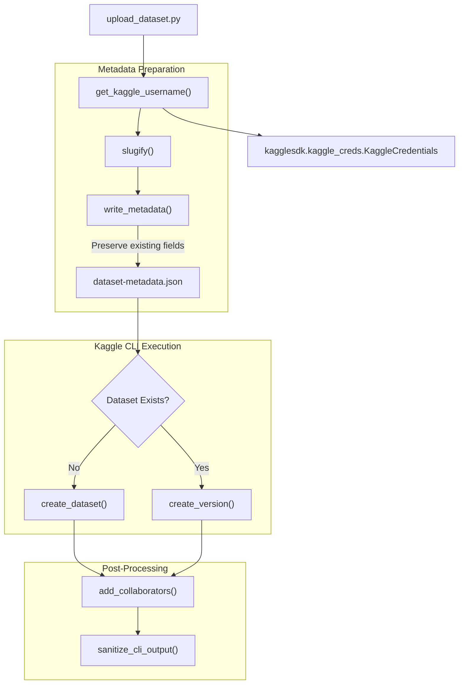
Sources: [skills/nvidia-kaggle-skill/scripts/upload_dataset.py:25-53](), [skills/nvidia-kaggle-skill/scripts/upload_dataset.py:56-61](), [skills/nvidia-kaggle-skill/scripts/upload_dataset.py:64-92](), [skills/nvidia-kaggle-skill/scripts/upload_dataset.py:124-135](), [skills/nvidia-kaggle-skill/scripts/upload_dataset.py:152-200]()

### Validation Rules
- **Slug Length**: Minimum 6, Maximum 50 characters [skills/nvidia-kaggle-skill/scripts/constants.py:19-20]().
- **Privacy**: Defaults to private unless `--public` is explicitly passed [skills/nvidia-kaggle-skill/SKILL.md:145]().
- **Sanitization**: All CLI output is passed through `sanitize_cli_output()` to strip ANSI/control sequences, preventing terminal manipulation by untrusted remote text [skills/nvidia-kaggle-skill/scripts/upload_dataset.py:115-135]().

## Research Brief Strategy

The `research-brief.md` workflow is a high-level orchestration instruction. It directs the agent to chain multiple scripts to produce a "Strategy Brief."

**Key Principles for the Agent:**
- **Quantified Score Ladder**: Collect scores into a baseline-to-top ladder [skills/nvidia-kaggle-skill/research-brief.md:37-38]().
- **Honesty Rules**: Distinguish between author claims (titles) and verified leaderboard scores [skills/nvidia-kaggle-skill/research-brief.md:44-47]().
- **Visual Integrity**: Every plotted number in the brief must trace to a gathered source; fabrication is strictly prohibited [skills/nvidia-kaggle-skill/research-brief.md:57-58]().

Sources: [skills/nvidia-kaggle-skill/research-brief.md:1-73]()

---

# Page: Core Architecture

# Core Architecture

<details>
<summary>Relevant source files</summary>

The following files were used as context for generating this wiki page:

- [skills/nvidia-kaggle-skill/SKILL.md](skills/nvidia-kaggle-skill/SKILL.md)
- [skills/nvidia-kaggle-skill/research-brief.md](skills/nvidia-kaggle-skill/research-brief.md)
- [skills/nvidia-kaggle-skill/scripts/runtime.py](skills/nvidia-kaggle-skill/scripts/runtime.py)
- [skills/nvidia-kaggle-skill/scripts/upload_dataset.py](skills/nvidia-kaggle-skill/scripts/upload_dataset.py)

</details>


The `nvidia-kaggle-skill` is structured as a collection of modular Python scripts that delegate complex logic to a shared runtime and domain-specific libraries. This architecture allows an AI agent to perform high-level workflows—such as "researching a competition"—by chaining together granular script executions that interact with Kaggle's public API and internal web services.

## System Overview

The skill operates by bridging the gap between the agent's natural language space and Kaggle's data structures. The architecture is defined by four primary layers:

1.  **Workflow Layer**: High-level Markdown files (`SKILL.md`, `research-brief.md`, `kernels.md`) that instruct the agent on how to combine scripts to achieve complex goals [skills/nvidia-kaggle-skill/SKILL.md:65-135]().
2.  **Script Entry Points**: A `scripts/` directory containing standalone Python tools (e.g., `fetch_competition_info.py`, `discussion_ingest.py`) that the agent invokes directly [skills/nvidia-kaggle-skill/SKILL.md:69-70]().
3.  **Shared Runtime**: The `runtime.py` module, which handles authentication (OAuth and XSRF), HTML-to-Markdown conversion, and Kaggle API client instantiation [skills/nvidia-kaggle-skill/scripts/runtime.py:1-4]().
4.  **Local Data Stores**: SQLite databases located in `data/` that cache discussion threads and kernel metadata to enable fast, offline querying and filtering [skills/nvidia-kaggle-skill/SKILL.md:115-120]().

### Natural Language to Code Mapping

The following diagram illustrates how user requests are mapped to specific code entities within the architecture.

**Diagram: Request Dispatch Flow**
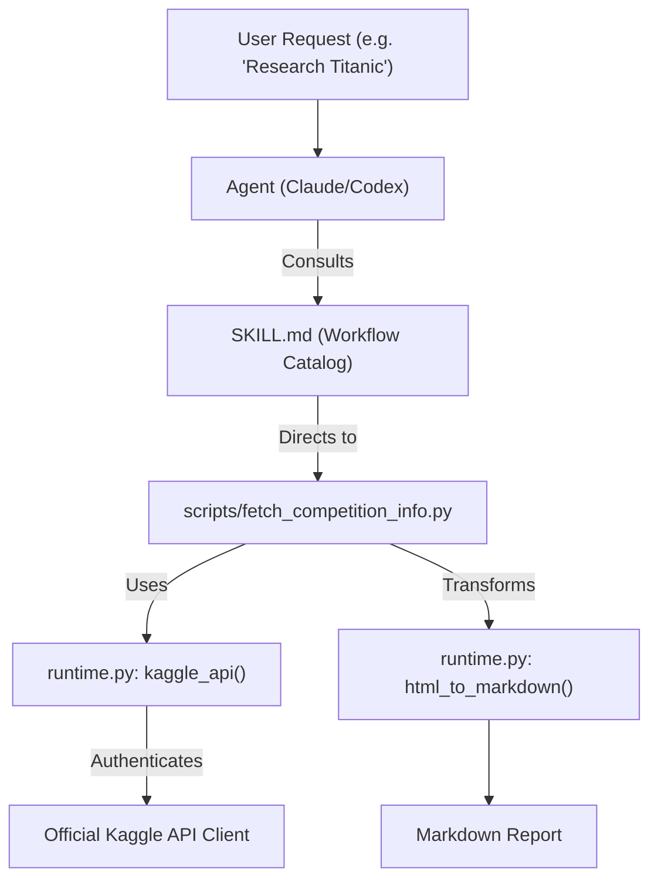
Sources: [skills/nvidia-kaggle-skill/SKILL.md:65-88](), [skills/nvidia-kaggle-skill/scripts/runtime.py:34-47](), [skills/nvidia-kaggle-skill/scripts/runtime.py:176-184]()

---

## Shared Runtime & API Clients

The core of the skill's connectivity is `runtime.py`. It provides two distinct ways to interact with Kaggle:

*   **Official API (`kaggle_api`)**: Used for standard operations like listing competition files or submitting kernels [skills/nvidia-kaggle-skill/scripts/runtime.py:34-47]().
*   **Internal Web Service (`KaggleWebServiceClient`)**: A custom client that handles XSRF-authenticated POST requests to `/api/i/` endpoints. This is required for data not exposed in the public API, such as leaderboard writeup links and full forum topic content [skills/nvidia-kaggle-skill/scripts/runtime.py:52-77]().

For details, see [Runtime Module & Kaggle API Clients](#2.1).

---

## Data Management & Local Storage

To provide a responsive experience and allow the agent to perform complex filtering (e.g., "find discussions with >10 votes by author X"), the skill implements a local caching strategy using SQLite and Pydantic models.

**Diagram: Data Persistence Architecture**
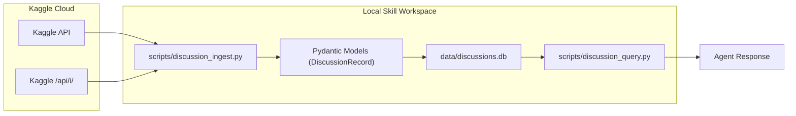
Sources: [skills/nvidia-kaggle-skill/SKILL.md:108-121](), [skills/nvidia-kaggle-skill/scripts/runtime.py:52-59]()

The skill maintains two primary databases:
*   `data/discussions.db`: Stores competition threads, comments, and metadata [skills/nvidia-kaggle-skill/SKILL.md:119]().
*   `data/kernels.db`: Stores kernel metadata, scores, and lineage information [skills/nvidia-kaggle-skill/SKILL.md:125]().

For details, see [Data Models & Local Storage](#2.2).

---

## Workflow Delegation

Individual workflows are defined in Markdown files that serve as "runbooks" for the AI. Instead of the agent guessing how to use the scripts, these files provide explicit instructions on sequencing and logic:

| Workflow | Primary Script / Logic | Purpose |
| :--- | :--- | :--- |
| **Research Brief** | `research-brief.md` | Chaining info, discussions, and kernels into a strategy document [skills/nvidia-kaggle-skill/research-brief.md:1-9](). |
| **Kernel Setup** | `kernel-setup.md` | Creating a local reproduction environment with symlinks and data [skills/nvidia-kaggle-skill/SKILL.md:128-129](). |
| **Dataset Upload** | `upload_dataset.py` | Handling metadata lifecycle and collaborator patching via SDK [skills/nvidia-kaggle-skill/scripts/upload_dataset.py:152-164](). |
| **Submissions** | `submission.md` | Managing the push-and-poll lifecycle for competition entries [skills/nvidia-kaggle-skill/SKILL.md:131-133](). |

Sources: [skills/nvidia-kaggle-skill/SKILL.md:89-149](), [skills/nvidia-kaggle-skill/research-brief.md:1-9](), [skills/nvidia-kaggle-skill/scripts/upload_dataset.py:152-164]()

---

# Page: Runtime Module & Kaggle API Clients

# Runtime Module & Kaggle API Clients

<details>
<summary>Relevant source files</summary>

The following files were used as context for generating this wiki page:

- [skills/nvidia-kaggle-skill/scripts/runtime.py](skills/nvidia-kaggle-skill/scripts/runtime.py)

</details>


The `runtime.py` module serves as the foundational utility layer for the `nvidia-kaggle` skill. It provides unified authentication, specialized API clients for both public and internal Kaggle services, and shared logic for parsing identifiers and content.

## Overview of Runtime Utilities

The runtime module manages the lifecycle of Kaggle connections, ensuring that all scripts in the skill have access to a consistent environment. It handles three primary concerns:
1.  **Environment & Auth**: Discovering the project root, loading `.env` files, and verifying `KAGGLE_API_TOKEN`.
2.  **Client Factories**: Providing authenticated instances of the official Kaggle SDK and a custom internal web service client.
3.  **Data Transformation**: Converting Kaggle's HTML-heavy competition content into clean Markdown and parsing URLs into canonical slugs.

### Project Discovery & Environment
The module includes logic to locate the project root by searching for marker files (like `pyproject.toml` or `SKILL.md`) and automatically loading environment variables via `dotenv`.

Sources: [skills/nvidia-kaggle-skill/scripts/runtime.py:40-41](), [skills/nvidia-kaggle-skill/scripts/runtime.py:127-127]()

---

## Kaggle API Clients

The codebase utilizes two distinct clients to interact with Kaggle, depending on whether the data is exposed via the public REST API or Kaggle's internal frontend service.

### 1. Official Kaggle API (`kaggle_api`)
The `kaggle_api()` factory returns an authenticated instance of the official `KaggleApi`. This is used for standard operations like listing competition files or fetching competition pages.

Sources: [skills/nvidia-kaggle-skill/scripts/runtime.py:34-46](), [skills/nvidia-kaggle-skill/scripts/runtime.py:194-195]()

### 2. Kaggle Web Service Client (`KaggleWebServiceClient`)
Certain critical data—such as leaderboard writeup links, forum topic content, and specific notebook versions—is only accessible via Kaggle's internal JSON web service (prefixed with `/api/i`). The `KaggleWebServiceClient` implements a session-based approach to access these endpoints without a full browser.

#### XSRF Authentication Flow
Kaggle's internal API requires an `XSRF-TOKEN` cookie and a corresponding `X-XSRF-TOKEN` header. The client automates this handshake:
1.  **Session Initialization**: Creates an `httpx.Client` with the `KAGGLE_API_TOKEN` in the Bearer header.
2.  **Seeding**: Performs a GET request to `https://www.kaggle.com` to populate the session cookies.
3.  **Token Extraction**: Extracts the `XSRF-TOKEN` from the cookie jar.
4.  **Request Execution**: Includes both the Bearer token and the XSRF token in subsequent POST requests.

Sources: [skills/nvidia-kaggle-skill/scripts/runtime.py:52-77](), [skills/nvidia-kaggle-skill/scripts/runtime.py:83-87]()

#### Retry Logic & Exponential Backoff
To handle transient network issues or rate limiting, the `_request` method implements a retry loop. It uses an exponential backoff strategy where the delay increases with each attempt.

| Parameter | Default Value | Description |
| :--- | :--- | :--- |
| `max_retries` | 3 | Maximum number of attempts for a failed request. |
| `retry_delay` | 2.0s | Base delay multiplier for backoff. |
| `timeout` | 30.0s | Network timeout for the HTTP session. |

Sources: [skills/nvidia-kaggle-skill/scripts/runtime.py:61-71](), [skills/nvidia-kaggle-skill/scripts/runtime.py:89-101]()

---

## Data Flow: Web Service Authentication

The following diagram illustrates the transition from the "Natural Language Space" (user/agent intent) to the "Code Entity Space" (authentication and request handling).

**Kaggle Web Service Authentication Sequence**
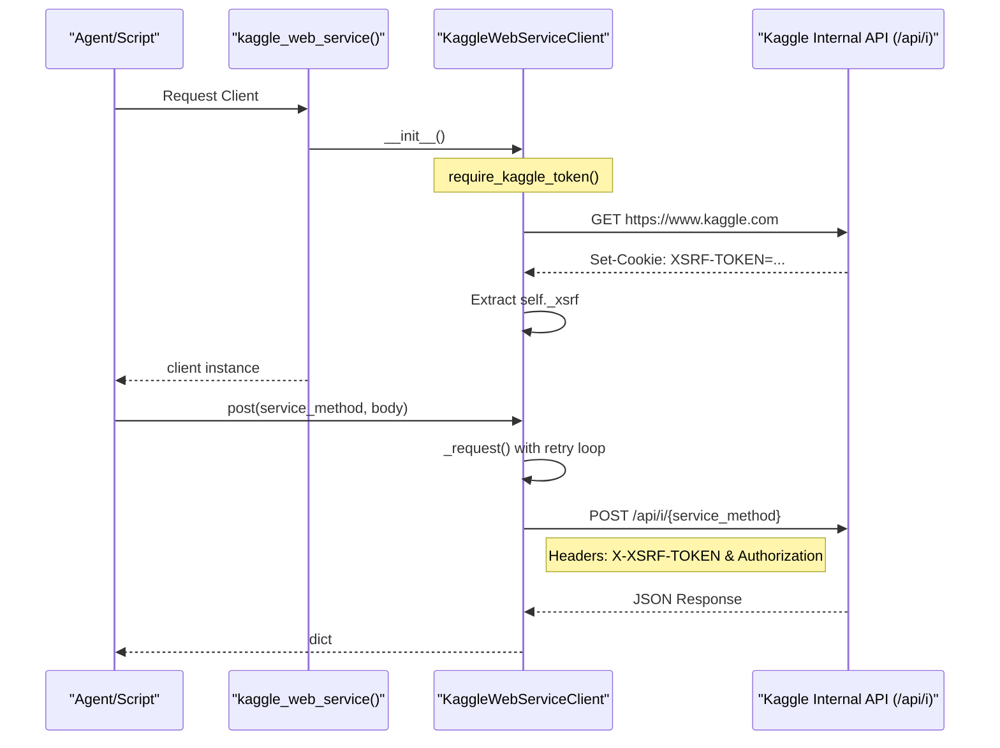
Sources: [skills/nvidia-kaggle-skill/scripts/runtime.py:52-128]()

---

## Content Parsing & Transformation

### Competition Pages & HTML to Markdown
Kaggle provides competition metadata (Rules, Evaluation, Description) as HTML. The `_MarkdownTextParser` (an `HTMLParser` subclass) converts this into clean Markdown for the LLM.

- **Tag Mapping**:
    - `h1`-`h6` $\rightarrow$ `#` headers.
    - `li` $\rightarrow$ `- ` bullet points.
    - `a` $\rightarrow$ `[text](href)` links.
    - `tr`, `p`, `div` $\rightarrow$ Double newlines for spacing.
- **Sanitization**: The parser drops unknown tags but preserves their text content and uses regex to collapse excessive whitespace.

Sources: [skills/nvidia-kaggle-skill/scripts/runtime.py:131-174](), [skills/nvidia-kaggle-skill/scripts/runtime.py:176-184]()

### Slug and Reference Helpers
The runtime provides regex-based helpers to extract identifiers from URLs or strings, ensuring scripts can handle both raw IDs and copy-pasted URLs.

| Function | Input Example | Output |
| :--- | :--- | :--- |
| `competition_slug` | `https://www.kaggle.com/competitions/titanic` | `titanic` |
| `kernel_ref` | `https://www.kaggle.com/code/user/notebook-slug` | `user/notebook-slug` |

Sources: [skills/nvidia-kaggle-skill/scripts/runtime.py:12-23]()

---

## Entity Relationship: Runtime Components

This diagram maps the logical components of the `runtime.py` module to their implementation entities.

**Runtime Module Architecture**
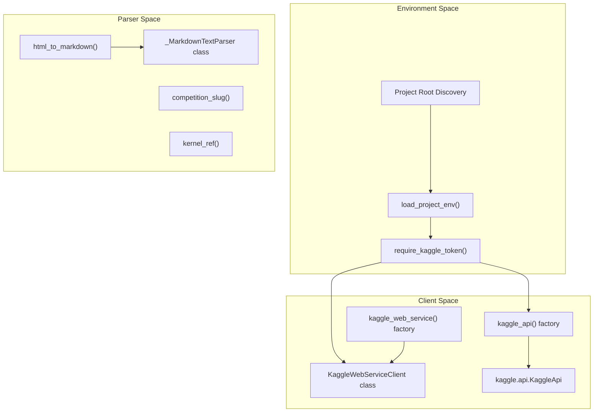
Sources: [skills/nvidia-kaggle-skill/scripts/runtime.py:1-201]()

---

# Page: Data Models & Local Storage

# Data Models & Local Storage

<details>
<summary>Relevant source files</summary>

The following files were used as context for generating this wiki page:

- [skills/nvidia-kaggle-skill/scripts/constants.py](skills/nvidia-kaggle-skill/scripts/constants.py)
- [skills/nvidia-kaggle-skill/scripts/discussions/database.py](skills/nvidia-kaggle-skill/scripts/discussions/database.py)
- [skills/nvidia-kaggle-skill/scripts/discussions/models.py](skills/nvidia-kaggle-skill/scripts/discussions/models.py)
- [skills/nvidia-kaggle-skill/scripts/discussions/paths.py](skills/nvidia-kaggle-skill/scripts/discussions/paths.py)
- [skills/nvidia-kaggle-skill/scripts/kernels/database.py](skills/nvidia-kaggle-skill/scripts/kernels/database.py)
- [skills/nvidia-kaggle-skill/scripts/kernels/models.py](skills/nvidia-kaggle-skill/scripts/kernels/models.py)
- [skills/nvidia-kaggle-skill/scripts/kernels/paths.py](skills/nvidia-kaggle-skill/scripts/kernels/paths.py)

</details>


This section describes the structured domain models and persistent storage mechanisms used by the `nvidia-kaggle` skill. The system utilizes Pydantic for data validation and SQLite for local caching of Kaggle entities, enabling fast querying and cross-referencing without constant API overhead.

## Domain Models

The codebase defines domain models using Pydantic `BaseModel` to ensure type safety and structured serialization across the discussion and kernel subsystems.

### Discussion Models
Discussion models capture the hierarchical nature of Kaggle forums, from top-level threads to individual comments.

| Class | Description | Key Fields |
| :--- | :--- | :--- |
| `DiscussionRecord` | Represents a main thread/topic. | `discussion_id`, `title`, `author`, `votes`, `body_markdown`, `tags` |
| `DiscussionComment` | A single reply within a thread. | `id`, `discussion_id`, `author`, `body_markdown`, `votes` |
| `CompetitionInfo` | Cached metadata for a competition. | `competition_id`, `title`, `evaluation_metric`, `deadline` |
| `CompetitionSummary` | Aggregated stats for local cache. | `discussion_count`, `top_authors`, `vote_stats` |

**Sources:**
- `DiscussionRecord`, `DiscussionComment`, `CompetitionInfo`: [skills/nvidia-kaggle-skill/scripts/discussions/models.py:9-64]()

### Kernel & Notebook Models
Kernel models handle both the metadata found in search results and the internal structure of Jupyter notebooks.

| Class | Description | Key Fields |
| :--- | :--- | :--- |
| `KernelMetadata` | Search-level info for a notebook. | `ref` (user/slug), `title`, `author`, `total_votes`, `last_run_time` |
| `NotebookCell` | A single unit of content. | `cell_type` ("code", "markdown"), `source`, `execution_count` |
| `NotebookContent` | A complete parsed notebook. | `kernel_ref`, `cells` (List of `NotebookCell`), `metadata` |

The `NotebookContent` class includes a `render_readable()` method that converts the structured cell data into a single Markdown document with Python code blocks, suitable for consumption by an LLM [skills/nvidia-kaggle-skill/scripts/kernels/models.py:53-64]().

**Sources:**
- `KernelMetadata`, `NotebookCell`, `NotebookContent`: [skills/nvidia-kaggle-skill/scripts/kernels/models.py:21-76]()

## Local Storage & SQLite Schema

The skill maintains two primary SQLite databases within the `data/` directory to facilitate offline search and analysis.

### Database Layout
- **`data/discussions.db`**: Stores competition forum threads and their full comment trees [skills/nvidia-kaggle-skill/scripts/discussions/paths.py:8-9]().
- **`data/kernels.db`**: Stores metadata for kernels, including vote counts and last run times [skills/nvidia-kaggle-skill/scripts/kernels/paths.py:8-9]().

### Discussion Schema Implementation
The `DiscussionDatabase` class manages three main tables: `discussions`, `discussion_comments`, and `competition_info`. It uses `ON CONFLICT` clauses to handle upserts during ingestion [skills/nvidia-kaggle-skill/scripts/discussions/database.py:113-141]().

**Discussion Database Entity Mapping**
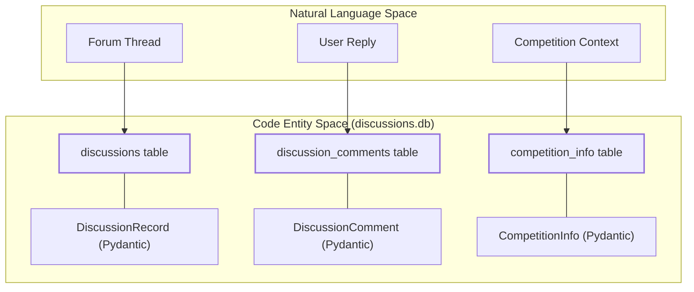
**Sources:**
- Schema definitions: [skills/nvidia-kaggle-skill/scripts/discussions/database.py:15-69]()
- `DiscussionDatabase` class: [skills/nvidia-kaggle-skill/scripts/discussions/database.py:72-192]()

### Kernel Schema Implementation
The `KernelDatabase` mirrors the competition info structure but focuses on the `kernels` table for discovery [skills/nvidia-kaggle-skill/scripts/kernels/database.py:13-42]().

**Kernel Database Entity Mapping**
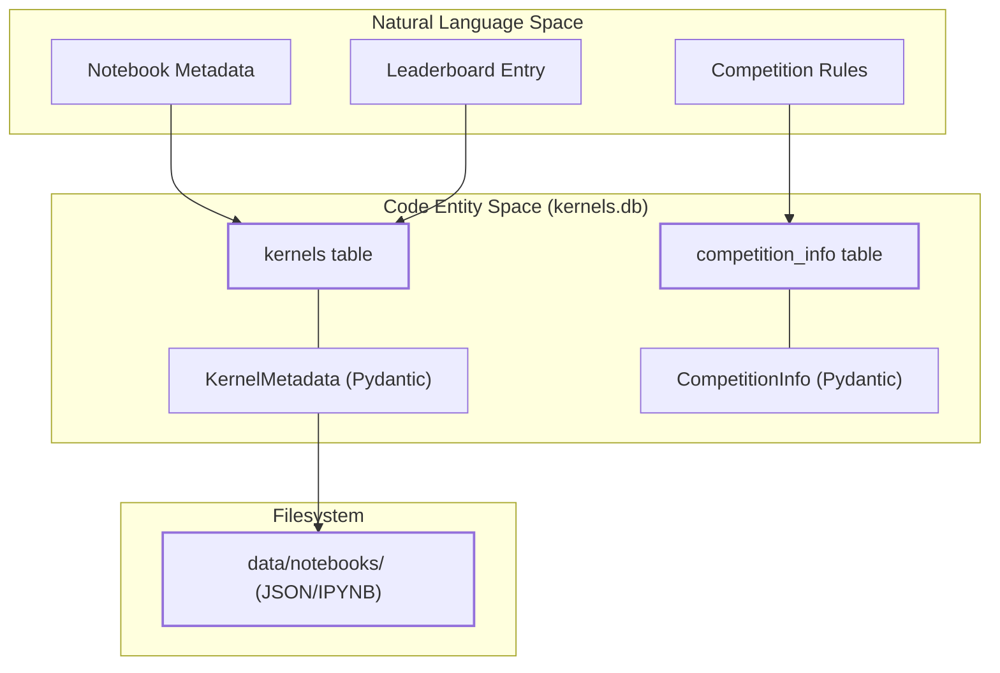
**Sources:**
- Schema definitions: [skills/nvidia-kaggle-skill/scripts/kernels/database.py:13-42]()
- `KernelDatabase` class: [skills/nvidia-kaggle-skill/scripts/kernels/database.py:45-164]()

## Filesystem Conventions

Beyond SQLite, the skill uses specific directory structures for raw content and artifacts.

### Data Directory
The `data/` directory is the root for all persistent local state:
- `data/discussions.db`: SQLite database for forum content.
- `data/kernels.db`: SQLite database for kernel metadata.
- `data/notebooks/`: Directory containing cached notebook source files (usually in `.ipynb` or `.json` format) [skills/nvidia-kaggle-skill/scripts/kernels/paths.py:12-13]().

### Constants & Limits
The system enforces several constraints defined in `constants.py` to ensure manageable data sizes:
- `DEFAULT_QUERY_LIMIT`: 50 records for search results [skills/nvidia-kaggle-skill/scripts/constants.py:9]().
- `MAX_DATASET_SLUG_LENGTH`: 50 characters [skills/nvidia-kaggle-skill/scripts/constants.py:20]().
- `DEFAULT_DISCUSSION_MAX_PAGES`: 5 pages during ingestion [skills/nvidia-kaggle-skill/scripts/constants.py:5]().

**Sources:**
- Path helpers: [skills/nvidia-kaggle-skill/scripts/discussions/paths.py:1-10](), [skills/nvidia-kaggle-skill/scripts/kernels/paths.py:1-14]()
- Numeric constants: [skills/nvidia-kaggle-skill/scripts/constants.py:1-21]()

---

# Page: Workflows & Capabilities

# Workflows & Capabilities

<details>
<summary>Relevant source files</summary>

The following files were used as context for generating this wiki page:

- [README.md](README.md)
- [demo/demo.gif](demo/demo.gif)
- [skills/nvidia-kaggle-skill/SKILL.md](skills/nvidia-kaggle-skill/SKILL.md)
- [skills/nvidia-kaggle-skill/research-brief.md](skills/nvidia-kaggle-skill/research-brief.md)
- [skills/nvidia-kaggle-skill/scripts/upload_dataset.py](skills/nvidia-kaggle-skill/scripts/upload_dataset.py)

</details>


The NVIDIA Kaggle Plugin provides a comprehensive suite of workflows designed to assist human and autonomous agents in navigating the Kaggle competition lifecycle. These capabilities range from initial context gathering and historical solution research to local environment setup, model submission, and dataset management.

This page serves as a high-level map of the functional areas exposed by the skill. For detailed implementation details, command-line arguments, and internal logic, refer to the specific child pages linked in each section.

## Functional Overview

The skill is organized into several major workflow groups that bridge the gap between natural language requests and specific Kaggle API or web service actions.

### System Architecture Bridge
The following diagram illustrates how natural language intents are mapped to specific code entities and scripts within the `nvidia-kaggle-skill`.

**Diagram: Workflow Mapping**
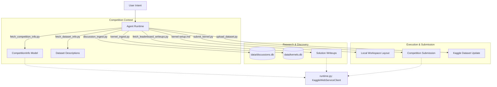
**Sources:** [README.md:15-25](), [skills/nvidia-kaggle-skill/SKILL.md:65-155]()

---

## 1. Competition & Dataset Information
This workflow provides the "Day 1" context needed for any competition. It retrieves the rules, evaluation metrics, timelines, and detailed dataset descriptions. It primarily utilizes the `competition_pages()` function to scrape and convert Kaggle's web interface into clean, agent-readable Markdown.

*   **Key Scripts:** `fetch_competition_info.py`, `fetch_dataset_info.py`
*   **Details:** See [Competition & Dataset Information](#3.1)

**Sources:** [skills/nvidia-kaggle-skill/SKILL.md:71-88]()

## 2. Discussion Workflows
The discussion pipeline allows agents to index thousands of forum posts into a local SQLite database (`data/discussions.db`) for fast, offline querying. This is used to find community tips, common bugs, and early insights.

*   **Key Scripts:** `discussion_ingest.py`, `discussion_query.py`, `discussion_read.py`
*   **Details:** See [Discussion Workflows](#3.2)

**Sources:** [skills/nvidia-kaggle-skill/SKILL.md:104-122]()

## 3. Kernel Research Workflows
This capability group handles the discovery and analysis of public Kaggle Notebooks (kernels). It supports indexing kernels by competition, filtering by score or votes, and resolving "best versions" based on competition metrics.

*   **Key Scripts:** `kernel_ingest.py`, `kernel_query.py`, `kernel_archive.py`
*   **Details:** See [Kernel Research Workflows](#3.3)

**Sources:** [skills/nvidia-kaggle-skill/SKILL.md:123-126]()

## 4. Writeup Workflows
Focused on "post-mortem" analysis, these workflows scrape leaderboards to find links to solution writeups. They correlate team rankings with discussion posts and extract clean Markdown content for strategy analysis.

*   **Key Scripts:** `fetch_leaderboard_writeups.py`, `fetch_writeup.py`
*   **Details:** See [Writeup Workflows](#3.4)

**Sources:** [skills/nvidia-kaggle-skill/SKILL.md:100-102](), [README.md:35-68]()

## 5. Kernel Setup (Local Reproduction)
This workflow automates the creation of a local reproduction environment. It downloads a kernel's source code, its associated competition data, and any external dataset or model dependencies, arranging them in a standardized `input/`, `working/`, and `scripts/` directory structure.

*   **Key Workflow:** `kernel-setup.md`
*   **Details:** See [Kernel Setup (Local Reproduction)](#3.5)

**Sources:** [skills/nvidia-kaggle-skill/SKILL.md:127-130](), [README.md:134-158]()

## 6. Submission Workflow
Provides a robust interface for submitting code to competitions. It supports pushing new kernel versions or submitting existing versions, and includes a polling loop that monitors the submission's lifecycle from `Pending` to `Complete`.

*   **Key Script:** `submit_kernel.py`
*   **Details:** See [Submission Workflow](#3.6)

**Sources:** [skills/nvidia-kaggle-skill/SKILL.md:131-134]()

## 7. Dataset Upload Workflow
Enables the creation and updating of Kaggle Datasets from local directories. It handles metadata preservation, slug generation, and collaborator management using the `kagglesdk`.

*   **Key Script:** `upload_dataset.py`
*   **Details:** See [Dataset Upload Workflow](#3.7)

**Sources:** [skills/nvidia-kaggle-skill/scripts/upload_dataset.py:1-8](), [skills/nvidia-kaggle-skill/SKILL.md:135-149]()

## 8. Research Brief Workflow
An orchestrator workflow that chains context gathering, discussion indexing, and kernel research into a single comprehensive `brief.md` artifact. It follows strict principles for "grounding" claims in evidence and maintaining visual integrity in plots.

*   **Key Workflow:** `research-brief.md`
*   **Details:** See [Research Brief Workflow](#3.8)

**Sources:** [skills/nvidia-kaggle-skill/research-brief.md:1-9](), [skills/nvidia-kaggle-skill/SKILL.md:89-99]()

---

### Data Lineage & Entities
The following diagram shows how data flows from the Kaggle Platform into the local storage entities managed by the skill.

**Diagram: Data Entity Flow**
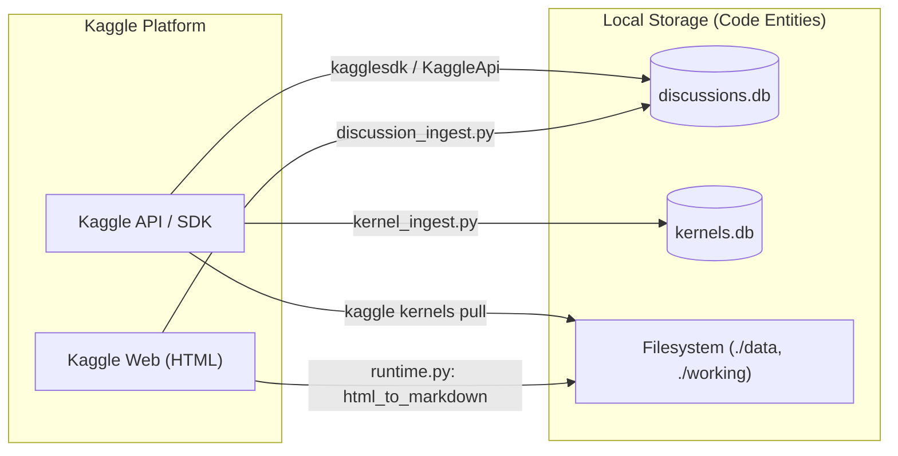
**Sources:** [skills/nvidia-kaggle-skill/SKILL.md:115-120](), [skills/nvidia-kaggle-skill/scripts/upload_dataset.py:165-199]()

---

# Page: Competition & Dataset Information

# Competition & Dataset Information

<details>
<summary>Relevant source files</summary>

The following files were used as context for generating this wiki page:

- [skills/nvidia-kaggle-skill/scripts/fetch_competition_info.py](skills/nvidia-kaggle-skill/scripts/fetch_competition_info.py)
- [skills/nvidia-kaggle-skill/scripts/fetch_dataset_info.py](skills/nvidia-kaggle-skill/scripts/fetch_dataset_info.py)
- [skills/nvidia-kaggle-skill/scripts/runtime.py](skills/nvidia-kaggle-skill/scripts/runtime.py)

</details>


This section covers the scripts responsible for retrieving structured and unstructured information about Kaggle competitions, including their rules, evaluation metrics, timelines, and dataset specifications. These scripts leverage the shared `runtime.py` module to interact with the Kaggle API and convert platform-specific HTML content into clean Markdown for agent consumption.

## Overview

The primary goal of these workflows is to provide the agent with the "ground truth" of a competition. Instead of scraping the public web pages, which is brittle and requires a browser, the skill uses the official Kaggle API's `competition_list_pages` method to retrieve content sections.

Key components:
- **`fetch_competition_info.py`**: Aggregates the 'Description' and 'Evaluation' pages into a single overview.
- **`fetch_dataset_info.py`**: Extracts the 'Data Description' page which contains details about file formats, column definitions, and sample submissions.
- **`runtime.py` (`competition_pages`)**: The underlying utility that fetches and caches the raw page content from the API.

## Data Flow & Implementation

The following diagram illustrates how a request for competition information moves from a slug or URL input through the runtime logic to the Kaggle API.

### Logic Flow: Competition Information Retrieval
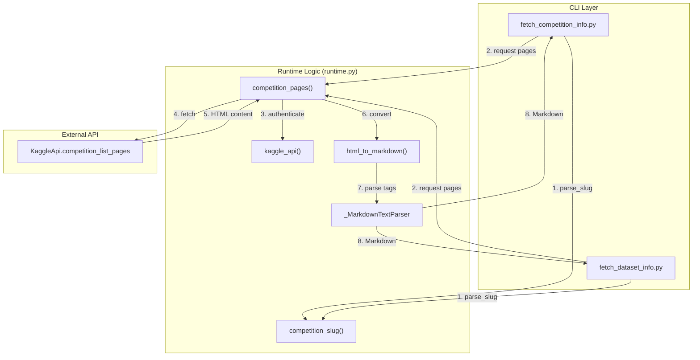
**Sources:** [skills/nvidia-kaggle-skill/scripts/fetch_competition_info.py:9-33](), [skills/nvidia-kaggle-skill/scripts/fetch_dataset_info.py:9-21](), [skills/nvidia-kaggle-skill/scripts/runtime.py:187-202]()

### Competition Overview (`fetch_competition_info.py`)

This script identifies the core objective of the competition. It specifically targets two sections returned by the API:
1.  **Description**: The general problem statement and background [skills/nvidia-kaggle-skill/scripts/fetch_competition_info.py:22-24]().
2.  **Evaluation**: The mathematical metrics used to rank submissions (e.g., LogLoss, MAE) and the expected format of the submission file [skills/nvidia-kaggle-skill/scripts/fetch_competition_info.py:26-28]().

The script combines these sections, prepending a `## Evaluation` header to the latter to maintain document structure [skills/nvidia-kaggle-skill/scripts/fetch_competition_info.py:28]().

### Dataset Description (`fetch_dataset_info.py`)

This script focuses on the `data-description` page [skills/nvidia-kaggle-skill/scripts/fetch_dataset_info.py:17](). This page typically contains:
- Descriptions of `train.csv`, `test.csv`, and other supplementary files.
- Data dictionaries (column names and types).
- Information on data splits (Public vs. Private leaderboard).

### Shared Runtime Utilities

Both scripts rely on `runtime.py` for three critical functions:

1.  **Slug Parsing**: `competition_slug()` uses regex `kaggle\.com/competitions/([^/?#]+)` to extract the unique identifier from a full URL or validate a provided slug [skills/nvidia-kaggle-skill/scripts/runtime.py:12-15]().
2.  **Page Retrieval**: `competition_pages()` calls `api.competition_list_pages(slug)`. It iterates through the returned objects, converting them to a dictionary where keys are lowercased page names (e.g., "description", "rules") [skills/nvidia-kaggle-skill/scripts/runtime.py:187-202]().
3.  **HTML to Markdown**: Since Kaggle stores page content as HTML, `html_to_markdown()` utilizes a custom `_MarkdownTextParser` (inheriting from `HTMLParser`) to convert tags like `<h1>` to `#`, `<li>` to `-`, and preserve `<a>` hrefs as Markdown links [skills/nvidia-kaggle-skill/scripts/runtime.py:131-184]().

## Code Entity Map

The following diagram maps the Natural Language concepts (like "Rules" or "Slug") to the specific Python entities and API methods used in the codebase.

### System Entity Mapping
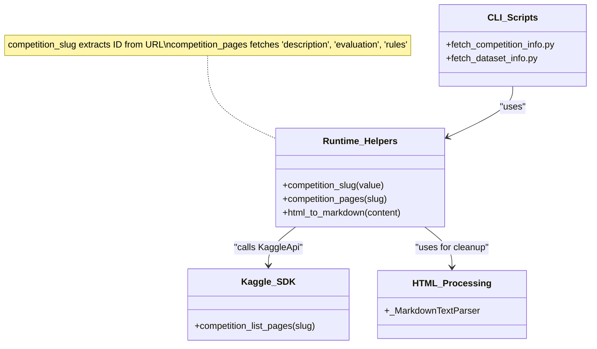
**Sources:** [skills/nvidia-kaggle-skill/scripts/runtime.py:12-15](), [skills/nvidia-kaggle-skill/scripts/runtime.py:131-140](), [skills/nvidia-kaggle-skill/scripts/runtime.py:187-195]()

## Usage Summary

| Script | Primary Input | Key Output Sections |
| :--- | :--- | :--- |
| `fetch_competition_info.py` | Slug or URL | `description`, `evaluation` |
| `fetch_dataset_info.py` | Slug or URL | `data-description` |

**Sources:** [skills/nvidia-kaggle-skill/scripts/fetch_competition_info.py:35-38](), [skills/nvidia-kaggle-skill/scripts/fetch_dataset_info.py:23-26]()

---

# Page: Discussion Workflows

# Discussion Workflows

<details>
<summary>Relevant source files</summary>

The following files were used as context for generating this wiki page:

- [skills/nvidia-kaggle-skill/scripts/discussion_db_info.py](skills/nvidia-kaggle-skill/scripts/discussion_db_info.py)
- [skills/nvidia-kaggle-skill/scripts/discussion_ingest.py](skills/nvidia-kaggle-skill/scripts/discussion_ingest.py)
- [skills/nvidia-kaggle-skill/scripts/discussion_query.py](skills/nvidia-kaggle-skill/scripts/discussion_query.py)
- [skills/nvidia-kaggle-skill/scripts/discussion_read.py](skills/nvidia-kaggle-skill/scripts/discussion_read.py)
- [skills/nvidia-kaggle-skill/scripts/discussions/__init__.py](skills/nvidia-kaggle-skill/scripts/discussions/__init__.py)
- [skills/nvidia-kaggle-skill/scripts/discussions/database.py](skills/nvidia-kaggle-skill/scripts/discussions/database.py)
- [skills/nvidia-kaggle-skill/scripts/discussions/discussion_client.py](skills/nvidia-kaggle-skill/scripts/discussions/discussion_client.py)
- [skills/nvidia-kaggle-skill/scripts/discussions/models.py](skills/nvidia-kaggle-skill/scripts/discussions/models.py)
- [skills/nvidia-kaggle-skill/scripts/discussions/paths.py](skills/nvidia-kaggle-skill/scripts/discussions/paths.py)

</details>


The Discussion Workflows provide a comprehensive pipeline for synchronizing, searching, and reading Kaggle competition discussions. Because Kaggle's API separates high-level search from detailed thread content, this system implements a two-stage ingestion process and a local SQLite cache to enable fast, offline-capable analysis of community insights.

## Pipeline Overview

The discussion system follows a structured data flow from the Kaggle API to a local persistent store, which is then queried by downstream research scripts.

### Data Flow Diagram

The following diagram bridges the **Natural Language Space** (User/Agent actions) to the **Code Entity Space** (scripts and library classes).

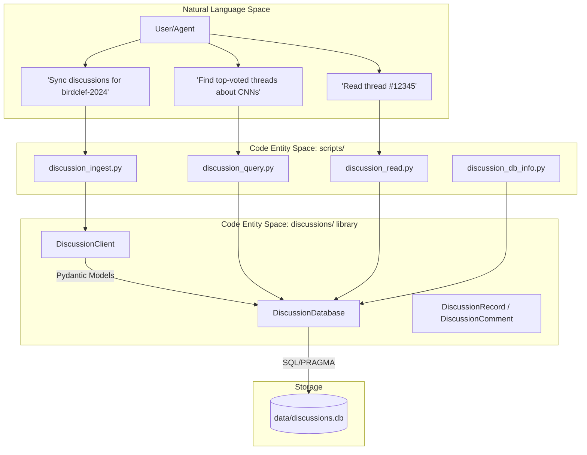
**Sources:** [skills/nvidia-kaggle-skill/scripts/discussion_ingest.py:10-14](), [skills/nvidia-kaggle-skill/scripts/discussions/database.py:72-81](), [skills/nvidia-kaggle-skill/scripts/discussions/paths.py:8-9]()

## Core Components

### DiscussionClient
The `DiscussionClient` handles the complexity of Kaggle's dual-API architecture. It uses `api.kaggle.com` for listing entities and the internal `www.kaggle.com/api/i` web service for fetching full thread details and comments.

*   **Authentication:** Requires a Kaggle API token via `require_kaggle_token()` [skills/nvidia-kaggle-skill/scripts/discussions/discussion_client.py:27]().
*   **XSRF Management:** The `_ensure_session()` method handles the acquisition of an `XSRF-TOKEN` from a live Kaggle session, which is mandatory for POSTing to the discussion service [skills/nvidia-kaggle-skill/scripts/discussions/discussion_client.py:76-91]().
*   **Slug Resolution:** The `_resolve_competition_title()` method converts competition slugs (e.g., `birdclef-2024`) into human-readable titles, as the Search API primarily matches on titles [skills/nvidia-kaggle-skill/scripts/discussions/discussion_client.py:128-144]().

**Sources:** [skills/nvidia-kaggle-skill/scripts/discussions/discussion_client.py:1-21](), [skills/nvidia-kaggle-skill/scripts/discussions/discussion_client.py:93-116]()

### DiscussionDatabase (SQLite)
The database serves as a local cache to avoid redundant API calls and enable complex filtering. It utilizes three primary tables: `discussions`, `discussion_comments`, and `competition_info` [skills/nvidia-kaggle-skill/scripts/discussions/database.py:15-63]().

| Table | Purpose | Key Fields |
| :--- | :--- | :--- |
| `discussions` | Thread metadata | `discussion_id`, `votes`, `body_markdown`, `tags` |
| `discussion_comments` | Individual replies | `discussion_id`, `author`, `body_markdown` |
| `competition_info` | Competition context | `evaluation_metric`, `deadline`, `description` |

**Sources:** [skills/nvidia-kaggle-skill/scripts/discussions/database.py:72-97](), [skills/nvidia-kaggle-skill/scripts/discussions/models.py:9-53]()

## Execution Workflows

### 1. Ingestion (`discussion_ingest.py`)
This script populates the local database. It first fetches a list of threads based on a sort metric (e.g., `hotness`, `votes`) and then iterates through each thread to fetch the full markdown body and all comments.

*   **Key Function:** `ingest()` [skills/nvidia-kaggle-skill/scripts/discussion_ingest.py:69-126]().
*   **Comment Fetching:** Uses `_fetch_and_store_comments()` to perform deep-dives into each thread [skills/nvidia-kaggle-skill/scripts/discussion_ingest.py:44-67]().
*   **Upsert Logic:** Uses `INSERT ... ON CONFLICT DO UPDATE` to ensure local data stays fresh without duplicates [skills/nvidia-kaggle-skill/scripts/discussions/database.py:101-148]().

**Sources:** [skills/nvidia-kaggle-skill/scripts/discussion_ingest.py:1-43]()

### 2. Filtering & Search (`discussion_query.py`)
Provides a CLI interface to search the cached discussions. It supports free-text search across titles and bodies, minimum vote thresholds, and author filtering.

*   **Implementation:** The `query()` function delegates to `DiscussionDatabase.query_discussions()` [skills/nvidia-kaggle-skill/scripts/discussion_query.py:22-44]().
*   **Search Scope:** The SQL query uses `LIKE` operators across `title`, `author`, and `body_markdown` [skills/nvidia-kaggle-skill/scripts/discussions/database.py:165-168]().

**Sources:** [skills/nvidia-kaggle-skill/scripts/discussion_query.py:70-90]()

### 3. Thread Reading (`discussion_read.py`)
Renders a specific discussion thread and its comments in the terminal using `rich.markdown`.

*   **Logic:** Retrieves the `DiscussionRecord` and associated `DiscussionComment` list via the database [skills/nvidia-kaggle-skill/scripts/discussion_read.py:17-38]().
*   **Rendering:** Uses `rich.Panel` for the header and `rich.Markdown` for the content to preserve formatting [skills/nvidia-kaggle-skill/scripts/discussion_read.py:44-63]().

**Sources:** [skills/nvidia-kaggle-skill/scripts/discussion_read.py:1-15]()

### 4. Database Statistics (`discussion_db_info.py`)
Displays an overview of what is currently stored in `data/discussions.db`.

*   **Overview:** Lists all competition IDs, total discussion counts, and ingestion timestamps [skills/nvidia-kaggle-skill/scripts/discussion_db_info.py:18-40]().
*   **Detail Mode:** If a `competition_id` is provided, it shows top authors and vote statistics [skills/nvidia-kaggle-skill/scripts/discussion_db_info.py:51-59]().

**Sources:** [skills/nvidia-kaggle-skill/scripts/discussion_db_info.py:1-16]()

## Internal Data Flow Detail

The following sequence diagram illustrates the interaction between the script, the client, and the database during a typical ingestion run.

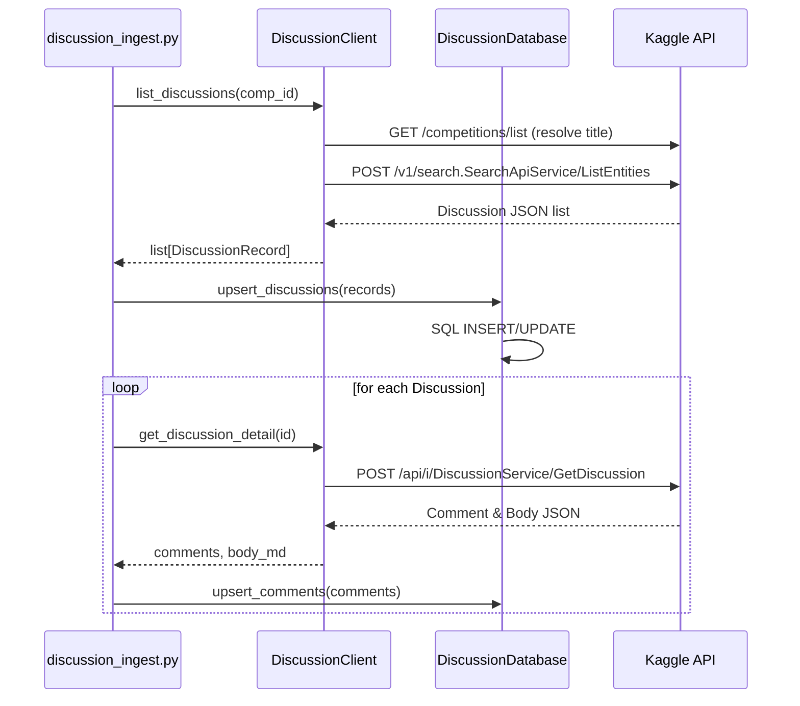
**Sources:** [skills/nvidia-kaggle-skill/scripts/discussion_ingest.py:82-113](), [skills/nvidia-kaggle-skill/scripts/discussions/discussion_client.py:148-185](), [skills/nvidia-kaggle-skill/scripts/discussions/database.py:101-148]()

---

# Page: Kernel Research Workflows

# Kernel Research Workflows

<details>
<summary>Relevant source files</summary>

The following files were used as context for generating this wiki page:

- [skills/nvidia-kaggle-skill/kernels.md](skills/nvidia-kaggle-skill/kernels.md)
- [skills/nvidia-kaggle-skill/scripts/fetch_kernel_score.py](skills/nvidia-kaggle-skill/scripts/fetch_kernel_score.py)
- [skills/nvidia-kaggle-skill/scripts/fetch_top_kernel_scores.py](skills/nvidia-kaggle-skill/scripts/fetch_top_kernel_scores.py)
- [skills/nvidia-kaggle-skill/scripts/kernel_db_info.py](skills/nvidia-kaggle-skill/scripts/kernel_db_info.py)
- [skills/nvidia-kaggle-skill/scripts/kernel_ingest.py](skills/nvidia-kaggle-skill/scripts/kernel_ingest.py)
- [skills/nvidia-kaggle-skill/scripts/kernel_query.py](skills/nvidia-kaggle-skill/scripts/kernel_query.py)
- [skills/nvidia-kaggle-skill/scripts/kernel_read.py](skills/nvidia-kaggle-skill/scripts/kernel_read.py)
- [skills/nvidia-kaggle-skill/scripts/kernels/__init__.py](skills/nvidia-kaggle-skill/scripts/kernels/__init__.py)
- [skills/nvidia-kaggle-skill/scripts/kernels/database.py](skills/nvidia-kaggle-skill/scripts/kernels/database.py)
- [skills/nvidia-kaggle-skill/scripts/kernels/kaggle_client.py](skills/nvidia-kaggle-skill/scripts/kernels/kaggle_client.py)
- [skills/nvidia-kaggle-skill/scripts/kernels/kaggle_search.py](skills/nvidia-kaggle-skill/scripts/kernels/kaggle_search.py)
- [skills/nvidia-kaggle-skill/scripts/kernels/notebook_reader.py](skills/nvidia-kaggle-skill/scripts/kernels/notebook_reader.py)
- [skills/nvidia-kaggle-skill/scripts/kernels/paths.py](skills/nvidia-kaggle-skill/scripts/kernels/paths.py)

</details>


The Kernel Research Workflow provides tools to fetch, browse, and analyze Kaggle competition notebooks (kernels). It enables technical analysis of public solutions, leaderboard score verification, and the discovery of lineage—how notebooks build upon or fork one another.

## Research Lifecycle

Kernel research follows a four-phase model designed to move from broad competition context to specific code-level insights [skills/nvidia-kaggle-skill/kernels.md:30-37]().

1.  **Phase 1: Collection**: Enumerate competition kernels and leaderboard snapshots.
2.  **Phase 2: Extraction**: Pull metadata and source code for high-performing or high-vote kernels.
3.  **Phase 3: Lineage Mapping**: Build a dependency graph using `kernel-metadata.json` (sources) and code references (URLs, `/kaggle/input/` paths) [skills/nvidia-kaggle-skill/kernels.md:59-61]().
4.  **Phase 4: Synthesis**: Generate a `top_kernels_research.md` report summarizing observed techniques and verified scores.

### System Architecture & Code Entities

The following diagram maps the logical research phases to the specific Python classes and scripts that implement them.

**Kernel Research Entity Map**
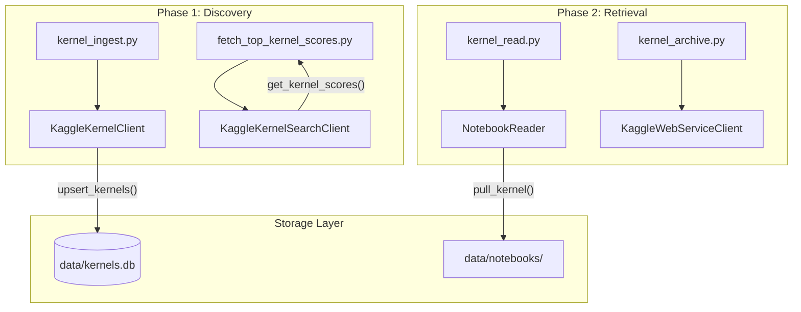
**Sources:** [skills/nvidia-kaggle-skill/scripts/kernel_ingest.py:28-43](), [skills/nvidia-kaggle-skill/scripts/kernels/kaggle_search.py:70-75](), [skills/nvidia-kaggle-skill/scripts/kernels/notebook_reader.py:18-27]()

---

## Core Capabilities

### 1. Ingestion and Local Querying
The workflow begins by syncing kernel metadata to a local SQLite database (`data/kernels.db`). This allows for fast filtering by votes, author, or "hotness" without repeated API calls.

*   **`kernel_ingest.py`**: Fetches paginated kernel lists for a competition [skills/nvidia-kaggle-skill/scripts/kernel_ingest.py:28-34]().
*   **`kernel_query.py`**: Filters the local database by search terms, vote thresholds, or authors [skills/nvidia-kaggle-skill/scripts/kernel_query.py:36-44]().
*   **`kernel_db_info.py`**: Provides statistics on the local cache, showing which competitions have been indexed [skills/nvidia-kaggle-skill/scripts/kernel_db_info.py:18-40]().

**Sources:** [skills/nvidia-kaggle-skill/scripts/kernel_ingest.py:1-61](), [skills/nvidia-kaggle-skill/scripts/kernel_query.py:1-88](), [skills/nvidia-kaggle-skill/scripts/kernel_db_info.py:1-70]()

### 2. Score Verification
Public scores in Kaggle search results can sometimes be stale or missing. The skill provides dedicated scripts to verify scores via the Kaggle SDK.

*   **`fetch_top_kernel_scores.py`**: Enumerates competition kernels via the REST API and enriches them with SDK-verified public leaderboard scores [skills/nvidia-kaggle-skill/scripts/fetch_top_kernel_scores.py:22-46]().
*   **`fetch_kernel_score.py`**: Retrieves the score for a single specific kernel reference [skills/nvidia-kaggle-skill/scripts/fetch_kernel_score.py:11-21]().

**Sources:** [skills/nvidia-kaggle-skill/scripts/fetch_top_kernel_scores.py:1-91](), [skills/nvidia-kaggle-skill/scripts/fetch_kernel_score.py:1-31]()

### 3. Notebook Reading & Analysis
Once a kernel of interest is identified, its content must be parsed for analysis.

*   **`kernel_read.py`**: Downloads the notebook and renders it as readable Markdown in the terminal [skills/nvidia-kaggle-skill/scripts/kernel_read.py:26-46]().
*   **`NotebookReader`**: The underlying class that handles `.ipynb` parsing via `nbformat` and manages the local file cache in `data/notebooks/` [skills/nvidia-kaggle-skill/scripts/kernels/notebook_reader.py:18-91]().

**Sources:** [skills/nvidia-kaggle-skill/scripts/kernel_read.py:1-71](), [skills/nvidia-kaggle-skill/scripts/kernels/notebook_reader.py:1-109]()

---

## Data Lineage & Storage Layout

The system maintains a structured filesystem to support research evidence and reproducibility.

| Path | Purpose | Code Reference |
| :--- | :--- | :--- |
| `data/kernels.db` | SQLite store for `KernelMetadata` and `CompetitionInfo`. | [kernels/database.py:48-54]() |
| `data/notebooks/<comp>/<ref>/` | Cache for `.ipynb` files and `kernel-metadata.json`. | [kernels/notebook_reader.py:35-36]() |
| `data/kernel_research/<comp>/` | Temporary directory for manual `kaggle kernels pull` evidence. | [kernels.md:90]() |
| `top_kernels_research.md` | Final research report artifact. | [kernels.md:61]() |

**Sources:** [skills/nvidia-kaggle-skill/kernels.md:84-91](), [skills/nvidia-kaggle-skill/scripts/kernels/database.py:13-42]()

---

## Best-Version Archiving

Kaggle's standard API and CLI (`kaggle kernels pull`) typically only return the *latest* version of a notebook. However, the best-scoring version is often a historical one.

*   **`kernel_archive.py`**: A specialized tool that uses Kaggle's internal web service to inspect every historical version of a kernel, identify the best public leaderboard score, and download that specific version [skills/nvidia-kaggle-skill/kernels.md:65-80]().

For details, see [Kernel Archiving & Best-Version Selection](#3.3.1).

**Sources:** [skills/nvidia-kaggle-skill/kernels.md:65-80]()

---

# Page: Kernel Archiving & Best-Version Selection

# Kernel Archiving & Best-Version Selection

<details>
<summary>Relevant source files</summary>

The following files were used as context for generating this wiki page:

- [skills/nvidia-kaggle-skill/scripts/kernel_archive.py](skills/nvidia-kaggle-skill/scripts/kernel_archive.py)
- [skills/nvidia-kaggle-skill/scripts/kernels/archive.py](skills/nvidia-kaggle-skill/scripts/kernels/archive.py)

</details>


The Kernel Archiving system provides the capability to retrieve and store specific historical versions of Kaggle kernels. While the official Kaggle API primarily exposes the latest version of a kernel, this module leverages Kaggle's internal web services to inspect the full version history, evaluate leaderboard performance for each version, and download the source code for the optimal version.

## Overview

The archiving process is handled by the `kernel_archive.py` CLI script and the underlying `kernels/archive.py` library. The system implements a sophisticated version selection logic that can automatically determine whether a competition's metric should be minimized or maximized based on historical submission data.

### Key Capabilities
- **Version Resolution**: Fetches every historical version of a kernel, including internal IDs and metadata [[skills/nvidia-kaggle-skill/scripts/kernels/archive.py:115-118]]().
- **Score Inference**: Automatically detects the optimization direction (minimize vs. maximize) by comparing version scores against the kernel's reported "best score" [[skills/nvidia-kaggle-skill/scripts/kernels/archive.py:160-177]]().
- **Source Retrieval**: Downloads the full notebook source (JSON) or script via internal endpoints [[skills/nvidia-kaggle-skill/scripts/kernels/archive.py:251-260]]().
- **Directory Convention**: Organizes archives using a specific naming convention: `v{version_number}__scriptVersionId-{id}` [[skills/nvidia-kaggle-skill/scripts/kernels/archive.py:231-233]]().

## System Architecture & Data Flow

The following diagram illustrates the flow from a user request to the final archived file on disk, highlighting the interaction with Kaggle's internal `LegacyKernelsService` and `KernelsService`.

### Kernel Archiving Flow
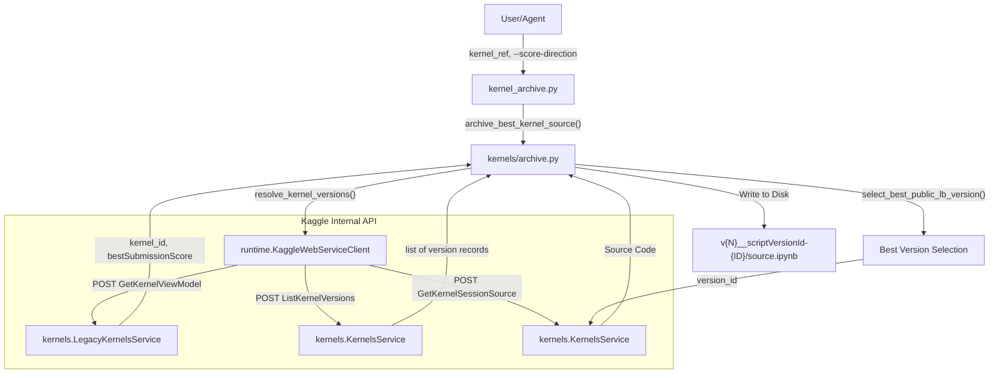
Sources: [[skills/nvidia-kaggle-skill/scripts/kernel_archive.py:19-71]](), [[skills/nvidia-kaggle-skill/scripts/kernels/archive.py:115-157]](), [[skills/nvidia-kaggle-skill/scripts/kernels/archive.py:214-239]]()

## Implementation Details

### Version Resolution & Scoring
The system calls `resolve_kernel_versions` to build a complete history of the kernel. It maps internal Kaggle entities to a unified record format.

| Field | Description | Source |
| :--- | :--- | :--- |
| `version_number` | The user-facing version index (1, 2, 3...) | [[skills/nvidia-kaggle-skill/scripts/kernels/archive.py:100]]() |
| `kernel_session_id` | Internal ID used to fetch source code | [[skills/nvidia-kaggle-skill/scripts/kernels/archive.py:101]]() |
| `public_lb_numeric` | Parsed float value of the leaderboard score | [[skills/nvidia-kaggle-skill/scripts/kernels/archive.py:152]]() |
| `best_submission_score_for_kernel` | The overall best score Kaggle associates with this kernel | [[skills/nvidia-kaggle-skill/scripts/kernels/archive.py:153]]() |

Sources: [[skills/nvidia-kaggle-skill/scripts/kernels/archive.py:97-112]](), [[skills/nvidia-kaggle-skill/scripts/kernels/archive.py:139-156]]()

### Best-Version Selection Logic
The `select_best_public_lb_version` function determines which version to download. If `score_direction` is set to `"auto"`, the system uses `_infer_direction` [[skills/nvidia-kaggle-skill/scripts/kernels/archive.py:180-182]]().

**Inference Logic (`_infer_direction`):**
1. It extracts all numeric scores from the version history [[skills/nvidia-kaggle-skill/scripts/kernels/archive.py:161]]().
2. It retrieves the kernel's global `best_score` from the metadata [[skills/nvidia-kaggle-skill/scripts/kernels/archive.py:168]]().
3. If the `best_score` matches the minimum value found in history, it sets direction to `minimize` [[skills/nvidia-kaggle-skill/scripts/kernels/archive.py:173-174]]().
4. If it matches the maximum, it sets direction to `maximize` [[skills/nvidia-kaggle-skill/scripts/kernels/archive.py:175-176]]().

Sources: [[skills/nvidia-kaggle-skill/scripts/kernels/archive.py:160-177]](), [[skills/nvidia-kaggle-skill/scripts/kernels/archive.py:180-212]]()

### Source Download & Storage
Once a version is selected, `archive_kernel_version` handles the retrieval. It uses the `GetKernelSessionSource` endpoint [[skills/nvidia-kaggle-skill/scripts/kernels/archive.py:25]]().

The source is saved into a directory following the convention:
`{output_dir}/v{version_number}__scriptVersionId-{version_id}/` [[skills/nvidia-kaggle-skill/scripts/kernels/archive.py:231-233]]().

The downloaded file is named `source.ipynb` (for notebooks) or `source.py`/`source.R` (for scripts) based on the kernel language [[skills/nvidia-kaggle-skill/scripts/kernels/archive.py:234-238]]().

Sources: [[skills/nvidia-kaggle-skill/scripts/kernels/archive.py:214-245]](), [[skills/nvidia-kaggle-skill/scripts/kernels/archive.py:248-266]]()

## CLI Usage

The `kernel_archive.py` script provides a command-line interface for these operations.

| Argument | Description |
| :--- | :--- |
| `kernel_ref` | `owner/slug` or a Kaggle URL [[skills/nvidia-kaggle-skill/scripts/kernel_archive.py:23]]() |
| `--version` | Skip "best" logic and download a specific version number [[skills/nvidia-kaggle-skill/scripts/kernel_archive.py:26-29]]() |
| `--score-direction` | Force `minimize` or `maximize` for "best" selection [[skills/nvidia-kaggle-skill/scripts/kernel_archive.py:30-35]]() |
| `--list` | Output all version scores as JSON and exit without downloading [[skills/nvidia-kaggle-skill/scripts/kernel_archive.py:39-44]]() |
| `--include-outputs` | Include cell outputs in the notebook JSON [[skills/nvidia-kaggle-skill/scripts/kernel_archive.py:36]]() |

### Example Entity Mapping
The following diagram maps CLI concepts to the internal `KernelRef` and `KaggleWebServiceClient` entities.

```mermaid
graph LR
    subgraph "CLI Space (kernel_archive.py)"
        REF["args.kernel_ref"]
        DIR["args.score_direction"]
        OUT["args.include_outputs"]
    end

    subgraph "Code Entity Space (kernels/archive.py)"
        KREF["KernelRef(owner_slug, kernel_slug)"]
        PARSE["parse_kernel_ref()"]
        RESO["resolve_kernel_versions()"]
        INF["_infer_direction()"]
    end

    REF -- "passed to" --> PARSE
    PARSE -- "returns" --> KREF
    KREF -- "used by" --> RESO
    DIR -- "influences" --> INF
```
Sources: [[skills/nvidia-kaggle-skill/scripts/kernel_archive.py:23-45]](), [[skills/nvidia-kaggle-skill/scripts/kernels/archive.py:33-36]](), [[skills/nvidia-kaggle-skill/scripts/kernels/archive.py:38-57]](), [[skills/nvidia-kaggle-skill/scripts/kernels/archive.py:115-120]]()

---

# Page: Writeup Workflows

# Writeup Workflows

<details>
<summary>Relevant source files</summary>

The following files were used as context for generating this wiki page:

- [skills/nvidia-kaggle-skill/scripts/fetch_leaderboard_writeups.py](skills/nvidia-kaggle-skill/scripts/fetch_leaderboard_writeups.py)
- [skills/nvidia-kaggle-skill/scripts/fetch_writeup.py](skills/nvidia-kaggle-skill/scripts/fetch_writeup.py)
- [skills/nvidia-kaggle-skill/writeups.md](skills/nvidia-kaggle-skill/writeups.md)

</details>


The Writeup Workflows provide automated mechanisms for discovering and extracting competition solution writeups from Kaggle. Unlike legacy approaches that relied on headless browsers, these workflows utilize Kaggle's internal web services to retrieve structured data and raw markdown content directly.

## Overview

The system supports two primary modes of operation:
1.  **Discovery Mode**: Identifying which top-ranking teams have published formal solution writeups.
2.  **Extraction Mode**: Fetching the raw markdown content of a specific writeup and sanitizing it for research use.

The logic is encapsulated in two primary scripts: `fetch_leaderboard_writeups.py` for discovery and `fetch_writeup.py` for content extraction.

### Data Flow Diagram: Writeup Discovery and Extraction

This diagram illustrates how the system transitions from a competition URL to a set of localized markdown files.

"Writeup Workflow Data Flow"
```mermaid
graph TD
    subgraph "Natural Language Space"
        User["User/Agent"]
        CompURL["Competition/Leaderboard URL"]
        WriteupURL["Specific Writeup URL"]
    end

    subgraph "Code Entity Space: Discovery"
        FLW["fetch_leaderboard_writeups.py"]
        KWS_L["kaggle_web_service()"]
        GetLeaderboard["LeaderboardService/GetLeaderboard"]
    end

    subgraph "Code Entity Space: Extraction"
        FW["fetch_writeup.py"]
        KWS_E["kaggle_web_service()"]
        GetTopic["DiscussionsService/GetForumTopicById"]
        Sanitize["Markdown Sanitization Logic"]
    end

    User -->|Provides| CompURL
    CompURL --> FLW
    FLW --> KWS_L
    KWS_L -->|POST| GetLeaderboard
    GetLeaderboard -->|JSON: solutionWriteUpUrl| FLW
    FLW -->|List of URLs| User

    User -->|Provides| WriteupURL
    WriteupURL --> FW
    FW --> KWS_E
    KWS_E -->|POST| GetTopic
    GetTopic -->|rawMarkdown| FW
    FW --> Sanitize
    Sanitize -->|writeup.md| User
```
Sources: [skills/nvidia-kaggle-skill/scripts/fetch_leaderboard_writeups.py:17-75](), [skills/nvidia-kaggle-skill/scripts/fetch_writeup.py:51-80](), [skills/nvidia-kaggle-skill/writeups.md:1-53]()

---

## Leaderboard Discovery

The script `fetch_leaderboard_writeups.py` identifies teams that have linked a solution writeup to their leaderboard entry.

### Implementation Details
The script performs a correlation between the team list and the leaderboard rankings:
1.  **Competition Resolution**: Resolves the competition slug to a numeric `competitionId` via `competitions.CompetitionService/GetCompetition` [skills/nvidia-kaggle-skill/scripts/fetch_leaderboard_writeups.py:28-32]().
2.  **Leaderboard Retrieval**: Fetches the leaderboard data via `competitions.LeaderboardService/GetLeaderboard` [skills/nvidia-kaggle-skill/scripts/fetch_leaderboard_writeups.py:36-39]().
3.  **Rank Correlation**: 
    *   It attempts to map `teamId` to rank using the `privateLeaderboard` [skills/nvidia-kaggle-skill/scripts/fetch_leaderboard_writeups.py:48-51]().
    *   If the private board is empty (e.g., live competitions), it falls back to the `publicLeaderboard` [skills/nvidia-kaggle-skill/scripts/fetch_leaderboard_writeups.py:52-56]().
4.  **Writeup Extraction**: Iterates through the `teams` list, extracting the `solutionWriteUpUrl` for any team that has provided one [skills/nvidia-kaggle-skill/scripts/fetch_leaderboard_writeups.py:59-71]().

### Output Format
The script outputs a JSON list of records sorted by rank:
```json
[
  {
    "rank": "1",
    "team": "Winning Team Name",
    "writeup_url": "https://www.kaggle.com/competitions/slug/writeups/12345"
  }
]
```
Sources: [skills/nvidia-kaggle-skill/scripts/fetch_leaderboard_writeups.py:58-89]()

---

## Writeup Extraction

The `fetch_writeup.py` script converts a Kaggle writeup URL into a sanitized markdown file.

### Topic ID Resolution
Kaggle writeup URLs use slugs (e.g., `/writeups/solution-slug`), but the API requires a numeric `forumTopicId`. The function `_resolve_topic_id` performs this mapping by:
1.  Fetching the competition leaderboard [skills/nvidia-kaggle-skill/scripts/fetch_writeup.py:36-39]().
2.  Matching the URL slug against the `solutionWriteUpUrl` in the team list to find the corresponding `writeUpForumTopicId` [skills/nvidia-kaggle-skill/scripts/fetch_writeup.py:40-44]().

### Content Retrieval and Sanitization
Once the `topic_id` is resolved, the script:
1.  Calls `discussions.DiscussionsService/GetForumTopicById` with `includeComments: False` [skills/nvidia-kaggle-skill/scripts/fetch_writeup.py:63-66]().
2.  Extracts content from `writeUp.message.rawMarkdown` [skills/nvidia-kaggle-skill/scripts/fetch_writeup.py:68-70]().
3.  **Sanitization**:
    *   Prepends the title as an H1 header if not already present [skills/nvidia-kaggle-skill/scripts/fetch_writeup.py:76-77]().
    *   Collapses excessive newlines (3 or more) into double newlines [skills/nvidia-kaggle-skill/scripts/fetch_writeup.py:79]().

"Writeup Resolution and Sanitization Logic"
```mermaid
graph LR
    URL["Writeup URL Slug"] --> Resolve["_resolve_topic_id()"]
    Resolve -->|API Request| LB["LeaderboardService"]
    LB -->|forumTopicId| Fetch["GetForumTopicById"]
    Fetch -->|rawMarkdown| MD["Markdown Processor"]
    MD -->|Regex Clean| Final["Sanitized .md"]

    subgraph "Sanitization Steps"
        S1["Add H1 Title"]
        S2["Regex: \\n{3,} -> \\n\\n"]
        S3["Strip whitespace"]
    end
    MD --- S1
    S1 --- S2
    S2 --- S3
```
Sources: [skills/nvidia-kaggle-skill/scripts/fetch_writeup.py:24-49](), [skills/nvidia-kaggle-skill/scripts/fetch_writeup.py:63-79]()

---

## Workflow Specifications

The `writeups.md` file defines the high-level orchestration logic for agents using these scripts.

### Single Writeup Mode
When a specific URL is provided, the agent is instructed to:
*   Run `fetch_writeup.py`.
*   Append a standard footer: `Fetched using the nvidia-kaggle-skill writeups workflow. Original write-up link: <link>` [skills/nvidia-kaggle-skill/writeups.md:24]().
*   Save the file using the writeup slug as the filename.

### Top-k Writeups Mode
When a competition URL or slug is provided, the agent performs a batch operation:
1.  **Discovery**: Runs `fetch_leaderboard_writeups.py` [skills/nvidia-kaggle-skill/writeups.md:32]().
2.  **Selection**: Selects the top `k` writeups (defaulting to 3) [skills/nvidia-kaggle-skill/writeups.md:11]().
3.  **Extraction**: Iteratively runs `fetch_writeup.py` for each URL [skills/nvidia-kaggle-skill/writeups.md:38]().
4.  **Summarization**: Generates a `summary.md` containing a table of ranks, teams, and brief approach summaries [skills/nvidia-kaggle-skill/writeups.md:41-46]().

### File Naming Convention
*   **Individual files**: `<rank>th_place_writeup.md` [skills/nvidia-kaggle-skill/writeups.md:41]().
*   **Aggregate index**: `summary.md` [skills/nvidia-kaggle-skill/writeups.md:41]().

Sources: [skills/nvidia-kaggle-skill/writeups.md:14-52]()

---

# Page: Kernel Setup (Local Reproduction)

# Kernel Setup (Local Reproduction)

<details>
<summary>Relevant source files</summary>

The following files were used as context for generating this wiki page:

- [CLA.md](CLA.md)
- [LICENSE](LICENSE)
- [skills/nvidia-kaggle-skill/SKILL.md](skills/nvidia-kaggle-skill/SKILL.md)
- [skills/nvidia-kaggle-skill/kernel-setup.md](skills/nvidia-kaggle-skill/kernel-setup.md)
- [skills/nvidia-kaggle-skill/research-brief.md](skills/nvidia-kaggle-skill/research-brief.md)
- [skills/nvidia-kaggle-skill/scripts/upload_dataset.py](skills/nvidia-kaggle-skill/scripts/upload_dataset.py)

</details>


The **Kernel Setup** workflow provides a structured process for reproducing Kaggle notebooks in a local environment. It automates the retrieval of notebook code, metadata, and all associated input sources (competitions, datasets, models, and other kernel outputs), while organizing them into a standard workspace layout that mimics the Kaggle environment.

## Workflow Overview

The reproduction process follows a sequence of pulling metadata, downloading dependencies, and post-processing the filesystem to ensure paths in the notebook (e.g., `/kaggle/input/...`) can be resolved locally.

### Workspace Directory Layout
The workflow mandates a specific directory structure to separate raw inputs from working code and temporary artifacts [skills/nvidia-kaggle-skill/kernel-setup.md:14-25]():

| Directory | Purpose |
| :--- | :--- |
| `input/` | Raw data from competitions, datasets, and models. |
| `working/` | The primary notebook file and execution environment. |
| `tmp/` | Temporary storage for metadata and intermediate archives. |
| `scripts/` | Utility scripts and helper modules extracted from the kernel. |

### Data Flow: Metadata to Workspace
The following diagram illustrates how the `kernel-metadata.json` acts as the source of truth for orchestrating the setup.

**Entity Association: Metadata-Driven Setup**
```mermaid
graph TD
    subgraph "Kaggle Platform"
        K_NB["Notebook Source"]
        K_META["Kernel Metadata"]
    end

    subgraph "Local Workspace"
        DIR_W["working/"]
        DIR_T["tmp/"]
        DIR_I["input/"]
        META_JSON["kernel-metadata.json"]
    end

    K_NB -- "kaggle kernels pull -p working/" --> DIR_W
    K_META -- "kaggle kernels pull -m -p tmp/" --> DIR_T
    DIR_T --> META_JSON
    
    META_JSON -- "dataset_sources" --> DIR_I
    META_JSON -- "competition_sources" --> DIR_I
    META_JSON -- "model_sources" --> DIR_I
    META_JSON -- "kernel_sources" --> DIR_I
```
Sources: [skills/nvidia-kaggle-skill/kernel-setup.md:27-41]()

## Implementation Details

### 1. Source Acquisition
The workflow uses the Kaggle CLI to fetch data based on the arrays defined in `kernel-metadata.json`.

*   **Competitions:** Downloaded via `kaggle competitions download -c {competition}`. Archives are extracted and zips are removed to save space [skills/nvidia-kaggle-skill/kernel-setup.md:46-52]().
*   **Datasets:** Downloaded using the `--unzip` flag to `{folder}/input/{dataset}` [skills/nvidia-kaggle-skill/kernel-setup.md:54-58]().
*   **Models:** Downloaded using the `--untar` flag via `kaggle models instances versions download` [skills/nvidia-kaggle-skill/kernel-setup.md:60-64]().
*   **Kernel Outputs:** Fetched via `kaggle kernels output` to provide lineage dependencies [skills/nvidia-kaggle-skill/kernel-setup.md:66-72]().

### 2. Path Mapping & Symlinking
Kaggle notebooks typically reference data using absolute paths like `/kaggle/input/competition-name/train.csv`. To support local execution without modifying the notebook code, the agent generates a `create_symlinks.sh` script [skills/nvidia-kaggle-skill/kernel-setup.md:78-79]().

**Entity Association: Path Resolution Logic**
```mermaid
sequenceDiagram
    participant NB as "Notebook (.ipynb)"
    participant FS as "Local Filesystem"
    participant SL as "create_symlinks.sh"

    NB->>NB: Scan for '/kaggle/input/' strings
    NB->>FS: Identify local path in 'input/' folder
    FS->>SL: Generate 'ln -s' commands
    Note over SL: Maps local input/ to /kaggle/input/
```
Sources: [skills/nvidia-kaggle-skill/kernel-setup.md:78-79]()

### 3. Dependency Handling
*   **Requirements:** If an `input_requirements.txt` is found within the kernel's metadata folders, it is converted to a standard `requirements.txt` in the root folder [skills/nvidia-kaggle-skill/kernel-setup.md:75-76]().
*   **Utility Scripts:** Dependency scripts (often found in Kaggle as "Utility Scripts") are moved to the `scripts/` directory and renamed to valid Python identifiers to support local imports [skills/nvidia-kaggle-skill/kernel-setup.md:77-77]().

## Documentation Generation
A `README.md` is generated in the root of the reproduction folder to guide the user through the final steps. It includes:
*   **Source Summary:** A table listing every dataset/competition, its local path, and its status [skills/nvidia-kaggle-skill/kernel-setup.md:85-85]().
*   **Execution Instructions:** Commands for running the symlink script and installing dependencies [skills/nvidia-kaggle-skill/kernel-setup.md:86-88]().
*   **Hardware Metadata:** Information on whether the kernel requires GPU, TPU, or Internet access [skills/nvidia-kaggle-skill/kernel-setup.md:89-91]().

## Troubleshooting
| Symptom | Cause | Action |
| :--- | :--- | :--- |
| `403 Forbidden` on Competition | Rules not accepted | Direct user to `kaggle.com/competitions/{slug}/rules` [skills/nvidia-kaggle-skill/kernel-setup.md:99-99](). |
| `403 Forbidden` on Dataset | Incorrect Owner | Use `kaggle datasets list -s` to verify the correct slug [skills/nvidia-kaggle-skill/kernel-setup.md:100-100](). |
| Unresolved Paths | Non-standard notebook paths | Log uncertainty in the generated README for manual fix [skills/nvidia-kaggle-skill/kernel-setup.md:101-101](). |

Sources: [skills/nvidia-kaggle-skill/kernel-setup.md:93-102]()

---

# Page: Submission Workflow

# Submission Workflow

<details>
<summary>Relevant source files</summary>

The following files were used as context for generating this wiki page:

- [skills/nvidia-kaggle-skill/scripts/db_info.py](skills/nvidia-kaggle-skill/scripts/db_info.py)
- [skills/nvidia-kaggle-skill/scripts/submission_quota.py](skills/nvidia-kaggle-skill/scripts/submission_quota.py)
- [skills/nvidia-kaggle-skill/scripts/submit_kernel.py](skills/nvidia-kaggle-skill/scripts/submit_kernel.py)
- [skills/nvidia-kaggle-skill/submission.md](skills/nvidia-kaggle-skill/submission.md)

</details>


The submission workflow manages the end-to-end lifecycle of a Kaggle competition entry. This process involves pushing code to Kaggle's notebook servers, monitoring the execution of that notebook, and finally submitting the generated output file to a competition for scoring. The workflow is primarily implemented in `submit_kernel.py` and `submission_quota.py`.

## Overview of Submission Lifecycle

The workflow follows a two-phase polling architecture:
1.  **Kernel Execution Phase**: The code is pushed as a Kaggle Kernel. The system polls the Kaggle API until the kernel reaches a terminal state (`COMPLETE`, `ERROR`, or `CANCEL_ACKNOWLEDGED`).
2.  **Competition Evaluation Phase**: If a competition output file (e.g., `submission.csv`) is specified, the system triggers a competition submission using the successfully run kernel and polls the leaderboard evaluation service until a public score is assigned.

### Submission Quota Management

Kaggle enforces daily submission limits per competition (resetting at 00:00 UTC). The `submission_quota.py` script provides a proactive guard to check these limits before attempting a submission.

| Feature | Implementation | Description |
| :--- | :--- | :--- |
| **Daily Limit Retrieval** | `competition_daily_submission_limit` | Fetches `max_daily_submissions` via the Kaggle SDK. [scripts/submission_quota.py:27-46]() |
| **Usage Counting (CLI)** | `submissions_used_today` | Counts rows from `kaggle competitions submissions` since UTC midnight. [scripts/submission_quota.py:97-109]() |
| **Usage Counting (SDK)** | `submissions_by_user_today` | Uses `api.competition_submissions` to attribute usage to specific users. [scripts/submission_quota.py:144-157]() |
| **Exhausted State** | CLI Output | Reports `exhausted: true` if `used >= limit`. [skills/nvidia-kaggle-skill/submission.md:52-54]() |

**Sources:** [skills/nvidia-kaggle-skill/submission.md:44-59](), [scripts/submission_quota.py:1-12]()

---

## Technical Implementation: submit_kernel.py

The `submit_kernel.py` script is the primary driver for pushing and submitting code. It supports two modes:
*   **Push Mode**: Uploads local code and metadata to create a new kernel version.
*   **Existing-Version Mode**: Submits a specific, already-existing Kaggle kernel version to a competition using the `-v` flag. [skills/nvidia-kaggle-skill/submission.md:39-40]()

### Kernel Metadata Requirements
The workflow requires a `kernel-metadata.json` file in the target directory. This file must define:
*   `id`: The kernel slug (e.g., `username/kernel-name`).
*   `code_file`: Path to the script or notebook.
*   `competition_sources`: List of competitions the kernel is associated with.

**Sources:** [scripts/submit_kernel.py:52-75](), [skills/nvidia-kaggle-skill/submission.md:16-21]()

### Submission Flow Diagram

The following diagram bridges the natural language workflow to the specific functions in `submit_kernel.py`.

**Title: Kernel Submission Logic Flow**
```mermaid
graph TD
    subgraph "Phase 0: Validation"
        A["main()"] --> B["read_kernel_metadata()"]
        B --> C{"-v VERSION provided?"}
    end

    subgraph "Phase 1: Kernel Execution"
        C -- "No" --> D["push_kernel()"]
        D --> E["api.kernels_push()"]
        C -- "Yes" --> F["Skip Push"]
        E --> G["poll_kernel()"]
        F --> G
        G --> H["api.kernels_status()"]
        H -- "Wait" --> G
    end

    subgraph "Phase 2: Competition Submission"
        H -- "COMPLETE" --> I{"--file provided?"}
        I -- "Yes" --> J["submit_to_competition()"]
        J --> K["api.competition_submit_code()"]
        K --> L["poll_submission()"]
        L --> M["api.competition_submissions()"]
        M -- "Match by Message" --> N["Report Public Score"]
    end

    subgraph "Error Handling"
        H -- "ERROR" --> ERR["Exit with Failure"]
        M -- "ERROR" --> ERR
    end
```
**Sources:** [scripts/submit_kernel.py:78-179](), [skills/nvidia-kaggle-skill/submission.md:60-69]()

---

## Polling Mechanisms

### Kernel Status Polling
The `poll_kernel` function monitors the `api.kernels_status(slug)` endpoint. It tracks elapsed time against a timeout (default 1 hour) and recognizes terminal states.
*   **Terminal States**: `COMPLETE`, `ERROR`, `CANCEL_ACKNOWLEDGED`. [scripts/submit_kernel.py:95-95]()
*   **Backoff**: Uses `DEFAULT_POLL_INTERVAL_SECONDS` (default 60s) between checks. [scripts/submit_kernel.py:18-18]()

### Competition Submission Polling
Once a kernel is complete, `poll_submission` monitors the competition leaderboard.
*   **Matching Logic**: Since the API does not return a submission ID immediately, the script matches submissions using a unique timestamped message: `DEFAULT_SUBMISSION_MESSAGE`. [scripts/submit_kernel.py:26-26]()
*   **Result Extraction**: Upon completion, it extracts the `public_score` from the `ApiSubmission` object. [scripts/submit_kernel.py:168-170]()

**Sources:** [scripts/submit_kernel.py:91-119](), [scripts/submit_kernel.py:131-179]()

---

## Data Flow: CLI to SDK

This diagram illustrates how user inputs are transformed and passed through the Kaggle API entities.

**Title: Submission Data Flow and Entity Mapping**
```mermaid
graph LR
    subgraph "User Input"
        DIR["Kernel Folder"]
        FILE["--file (submission.csv)"]
        MSG["--message"]
    end

    subgraph "Entity: KernelMetadata"
        META["kernel-metadata.json"]
        SLUG["id (slug)"]
        SRC["competition_sources"]
    end

    subgraph "Code Entities (submit_kernel.py)"
        API["KaggleApi Instance"]
        PUSH["kernels_push(path)"]
        SUB["competition_submit_code()"]
    end

    DIR --> META
    META --> SLUG
    META --> SRC
    
    SLUG --> PUSH
    FILE --> SUB
    MSG --> SUB
    SRC --> SUB
    
    SUB --> STATUS["ApiSubmission Status"]
```
**Sources:** [scripts/submit_kernel.py:33-38](), [scripts/submit_kernel.py:52-75](), [scripts/submit_kernel.py:120-128]()

## Usage Summary

### Execution Command
The script should be run with `PYTHONUNBUFFERED=1` to ensure real-time log visibility during long-running polling loops. [skills/nvidia-kaggle-skill/submission.md:33-40]()

```bash
# Standard push and submit
PYTHONUNBUFFERED=1 python ./scripts/submit_kernel.py ./my-solution --file submission.csv

# Submit existing version
PYTHONUNBUFFERED=1 python ./scripts/submit_kernel.py ./my-solution --file submission.csv -v 5
```

### Quota Check Command
```bash
python ./scripts/submission_quota.py <competition-slug> --as-json
```
The output includes `used`, `remaining`, and `exhausted` fields based on UTC midnight resets. [skills/nvidia-kaggle-skill/submission.md:52-52]()

**Sources:** [skills/nvidia-kaggle-skill/submission.md:31-59](), [scripts/submission_quota.py:1-11]()

---

# Page: Dataset Upload Workflow

# Dataset Upload Workflow

<details>
<summary>Relevant source files</summary>

The following files were used as context for generating this wiki page:

- [skills/nvidia-kaggle-skill/SKILL.md](skills/nvidia-kaggle-skill/SKILL.md)
- [skills/nvidia-kaggle-skill/research-brief.md](skills/nvidia-kaggle-skill/research-brief.md)
- [skills/nvidia-kaggle-skill/scripts/upload_dataset.py](skills/nvidia-kaggle-skill/scripts/upload_dataset.py)

</details>


The Dataset Upload Workflow provides a robust mechanism for creating or updating Kaggle datasets from local directories. It manages the entire lifecycle of dataset metadata, handles credential resolution, and ensures that sensitive terminal outputs are sanitized.

## Overview

The primary entry point for this workflow is `upload_dataset.py`. It automates the generation of `dataset-metadata.json`, handles slug constraints, and uses a combination of the Kaggle CLI and the `kagglesdk` to manage dataset creation, versioning, and collaborator permissions.

### Key Features
*   **Automatic Slug Generation**: Converts folder names into valid Kaggle slugs within length constraints [skills/nvidia-kaggle-skill/scripts/upload_dataset.py:56-61]().
*   **Metadata Lifecycle**: Creates new metadata files or patches existing ones to preserve descriptions and licenses [skills/nvidia-kaggle-skill/scripts/upload_dataset.py:64-92]().
*   **Collaborator Management**: Uses the `kagglesdk` to patch collaborator roles, as the standard CLI ignores these during initial creation [skills/nvidia-kaggle-skill/scripts/upload_dataset.py:152-164]().
*   **Output Sanitization**: Strips ANSI escape codes and control characters from CLI output to prevent terminal spoofing [skills/nvidia-kaggle-skill/scripts/upload_dataset.py:124-135]().

---

## Implementation Details

### Username & Credential Resolution
Before any upload occurs, the script resolves the Kaggle username using the `KAGGLE_API_TOKEN` (KGAT). It uses `KaggleCredentials` from the `kagglesdk` to introspect the token and retrieve the owner's handle.

| Entity | Role |
| --- | --- |
| `has_kaggle_credentials()` | Validates existence of `KAGGLE_API_TOKEN` [skills/nvidia-kaggle-skill/scripts/upload_dataset.py:20-22](). |
| `get_kaggle_username()` | Uses `KaggleCredentials.introspect()` to resolve the owner slug [skills/nvidia-kaggle-skill/scripts/upload_dataset.py:25-53](). |

### Slug and Metadata Generation
Kaggle requires dataset slugs to be between 6 and 50 characters, consisting only of alphanumeric characters and hyphens [skills/nvidia-kaggle-skill/scripts/constants.py:11-12]().

1.  **Slugification**: The `slugify()` function cleans the provided title or folder name [skills/nvidia-kaggle-skill/scripts/upload_dataset.py:56-61]().
2.  **Metadata Merging**: `write_metadata()` creates `dataset-metadata.json`. If a file already exists, it preserves fields like `subtitle`, `description`, `keywords`, and `licenses` while updating the `id` and `isPrivate` status [skills/nvidia-kaggle-skill/scripts/upload_dataset.py:78-87]().

### Data Flow: Natural Language to Code Entities

The following diagram illustrates how user-provided parameters are transformed into Kaggle API entities.

**Dataset Entity Mapping**
```mermaid
graph TD
    User["User CLI Args"] -->|"--title"| Title["Title String"]
    User -->|"--public"| Privacy["isPrivate: bool"]
    User -->|"--collaborator"| CollabStr["'user:role' string"]
    
    subgraph Logic["upload_dataset.py Logic"]
        Title -->|"slugify()"| Slug["dataset_slug"]
        CollabStr -->|"parse_collaborator()"| CollabDict["{'username', 'role'}"]
        Privacy -->|"write_metadata()"| MetaFile["dataset-metadata.json"]
    end

    subgraph SDK["Kagglesdk / CLI Entities"]
        Slug -->|"ApiUpdateDatasetMetadataRequest"| Req["Metadata Request"]
        CollabDict -->|"DatasetCollaborator"| SDKCollab["Collaborator Object"]
        MetaFile -->|"kaggle datasets create"| CLI["Kaggle CLI Invocation"]
    end
```
**Sources:** [skills/nvidia-kaggle-skill/scripts/upload_dataset.py:56-103](), [skills/nvidia-kaggle-skill/scripts/upload_dataset.py:138-149](), [skills/nvidia-kaggle-skill/scripts/upload_dataset.py:193-196]()

---

## Upload Execution & Collaborator Patching

The workflow differentiates between creating a new dataset and pushing a new version of an existing one.

### Creation vs. Update
The script executes `kaggle datasets create` for new datasets [skills/nvidia-kaggle-skill/scripts/upload_dataset.py:95-103](). If the dataset already exists, it requires `--version-notes` and executes `kaggle datasets version` [skills/nvidia-kaggle-skill/scripts/upload_dataset.py:106-112]().

### Collaborator Patching
Because the Kaggle CLI's `create` command does not process the `collaborators` field in the metadata file, `upload_dataset.py` performs a secondary "patch" operation using the `kagglesdk`.

1.  It maps roles (`reader`, `writer`) to `CollaboratorType` [skills/nvidia-kaggle-skill/scripts/upload_dataset.py:173-176]().
2.  It constructs a `DatasetSettings` object [skills/nvidia-kaggle-skill/scripts/upload_dataset.py:181-191]().
3.  It calls `update_dataset_metadata` via the `dataset_api_client` [skills/nvidia-kaggle-skill/scripts/upload_dataset.py:198-200]().

**Collaborator Patching Flow**
```mermaid
sequenceDiagram
    participant CLI as Kaggle CLI
    participant Script as upload_dataset.py
    participant SDK as kagglesdk
    participant API as Kaggle API

    Script->>CLI: run "kaggle datasets create -p <path>"
    CLI-->>Script: Success (Dataset Created)
    Note over Script: CLI ignores collaborators in metadata
    Script->>SDK: Instantiate DatasetSettings & DatasetCollaborator
    Script->>SDK: Build ApiUpdateDatasetMetadataRequest
    Script->>API: update_dataset_metadata(request)
    API-->>Script: Response (Collaborators Patched)
```
**Sources:** [skills/nvidia-kaggle-skill/scripts/upload_dataset.py:95-103](), [skills/nvidia-kaggle-skill/scripts/upload_dataset.py:152-202]()

---

## Output Sanitization

To ensure security when running in agentic environments, all CLI output is passed through `sanitize_cli_output()`.

*   **ANSI Stripping**: Removes escape sequences (e.g., `\x1b[...`) that could be used to manipulate terminal state or spoof logs [skills/nvidia-kaggle-skill/scripts/upload_dataset.py:119-131]().
*   **Control Char Removal**: Strips non-printable characters, excluding tabs and newlines [skills/nvidia-kaggle-skill/scripts/upload_dataset.py:120-132]().
*   **Truncation**: Limits output to 8,000 characters to prevent buffer overflows or excessive context window usage [skills/nvidia-kaggle-skill/scripts/upload_dataset.py:121-134]().

---

## Directory Modes

The `--dir-mode` option determines how the local directory is handled during upload [skills/nvidia-kaggle-skill/scripts/upload_dataset.py:140]():

| Mode | Description |
| --- | --- |
| `zip` | Compresses the directory into a .zip file before upload [skills/nvidia-kaggle-skill/scripts/upload_dataset.py:100-102](). |
| `tar` | Compresses the directory into a .tar file before upload [skills/nvidia-kaggle-skill/scripts/upload_dataset.py:100-102](). |
| `skip` | Uploads individual files within the directory without archiving them. |

**Sources:** [skills/nvidia-kaggle-skill/scripts/upload_dataset.py:6](), [skills/nvidia-kaggle-skill/scripts/upload_dataset.py:100-102](), [skills/nvidia-kaggle-skill/scripts/upload_dataset.py:140]()

---

# Page: Research Brief Workflow

# Research Brief Workflow

<details>
<summary>Relevant source files</summary>

The following files were used as context for generating this wiki page:

- [skills/nvidia-kaggle-skill/SKILL.md](skills/nvidia-kaggle-skill/SKILL.md)
- [skills/nvidia-kaggle-skill/kernels.md](skills/nvidia-kaggle-skill/kernels.md)
- [skills/nvidia-kaggle-skill/research-brief.md](skills/nvidia-kaggle-skill/research-brief.md)
- [skills/nvidia-kaggle-skill/scripts/upload_dataset.py](skills/nvidia-kaggle-skill/scripts/upload_dataset.py)

</details>


The Research Brief workflow is a high-level strategy pipeline that aggregates data from multiple specialized sub-systems (competition context, discussions, kernels, and writeups) to produce a comprehensive, grounded `brief.md` artifact. Unlike atomic scripts, this workflow is an agentic pattern where the system chains individual capabilities to synthesize an actionable strategy for a Kaggle competition [skills/nvidia-kaggle-skill/research-brief.md:3-9]().

## Workflow Overview

The Research Brief is designed to move from raw platform data to a structured strategy document. It emphasizes "grounding"—the principle that every claim, score, and technique must be traceable to a verified source gathered during the current session [skills/nvidia-kaggle-skill/research-brief.md:46-47]().

### Data Flow and Component Chaining

The workflow orchestrates the following sequence of script executions:

1.  **Context Discovery**: Retrieves competition mechanics (metrics, constraints, data shape) using `fetch_competition_info.py` and `fetch_dataset_info.py` [skills/nvidia-kaggle-skill/research-brief.md:13-14]().
2.  **Community Intelligence**: Ingests and queries threads via `discussion_ingest.py` and `discussion_query.py` to identify high-signal tips and community-vetted approaches [skills/nvidia-kaggle-skill/research-brief.md:14-15]().
3.  **Technical Research**: Enumerates kernels via `kernel_ingest.py` and verifies performance using `fetch_top_kernel_scores.py`. This phase identifies the "Score Ladder" [skills/nvidia-kaggle-skill/research-brief.md:15-16]().
4.  **Historical Analysis**: Pulls winning solutions via `fetch_leaderboard_writeups.py` and `fetch_writeup.py` to understand long-term successful strategies [skills/nvidia-kaggle-skill/research-brief.md:17-18]().

### System Entity Map

The following diagram illustrates how the natural language request for a "Research Brief" translates into specific code entities and data stores.

**Research Brief Entity Mapping**
```mermaid
graph TD
    subgraph "Natural Language Space"
        REQ["'Research this competition'"]
        BRIEF["Strategy Brief (brief.md)"]
    end

    subgraph "Code Entity Space (Scripts & Logic)"
        RB_PROC["Research Brief Logic (research-brief.md)"]
        FCI["fetch_competition_info.py"]
        DI["discussion_ingest.py"]
        KI["kernel_ingest.py"]
        FTKS["fetch_top_kernel_scores.py"]
        FW["fetch_writeup.py"]
    end

    subgraph "Data Space (Persistence)"
        D_DB[("data/discussions.db")]
        K_DB[("data/kernels.db")]
    end

    REQ --> RB_PROC
    RB_PROC --> FCI
    RB_PROC --> DI
    RB_PROC --> KI
    RB_PROC --> FTKS
    RB_PROC --> FW
    
    DI --> D_DB
    KI --> K_DB
    
    RB_PROC --> BRIEF
```
Sources: [skills/nvidia-kaggle-skill/research-brief.md:1-18](), [skills/nvidia-kaggle-skill/SKILL.md:89-98]()

## Key Concepts

### The Score Ladder
A central component of the brief is the **Score Ladder**. This is a quantified progression of performance tiers (e.g., Baseline → Strong → Top-tier) where every rung is linked to a specific, verified source [skills/nvidia-kaggle-skill/research-brief.md:37-38]().
*   **Verification Rule**: Numbers found in notebook titles are treated as "claims." Only scores retrieved via `fetch_kernel_score.py` or `fetch_top_kernel_scores.py` are treated as "verified" [skills/nvidia-kaggle-skill/research-brief.md:39-40]().

### Visual Integrity Rules
The workflow mandates strict rules for any plots generated during the research process:
*   **Traceability**: Every plotted number must trace back to data actually gathered in the current run [skills/nvidia-kaggle-skill/research-brief.md:57-58]().
*   **Performance Over Popularity**: Plots should prioritize the score landscape (distribution of LB scores) over social metrics like vote counts [skills/nvidia-kaggle-skill/research-brief.md:54-56]().
*   **Legibility**: Entities must use human-readable titles or slugs rather than internal numeric IDs [skills/nvidia-kaggle-skill/research-brief.md:62-63]().

## Implementation Logic

The agent implementing this workflow follows a four-phase research model to build the final report.

**Research Execution Lifecycle**
```mermaid
sequenceDiagram
    participant A as Agent (Logic)
    participant C as Competition API
    participant D as Discussion System
    participant K as Kernel System
    participant W as Writeup System

    Note over A: Phase 1: Context
    A->>C: fetch_competition_info.py
    A->>C: fetch_dataset_info.py

    Note over A: Phase 2: Community & Code
    A->>D: discussion_ingest.py
    A->>K: kernel_ingest.py
    A->>K: fetch_top_kernel_scores.py

    Note over A: Phase 3: Historical Success
    A->>W: fetch_leaderboard_writeups.py
    A->>W: fetch_writeup.py

    Note over A: Phase 4: Synthesis
    A->>A: Build Score Ladder
    A->>A: Generate plots (Performance Landscape)
    A->>A: Write brief.md
```
Sources: [skills/nvidia-kaggle-skill/research-brief.md:11-18](), [skills/nvidia-kaggle-skill/kernels.md:30-37]()

## Output Structure

The resulting `brief.md` (or `top_kernels_research.md`) typically includes:

| Section | Content Source | Integrity Requirement |
| :--- | :--- | :--- |
| **Mechanics** | `fetch_competition_info.py` | Must specify metric and constraints [skills/nvidia-kaggle-skill/research-brief.md:33-34](). |
| **Winning Techniques** | `discussion_read.py`, `fetch_writeup.py` | Each technique must be tied to a source link [skills/nvidia-kaggle-skill/research-brief.md:35-36](). |
| **Score Ladder** | `fetch_top_kernel_scores.py` | Distinguish between claims and verified scores [skills/nvidia-kaggle-skill/research-brief.md:37-40](). |
| **Actionable Path** | Synthesis | Sequence of baseline to blending steps [skills/nvidia-kaggle-skill/research-brief.md:41-42](). |

Sources: [skills/nvidia-kaggle-skill/research-brief.md:28-43](), [skills/nvidia-kaggle-skill/kernels.md:61]()

---

# Page: Plugin Integration & Marketplace

# Plugin Integration & Marketplace

<details>
<summary>Relevant source files</summary>

The following files were used as context for generating this wiki page:

- [.agents/plugins/marketplace.json](.agents/plugins/marketplace.json)
- [.claude-plugin/marketplace.json](.claude-plugin/marketplace.json)

</details>


The `nvidia-kaggle` repository is designed as a multi-runtime skill that can be integrated into various AI agent environments. It achieves this through a dual-manifest strategy, providing the necessary metadata for both **Claude Code** and **Codex** marketplaces. While the core logic resides in the `scripts/` directory and the `nvidia_kaggle` Python package, these integration layers define how the agent discovers, installs, and authenticates the plugin.

### Integration Overview

The plugin is distributed primarily via its GitHub repository and is structured to be "installable" by agent runtimes that support the Claude or Codex plugin specifications. The integration defines the plugin's identity, source location, and installation policies.

#### Marketplace Discovery and Identity
The plugin identifies itself as `nvidia-kaggle` across all platforms. It utilizes a `marketplace.json` file in platform-specific hidden directories to register its presence and capabilities.

| Property | Claude Code (`.claude-plugin/`) | Codex (`.agents/`) |
| :--- | :--- | :--- |
| **Name** | `nvidia-kaggle` [.claude-plugin/marketplace.json:2]() | `nvidia-kaggle` [.agents/plugins/marketplace.json:2]() |
| **Category** | `data-science` [.claude-plugin/marketplace.json:19]() | `Productivity` [.agents/plugins/marketplace.json:18]() |
| **Source URL** | `https://github.com/NVIDIA/nvidia-kaggle.git` [.claude-plugin/marketplace.json:15]() | `https://github.com/NVIDIA/nvidia-kaggle.git` [.agents/plugins/marketplace.json:11]() |
| **Default Ref** | `main` [.claude-plugin/marketplace.json:16]() | `main` [.agents/plugins/marketplace.json:12]() |

**Sources:**
- [.claude-plugin/marketplace.json:1-24]()
- [.agents/plugins/marketplace.json:1-21]()

---

### Plugin Architecture & Runtime Mapping

The following diagram illustrates how the "Natural Language Space" (the user's intent within an agent) bridges to the "Code Entity Space" (the specific manifests and scripts) through the marketplace integration layer.

**Marketplace to Code Entity Bridge**
```mermaid
graph TD
    subgraph "Natural Language Space (User/Agent)"
        A["'Install nvidia-kaggle plugin'"]
        B["'Search Kaggle competitions'"]
    end

    subgraph "Plugin Integration Layer (Metadata)"
        C[".claude-plugin/plugin.json"]
        D[".agents/plugins/marketplace.json"]
        E["SKILL.md (Contract)"]
    end

    subgraph "Code Entity Space (Implementation)"
        F["scripts/fetch_competition_info.py"]
        G["nvidia_kaggle/runtime.py"]
        H["scripts/discussion_ingest.py"]
    end

    A --> D
    A --> C
    D --> E
    C --> E
    B --> E
    E --> F
    E --> H
    F --> G
    H --> G
```
**Sources:**
- [.agents/plugins/marketplace.json:1-21]()
- [.claude-plugin/marketplace.json:1-24]()

---

### Distribution Runtimes

The `nvidia-kaggle` skill is currently optimized for two primary agentic ecosystems. Each runtime has its own lifecycle management for installing the Python dependencies (via `uv`) and configuring the `KAGGLE_API_TOKEN`.

#### Claude Code Plugin
The Claude Code integration is managed via the `.claude-plugin/` directory. It defines a `marketplace.json` that the Claude CLI uses to resolve the plugin's source and version. The integration relies on the `skills` array to point the agent toward the core `SKILL.md` definitions.

For details on manifest structure and the install/uninstall lifecycle, see **[Claude Code Plugin (#4.1)](#)**.

#### Codex Plugin
The Codex integration is managed via the `.agents/` and `.codex-plugin/` directories. It specifies an `installation` policy of `AVAILABLE` and an `authentication` policy of `ON_INSTALL`, ensuring the agent prompts for necessary credentials during the setup phase.

For details on the Codex agent runtime discovery and interface metadata, see **[Codex Plugin (#4.2)](#)**.

**Marketplace Policy Comparison**
```mermaid
graph LR
    subgraph "Codex Policy"
        P1["Policy: AVAILABLE"]
        P2["Auth: ON_INSTALL"]
    end

    subgraph "Claude Policy"
        P3["Owner: nvidia-kaggle maintainers"]
        P4["Tags: kaggle, competition"]
    end

    P1 --- P2
    P3 --- P4
```
**Sources:**
- [.agents/plugins/marketplace.json:14-17]()
- [.claude-plugin/marketplace.json:3-5]()
- [.claude-plugin/marketplace.json:20-20]()

---

### Key Marketplace Metadata

Both platforms share a common set of metadata that defines the plugin's purpose to the end-user.

| File Path | Entity | Description |
| :--- | :--- | :--- |
| [.claude-plugin/marketplace.json:7-7]() | `description` | "Claude Code marketplace for the NVIDIA Kaggle plugin." |
| [.claude-plugin/marketplace.json:8-8]() | `version` | `0.1.0` |
| [.agents/plugins/marketplace.json:4-4]() | `displayName` | "NVIDIA Kaggle" |

**Sources:**
- [.claude-plugin/marketplace.json:1-24]()
- [.agents/plugins/marketplace.json:1-21]()

---

# Page: Claude Code Plugin

# Claude Code Plugin

<details>
<summary>Relevant source files</summary>

The following files were used as context for generating this wiki page:

- [.claude-plugin/marketplace.json](.claude-plugin/marketplace.json)
- [.claude-plugin/plugin.json](.claude-plugin/plugin.json)

</details>


The `nvidia-kaggle` repository is designed to be consumed as a plugin for **Claude Code**, an agentic command-line interface. The plugin architecture allows Claude Code to discover, install, and execute the Kaggle-specific workflows defined in this repository. The integration is primarily managed through metadata files located in the `.claude-plugin/` directory.

## Plugin Architecture and Manifests

The plugin's identity and structure are defined by two primary JSON files. These files act as the entry point for the `claude` CLI to understand what capabilities the plugin provides and where the underlying logic resides.

### Plugin Manifest (`plugin.json`)
The `plugin.json` file is the core configuration for the plugin. It defines the plugin's name, description, and the location of its "skills."

*   **Name**: `nvidia-kaggle` [ .claude-plugin/plugin.json:2-2 ]()
*   **Skills Array**: This is the most critical field. It points to the directory containing the actual logic and the `SKILL.md` contract. In this repository, it points to `./skills/nvidia-kaggle-skill/` [ .claude-plugin/plugin.json:5-7 ]().

### Marketplace Registration (`marketplace.json`)
The `marketplace.json` file facilitates the discovery and installation of the plugin from a remote source. It provides the metadata necessary for the `claude` CLI to fetch the code from GitHub.

*   **Source Configuration**: It specifies the source type as `url` and points to the GitHub repository `https://github.com/NVIDIA/nvidia-kaggle.git` on the `main` branch [ .claude-plugin/marketplace.json:13-17 ]().
*   **Classification**: The plugin is categorized under `data-science` with tags including `kaggle` and `competition` [ .claude-plugin/marketplace.json:19-20 ]().

### Skill Mapping
The plugin logic is encapsulated in a "skill." The relationship between the plugin manifest and the physical code is illustrated below:

**Natural Language to Code Entity Mapping: Plugin Structure**

```mermaid
graph TD
    subgraph "Claude CLI Runtime"
        CLI["claude plugin install"]
    end

    subgraph "Manifest Space (.claude-plugin/)"
        PJ["plugin.json"]
        MJ["marketplace.json"]
    end

    subgraph "Code Entity Space (./skills/)"
        SKILL_DIR["nvidia-kaggle-skill/"]
        SKILL_MD["SKILL.md"]
        SCRIPTS["scripts/ (Python Workflows)"]
    end

    CLI --> MJ
    MJ --> PJ
    PJ -- "skills[0]" --> SKILL_DIR
    SKILL_DIR --> SKILL_MD
    SKILL_DIR --> SCRIPTS
```
Sources: [ .claude-plugin/plugin.json:1-8 ](), [ .claude-plugin/marketplace.json:1-23 ]()

## Installation Lifecycle

The `claude` CLI manages the lifecycle of the plugin. When a user executes an install command, the CLI performs the following sequence:

1.  **Discovery**: The CLI reads `marketplace.json` to identify the repository URL [ .claude-plugin/marketplace.json:15-15 ]().
2.  **Cloning/Linking**: The CLI fetches the repository or links a local directory.
3.  **Manifest Parsing**: The CLI reads `.claude-plugin/plugin.json` to locate the skill directory [ .claude-plugin/plugin.json:6-6 ]().
4.  **Capability Registration**: The CLI parses the `SKILL.md` file within the skill directory to register available commands and their parameters with the LLM's toolset.

### Lifecycle Data Flow

The following diagram demonstrates how the plugin metadata bridges the gap between the Claude agent's natural language understanding and the execution of Python scripts.

**Natural Language to Code Entity Mapping: Execution Flow**

```mermaid
sequenceDiagram
    participant User as "User (Natural Language)"
    participant Claude as "Claude Agent (LLM)"
    participant Plugin as "plugin.json / SKILL.md"
    participant Script as "Python Script (e.g., fetch_competition_info.py)"

    User->>Claude: "What are the rules for the Titanic competition?"
    Claude->>Plugin: Look up capability for 'competition rules'
    Plugin-->>Claude: Found skill mapping to 'scripts/fetch_competition_info.py'
    Claude->>Script: Execute script via shell with --competition 'titanic'
    Script-->>Claude: Return Markdown output
    Claude->>User: "The rules for the Titanic competition are..."
```
Sources: [ .claude-plugin/plugin.json:5-7 ](), [ .claude-plugin/marketplace.json:12-18 ]()

## Key Metadata Components

| Field | Location | Description |
| :--- | :--- | :--- |
| `name` | `plugin.json` | The unique identifier for the plugin in the Claude ecosystem. |
| `skills` | `plugin.json` | A list of paths to directories containing `SKILL.md` and associated scripts. |
| `source.url` | `marketplace.json` | The Git URL used for remote installation. |
| `metadata.version` | `marketplace.json` | The current semantic version of the plugin (e.g., `0.1.0`). |

Sources: [ .claude-plugin/plugin.json:1-8 ](), [ .claude-plugin/marketplace.json:1-23 ]()

---

# Page: Codex Plugin

# Codex Plugin

<details>
<summary>Relevant source files</summary>

The following files were used as context for generating this wiki page:

- [.agents/plugins/marketplace.json](.agents/plugins/marketplace.json)
- [.codex-plugin/plugin.json](.codex-plugin/plugin.json)

</details>


The Codex Plugin configuration defines how the `nvidia-kaggle` skill is discovered, installed, and represented within the Codex agent runtime. This integration relies on two primary directories: `.codex-plugin/`, which contains the plugin manifest and skill pointers, and `.agents/`, which manages marketplace registration and installation policies.

## Plugin Architecture and Manifests

The Codex agent runtime utilizes a manifest-driven approach to identify the capabilities of a plugin. The `nvidia-kaggle` plugin exposes a suite of Kaggle-specific workflows (research, submission, data management) by pointing the runtime to the `./skills/` directory.

### Plugin Definition (`.codex-plugin/plugin.json`)

The `plugin.json` file serves as the primary descriptor for the plugin's identity and its interface within the Codex ecosystem. It defines the versioning, licensing, and the entry point for the skill definitions.

| Field | Value | Description |
| :--- | :--- | :--- |
| `name` | `nvidia-kaggle` | Unique identifier for the plugin. |
| `skills` | `./skills/` | Path to the directory containing `SKILL.md` and associated scripts. |
| `interface.displayName` | `NVIDIA Kaggle` | The name shown to users in the Codex UI. |
| `interface.category` | `Data Science` | The classification used for filtering in the plugin library. |

**Sources:**
- [.codex-plugin/plugin.json:1-13]()

### Marketplace Registration (`.agents/plugins/marketplace.json`)

The `marketplace.json` file controls how the plugin is surfaced to the agent and the lifecycle of its installation. It explicitly links the plugin name to its source repository and defines security/authentication policies.

**Marketplace Policy Configuration:**
- **Installation Policy (`AVAILABLE`)**: The plugin is listed in the marketplace and can be explicitly selected or requested by the agent.
- **Authentication Policy (`ON_INSTALL`)**: Triggers the requirement for environment variables or credentials (such as `KAGGLE_API_TOKEN`) at the moment the plugin is added to the agent's environment.

**Sources:**
- [.agents/plugins/marketplace.json:1-21]()

---

## Data Flow: Discovery to Installation

The following diagram illustrates how the Codex Agent Runtime processes the plugin metadata to make the Kaggle skills available to the LLM.

### Codex Plugin Discovery Flow
```mermaid
graph TD
    subgraph "Repository Structure"
        A[".agents/plugins/marketplace.json"]
        B[".codex-plugin/plugin.json"]
        C["./skills/SKILL.md"]
    end

    subgraph "Codex Agent Runtime"
        D["Plugin Discovery Engine"]
        E["Skill Parser"]
        F["Tool Registry"]
    end

    A -->|"Source: URL & Policy: AVAILABLE"| D
    B -->|"Interface Metadata"| D
    D --> E
    C -->|"Workflow Specs & Capabilities"| E
    E -->|"Register Python Scripts as Tools"| F
```
**Sources:**
- [.agents/plugins/marketplace.json:9-17]()
- [.codex-plugin/plugin.json:6-12]()

---

## Technical Implementation Details

### Metadata and Categories
The plugin utilizes two distinct category labels depending on the manifest being read. In `.codex-plugin/plugin.json`, it is categorized as `"Data Science"` [[.codex-plugin/plugin.json:11]()] to align with technical task grouping. In `.agents/plugins/marketplace.json`, it is categorized as `"Productivity"` [[.agents/plugins/marketplace.json:18]()] to reflect its role in automating research and submission workflows.

### Skill Discovery
The `skills` field in the manifest points to `./skills/` [[.codex-plugin/plugin.json:6]()]. The Codex runtime expects this directory to contain a `SKILL.md` file that acts as a contract, mapping natural language descriptions to specific Python execution paths within the `scripts/` directory.

### Implementation Mapping: Natural Language to Code
This diagram shows how the metadata in the plugin manifests bridges the gap between the user's natural language intent and the underlying Python implementation.

### Code Entity Mapping
```mermaid
graph LR
    subgraph "Natural Language Space (UI)"
        UI["Display Name: 'NVIDIA Kaggle'"]
        DESC["'Kaggle competition research'"]
    end

    subgraph "Plugin Manifest Space"
        M1[".codex-plugin/plugin.json"]
        M2[".agents/plugins/marketplace.json"]
    end

    subgraph "Code Entity Space"
        S1["./skills/SKILL.md"]
        S2["scripts/runtime.py"]
        S3["scripts/submit_kernel.py"]
    end

    UI -.-> M1
    DESC -.-> M1
    M1 -->|"points to"| S1
    M2 -->|"installs via"| M1
    S1 -->|"executes"| S2
    S1 -->|"executes"| S3
```
**Sources:**
- [.codex-plugin/plugin.json:1-13]()
- [.agents/plugins/marketplace.json:1-21]()

## Key Files Summary

| File Path | Role | Key Code Symbols |
| :--- | :--- | :--- |
| `.codex-plugin/plugin.json` | Plugin Manifest | `name`, `skills`, `interface` |
| `.agents/plugins/marketplace.json` | Marketplace Config | `source.url`, `policy.installation`, `policy.authentication` |

**Sources:**
- [.codex-plugin/plugin.json:1-13]()
- [.agents/plugins/marketplace.json:1-21]()

---

# Page: Testing

# Testing

<details>
<summary>Relevant source files</summary>

The following files were used as context for generating this wiki page:

- [pyproject.toml](pyproject.toml)
- [tests/__init__.py](tests/__init__.py)
- [tests/conftest.py](tests/conftest.py)

</details>


The `nvidia-kaggle` repository utilizes a comprehensive test suite managed by `pytest` to ensure the integrity of its Kaggle competition workflows, plugin manifests, and runtime contracts. The test suite is divided into structural validation, unit tests, and live integration tests that interact with the Kaggle platform.

### Test Architecture Overview

The testing infrastructure is designed to handle both hermetic unit tests and environment-dependent integration tests. Configuration is centralized in `pyproject.toml` and `tests/conftest.py`.

**Testing Components Association**

```mermaid
graph TD
    subgraph "Natural Language Space"
        A["Unit & Structure Validation"]
        B["Integration Testing"]
        C["Claude Plugin Acceptance"]
    end

    subgraph "Code Entity Space"
        D["pytest.ini_options"]
        E["tests/conftest.py"]
        F["kaggle_api_token fixture"]
        G["installed_claude_plugin fixture"]
    end

    A --> D
    B --> F
    C --> G
    D --> E
```
**Sources:** [pyproject.toml:29-38](), [tests/conftest.py:1-43]()

---

### Test Categories

The suite distinguishes between fast, local tests and those requiring external network access or specific CLI tools.

| Category | Marker | Requirement | Description |
| :--- | :--- | :--- | :--- |
| **Structural** | N/A | None | Validates `SKILL.md` contracts and plugin manifests. |
| **Integration** | `integration` | `KAGGLE_API_TOKEN` | Hits real Kaggle API endpoints via `httpx` or `kagglesdk`. |
| **Claude Plugin** | `claude_plugin` | `claude` CLI | Tests marketplace installation/uninstallation in a temporary project. |

**Sources:** [pyproject.toml:31-31](), [tests/conftest.py:21-42]()

---

### Running Tests

Tests are executed using `pytest`. By default, integration and plugin-specific tests are skipped to ensure a fast, hermetic developer loop.

#### Standard Execution
To run unit and structural tests:
```bash
pytest
```

#### Running Integration Tests
Integration tests require the `--run-integration` flag and a valid `KAGGLE_API_TOKEN` in the environment. The `kaggle_api_token` fixture in `tests/conftest.py` will automatically skip tests if the token is missing.
```bash
export KAGGLE_API_TOKEN="your_token_here"
pytest --run-integration
```

#### Running Plugin Installation Tests
To verify the Claude Code plugin marketplace lifecycle, use the `--run-claude-plugin` flag. This utilizes the `installed_claude_plugin` fixture to simulate a project-scoped installation.
```bash
pytest --run-claude-plugin
```
**Sources:** [tests/conftest.py:21-34](), [tests/conftest.py:45-64](), [tests/conftest.py:67-72]()

---

### Test Suite Structure

The test suite is organized into two primary areas, detailed in the following child pages:

#### [Unit & Structure Tests](#5.1)
Focuses on the internal consistency of the skill.
*   **Manifest Validation:** Ensures `.claude-plugin/plugin.json` and `.codex-plugin/plugin.json` are correctly formatted.
*   **Contract Testing:** Validates that `SKILL.md` matches the available scripts and that the runtime parser correctly identifies capabilities.
*   **Wheel Payload:** Verifies that the build process includes necessary skill scripts and assets.

For details, see [Unit & Structure Tests](#5.1).

#### [Integration & Acceptance Tests](#5.2)
Focuses on end-to-end functionality and platform compatibility.
*   **API Integration:** Tests the `KaggleWebServiceClient` and `DiscussionsService` against live data.
*   **Marketplace Lifecycle:** Uses the `claude` CLI to add, install, and uninstall the plugin from a local path.
*   **Manual Acceptance:** References the `agent_acceptance_test.md` runbook for verifying agent behavior in complex workflows like "Research Brief" generation.

For details, see [Integration & Acceptance Tests](#5.2).

**Sources:** [tests/conftest.py:86-120](), [pyproject.toml:44-50]()

---

# Page: Unit & Structure Tests

# Unit & Structure Tests

<details>
<summary>Relevant source files</summary>

The following files were used as context for generating this wiki page:

- [tests/conftest.py](tests/conftest.py)
- [tests/test_codex_plugin_structure.py](tests/test_codex_plugin_structure.py)
- [tests/test_day_one_skill_contracts.py](tests/test_day_one_skill_contracts.py)
- [tests/test_plugin_structure.py](tests/test_plugin_structure.py)

</details>


This section covers the structural and unit tests that ensure the `nvidia-kaggle` plugin adheres to the manifest requirements of various agent runtimes (Claude Code and Codex) and maintains its internal contract defined in `SKILL.md`. These tests are designed to run quickly without requiring external network access, focusing on file layout, metadata correctness, and core logic parsing.

## Overview of Structure Testing

The repository uses structural tests to validate that the plugin is correctly packaged for distribution and that its internal components (scripts, documentation, and shared runtime) are consistent. These tests ensure that changes to the directory structure or manifest files do not break the installation process for end-users.

### Key Test Categories
*   **Manifest Validation**: Verifies `plugin.json` and `marketplace.json` for both Claude and Codex platforms.
*   **Skill Contract Enforcement**: Ensures `SKILL.md` contains required sections and correctly references progressive-disclosure documents.
*   **Wheel Payload Verification**: Checks that build artifacts (Python wheels) exclude internal metadata while including necessary source files.
*   **Runtime Parser Correctness**: Validates utility functions in `runtime.py` for parsing Kaggle URLs and slugs.

Sources: [tests/test_plugin_structure.py:1-5]() | [tests/test_codex_plugin_structure.py:1-10]() | [tests/test_day_one_skill_contracts.py:1-12]()

## Claude Plugin Structure

The tests in `test_plugin_structure.py` validate the layout required by the Claude Code plugin system.

### Manifest and Marketplace Validation
The system checks that the `.claude-plugin/` directory contains a valid `plugin.json` naming the plugin `nvidia-kaggle` [tests/test_plugin_structure.py:13-20](). It also validates the `marketplace.json` structure, ensuring the source type (e.g., `github`, `url`, `git-subdir`) matches the expected schema for the Claude marketplace [tests/test_plugin_structure.py:22-54]().

### Skill Directory Integrity
The tests enforce that all skills are located in the `skills/` directory and that each contains a `SKILL.md` file [tests/test_plugin_structure.py:57-65](). Crucially, the list of skill directories on disk must exactly match the `skills` array defined in the plugin manifest [tests/test_plugin_structure.py:67-73]().

Sources: [tests/test_plugin_structure.py:13-73]()

## Codex Plugin & Wheel Payload

Codex-specific tests ensure compatibility with the OpenAI Codex agent runtime and verify the hygiene of the Python distribution package.

### Codex Manifests
Tests verify that `.agents/plugins/marketplace.json` correctly registers the "nvidia-kaggle" interface and sets the installation policy to `AVAILABLE` with `ON_INSTALL` authentication [tests/test_codex_plugin_structure.py:18-52](). The core manifest at `.codex-plugin/plugin.json` is checked for its license, name, and skill pathing [tests/test_codex_plugin_structure.py:54-64]().

### Build Payload Controls
To keep the distributed wheel clean, tests inspect the `pyproject.toml` configuration (specifically `hatch` build targets). They ensure that internal metadata directories like `.agents`, `.claude-plugin`, and `.codex-plugin` are excluded from the wheel payload [tests/test_codex_plugin_structure.py:66-74]().

### Data Flow: Plugin Registration to Payload
The following diagram illustrates how the codebase entities map to the physical distribution artifacts and runtime registration.

**Plugin Packaging and Registration Flow**
```mermaid
graph TD
    subgraph "Source Entities"
        P_TOML["pyproject.toml"]
        CLAUDE_M["./.claude-plugin/plugin.json"]
        CODEX_M["./.codex-plugin/plugin.json"]
        SKILLS_DIR["./skills/nvidia-kaggle-skill/"]
    end

    subgraph "Validation Logic (test_codex_plugin_structure.py)"
        V_WHEEL["test_wheel_payload_excludes_plugin_metadata()"]
        V_CODEX["test_codex_core_manifest_lives_in_project_root()"]
        V_ROOT["test_codex_plugin_payload_does_not_escape_plugin_root()"]
    end

    subgraph "Distribution Artifacts"
        WHEEL["*.whl (Python Package)"]
        MARKETPLACE["Marketplace Registry"]
    end

    P_TOML --> V_WHEEL
    V_WHEEL -- "filters" --> WHEEL
    CLAUDE_M -- "names" --> MARKETPLACE
    CODEX_M --> V_CODEX
    V_CODEX -- "defines" --> SKILLS_DIR
    SKILLS_DIR --> V_ROOT
```
Sources: [tests/test_codex_plugin_structure.py:18-90]()

## Skill Contract & Runtime Logic

The `test_day_one_skill_contracts.py` suite ensures that the `SKILL.md` file serves as a reliable contract for agent runtimes.

### Contract Requirements
The tests verify the presence of mandatory sections in `SKILL.md`:
*   `## Inputs`
*   `## Runtime Dependencies`
*   `## Outputs`
*   `## Troubleshooting`
*   `## Runtime Compatibility` (must mention Codex, Claude Code, and Claude Agent SDK)

Sources: [tests/test_day_one_skill_contracts.py:20-26, 54-61]()

### Script Inventory and Self-Containment
The suite maintains an inventory of expected scripts in the `scripts/` directory, ensuring that core workflows (discussion, kernel, submission) are present [tests/test_day_one_skill_contracts.py:77-99](). A "self-contained" test copies the skill to a temporary directory and verifies that it can still execute and find its dependencies (like `runtime.py`) without relying on the original repository structure [tests/test_day_one_skill_contracts.py:112-130]().

### Parser Verification
The tests validate the `competition_slug` and `kernel_ref` parsers from `runtime.py`, ensuring they correctly handle both raw identifiers and full Kaggle URLs.

| Input Type | Input String | Expected Output |
| :--- | :--- | :--- |
| Competition Slug | `titanic` | `titanic` |
| Competition URL | `https://www.kaggle.com/competitions/titanic/data` | `titanic` |
| Kernel Ref | `alice/my-kernel` | `alice/my-kernel` |
| Kernel URL | `https://www.kaggle.com/code/alice/my-kernel?scriptVersionId=1` | `alice/my-kernel` |

Sources: [tests/test_day_one_skill_contracts.py:101-106]()

**Natural Language to Code Mapping: Runtime Parsers**
```mermaid
graph LR
    subgraph "Natural Language / URL Space"
        URL_COMP["'https://www.kaggle.com/competitions/titanic'"]
        URL_KERN["'https://www.kaggle.com/code/user/kernel'"]
    end

    subgraph "Code Entity Space (runtime.py)"
        F_CS["competition_slug()"]
        F_KR["kernel_ref()"]
    end

    subgraph "Internal Logic Space"
        L_PARSE["Regex / Path Parsing"]
    end

    URL_COMP --> F_CS
    URL_KERN --> F_KR
    F_CS --> L_PARSE
    F_KR --> L_PARSE
    L_PARSE -- "returns" --> SLUG["'titanic'"]
    L_PARSE -- "returns" --> REF["'user/kernel'"]
```
Sources: [tests/test_day_one_skill_contracts.py:101-106]()

## Shared Fixtures (`conftest.py`)

The `tests/conftest.py` file provides the foundation for the test suite, including CLI options and environment setup.

### Test Markers
The configuration defines two custom markers to segregate slow or environment-dependent tests:
*   `--run-integration`: Enables tests that hit the live Kaggle API (requires `KAGGLE_API_TOKEN`) [tests/conftest.py:21-27]().
*   `--run-claude-plugin`: Enables tests that perform a full installation via the `claude` CLI [tests/conftest.py:29-33]().

### The `installed_claude_plugin` Fixture
This fixture provides a high-level integration test for the Claude marketplace. It:
1.  Creates a temporary project directory [tests/conftest.py:96-97]().
2.  Uses the `claude` CLI to add the local repository as a marketplace [tests/conftest.py:101]().
3.  Installs the `nvidia-kaggle` plugin [tests/conftest.py:102]().
4.  Yields the project path for the test to use.
5.  Cleans up by uninstalling the plugin and removing the marketplace entry [tests/conftest.py:105-120]().

Sources: [tests/conftest.py:21-121]()

---

# Page: Integration & Acceptance Tests

# Integration & Acceptance Tests

<details>
<summary>Relevant source files</summary>

The following files were used as context for generating this wiki page:

- [tests/actions/kaggle-discussions/test_discussion_client.py](tests/actions/kaggle-discussions/test_discussion_client.py)
- [tests/actions/kaggle-discussions/test_integration.py](tests/actions/kaggle-discussions/test_integration.py)
- [tests/agent_acceptance_test.md](tests/agent_acceptance_test.md)
- [tests/test_claude_plugin_install.py](tests/test_claude_plugin_install.py)

</details>


This page covers the integration and acceptance testing strategies for the `nvidia-kaggle` plugin. These tests ensure that the individual components work together correctly, the plugin interfaces properly with the live Kaggle API, and the end-to-end agent workflows are valid within their target runtimes (Claude Code and Codex).

## Overview of Test Categories

The testing suite is divided into three primary levels of integration:

1.  **Mocked Integration Tests**: Validate logic using the `DiscussionClient` and other service classes with mocked HTTP responses.
2.  **Live Integration Tests**: Targeted tests that hit the real Kaggle API, requiring a `KAGGLE_API_TOKEN`.
3.  **Agent Acceptance Tests**: A human-in-the-loop or agent-led runbook that validates the plugin's installation, marketplace registration, and full workflow execution in an isolated environment.

---

## Live Integration Tests

Integration tests that interact with the live Kaggle platform are gated behind the `--run-integration` flag and require a valid `KAGGLE_API_TOKEN` in the environment [tests/actions/kaggle-discussions/test_integration.py:25-27]().

### Discussion Client Integration
The `TestListDiscussions` and `TestCommentFetching` classes verify that the `DiscussionClient` can successfully authenticate, fetch records, and parse complex nested comment structures from real Kaggle competition threads [tests/actions/kaggle-discussions/test_integration.py:42-62]().

Key behaviors validated:
*   **Slug-to-Title Resolution**: Kaggle's discussion search often requires a competition title rather than a URL slug. The integration suite tests specific cases like `playground-series-s6e5` to ensure they resolve to the correct display title (e.g., "Predicting F1 Pit Stops") [tests/actions/kaggle-discussions/test_integration.py:17-20](), [tests/actions/kaggle-discussions/test_integration.py:65-77]().
*   **Database Roundtrip**: Ensures that data fetched from the API can be successfully ingested into the local SQLite `DiscussionDatabase`, queried back, and maintain referential integrity [tests/actions/kaggle-discussions/test_integration.py:91-104]().

### Data Flow: Integration Roundtrip
The following diagram illustrates the flow from the live API through the client and into the local storage during an integration test.

**Integration Test Data Flow**
```mermaid
graph TD
    subgraph "Kaggle Platform"
        API["Kaggle API / Web Service"]
    end

    subgraph "Code Entity Space"
        DC["DiscussionClient [discussions/discussion_client.py]"]
        DB["DiscussionDatabase [discussions/database.py]"]
        TI["TestFullPipeline [tests/actions/kaggle-discussions/test_integration.py]"]
    end

    TI -->|1. list_discussions| DC
    DC -->|2. HTTP GET/POST| API
    API -->|3. JSON Response| DC
    DC -->|4. DiscussionRecord| TI
    TI -->|5. upsert_discussions| DB
    DB -->|6. SQL INSERT| SQL[("data/discussions.db")]
```
Sources: [tests/actions/kaggle-discussions/test_integration.py:91-104](), [discussions/discussion_client.py:13-15](), [discussions/database.py:10-12]()

---

## Claude Plugin Installation Tests

The `test_claude_plugin_install.py` suite validates the marketplace and installation lifecycle. These tests are marked with `@pytest.mark.claude_plugin` and are skipped if the `claude` CLI is not present [tests/test_claude_plugin_install.py:16-19]().

### Key Functions
*   **`test_claude_plugin_validate_accepts_repo_manifest`**: Executes `claude plugin validate` against the repository root to ensure `plugin.json` and the `.claude-plugin/` structure meet the official schema requirements [tests/test_claude_plugin_install.py:17-28]().
*   **`test_marketplace_install_uses_plugin`**: Uses the `installed_claude_plugin` fixture to verify that the plugin can be registered in a temporary project's marketplace and listed via `claude plugin list` [tests/test_claude_plugin_install.py:31-44]().

---

## Agent Acceptance Runbook

The `agent_acceptance_test.md` file defines a rigorous manual/agent-led validation process. Unlike `pytest` suites, this is an "Acceptance Checklist" designed to be executed by an agent (like Claude Code) running in a clean, isolated directory [tests/agent_acceptance_test.md:1-5]().

### Isolation Rules
To prevent "contamination" from the development environment, the runbook enforces strict isolation:
*   Tests must run from a temporary `ACCEPTANCE_ROOT` outside the `REPO_ROOT` [tests/agent_acceptance_test.md:21-23]().
*   The agent must not use `--plugin-dir` (which bypasses marketplace logic) [tests/agent_acceptance_test.md:24]().
*   Plugins must be installed at the `project` scope, never `user` scope [tests/agent_acceptance_test.md:25]().

### Acceptance Workflow
The runbook follows a 9-step progression:
1.  **Health Checks**: Running `uv run pytest` and `claude plugin validate` on the source repo [tests/agent_acceptance_test.md:73-88]().
2.  **Plugin Verification**: Confirming the plugin is visible via `claude plugin list --json` and the `/skills` command [tests/agent_acceptance_test.md:133-157]().
3.  **Smoke Checks**: Executing core skills like `fetch_competition_info` and `upload_dataset` (using a tiny private test dataset) [tests/agent_acceptance_test.md:163-170]().
4.  **Cleanup**: Mandatory deletion of Kaggle datasets and uninstallation of the plugin to leave the system in a clean state [tests/agent_acceptance_test.md:33-35]().

### Acceptance Logic Mapping
This diagram maps the conceptual "Acceptance Steps" to the specific CLI commands and entities they validate.

**Acceptance Test Logic Mapping**
```mermaid
graph LR
    subgraph "Natural Language Space"
        S2["Step 2: Health Check"]
        S4["Step 4: Verify Install"]
        S5["Step 5: Smoke Test"]
        S7["Step 7: Uninstall"]
    end

    subgraph "Code Entity Space"
        PV["claude plugin validate"]
        PL["claude plugin list"]
        SK["/skills command"]
        UD["upload_dataset.py"]
        PU["claude plugin uninstall"]
    end

    S2 --> PV
    S4 --> PL
    S4 --> SK
    S5 --> UD
    S7 --> PU
```
Sources: [tests/agent_acceptance_test.md:73-170](), [tests/test_claude_plugin_install.py:17-28]()

---

## Discussion Client Mocked Tests

For rapid iteration without API dependencies, `test_discussion_client.py` provides extensive unit coverage using `unittest.mock` to simulate Kaggle's internal web services.

### Core Validation Logic
*   **`TestParseDiscussionDoc`**: Validates the conversion of Kaggle's internal JSON "documents" into `DiscussionRecord` Pydantic models, including handling of missing IDs, non-numeric IDs, and malformed tags [tests/actions/kaggle-discussions/test_discussion_client.py:23-66]().
*   **`TestListDiscussions`**: Mocks the `_post_search` method to verify pagination logic, ensuring the client stops when `nextPageToken` is missing or `max_pages` is reached [tests/actions/kaggle-discussions/test_discussion_client.py:94-150]().
*   **`TestGetDiscussionDetail`**: Validates the recursive parsing of nested comments and replies, ensuring that author tiers and vote counts are correctly captured from the nested JSON structure [tests/actions/kaggle-discussions/test_discussion_client.py:155-180]().

Sources: [tests/actions/kaggle-discussions/test_discussion_client.py:1-180](), [tests/actions/kaggle-discussions/test_integration.py:1-104](), [tests/agent_acceptance_test.md:1-50](), [tests/test_claude_plugin_install.py:1-44]()

---

# Page: Contributing & Legal

# Contributing & Legal

<details>
<summary>Relevant source files</summary>

The following files were used as context for generating this wiki page:

- [CLA.md](CLA.md)
- [CONTRIBUTING.md](CONTRIBUTING.md)
- [LICENSE](LICENSE)
- [SECURITY.md](SECURITY.md)
- [THIRD_PARTY_NOTICES.md](THIRD_PARTY_NOTICES.md)
- [skills/nvidia-kaggle-skill/kernel-setup.md](skills/nvidia-kaggle-skill/kernel-setup.md)

</details>


This page outlines the guidelines for contributing to the `nvidia-kaggle` project, the legal requirements for contributors, security reporting procedures, and third-party software licensing information.

## Contribution Guidelines

The `nvidia-kaggle` project follows a set of conventions to ensure that the skill remains self-contained and portable across different agent runtimes such as Claude Code and Codex.

### Development Environment
To begin contributing, clone the repository and initialize the environment using `uv` [CONTRIBUTING.md:5-9](). All workflows require a Kaggle API token, which should be provided via the `KAGGLE_API_TOKEN` environment variable [CONTRIBUTING.md:11-11]().

### Project Layout and Conventions
The skill is located in `skills/nvidia-kaggle-skill/` [CONTRIBUTING.md:15-15](). Contributors should adhere to the following rules:
*   **Self-Containment**: All logic required for the skill must reside within its directory to ensure it remains functional when copied into other runtimes [CONTRIBUTING.md:15-15]().
*   **Naming**: Use `nvidia-kaggle-skill` (hyphenated) for the public skill name, while Python modules and scripts must use `snake_case` [CONTRIBUTING.md:24-24]().
*   **Output Handling**: Use standard `print()` for primary data output intended for users or downstream commands. Use `rich`'s `console.print` for formatted tables and `logging` for internal diagnostics [CONTRIBUTING.md:27-27]().
*   **Credentials**: Never commit `.env`, `kaggle.json`, or private notebooks to the repository [CONTRIBUTING.md:31-31]().

### Testing Requirements
Before submitting changes, all tests must pass. The test suite is categorized by the level of access required:
*   **Unit Tests**: Run via `uv run pytest` [CONTRIBUTING.md:38-38]().
*   **Integration Tests**: These require network access and valid Kaggle credentials. Run via `uv run pytest --run-integration` [CONTRIBUTING.md:44-44]().
*   **Plugin Validation**: For Claude-specific changes, use `uv run pytest --run-claude-plugin tests/test_claude_plugin_install.py` and the `claude plugin validate .` command [CONTRIBUTING.md:50-56]().

### Workflow Implementation Flow
The following diagram illustrates the relationship between natural language workflow definitions and the Python implementation scripts.

**Workflow to Code Entity Mapping**
```mermaid
graph TD
    subgraph "Natural Language Space (Markdown Workflows)"
        W1["writeups.md"]
        W2["kernels.md"]
        W3["kernel-setup.md"]
        W4["submission.md"]
    end

    subgraph "Code Entity Space (Python Scripts)"
        S1["fetch_leaderboard_writeups.py"]
        S2["kernel_query.py"]
        S3["kernel_read.py"]
        S4["submit_kernel.py"]
        S5["runtime.py"]
    end

    W1 -->|"implements"| S1
    W2 -->|"implements"| S2
    W2 -->|"implements"| S3
    W4 -->|"implements"| S4
    S1 & S2 & S3 & S4 -->|"uses"| S5
```
Sources: [CONTRIBUTING.md:15-15](), [skills/nvidia-kaggle-skill/kernel-setup.md:1-3]()

## Legal & Licensing

### License
The project is licensed under the **MIT License** [LICENSE:1-1](). This allows for broad use, modification, and distribution, provided that the copyright notice and permission notice are included in all copies or substantial portions of the software [LICENSE:5-13]().

### Contribution License Agreement (CLA)
All contributors must agree to the NVIDIA Contribution License Agreement [CLA.md:4-4](). 
*   **Originality**: You represent that your submissions are your original work [CLA.md:26-26]().
*   **Grant of Rights**: You grant NVIDIA a perpetual, worldwide, non-exclusive, royalty-free, irrevocable license to reproduce, distribute, and sublicense your contributions [CLA.md:43-44]().
*   **Employer Permission**: If the submission is made in the course of your employment, you must secure permission from your employer [CLA.md:34-35]().

### Third-Party Notices
The project relies on several third-party libraries. No third-party source code is vendored; all dependencies are resolved at runtime via standard Python package managers [THIRD_PARTY_NOTICES.md:5-5]().

| License | Dependencies |
| :--- | :--- |
| **Apache-2.0** | `kaggle`, `kagglesdk`, `Codex CLI/SDK`, `RAPIDS cuDF`, `RAPIDS cuML` |
| **MIT** | `claude-agent-sdk`, `pydantic`, `pytest`, `rich`, `hatchling`, `CuPy` |
| **BSD-3-Clause** | `httpx`, `nbformat`, `numpy`, `pandas`, `python-dotenv`, `scikit-learn` |

Sources: [THIRD_PARTY_NOTICES.md:11-84](), [LICENSE:1-21](), [CLA.md:1-110]()

## Security Policy

NVIDIA handles security vulnerabilities through private disclosure channels rather than public GitHub issues [SECURITY.md:5-5]().

### Reporting Vulnerabilities
If you identify a potential security issue, please report it via:
*   **Web**: [NVIDIA Security Vulnerability Submission Form](https://www.nvidia.com/object/submit-security-vulnerability.html) [SECURITY.md:10-10]()
*   **Email**: `psirt@nvidia.com` (PGP encryption encouraged) [SECURITY.md:11-12]()

### Required Information
When reporting, include:
1.  Product/Branch version [SECURITY.md:14-14]()
2.  Vulnerability type (e.g., code execution, buffer overflow) [SECURITY.md:15-15]()
3.  Reproduction instructions and Proof-of-Concept code [SECURITY.md:16-17]()
4.  Potential impact [SECURITY.md:18-18]()

**Security Response Data Flow**
```mermaid
graph LR
    subgraph "External Researcher"
        R["Researcher"]
        POC["Proof of Concept"]
    end

    subgraph "NVIDIA Private Channels"
        PSIRT["psirt@nvidia.com"]
        FORM["Submission Form"]
    end

    subgraph "Remediation"
        M["Maintainers"]
        V["Vulnerability Disclosure Policy"]
    end

    R -->|"Report (Private)"| PSIRT
    R -->|"Report (Private)"| FORM
    POC --> PSIRT
    PSIRT -->|"Coordinate"| M
    M -->|"Apply"| V
```
Sources: [SECURITY.md:5-20]()

---

# Page: Glossary

# Glossary

<details>
<summary>Relevant source files</summary>

The following files were used as context for generating this wiki page:

- [README.md](README.md)
- [demo/demo.gif](demo/demo.gif)
- [skills/nvidia-kaggle-skill/SKILL.md](skills/nvidia-kaggle-skill/SKILL.md)
- [skills/nvidia-kaggle-skill/kernels.md](skills/nvidia-kaggle-skill/kernels.md)
- [skills/nvidia-kaggle-skill/research-brief.md](skills/nvidia-kaggle-skill/research-brief.md)
- [skills/nvidia-kaggle-skill/scripts/constants.py](skills/nvidia-kaggle-skill/scripts/constants.py)
- [skills/nvidia-kaggle-skill/scripts/discussions/models.py](skills/nvidia-kaggle-skill/scripts/discussions/models.py)
- [skills/nvidia-kaggle-skill/scripts/kernels/archive.py](skills/nvidia-kaggle-skill/scripts/kernels/archive.py)
- [skills/nvidia-kaggle-skill/scripts/kernels/models.py](skills/nvidia-kaggle-skill/scripts/kernels/models.py)
- [skills/nvidia-kaggle-skill/scripts/runtime.py](skills/nvidia-kaggle-skill/scripts/runtime.py)
- [skills/nvidia-kaggle-skill/scripts/submission_quota.py](skills/nvidia-kaggle-skill/scripts/submission_quota.py)
- [skills/nvidia-kaggle-skill/scripts/upload_dataset.py](skills/nvidia-kaggle-skill/scripts/upload_dataset.py)
- [skills/nvidia-kaggle-skill/submission.md](skills/nvidia-kaggle-skill/submission.md)

</details>


This glossary defines codebase-specific terms, Kaggle platform concepts, and technical jargon used within the `nvidia-kaggle` plugin. It provides a bridge between natural language domain concepts and their specific implementations in the code.

## Core Concepts & Terms

### Competition Slug
A unique, URL-friendly identifier for a Kaggle competition (e.g., `titanic` or `home-credit-default-risk`).
*   **Implementation:** Extracted from URLs or raw strings using `competition_slug()` in [skills/nvidia-kaggle-skill/scripts/runtime.py:12-16]().
*   **Usage:** Used as a primary key for local SQLite caches and as a required parameter for most Kaggle API/CLI calls.

### Kernel Reference (kernel_ref)
A unique identifier for a Kaggle notebook, typically in the format `owner/slug` or a full Kaggle code URL.
*   **Implementation:** Parsed via `kernel_ref()` in [skills/nvidia-kaggle-skill/scripts/runtime.py:18-23]() and `parse_kernel_ref()` in [skills/nvidia-kaggle-skill/scripts/kernels/archive.py:38-57]().
*   **Data Structure:** Represented by the `KernelRef` dataclass [skills/nvidia-kaggle-skill/scripts/kernels/archive.py:32-36]().

### KGAT (Kaggle API Token)
The authentication credential required for the plugin to interact with Kaggle services.
*   **Implementation:** Loaded from the `KAGGLE_API_TOKEN` environment variable via `require_kaggle_token()` [skills/nvidia-kaggle-skill/scripts/runtime.py:26-32]().
*   **Security:** The system enforces that this token is never logged or echoed [skills/nvidia-kaggle-skill/SKILL.md:43-43]().

### Score Direction
The optimization goal of a competition metric, determining whether a lower score (e.g., MAE) or a higher score (e.g., Accuracy) is better.
*   **Implementation:** Managed in `select_best_public_lb_version()` with modes `auto`, `minimize`, or `maximize` [skills/nvidia-kaggle-skill/scripts/kernels/archive.py:180-187]().
*   **Inference Logic:** The `_infer_direction()` function attempts to determine the direction by comparing version scores against the `bestSubmissionScore` metadata [skills/nvidia-kaggle-skill/scripts/kernels/archive.py:160-178]().

---

## Technical Entities & Data Flow

### Kaggle Web Service (Internal API)
An internal JSON API (`/api/i/`) used by the Kaggle frontend, providing data not available in the public REST API (e.g., detailed version scores, writeup links).
*   **Implementation:** Handled by the `KaggleWebServiceClient` class [skills/nvidia-kaggle-skill/scripts/runtime.py:52-124]().
*   **Authentication:** Uses a dual-layer auth: the `KAGGLE_API_TOKEN` in the `Authorization` header and a session-seeded `X-XSRF-TOKEN` [skills/nvidia-kaggle-skill/scripts/runtime.py:83-87]().

### The "Research Brief" Pipeline
A high-level workflow that orchestrates multiple scripts to produce a strategic overview of a competition.

#### Natural Language to Code Entity Space: Research Brief
The following diagram maps the logical steps of a "Research Brief" request to the specific code entities that execute them.

```mermaid
graph TD
    subgraph "Natural Language Space"
        A["'Research this competition'"]
        B["'What are the winning strategies?'"]
        C["'Show me the score ladder'"]
    end

    subgraph "Code Entity Space"
        A --> S1["fetch_competition_info.py"]
        A --> S2["fetch_dataset_info.py"]
        B --> S3["discussion_ingest.py"]
        B --> S4["discussion_query.py"]
        C --> S5["fetch_top_kernel_scores.py"]
        C --> S6["kernel_archive.py"]
    end

    S1 -- "Uses" --> R1["runtime.competition_pages()"]
    S3 -- "Stores in" --> D1["data/discussions.db"]
    S6 -- "Calls" --> R2["runtime.KaggleWebServiceClient"]
```
**Sources:** [skills/nvidia-kaggle-skill/SKILL.md:89-98](), [skills/nvidia-kaggle-skill/research-brief.md:1-9](), [skills/nvidia-kaggle-skill/scripts/runtime.py:187-193]()

---

## Domain Models

The plugin uses Pydantic models to standardize data retrieved from various Kaggle sources before caching them in SQLite.

| Model | File | Description |
| :--- | :--- | :--- |
| `CompetitionInfo` | [discussions/models.py:9-19]() | Metadata including metric, deadline, and description. |
| `DiscussionRecord` | [discussions/models.py:21-39]() | A thread's metadata, author info, and body content. |
| `DiscussionComment` | [discussions/models.py:41-54]() | Individual replies within a thread. |
| `KernelMetadata` | [kernels/models.py]() | (Referenced) metadata for Kaggle notebooks. |

**Sources:** [skills/nvidia-kaggle-skill/scripts/discussions/models.py:1-64]()

---

## Submission Lifecycle

The submission process involves a two-phase polling mechanism to track both the notebook execution and the competition leaderboard evaluation.

#### Natural Language to Code Entity Space: Submission Flow
This diagram tracks the state transitions during a `submit_kernel.py` execution.

```mermaid
stateDiagram-v2
    [*] --> Validation: "Check KAGGLE_API_TOKEN & kernel-metadata.json"
    Validation --> Push: "api.kernels_push()"
    Push --> KernelPolling: "api.kernels_status()"
    
    state KernelPolling {
        direction LR
        Running --> Complete
        Running --> Error
    }
    
    KernelPolling --> CompetitionSubmit: "api.competition_submit_code()"
    note right of CompetitionSubmit: "Requires --file argument"
    
    CompetitionSubmit --> EvaluationPolling: "api.competition_submissions()"
    
    state EvaluationPolling {
        direction LR
        Pending --> Scored
        Pending --> Failed
    }
    
    Scored --> [*]: "Return Public Score"
```
**Sources:** [skills/nvidia-kaggle-skill/submission.md:60-69](), [skills/nvidia-kaggle-skill/scripts/submit_kernel.py]()

---

## Abbreviations & Jargon

*   **LB (Leaderboard):** The ranking of participants. "Public LB" refers to the score on the visible test subset.
*   **Slug:** The URL-safe version of a title (e.g., `titanic` for the "Titanic - Machine Learning from Disaster" competition).
*   **Ingest:** The process of fetching remote Kaggle data (discussions or kernels) and saving it to the local SQLite `data/` directory.
*   **Quota Check:** A proactive check using `submission_quota.py` to see if the daily limit of competition submissions has been reached [skills/nvidia-kaggle-skill/scripts/submission_quota.py:2-11]().
*   **XSRF (Cross-Site Request Forgery):** A security token required by Kaggle's internal web service, obtained by the `KaggleWebServiceClient` during its initial session handshake [skills/nvidia-kaggle-skill/scripts/runtime.py:72-76]().
*   **Collaborator Patching:** The process of adding users to a dataset via the SDK because the CLI `create` command ignores the collaborator field in `dataset-metadata.json` [skills/nvidia-kaggle-skill/scripts/upload_dataset.py:159-164]().

**Sources:** [skills/nvidia-kaggle-skill/scripts/runtime.py:53-59](), [skills/nvidia-kaggle-skill/scripts/upload_dataset.py:159-164](), [skills/nvidia-kaggle-skill/scripts/submission_quota.py:2-11]()